# The Scriptura reader in English (United States): a guide for its reviewer

English is the language the reader was written in, and every other language is translated from it. You are checking that the English itself is clear, consistent and well made.

This guide puts every word in front of you without your having to hunt for it, in three parts:

| Part | What you do | About |
|---|---|---|
| [1. First pass](#part-1-first-pass) | Read the voice, the words used everywhere, and how numbers are written. | 15 minutes |
| [2. Screen by screen](#part-2-screen-by-screen) | Look at each picture, then read every text that belongs to it. | 60 to 90 minutes |
| [3. Try it yourself](#part-3-try-it-yourself) | Use the app in your language and look for what a picture cannot show. | 30 minutes |

Part 1 alone already tells us a great deal. If you can give only a quarter of an hour, give it to Part 1.

## How to send corrections

- **In this file:** write them in [Your notes](#your-notes) at the end and send the file back. A ticked box anywhere above means "I checked this and it is right."
- **Or on the web:** [the correction form for English (United States)](https://github.com/AlanRoman117/Scriptura/issues/new?template=translation-en.yml).
- Either way, give the **key** from the first column of a table (for example `verseActions.quote`) so we can find the text, and what it should say instead.

## How to read the tables

- Each row is one text. **Key** is its name in the program; **Text** is what a reader sees or hears.
- The small print under a key, where there is some, is the programmer's own note on that text. It often says whether the text is shown on the screen or only spoken by a screen reader, which a blind reader uses.
- Names and numbers inside a text are examples: "John 1:3-5", "Berean Standard Bible", "1,382". The app puts the real ones there. Where a text changes with a number, it is shown with one and with several.
- A word in braces, such as `{count}`, is a place where the app puts a number or a name. Leave it as it is; it may move within the sentence.
- `␣` marks a space at the start or end of a text that has to stay, and <kbd>Enter</kbd> is a key on the keyboard.
- The pictures were taken with the Berean Standard Bible open, so the names of books are that Bible's own.

---

## Part 1: First pass

### 1.1 The voice

The text is meant to be written in this register: **plain, second person**, with quotation marks “ ”.

- [ ] Plain words and short sentences, spoken to the reader as "you". Nothing a reader of the Bible would need a computer manual to understand.
- [ ] A button says what it does ("Delete note"), in sentence case, without a full stop.
- [ ] One word for one thing, everywhere: a note is always a note, a board always a board.
- [ ] American spelling and punctuation.

- [ ] **A decision for you:** 17 texts use British spelling (colour, licence, colours, behaviour) in an interface labelled English (United States). Either they change, or the label does. They are: `reader.marksChip`, `marks.hint`, `marks.empty`, `library.licences.custom-free`, `settings.markers`, `help.sections.marks.blocks.1.p`, `help.sections.marks.blocks.3.p`, `help.sections.boards.blocks.2.p`, `help.terms.1.2`, `help.glossary.1.2`, `help.accessibility.1`, `canvas.colour`, `canvas.colourPanel`, `canvas.colourTitle`, `canvas.colours`, `canvas.noColour`, `canvas.uncoloured`.

### 1.2 The words used everywhere

These are the names of the app's own things. Each should be used the same way on every screen.

| Thing | Called | Right? |
|---|---|---|
| What a reader writes | Notes | |
| A verse marked with a colour | Marks | |
| A surface for laying out verses as cards | Canvas | |
| One Bible among several | Translations | |
| Putting a passage into a note with its reference | Quote | |
| Putting a reference into a note without the text | Link | |

- [ ] None of them is used for two different things. (A board is called both "Board" and "Canvas" in places: is that clear, or confusing?)

### 1.3 Numbers and counts

How the app writes a number, a percentage and a size in this language, and how one text changes with the number in it.

| | Written as |
|---|---|
| One thousand three hundred and eighty-two | 1,382 |
| Fifty-eight per cent | 58% |
| The size of a download | 5.4 MB |
| 0 search results | 0 matches |
| 1 search result | 1 match |
| 2 search results | 2 matches |
| 5 search results | 5 matches |
| 1382 search results | 1,382 matches |
| 1 verse selected | 1 verse · John 1:3 |
| 2 verses selected | 2 verses · John 1:3-4 |
| 5 verses selected | 5 verses · John 1:3-7 |

- [ ] Thousands are grouped, and the percentage is written, the way this language does it.
- [ ] Every count above is grammatical, zero and one included.

---

## Part 2: Screen by screen

For each screen: look at the picture first, then tick what you have checked, then read the table. The order is the order in which a reader meets things.

### What every reader sees

If time is short, these four screens matter most: they are the app on an ordinary day.

#### 2.1 The first visit, and reading a chapter

The bar across the top chooses the book, the chapter and the translation, and opens Marks, Settings and Help. A reader whose language is not English is first offered a Bible in it.

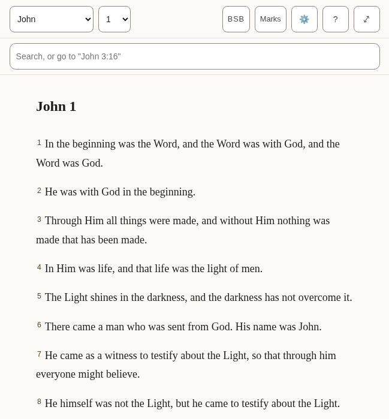

*What a new reader sees: the English Bible the app arrives with. A reader of English is offered nothing first.*

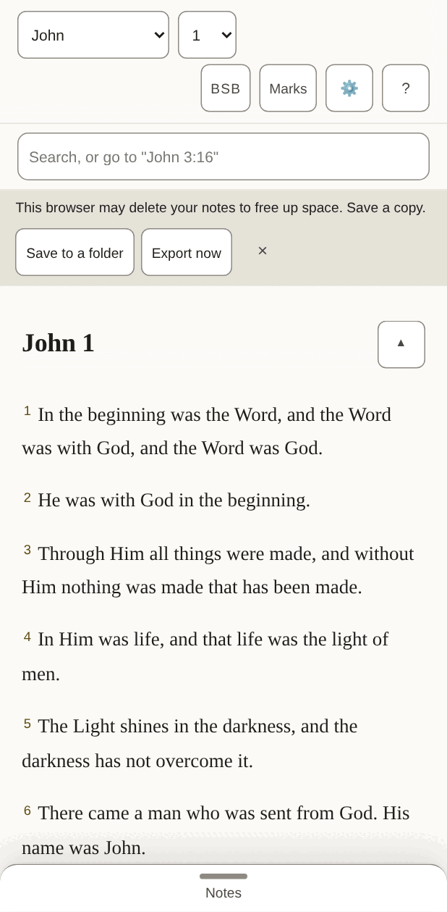

*The same, on a phone, once a Bible in this language is open.*

- [ ] Nothing in the bar is cut short or squeezed, on the phone above all.
- [ ] Every text in the table below is correct and sounds natural.
- [ ] Nothing in the pictures is cut off, overlapping or badly broken across lines.

**The 48 texts of this part**

| Key | Text |
|---|---|
| `app.name` | Scriptura Reader |
| `app.downloading` | Downloading the text for offline use… |
| `app.opening` | Opening… |
| `app.bootFailed` | The Bible text could not be opened. Reload to try again. |
| `app.skipToScripture` | Skip to scripture |
| `app.skipToNotes` | Skip to notes |
| `app.skipToBoard` | Skip to the canvas |
| `app.title` | John 1 · BSB · Scriptura |
| `app.passageTitle` | John 1 · BSB |
| `app.boardTitle` | John 1 · Boards |
| `app.opened` | Settings opened |
| `app.closed` | Settings closed |
| `app.boardSaveFailed` | Could not save the board — export your notes |
| `app.languageChanged` | The interface is now in English. |
| `reader.passage` | Passage |
| `reader.book` | Book |
| `reader.chapter` | Chapter |
| `reader.translationChip` | BSB — Berean Standard Bible. Choose or add a translation |
| `reader.marks` | Marks |
| `reader.marksChip` | Marks (7) — verses you have marked, by colour |
| `reader.settingsChip` | Settings — display, storage, export, and assistant access |
| `reader.helpChip` | Help — finding passages, searching, notes, marks, boards, keyboard, and what the abbreviations mean |
| `reader.selectVerse` A verse's number: a toggle that adds the verse to the selection or takes it out. | Select John 1:2 |
| `reader.selectVerseIn` | Select John 1:2 — in Amber (amber) |
| `reader.selection` Said when the selection changes and focus does not move to say it. | 1 verse selected: John 1:3 3 verses selected: John 1:3-5 |
| `reader.selectionCleared` | Selection cleared |
| `reader.chapterMissing` | This chapter is not in Berean Standard Bible. |
| `reader.readingAnnounce` | Reading Berean Standard Bible |
| `reader.showMenus` The button at the end of the chapter title, on a small screen: named for what a press will do. | Show the reading menus |
| `reader.hideMenus` | Hide the reading menus |
| `panels.marks` | Marks |
| `panels.translations` | Translations |
| `panels.settings` | Settings |
| `panels.help` | Help |
| `panels.results` | Search results |
| `common.cancel` | Cancel |
| `common.untitledNote` | Untitled |
| `common.untitledBoard` | Untitled board |
| `common.source` | Berean Standard Bible source |
| `common.undoRemove` | Undo remove |
| `common.remove` | Remove |
| `common.done` | Done |
| `offer.title` | Bibles in English |
| `offer.intro` | These translations are in your language. Download one to read it, online or offline. |
| `offer.downloadAndRead` | Download and read |
| `offer.downloadAndReadName` | Download and read Berean Standard Bible |
| `offer.allTranslations` | All translations |
| `offer.notNow` | Not now |

#### 2.2 Selecting verses and acting on them

Pressing a verse selects it and opens a row of actions: five colours to mark it with, then Quote, Link and Canvas. Pressing more verses adds them, and the row says how many it holds.

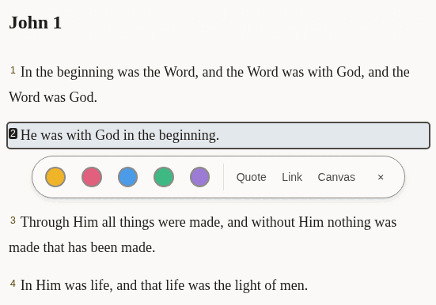

*One verse selected.*

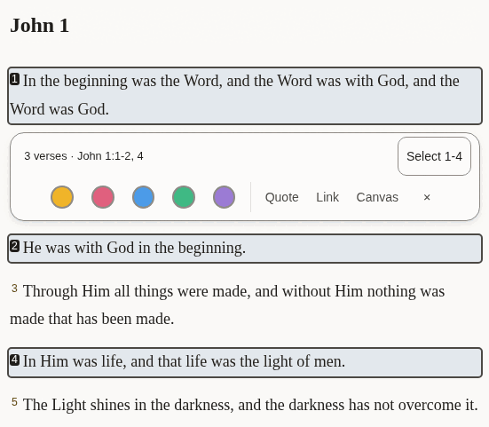

*Three verses selected, two of them together and one apart: the row says so, and offers to take in the verses between.*

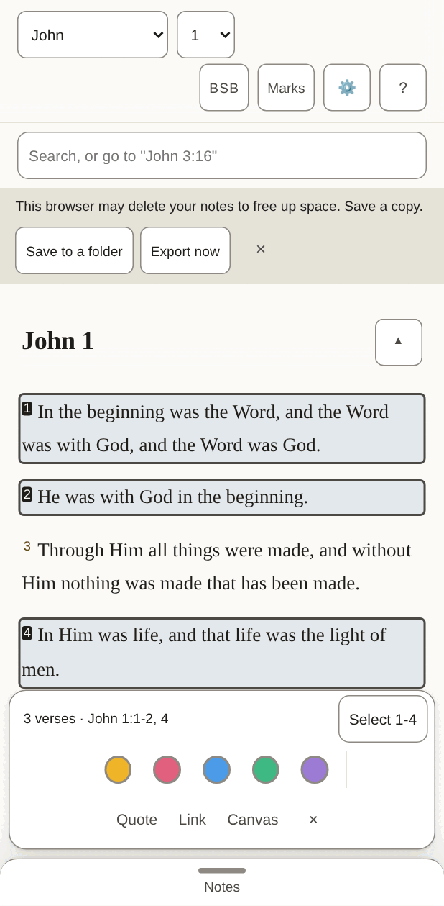

*On a phone the row sits at the bottom of the screen.*

- [ ] The summary ("3 verses · …") and the button beside it fit on one line.
- [ ] The three words for the actions are short enough to sit side by side on a phone.
- [ ] Every text in the table below is correct and sounds natural.
- [ ] Nothing in the pictures is cut off, overlapping or badly broken across lines.

**The 24 texts of this part**

| Key | Text |
|---|---|
| `verseActions.group` | Actions for John 1:2 |
| `verseActions.mark` | Mark as Amber (amber) |
| `verseActions.quote` | Quote |
| `verseActions.link` | Link |
| `verseActions.canvas` | Canvas |
| `verseActions.canvasName` | Canvas — put this verse on the board |
| `verseActions.close` | Close actions for John 1:2 |
| `verseActions.groupMany` The row's name when it holds several verses. | Actions for 1 verse: John 1:3 Actions for 3 verses: John 1:3-5 |
| `verseActions.summary` Shown in the row while several are selected, so what it will act on is in words. | 1 verse · John 1:3 3 verses · John 1:3-5 |
| `verseActions.fill` The button that takes in every verse between the first and the last selected: "Select 3-18". | Select 3-18 |
| `verseActions.canvasNameMany` | Canvas — put these verses on the board |
| `verseActions.clear` | Clear the selection |
| `verseActions.marked` | Marked 1 verse as Amber (amber) Marked 3 verses as Amber (amber) |
| `verseActions.unmarked` | Cleared Amber (amber) from 1 verse Cleared Amber (amber) from 3 verses |
| `colours.amber` | Amber |
| `colours.rose` | Rose |
| `colours.sky` | Sky |
| `colours.mint` | Mint |
| `colours.violet` | Violet |
| `colourWords.amber` | amber |
| `colourWords.rose` | rose |
| `colourWords.sky` | sky |
| `colourWords.mint` | mint |
| `colourWords.violet` | violet |

#### 2.3 Notes

The pane beside the Bible, where a reader writes. A quoted passage arrives with its reference, and a line under the note says what was just done and whether it is saved.

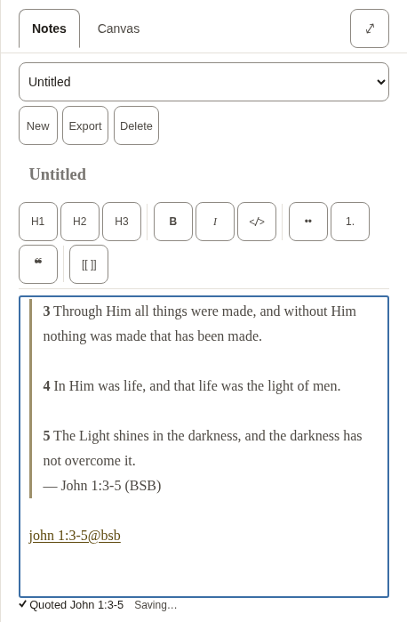

*A new note with three verses quoted into it.*

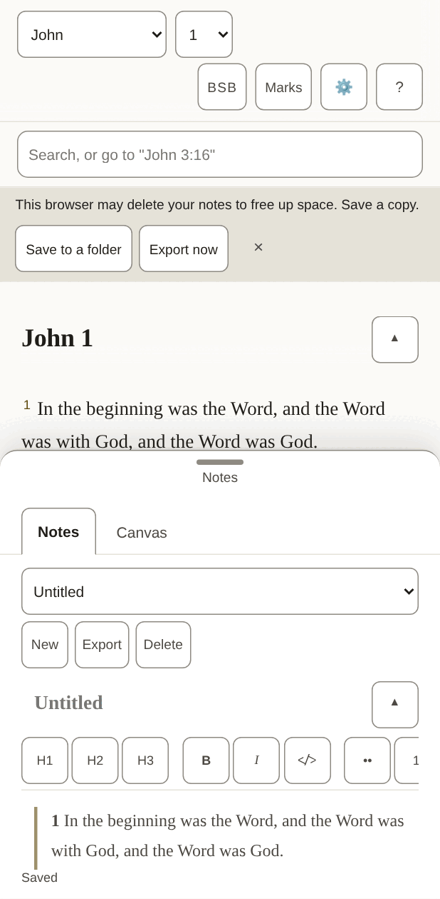

*On a phone the notes are a sheet that slides up over the text.*

- [ ] The formatting buttons carry one or two letters each (bold, italic, headings): they should be the letters a writer in this language expects.
- [ ] The line under the note ("Quoted …", "Saved") reads as a short report, not a sentence cut in two.
- [ ] Every text in the table below is correct and sounds natural.
- [ ] Nothing in the pictures is cut off, overlapping or badly broken across lines.

**The 51 texts of this part**

| Key | Text |
|---|---|
| `notes.new` A new note. Nouns have gender in other languages, so notes and boards each say it. | New |
| `notes.startOne` | Start one |
| `notes.heading` | Notes |
| `notes.picker` | Note |
| `notes.showMenus` | Show the note menus |
| `notes.hideMenus` | Hide the note menus |
| `notes.none` | No notes yet |
| `notes.preview` | Preview |
| `notes.write` | Write |
| `notes.previewTitle` | See it rendered |
| `notes.writeTitle` | Back to writing |
| `notes.canvas` | Canvas |
| `notes.canvasTitle` | Lay verses and notes out on a board |
| `notes.export` | Export |
| `notes.exportTitle` | Download every note and board as Markdown in a .zip |
| `notes.delete` | Delete |
| `notes.title` | Note title |
| `notes.body` | Note body |
| `notes.placeholder` | Write here… |
| `notes.goTo` | Go to John 1:3-5 |
| `notes.noneOpen` | No note open. |
| `notes.saveFailed` | Could not save — export your notes |
| `notes.saving` | Saving… |
| `notes.saved` | Saved |
| `notes.linkIn` | John 1:3-5 (KJV) |
| `notes.linkMissing` | John 1:3-5 (KJV — not downloaded) |
| `tools.label` | Formatting |
| `tools.heading` | Heading 2 |
| `tools.headingGlyph` | H2 |
| `tools.bold` | Bold |
| `tools.boldGlyph` | B |
| `tools.italic` | Italic |
| `tools.italicGlyph` | I |
| `tools.code` | Code |
| `tools.bullets` | Bulleted list |
| `tools.numbers` | Numbered list |
| `tools.quote` | Quote |
| `tools.link` | Link to a passage |
| `insert.quoted` | Quoted John 1:3-5 |
| `insert.quotedFrom` | Quoted John 1:3-5 (BSB) |
| `insert.linked` | Linked John 1:3-5 |
| `insert.addedBoard` | Added the board “John 1” |
| `insert.addedToBoard` | Added John 1:3-5 to “John 1” |
| `insert.alreadyOnBoard` | John 1:3-5 is already on “John 1” |
| `insert.inNewNote` | Quoted John 1:3-5 in a new note |
| `insert.inNote` | Quoted John 1:3-5 in “John 1” |
| `insert.inUntitledNote` | Quoted John 1:3-5 in an untitled note |
| `insert.studyBoard` | Study board |
| `preview.empty` | Nothing written yet. |
| `preview.editHere` | Edit here (block 3) |
| `preview.goTo` | Go to John 1:3-5 |

#### 2.4 Search

One box does two things: a reference goes straight to the passage, anything else searches the open Bible. The short list under the box is for jumping; the full list counts every match, book by book.

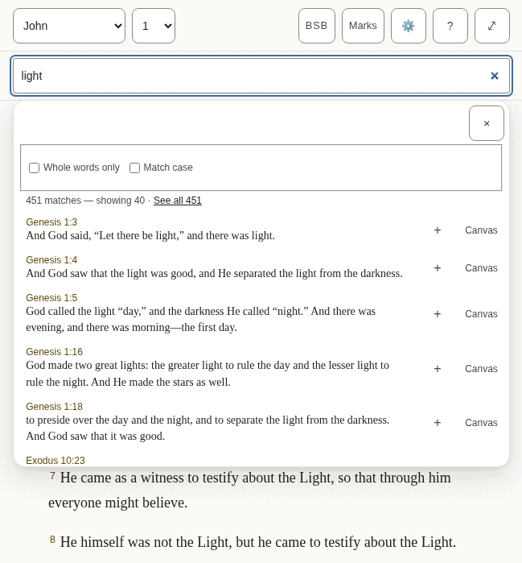

*The suggestions under the box.*

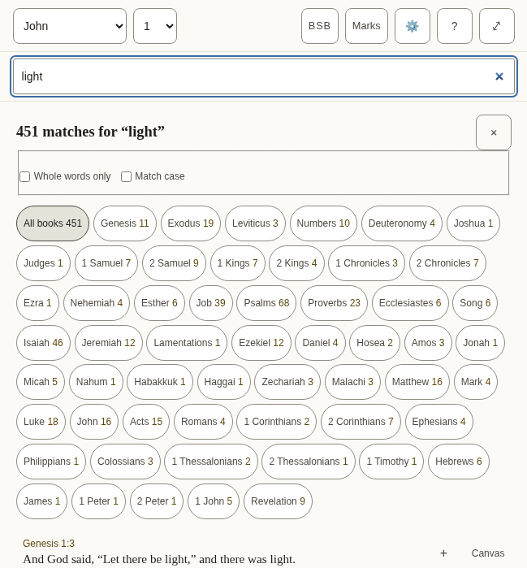

*Every match, with the count for each book.*

- [ ] The counts read naturally with a small number and with a large one.
- [ ] The two options ("Whole words only", "Match case") are understood without explanation.
- [ ] Every text in the table below is correct and sounds natural.
- [ ] Nothing in the pictures is cut off, overlapping or badly broken across lines.

**The 31 texts of this part**

| Key | Text |
|---|---|
| `search.label` | Search or go to a reference |
| `search.placeholder` | Search, or go to "John 3:16" |
| `search.hint` | Enter opens the passage, or every match. Down arrow moves into the suggestions. |
| `search.suggestions` | Suggestions |
| `search.goTo` | Go to John 1:2 |
| `search.close` | Close suggestions |
| `search.matching` | Matching |
| `search.wholeWords` | Whole words only |
| `search.wholeWordsHint` | Finds love but not loveth. Off, the search also looks inside longer words. |
| `search.matchCase` | Match case |
| `search.matchCaseHint` | Capital letters matter: God and god are different. |
| `search.noMatches` | No matches |
| `search.matches` | 1 match 1,382 matches |
| `search.showing` | ␣— showing 40 |
| `search.seeAll` | See all 1,382 |
| `search.insert` | Insert John 1:2 into the open note |
| `search.toCanvas` The name of a result's Canvas button: its visible word first (2.5.3). | Canvas — put John 1:2 on the board |
| `search.weakBelow` | Below: inside a longer word |
| `search.announceNone` | No matches for “light” |
| `search.announceCount` | 1 match for “light” 1,382 matches for “light” |
| `results.label` | Search results |
| `results.heading` `{count}` is replaced by the total, in its own element. | {count} match for “light” {count} matches for “light” |
| `results.close` | Close search results |
| `results.filter` | Filter by book |
| `results.allBooks` | All books |
| `results.weakBelow` | Below: “light” inside a longer word |
| `results.insert` | Quote John 1:2 into the open note |
| `results.insertTitle` | Quote into the open note |
| `results.showing` | Showing 100 of 1,382 |
| `results.inBook` | ␣in John |
| `results.more` | Show 100 more |

### The panels

Opened from the bar. They take the place of the chapter while they are open.

#### 2.5 Marks

Each of the five colours is a collection of the verses marked with it, and can be given a name of the reader’s own.

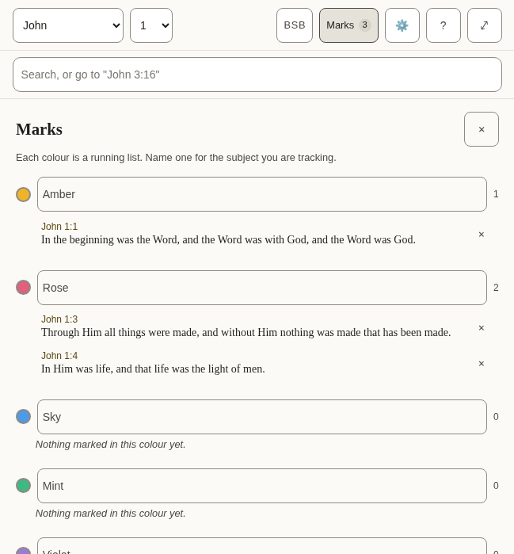

*Three marked verses in two collections.*

- [ ] The colour names are the everyday words for those colours.
- [ ] Every text in the table below is correct and sounds natural.
- [ ] Nothing in the pictures is cut off, overlapping or badly broken across lines.

**The 9 texts of this part**

| Key | Text |
|---|---|
| `marks.label` | Marked verses |
| `marks.title` | Marks |
| `marks.close` | Close marks |
| `marks.hint` | Each colour is a running list. Name one for the subject you are tracking. |
| `marks.nameFor` | Name for the amber collection |
| `marks.empty` | Nothing marked in this colour yet. |
| `marks.remove` | Remove the mark on John 1:2 |
| `marks.removed` | Mark removed. Undo is available in the Marks bar. |
| `marks.restored` | Mark restored |

#### 2.6 Translations, and reading two side by side

Where a Bible is downloaded, read, compared with the one being read, or removed. Each shows its size before it is downloaded.

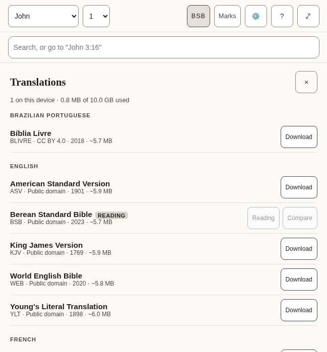

*The list of translations, by language.*

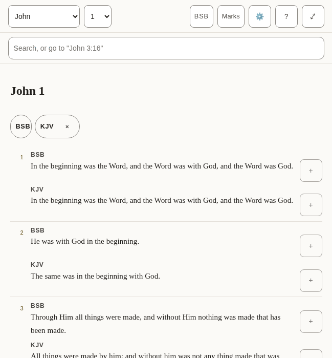

*Two translations, verse by verse.*

- [ ] The language headings are how this language names those languages.
- [ ] The note about what removing a translation does and does not touch is plain.
- [ ] Every text in the table below is correct and sounds natural.
- [ ] Nothing in the pictures is cut off, overlapping or badly broken across lines.

**The 32 texts of this part**

| Key | Text |
|---|---|
| `library.title` | Translations |
| `library.close` | Close translations |
| `library.onDevice` | 2 on this device |
| `library.used` | 11.8 MB of 1.9 GB used |
| `library.about` | about 5.4 MB |
| `library.licences.public-domain` | Public domain |
| `library.licences.cc-by-4.0` | CC BY 4.0 |
| `library.licences.cc-by-sa-4.0` | CC BY-SA 4.0 |
| `library.licences.cc0` | CC0 |
| `library.licences.custom-free` | Free licence |
| `library.reading` | Reading |
| `library.comparing` | Comparing |
| `library.read` | Read |
| `library.compare` | Compare |
| `library.compareTitle` | Show beside the translation you are reading |
| `library.downloading` | Downloading Berean Standard Bible |
| `library.download` | Download |
| `library.removeActive` | Remove Berean Standard Bible — switch to another translation first |
| `library.removeFromDevice` | Remove Berean Standard Bible from this device |
| `library.note` | A downloaded translation stays on this device and can be read offline. Removing one never touches your notes or marks: both belong to the passage, not to a translation. |
| `library.progress` | Berean Standard Bible: 50% downloaded |
| `library.downloaded` | Berean Standard Bible downloaded |
| `library.failed` | Berean Standard Bible: No connection — try again when you are online. |
| `library.failedOnline` | The download did not finish. Try again later. |
| `library.offline` | No connection — try again when you are online. |
| `compare.label` | Translations side by side |
| `compare.compared` | Translations compared |
| `compare.stop` | Stop comparing KJV |
| `compare.verse` | Verse |
| `compare.verseBefore` | Verse␣ |
| `compare.missing` | Not in KJV |
| `compare.quote` | Quote KJV verse 16 |

#### 2.7 Settings

How the text looks, the interface language, where the reader’s work is kept, and whether an assistant may help.

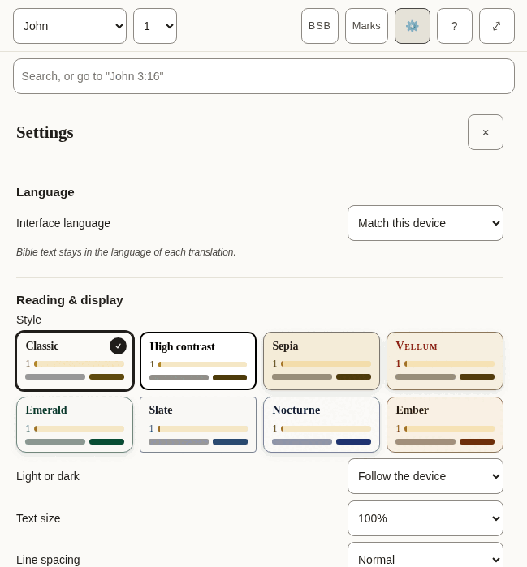

*The top of Settings.*

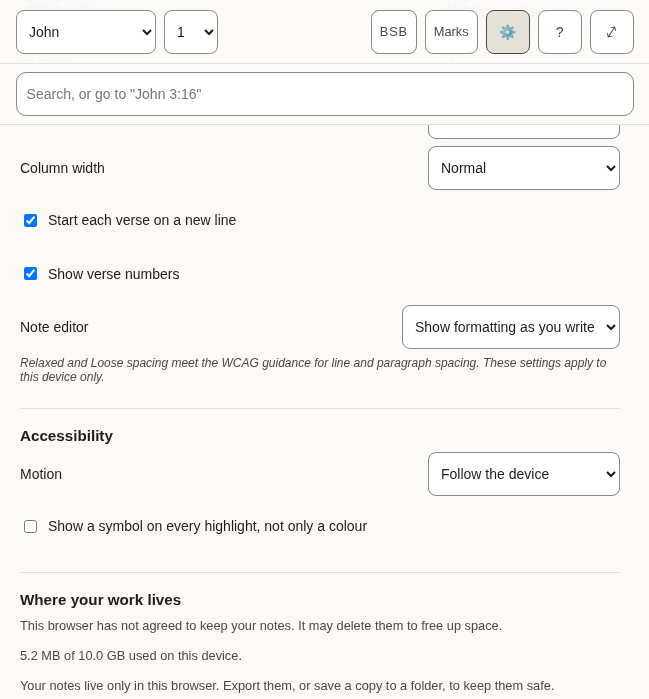

*Further down.*

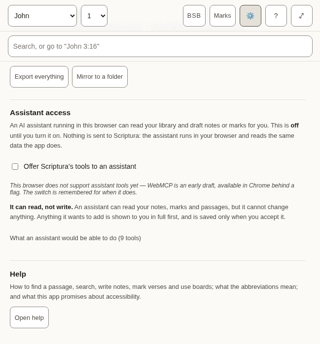

*The end.*

- [ ] Each label and the choices under it read as one thought.
- [ ] The style names are evocative, not literal (Vellum, Emerald, Nocturne): they should sound like names, not descriptions.
- [ ] The explanations in smaller type are complete sentences and easy to follow.
- [ ] Every text in the table below is correct and sounds natural.
- [ ] Nothing in the pictures is cut off, overlapping or badly broken across lines.

**The 66 texts of this part**

| Key | Text |
|---|---|
| `settings.title` | Settings |
| `settings.close` | Close settings |
| `settings.display` | Reading &amp; display |
| `settings.style` | Style |
| `settings.styles.classic` | Classic |
| `settings.styles.contrast` | High contrast |
| `settings.styles.sepia` | Sepia |
| `settings.styles.vellum` | Vellum |
| `settings.styles.emerald` | Emerald |
| `settings.styles.slate` | Slate |
| `settings.styles.nocturne` | Nocturne |
| `settings.styles.ember` | Ember |
| `settings.appearance` | Light or dark |
| `settings.appearances.system` | Follow the device |
| `settings.appearances.light` | Light |
| `settings.appearances.dark` | Dark |
| `settings.textSize` | Text size |
| `settings.spacing` | Line spacing |
| `settings.spacings.normal` | Normal |
| `settings.spacings.relaxed` | Relaxed |
| `settings.spacings.loose` | Loose |
| `settings.measure` | Column width |
| `settings.measures.narrow` | Narrow |
| `settings.measures.normal` | Normal |
| `settings.measures.wide` | Wide |
| `settings.measures.full` | Full |
| `settings.editor` | Note editor |
| `settings.editors.live` | Show formatting as you write |
| `settings.editors.plain` | Plain text |
| `settings.displayNote` | Relaxed and Loose spacing meet the WCAG guidance for line and paragraph spacing. These settings apply to this device only. |
| `settings.accessibility` | Accessibility |
| `settings.motion` | Motion |
| `settings.motions.system` | Follow the device |
| `settings.motions.reduce` | Reduce motion |
| `settings.markers` | Show a symbol on every highlight, not only a colour |
| `settings.verseLines` | Start each verse on a new line |
| `settings.verseNumbers` | Show verse numbers |
| `settings.recedeMenus` | On a small screen, hide the menus while reading |
| `settings.storage` | Where your work lives |
| `settings.persistence.persisted` | This browser has agreed to keep your notes. Clearing site data still removes them. |
| `settings.persistence.denied` | This browser has not agreed to keep your notes. It may delete them to free up space. |
| `settings.persistence.unsupported` | This browser will not say whether it keeps your notes. Assume it may delete them. |
| `settings.persistence.unknown` | Checking… |
| `settings.usedOnDevice` | 11.8 MB of 1.9 GB used on this device. |
| `settings.mirrored` | Your notes are also saved to a folder you chose. |
| `settings.notMirrored` | Your notes live only in this browser. Export them, or save a copy to a folder, to keep them safe. |
| `settings.exportAll` | Export everything |
| `settings.anotherFolder` | Choose another folder |
| `settings.mirror` | Mirror to a folder |
| `settings.assistant` | Assistant access |
| `settings.assistantIntro` | An AI assistant running in this browser can read your library and draft notes or marks for you. This is **off** until you turn it on. Nothing is sent to Scriptura: the assistant runs in your browser and reads the same data the app does. |
| `settings.assistantToggle` | Offer Scriptura’s tools to an assistant |
| `settings.assistantSupported` | This browser supports assistant tools. |
| `settings.assistantUnsupported` | This browser does not support assistant tools yet — WebMCP is an early draft, available in Chrome behind a flag. The switch is remembered for when it does. |
| `settings.assistantReadOnly` | **It can read, not write.** An assistant can read your notes, marks and passages, but it cannot change anything. Anything it wants to add is shown to you in full first, and is saved only when you accept it. |
| `settings.assistantTools` | What an assistant would be able to do (9 tools) |
| `settings.toolReads` | reads |
| `settings.toolNeedsApproval` | needs your approval |
| `settings.toolsInEnglish` Shown only in the other languages, beside the tool descriptions, which stay English. | The descriptions are in English, as the assistant reads them. |
| `settings.help` | Help |
| `settings.helpIntro` | How to find a passage, search, write notes, mark verses and use boards; what the abbreviations mean; and what this app promises about accessibility. |
| `settings.openHelp` | Open help |
| `settings.language` | Language |
| `settings.languageLabel` | Interface language |
| `settings.languageSystem` | Match this device |
| `settings.languageNote` | Bible text stays in the language of each translation. |

#### 2.8 Help

The longest text in the app, and the one a reader turns to when stuck. It includes a list of terms and abbreviations, and a statement about accessibility.

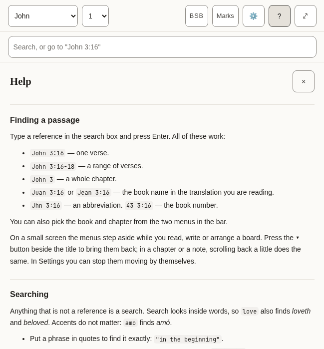

*The top of Help.*

- [ ] It reads well from start to finish as an explanation, not as a list of translated sentences.
- [ ] The examples of references are ones that work in a Bible in this language.
- [ ] The names of keys (Enter, Shift, Escape) are how this language’s keyboards and manuals name them.
- [ ] Every text in the table below is correct and sounds natural.
- [ ] Nothing in the pictures is cut off, overlapping or badly broken across lines.

**The 76 texts of this part**

| Key | Text |
|---|---|
| `help.title` | Help |
| `help.close` | Close help |
| `help.sections.finding.heading` | Finding a passage |
| `help.sections.finding.blocks.1.p` | Type a reference in the search box and press Enter. All of these work: |
| `help.sections.finding.blocks.2.ul.1` | `John 3:16` — one verse. |
| `help.sections.finding.blocks.2.ul.2` | `John 3:16-18` — a range of verses. |
| `help.sections.finding.blocks.2.ul.3` | `John 3` — a whole chapter. |
| `help.sections.finding.blocks.2.ul.4` | `Juan 3:16` or `Jean 3:16` — the book name in the translation you are reading. |
| `help.sections.finding.blocks.2.ul.5` | `Jhn 3:16` — an abbreviation. `43 3:16` — the book number. |
| `help.sections.finding.blocks.3.p` | You can also pick the book and chapter from the two menus in the bar. |
| `help.sections.finding.blocks.4.p` | On a small screen the menus step aside while you read, write or arrange a board. Press the **▾** button beside the title to bring them back; in a chapter or a note, scrolling back a little does the same. In Settings you can stop them moving by themselves. |
| `help.sections.searching.heading` | Searching |
| `help.sections.searching.blocks.1.p` | Anything that is not a reference is a search. Search looks inside words, so `love` also finds *loveth* and *beloved*. Accents do not matter: `amo` finds *amó*. |
| `help.sections.searching.blocks.2.ul.1` | Put a phrase in quotes to find it exactly: `"in the beginning"`. |
| `help.sections.searching.blocks.2.ul.2` | Put a minus sign before a word to leave verses with it out: `God -love`. |
| `help.sections.searching.blocks.2.ul.3` | **Whole words only** stops the search looking inside longer words. |
| `help.sections.searching.blocks.2.ul.4` | **Match case** makes capital letters matter. |
| `help.sections.searching.blocks.3.p` | The first results are verses where your word stands alone; verses where it sits inside a longer word come after a line that says so. Press Enter on a search to see every match, counted by book. |
| `help.sections.notes.heading` | Notes |
| `help.sections.notes.blocks.1.p` | Notes are plain text with Markdown. Formatting takes shape as you write, and its symbols come back on the line you are editing; to see only the Markdown, choose **Plain text** under Note editor in Settings. The toolbar above the note adds headings, bold, italic, lists and quotes; press a tool again to take the formatting off. With Plain text, **Preview** shows the note as it will read. |
| `help.sections.notes.blocks.2.p` | A link to a passage looks like `[[john 3:16]]`. Add `@kjv` to say which translation: `[[john 3:16@kjv]]`. Put the cursor inside a link and a **Go to** button opens it. **Quote** beside a verse copies the verse into your note with its reference and a link. |
| `help.sections.notes.blocks.3.p` | Notes are saved on this device as you type. **Export** downloads every note and board as text files in a zip. |
| `help.sections.marks.heading` | Marks |
| `help.sections.marks.blocks.1.p` | Press a verse, or its number, to mark it in one of five colours. Each colour is a collection: name it for the subject you are following, and the **Marks** panel lists its verses in Bible order. Marks follow the passage, not the translation, so a mark made in one translation shows in all of them. |
| `help.sections.marks.blocks.2.p` | Press more verses to act on several at once, and press one again to leave it out. With verses apart selected, **Select** in the row of actions takes in every verse between them; holding <kbd>Shift</kbd> while you press a verse does the same. **Quote** then writes them into your note as one passage under one reference. |
| `help.sections.marks.blocks.3.p` | In Settings you can add a symbol to every mark, so colour is not the only sign. |
| `help.sections.marks.blocks.4.p` | In Settings you can also run the verses together as one text and hide their numbers. Pressing a sentence still picks the verse it belongs to. |
| `help.sections.boards.heading` | Boards |
| `help.sections.boards.blocks.1.p` | A board lays verses and notes out as cards you can move and join with arrows. **Canvas** beside a verse puts it on the current board. Cards hold a reference, not a copy of the text, so they show the translation you are reading. Give a board a name in the box beside the board menu. |
| `help.sections.boards.blocks.2.p` | To move or resize a card without dragging, use its **✥** button; to colour it, its colour button. The arrow buttons beside the zoom move the view. **Connections**, in the board's bar, lists every arrow in words and removes one. Removing a card asks first, and removing a card or a connection can be undone until you change something else. |
| `help.sections.translations.heading` | Translations |
| `help.sections.translations.blocks.1.p` | The library lists every translation, grouped by language, with its size. Download one to read it offline; **Compare** shows it beside the one you are reading, verse by verse. Removing a translation never touches your notes or marks. |
| `help.sections.keyboard.heading` | Keyboard |
| `help.sections.keyboard.blocks.1.ul.1` | <kbd>Tab</kbd> and <kbd>Shift</kbd>+<kbd>Tab</kbd> move between controls. The first press offers to skip to the text or the notes. |
| `help.sections.keyboard.blocks.1.ul.2` | <kbd>Escape</kbd> closes whatever opened last: a panel, the verse actions, the search suggestions. |
| `help.sections.keyboard.blocks.1.ul.3` | <kbd>Enter</kbd> on a verse number selects it and opens the actions; the arrow keys move along them. <kbd>Enter</kbd> on another number adds that verse, and <kbd>Shift</kbd>+<kbd>Enter</kbd> takes in every verse up to it. |
| `help.sections.keyboard.blocks.1.ul.4` | On the divider between the panes, the arrow keys, <kbd>Home</kbd> and <kbd>End</kbd> resize; the two small buttons do the same. |
| `help.sections.keyboard.blocks.1.ul.5` | In a note, <kbd>Shift</kbd>+<kbd>Tab</kbd> reaches the formatting tools; the arrow keys move between them. |
| `help.sections.keyboard.blocks.1.ul.6` | On a board, cards take focus: the arrow keys move a card, <kbd>Alt</kbd> with an arrow resizes it, and <kbd>Delete</kbd> asks to remove it. With the board itself focused, the arrow keys move the view and <kbd>+</kbd> and <kbd>−</kbd> zoom. |
| `help.abbreviations` | Abbreviations |
| `help.abbreviationsCaption` | What each abbreviation means |
| `help.short` | Short |
| `help.meaning` | Meaning |
| `help.terms.1.1` | CC BY-SA 4.0 |
| `help.terms.1.2` | Creative Commons Attribution–ShareAlike 4.0: a free licence that asks you to credit the source and share changes under the same terms. |
| `help.terms.2.1` | CC0 |
| `help.terms.2.2` | Creative Commons Zero: the author has waived all rights; the text is free to use. |
| `help.terms.3.1` | OT |
| `help.terms.3.2` | Old Testament. |
| `help.terms.4.1` | NT |
| `help.terms.4.2` | New Testament. |
| `help.terms.5.1` | PWA |
| `help.terms.5.2` | Progressive web app: a website you can install and use offline. |
| `help.terms.6.1` | WCAG |
| `help.terms.6.2` | Web Content Accessibility Guidelines, the standard this app is measured against. |
| `help.glossaryHeading` | Words used here |
| `help.glossary.1.1` | Collection |
| `help.glossary.1.2` | Every verse you mark in one colour. Name a colour for the subject you are following, and the Marks panel lists those verses in Bible order. |
| `help.glossary.2.1` | Board |
| `help.glossary.2.2` | A space where verses and notes are laid out as cards and joined with arrows. Boards are saved and exported with your notes. |
| `help.glossary.3.1` | Card |
| `help.glossary.3.2` | One item on a board: a verse, a note, or text you typed. A verse card shows the verse from whichever translation you are reading. |
| `help.glossary.4.1` | Translation |
| `help.glossary.4.2` | One version of the Bible, in one language. Every translation here is free to copy. |
| `help.glossary.5.1` | Whole words only |
| `help.glossary.5.2` | A search option. With it on, "love" finds love but not loveth. With it off, it finds both. |
| `help.glossary.6.1` | Match case |
| `help.glossary.6.2` | A search option. With it on, "God" and "god" are different. |
| `help.glossary.7.1` | Mirror to a folder |
| `help.glossary.7.2` | Keep a copy of your notes as text files in a folder on this computer, updated as you write. Works in Chrome and Edge. |
| `help.glossary.8.1` | Assistant tools |
| `help.glossary.8.2` | A way for an AI assistant running in your browser to read your library and suggest notes or marks. Off unless you turn it on; nothing is saved without your approval. |
| `help.accessibilityHeading` | Accessibility |
| `help.accessibility.1` | This app aims to meet the Web Content Accessibility Guidelines 2.2 at Level AAA for everything the app itself shows: its controls, its text, its colours and its behaviour. Every control can be reached by keyboard, is at least 44 by 44 pixels, shows where focus is, and has a name. Text is at least 7:1 against its background in every colour theme, and you can change the size, spacing and colours in Settings. |
| `help.accessibility.2` | Two things are outside that promise. The Bible text is shown as it was published: how hard it is to read, and how its words are said, belong to each translation, not to this app. The same is true of what you write in your notes. |
| `help.accessibility.3` | What is checked by machine is checked on every change. What needs a person — a screen reader on a phone, the app under a Windows contrast theme — is checked by hand, less often. If something does not work for you, please report it at the project's issue tracker on GitHub (`AlanRoman117/scriptura`). |

### Met less often

Boards, the questions asked before something is deleted, and the notices. Many of these texts are spoken by a screen reader and never shown.

#### 2.9 Boards (the canvas)

A surface where verses and notes are laid out as cards and joined with arrows. Most of its texts are the names of buttons, heard by a screen reader.

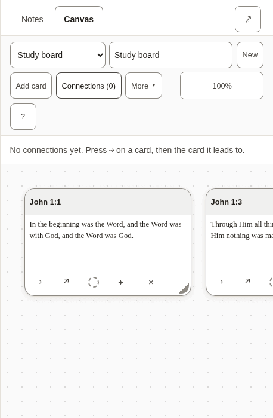

*Two verses on a board, with the list of connections open.*

- [ ] The words for a board, a card and a connection are used the same way here as everywhere else.
- [ ] Every text in the table below is correct and sounds natural.
- [ ] Nothing in the pictures is cut off, overlapping or badly broken across lines.

**The 93 texts of this part**

| Key | Text |
|---|---|
| `canvas.new` A new board. | New |
| `canvas.more` Beside the Bible, the button the less-used board actions fold behind. | More |
| `canvas.startOne` | Start one |
| `canvas.label` | Boards |
| `canvas.heading` | Board: John 1 |
| `canvas.noneOpenHeading` | none open |
| `canvas.picker` | Board |
| `canvas.showMenus` | Show the board menus |
| `canvas.hideMenus` | Hide the board menus |
| `canvas.name` | Board name |
| `canvas.none` | No boards yet |
| `canvas.undo` | Undo: put back John 1:1 Undo: put back the connection John 1:1 → John 1:14 |
| `canvas.putBack` | John 1:1 put back The connection John 1:1 → John 1:14 put back |
| `canvas.removed` | John 1:1 removed. Undo is in the board's bar. The connection John 1:1 → John 1:14 removed. Undo is in the board's bar. |
| `canvas.addCard` | Add card |
| `canvas.addNote` | Add note |
| `canvas.addNoteName` | Add note — put the newest note on the board |
| `canvas.addNoteNoNotes` | Add note — write a note first |
| `canvas.toNote` | Add to note |
| `canvas.toNoteName` | Add to note — put this board into the note you have open |
| `canvas.connections` | Connections (2) |
| `canvas.connectionsLabel` | Connections |
| `canvas.deleteBoard` | Delete board |
| `canvas.zoom` | Zoom |
| `canvas.zoomOut` | Zoom out |
| `canvas.zoomIn` | Zoom in |
| `canvas.zoomReset` | Zoom 120%. Reset to full size, showing your cards |
| `canvas.moveView` | Move the view |
| `canvas.viewLeft` | Move the view left |
| `canvas.viewUp` | Move the view up |
| `canvas.viewDown` | Move the view down |
| `canvas.viewRight` | Move the view right |
| `canvas.help` | Help — boards, keyboard, and what the abbreviations mean |
| `canvas.noConnections` | No connections yet. Press ⇢ on a card, then the card it leads to. |
| `canvas.removeConnection` | Remove the connection John 1:1 → John 1:14 |
| `canvas.missingCard` | a missing card |
| `canvas.edge` | John 1:1 → John 1:14 |
| `canvas.frame` | Board canvas, 1 card Board canvas, 4 cards |
| `canvas.frameHint` | Arrow keys move the view; plus and minus zoom. Each card takes focus: arrow keys move it, and Alt with an arrow resizes it. |
| `canvas.verseCard` | Verse card |
| `canvas.noteCard` | Note card |
| `canvas.card` | Card |
| `canvas.cardName` | Verse card: John 1:1, Amber (amber) Verse card: John 1:1 |
| `canvas.colourName` | Amber (amber) |
| `canvas.cardTitle` | Card title |
| `canvas.cardTitlePlaceholder` | Card |
| `canvas.cardText` | Card text |
| `canvas.cardTextPlaceholder` | Write here… |
| `canvas.cardBody` | John 1:1 — text |
| `canvas.connect` | Connect John 1:1 to another card |
| `canvas.connectPrompt` | Choose the card to connect to: press it, or Enter on it. Escape cancels. |
| `canvas.connected` | Connected John 1:1 to John 1:14 |
| `canvas.open` | Open John 1:1 in the reader |
| `canvas.colour` | Colour: Amber (amber). Change the colour of John 1:1 Colour: none. Change the colour of John 1:1 |
| `canvas.adjust` | Move or resize John 1:1 without dragging |
| `canvas.takeOff` | Take John 1:1 off the board |
| `canvas.empty` | Nothing on this board yet. Add a card here, or use **Canvas** beside a verse while reading. |
| `canvas.adjustPanel` | Move and resize John 1:1 |
| `canvas.colourPanel` | Colour of John 1:1 |
| `canvas.adjustTitle` | Move and resize |
| `canvas.colourTitle` | Colour |
| `canvas.panelTitle` | Move and resize: John 1:1 |
| `canvas.move` | Move |
| `canvas.moveLeft` | Move left |
| `canvas.moveUp` | Move up |
| `canvas.moveDown` | Move down |
| `canvas.moveRight` | Move right |
| `canvas.size` | Size |
| `canvas.narrower` | Narrower |
| `canvas.wider` | Wider |
| `canvas.shorter` | Shorter |
| `canvas.taller` | Taller |
| `canvas.colours` | Colours |
| `canvas.noColour` | No colour |
| `canvas.moved` | John 1:1: moved to 320, 180 |
| `canvas.resized` | John 1:1: 280 wide, 180 tall |
| `canvas.coloured` | John 1:1: Amber (amber) |
| `canvas.uncoloured` | John 1:1: no colour |
| `canvas.noneOpen` | No board open. |
| `cards.verseMissing` | Not in this translation. |
| `cards.untitledNote` | Untitled note |
| `cards.untitledBoard` | Untitled board |
| `cards.emptyNote` | Empty note. |
| `cards.deletedNote` | This note has been deleted. |
| `cards.card` | Card |
| `cards.emptyBoard` | _Empty board._ |
| `cards.connections` | Connections |
| `cards.missingCard` | (missing card) |
| `embed.scrolls` | Board: John 1, scrolls sideways |
| `embed.picture` | Board: John 1, 1 cards Board: John 1, 4 cards |
| `embed.empty` | This board is empty. |
| `embed.missing` | A board was embedded here, but it no longer exists. |
| `embed.open` | Open board |

#### 2.10 Questions before something is deleted

Deleting a note or a board, or removing a card, a mark or a translation, asks first. The question names what will go, and says whether it can come back.

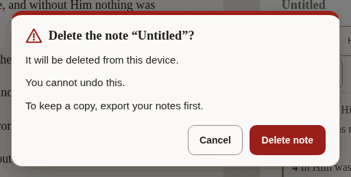

*The question before a note is deleted.*

- [ ] It is unmistakable what will be deleted and that it cannot be undone.
- [ ] The button that deletes says what it deletes.
- [ ] Every text in the table below is correct and sounds natural.
- [ ] Nothing in the pictures is cut off, overlapping or badly broken across lines.

**The 26 texts of this part**

| Key | Text |
|---|---|
| `confirm.permanent` | You cannot undo this. |
| `confirm.undoable` | You can undo this until your next change. |
| `confirm.note.title` | Delete the note “John 1”? |
| `confirm.note.gone` | It will be deleted from this device. |
| `confirm.note.keepCopy` | To keep a copy, export your notes first. |
| `confirm.note.action` | Delete note |
| `confirm.note.done` | Deleted the note “John 1” |
| `confirm.board.title` | Delete the board “John 1”? |
| `confirm.board.cards` | The board and its card will be deleted. The board and its 4 cards will be deleted. |
| `confirm.board.empty` | The board is empty. |
| `confirm.board.kept` | Your notes are not changed. |
| `confirm.board.action` | Delete board |
| `confirm.board.done` | Deleted the board “John 1” |
| `confirm.card.title` | Remove John 1:1 from the board? |
| `confirm.card.connections` | Its connection is removed too. Its 3 connections are removed too. |
| `confirm.card.noteKept` | The note itself is not changed. |
| `confirm.card.action` | Remove card |
| `confirm.mark.title` | Remove the mark on John 1:2? |
| `confirm.mark.leaves` | The verse leaves the collection “Amber”. |
| `confirm.mark.action` | Remove mark |
| `confirm.translation.title` | Remove Berean Standard Bible from this device? |
| `confirm.translation.frees` | This frees about 5.4 MB. |
| `confirm.translation.kept` | Your notes and marks are not changed. |
| `confirm.translation.again` | You can download it again when you are online. |
| `confirm.translation.action` | Remove translation |
| `confirm.translation.done` | Removed Berean Standard Bible from this device |

#### 2.11 Notices

A line about where the reader’s work is kept, the offer of a newer version, and the notice on this preview.

- [ ] The notice about storage is honest without being alarming.
- [ ] Every text in the table below is correct and sounds natural.

**The 23 texts of this part**

| Key | Text |
|---|---|
| `durability.label` | Where your notes are kept |
| `durability.denied` | This browser may delete your notes to free up space. Save a copy. |
| `durability.stale` | You have not exported your notes for a while. |
| `durability.local` | Your notes live in this browser only. |
| `durability.saveFolder` | Save to a folder |
| `durability.saveFolderTitle` | Keep a copy as .md files in a folder you choose |
| `durability.exportNow` | Export now |
| `durability.dismiss` | Dismiss this notice |
| `update.label` | A new version is ready |
| `update.ready` | A new version of Scriptura is ready. |
| `update.readyAnnounce` | A new version of Scriptura is ready. Reload when it suits you. |
| `update.reload` | Reload |
| `update.reloading` | Reloading… |
| `update.later` | Later |
| `previewBuild.label` | Preview |
| `previewBuild.intro` | **Preview.** An early build for the people reviewing its translations. |
| `previewBuild.report` | Report a translation correction on GitHub (opens in a new tab) |
| `previewBuild.reportShort` The notice's short link; `newTab` completes its name for a screen reader. | Report a correction |
| `previewBuild.newTab` | (on GitHub, opens in a new tab) |
| `previewBuild.hide` | Hide |
| `previewBuild.heading` | About this preview |
| `previewBuild.about` | This build is for the people checking the interface in Spanish, French, Japanese, Chinese and Portuguese. Nothing you do here is sent anywhere: your notes and marks stay in this browser. To report a word that is wrong or unclear, use the link below. It opens a short form on GitHub, which needs a free account. |
| `previewBuild.version` | Version: 0.1.0 |

#### 2.12 Panes, tabs and the sheet

The names of the two panes, the tabs that choose between notes and a board, and the buttons that resize them. Mostly heard, not seen.

- [ ] Every text in the table below is correct and sounds natural.

**The 20 texts of this part**

| Key | Text |
|---|---|
| `layout.scripture` | Scripture |
| `layout.notes` | Notes |
| `layout.expandNotes` | Expand notes |
| `layout.collapseNotes` | Collapse notes |
| `layout.gripWithNews` | Expand notes, Quoted John 1:3-5 |
| `layout.sheetHint` | Drag, or use the up and down arrow keys, to make the notes taller or shorter. |
| `layout.notesMoreRoom` | Give the notes more room |
| `layout.bibleMoreRoom` | Give the Bible more room |
| `layout.resize` | Resize panes |
| `layout.split` Both shares arrive formatted as percentages. | 56% Bible, 44% notes |
| `layout.showNotes` | Show notes |
| `layout.paneBible` | Bible |
| `layout.paneNotes` | Notes |
| `layout.sides` The side pane holds the notes or the canvas; these name the switch and the canvas side. | Notes or canvas |
| `layout.paneBoard` | Canvas |
| `layout.expandBoard` | Expand canvas |
| `layout.collapseBoard` | Collapse canvas |
| `layout.showBoard` | Show canvas |
| `layout.maximize` | Maximize Bible |
| `layout.restore` | Restore Bible |

#### 2.13 What an assistant proposes

When the reader has allowed an assistant to help, what it wants to add is shown first and waits for a yes.

- [ ] Every text in the table below is correct and sounds natural.

**The 10 texts of this part**

| Key | Text |
|---|---|
| `proposal.noteTitle` | A note has been drafted for you |
| `proposal.marksTitle` | Verses suggested for marking |
| `proposal.lede` | An assistant proposed this. Nothing has been saved — review it, change anything you like, and it only takes effect when you accept. |
| `proposal.titleInput` | Proposed note title |
| `proposal.bodyInput` | Proposed note body |
| `proposal.into` `{collection}` is replaced by the collection's name, in bold. | Into {collection} (amber) |
| `proposal.missing` | Not in this translation. |
| `proposal.discard` | Discard |
| `proposal.save` | Save this note |
| `proposal.mark` | Mark 1 verse Mark 3 verses |

---

## Part 3: Try it yourself

Open **<https://alanroman117.github.io/Scriptura/>** on a computer, and then on a phone if you can.

The app follows your browser's language. If it opens in another language, choose **Settings** (the gear), then **Language**, then **English (United States)**.

A picture shows words standing still. What you are looking for here is what only use can show: a word that does not fit its button, a message that arrives at the wrong moment, a sentence that is right alone and wrong after the one before it.

- [ ] Press a verse, then two more. Read what the row says, then press **Quote**.
- [ ] Read the note that was made, and the line beneath it.
- [ ] Type a word into the search box and read the count. Open the full list of results.
- [ ] Type a reference, such as "John 3:16", and press <kbd>Enter</kbd>.
- [ ] Mark a verse with a colour, then open **Marks** and give that colour a name.
- [ ] Open **Translations**: download another Bible, compare it with yours, then remove it and read the question it asks.
- [ ] Open **Settings** and read it from top to bottom, changing each choice once.
- [ ] Open **Help** and read it as a newcomer would.
- [ ] Put two verses on a board (**Canvas**), open the board, and join them.
- [ ] Delete the note and read the question it asks.
- [ ] On a phone: do the first three steps again, upright and on its side.
- [ ] If you use a screen reader: listen to the bar at the top, to a verse being selected, and to a quote being made. The interface should be spoken in your language, and the Bible in its own.

While you do this:

- [ ] No text is cut off, runs out of its button, or sits on top of another.
- [ ] No English appears where your language should be. (The names of Bibles are as their publishers wrote them, and what an assistant may do, in Settings, is in English on purpose.)
- [ ] Numbers, sizes and counts look right as they change.
- [ ] Nothing reads as rude, childish, or stiffer than the rest.

---

## Your notes

<!-- YOURS: everything below this line is kept when the guide is written again. -->

### What should change

One row for each correction. Add as many rows as you need.

| Where (the key, or the screen) | What is wrong | What it should say |
|---|---|---|
| | | |
| | | |
| | | |
| | | |
| | | |
| | | |

### Anything else

What a table cannot hold: the tone as a whole, a word you would change everywhere, something that confused you.

> 

### Your verdict

- [ ] It can be published as it is.
- [ ] It can be published once the corrections above are made.
- [ ] It needs another reading after the corrections.

| | |
|---|---|
| Reviewed by | |
| Date | |
| Version tested (Help, "About this preview") | |
| Device and browser | |
| Parts done (1, 2, 3) | |
