# The Scriptura reader in Español (México): a guide for its reviewer

The reader's interface has been drafted in Spanish (Mexico) and has not yet been read by someone whose language it is. You are that reader. Nothing here is final until you say so.

This guide puts every word in front of you without your having to hunt for it, in three parts:

| Part | What you do | About |
|---|---|---|
| [1. First pass](#part-1-first-pass) | Read the voice, the words used everywhere, and how numbers are written. | 15 minutes |
| [2. Screen by screen](#part-2-screen-by-screen) | Look at each picture, then read every text that belongs to it. | 60 to 90 minutes |
| [3. Try it yourself](#part-3-try-it-yourself) | Use the app in your language and look for what a picture cannot show. | 30 minutes |

Part 1 alone already tells us a great deal. If you can give only a quarter of an hour, give it to Part 1.

## How to send corrections

- **In this file:** write them in [Your notes](#your-notes) at the end and send the file back. A ticked box anywhere above means "I checked this and it is right."
- **Or on the web:** [the correction form for Español (México)](https://github.com/AlanRoman117/Scriptura/issues/new?template=translation-es.yml).
- Either way, give the **key** from the first column of a table (for example `verseActions.quote`) so we can find the text, and what it should say instead.

## How to read the tables

- Each row is one text. **Key** is its name in the program, **English** is the original, and **Español (México)** is what is being reviewed.
- The small print under a key, where there is some, is the programmer's own note on that text. It often says whether the text is shown on the screen or only spoken by a screen reader, which a blind reader uses.
- Names and numbers inside a text are examples: "Juan 1:3-5", "Reina Valera 1909", "1,382". The app puts the real ones there. Where a text changes with a number, it is shown with one and with several.
- A word in braces, such as `{count}`, is a place where the app puts a number or a name. Leave it as it is; it may move within the sentence.
- `␣` marks a space at the start or end of a text that has to stay, and <kbd>Enter</kbd> is a key on the keyboard.
- The pictures were taken with the Bible "Reina Valera 1909" open, so the names of books are that Bible's own.

---

## Part 1: First pass

### 1.1 The voice

The text is meant to be written in this register: **tú**, with quotation marks “ ”.

- [ ] The reader is addressed as *tú* throughout: never *usted*, never *vosotros*.
- [ ] Mexican Spanish where it differs from Spain's (*computadora*, not *ordenador*).
- [ ] Opening ¿ and ¡ where they belong, and quotation marks “ ”.
- [ ] It sounds like someone writing in Spanish, not like a translation from English.

### 1.2 The words used everywhere

These are the names of the app's own things. Each is used the same way on every screen, so one that is wrong is wrong everywhere.

| In English | In Español (México) | Right? |
|---|---|---|
| Notes / note | Notas / nota | |
| Marks / mark (verb) | Marcas / marcar | |
| Collection | Colección | |
| Board | Tablero | |
| Card | Tarjeta | |
| Connection | Conexión | |
| Quote | Citar | |
| Link | Enlazar | |
| Canvas (put on a board) | Al tablero | |
| Translation | Traducción | |
| Scripture | Escrituras | |
| Passage | Pasaje | |
| Book / chapter / verse | Libro / capítulo / versículo | |
| Search | Buscar | |
| Whole words only | Solo palabras completas | |
| Match case | Distinguir mayúsculas | |
| Settings | Configuración | |
| Help | Ayuda | |
| Export | Exportar | |
| Preview / Write | Vista previa / Escribir | |
| Delete / Remove | Eliminar / Quitar | |
| Delete the note “…”? (the confirmation) | ¿Eliminar la nota “…”? | |
| You cannot undo this. | No se puede deshacer. | |
| Untitled | Sin título | |
| Bold / Italic glyphs | N / K | |

- [ ] Each is the word a reader of the Bible in Spanish (Mexico) would expect.
- [ ] None of them is used for two different things.

### 1.3 Numbers and counts

How the app writes a number, a percentage and a size in this language, and how one text changes with the number in it.

| | Written as |
|---|---|
| One thousand three hundred and eighty-two | 1,382 |
| Fifty-eight per cent | 58% |
| The size of a download | 5.4 MB |
| 0 search results | 0 resultados |
| 1 search result | 1 resultado |
| 2 search results | 2 resultados |
| 5 search results | 5 resultados |
| 1382 search results | 1,382 resultados |
| 1 verse selected | 1 versículo · Juan 1:3 |
| 2 verses selected | 2 versículos · Juan 1:3-4 |
| 5 verses selected | 5 versículos · Juan 1:3-7 |

- [ ] Thousands are grouped, and the percentage is spaced, the way this language does it.
- [ ] Every count above is grammatical, zero and one included.

---

## Part 2: Screen by screen

For each screen: look at the picture first, then tick what you have checked, then read the table. The order is the order in which a reader meets things.

### What every reader sees

If time is short, these four screens matter most: they are the app on an ordinary day.

#### 2.1 The first visit, and reading a chapter

The bar across the top chooses the book, the chapter and the translation, and opens Marks, Settings and Help. A reader whose language is not English is first offered a Bible in it.

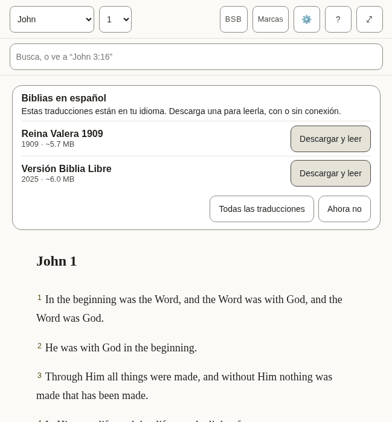

*What a new reader sees: the offer of a Bible in this language, over the English one the app arrives with.*

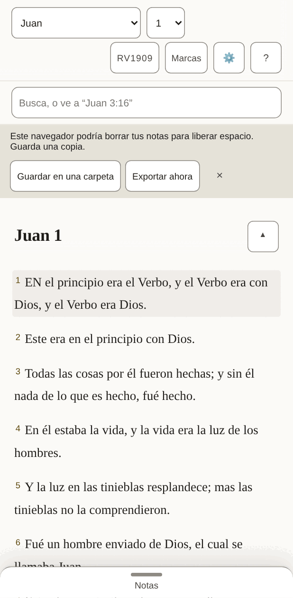

*The same, on a phone, once a Bible in this language is open.*

- [ ] The offer reads as an invitation, and its buttons are clear about what they will do.
- [ ] Nothing in the bar is cut short or squeezed, on the phone above all.
- [ ] Every text in the table below is correct and sounds natural.
- [ ] Nothing in the pictures is cut off, overlapping or badly broken across lines.

**The 48 texts of this part**

| Key | English | Español (México) |
|---|---|---|
| `app.name` | Scriptura Reader | Scriptura Reader |
| `app.downloading` | Downloading the text for offline use… | Descargando el texto para usarlo sin conexión… |
| `app.opening` | Opening… | Abriendo… |
| `app.bootFailed` | The Bible text could not be opened. Reload to try again. | No se pudo abrir el texto bíblico. Recarga para intentarlo de nuevo. |
| `app.skipToScripture` | Skip to scripture | Saltar a las Escrituras |
| `app.skipToNotes` | Skip to notes | Saltar a las notas |
| `app.skipToBoard` | Skip to the canvas | Saltar a los tableros |
| `app.title` | John 1 · BSB · Scriptura | Juan 1 · RV1909 · Scriptura |
| `app.passageTitle` | John 1 · BSB | Juan 1 · RV1909 |
| `app.boardTitle` | John 1 · Boards | Juan 1 · Tableros |
| `app.opened` | Settings opened | Se abrió Configuración |
| `app.closed` | Settings closed | Se cerró Configuración |
| `app.boardSaveFailed` | Could not save the board — export your notes | No se pudo guardar el tablero; exporta tus notas |
| `app.languageChanged` | The interface is now in English. | La interfaz ahora está en español. |
| `reader.passage` | Passage | Pasaje |
| `reader.book` | Book | Libro |
| `reader.chapter` | Chapter | Capítulo |
| `reader.translationChip` | BSB — Berean Standard Bible. Choose or add a translation | RV1909: Reina Valera 1909. Elige o agrega una traducción |
| `reader.marks` | Marks | Marcas |
| `reader.marksChip` | Marks (7) — verses you have marked, by colour | Marcas (7): los versículos que marcaste, por color |
| `reader.settingsChip` | Settings — display, storage, export, and assistant access | Configuración: pantalla, almacenamiento, exportación y acceso de asistentes |
| `reader.helpChip` | Help — finding passages, searching, notes, marks, boards, keyboard, and what the abbreviations mean | Ayuda: encontrar pasajes, buscar, notas, marcas, tableros, teclado y el significado de las abreviaturas |
| `reader.selectVerse` A verse's number: a toggle that adds the verse to the selection or takes it out. | Select John 1:2 | Seleccionar Juan 1:2 |
| `reader.selectVerseIn` | Select John 1:2 — in Amber (amber) | Seleccionar Juan 1:2: está en Ámbar (ámbar) |
| `reader.selection` Said when the selection changes and focus does not move to say it. | 1 verse selected: John 1:3 3 verses selected: John 1:3-5 | 1 versículo seleccionado: Juan 1:3 3 versículos seleccionados: Juan 1:3-5 |
| `reader.selectionCleared` | Selection cleared | Se quitó la selección |
| `reader.chapterMissing` | This chapter is not in Berean Standard Bible. | Este capítulo no está en Reina Valera 1909. |
| `reader.readingAnnounce` | Reading Berean Standard Bible | Leyendo Reina Valera 1909 |
| `reader.showMenus` The button at the end of the chapter title, on a small screen: named for what a press will do. | Show the reading menus | Mostrar los menús de lectura |
| `reader.hideMenus` | Hide the reading menus | Ocultar los menús de lectura |
| `panels.marks` | Marks | Marcas |
| `panels.translations` | Translations | Traducciones |
| `panels.settings` | Settings | Configuración |
| `panels.help` | Help | Ayuda |
| `panels.results` | Search results | Resultados de búsqueda |
| `common.cancel` | Cancel | Cancelar |
| `common.untitledNote` | Untitled | Sin título |
| `common.untitledBoard` | Untitled board | Tablero sin título |
| `common.source` | Berean Standard Bible source | Fuente de Reina Valera 1909 |
| `common.undoRemove` | Undo remove | Deshacer |
| `common.remove` | Remove | Quitar |
| `common.done` | Done | Listo |
| `offer.title` | Bibles in American English | Biblias en español de México |
| `offer.intro` | These translations are in your language. Download one to read it, online or offline. | Estas traducciones están en tu idioma. Descarga una para leerla, con o sin conexión. |
| `offer.downloadAndRead` | Download and read | Descargar y leer |
| `offer.downloadAndReadName` | Download and read Berean Standard Bible | Descargar y leer Reina Valera 1909 |
| `offer.allTranslations` | All translations | Todas las traducciones |
| `offer.notNow` | Not now | Ahora no |

#### 2.2 Selecting verses and acting on them

Pressing a verse selects it and opens a row of actions: five colours to mark it with, then Quote, Link and Canvas. Pressing more verses adds them, and the row says how many it holds.

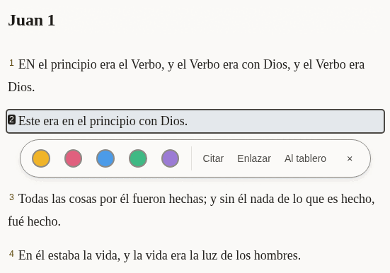

*One verse selected.*

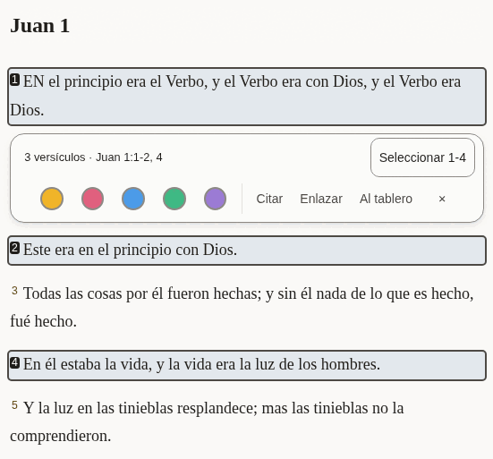

*Three verses selected, two of them together and one apart: the row says so, and offers to take in the verses between.*

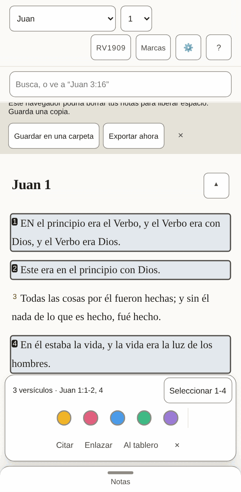

*On a phone the row sits at the bottom of the screen.*

- [ ] The summary ("3 verses · …") and the button beside it fit on one line.
- [ ] The three words for the actions are short enough to sit side by side on a phone.
- [ ] Every text in the table below is correct and sounds natural.
- [ ] Nothing in the pictures is cut off, overlapping or badly broken across lines.

**The 24 texts of this part**

| Key | English | Español (México) |
|---|---|---|
| `verseActions.group` | Actions for John 1:2 | Acciones para Juan 1:2 |
| `verseActions.mark` | Mark as Amber (amber) | Marcar en Ámbar (ámbar) |
| `verseActions.quote` | Quote | Citar |
| `verseActions.link` | Link | Enlazar |
| `verseActions.canvas` | Canvas | Al tablero |
| `verseActions.canvasName` | Canvas — put this verse on the board | Al tablero: pon este versículo en el tablero |
| `verseActions.close` | Close actions for John 1:2 | Cerrar las acciones de Juan 1:2 |
| `verseActions.groupMany` The row's name when it holds several verses. | Actions for 1 verse: John 1:3 Actions for 3 verses: John 1:3-5 | Acciones para 1 versículo: Juan 1:3 Acciones para 3 versículos: Juan 1:3-5 |
| `verseActions.summary` Shown in the row while several are selected, so what it will act on is in words. | 1 verse · John 1:3 3 verses · John 1:3-5 | 1 versículo · Juan 1:3 3 versículos · Juan 1:3-5 |
| `verseActions.fill` The button that takes in every verse between the first and the last selected: "Select 3-18". | Select 3-18 | Seleccionar 3-18 |
| `verseActions.canvasNameMany` | Canvas — put these verses on the board | Al tablero: pon estos versículos en el tablero |
| `verseActions.clear` | Clear the selection | Quitar la selección |
| `verseActions.marked` | Marked 1 verse as Amber (amber) Marked 3 verses as Amber (amber) | Se marcó 1 versículo en Ámbar (ámbar) Se marcaron 3 versículos en Ámbar (ámbar) |
| `verseActions.unmarked` | Cleared Amber (amber) from 1 verse Cleared Amber (amber) from 3 verses | Se quitó 1 versículo de Ámbar (ámbar) Se quitaron 3 versículos de Ámbar (ámbar) |
| `colours.amber` | Amber | Ámbar |
| `colours.rose` | Rose | Rosa |
| `colours.sky` | Sky | Cielo |
| `colours.mint` | Mint | Menta |
| `colours.violet` | Violet | Violeta |
| `colourWords.amber` | amber | ámbar |
| `colourWords.rose` | rose | rosa |
| `colourWords.sky` | sky | cielo |
| `colourWords.mint` | mint | menta |
| `colourWords.violet` | violet | violeta |

#### 2.3 Notes

The pane beside the Bible, where a reader writes. A quoted passage arrives with its reference, and a line under the note says what was just done and whether it is saved.

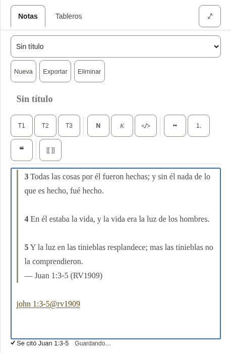

*A new note with three verses quoted into it.*

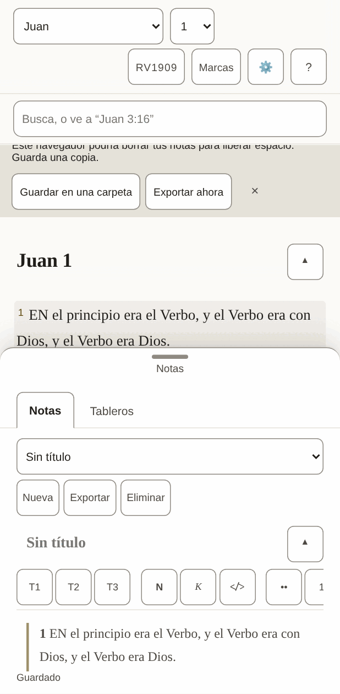

*On a phone the notes are a sheet that slides up over the text.*

- [ ] The formatting buttons carry one or two letters each (bold, italic, headings): they should be the letters a writer in this language expects.
- [ ] The line under the note ("Quoted …", "Saved") reads as a short report, not a sentence cut in two.
- [ ] Every text in the table below is correct and sounds natural.
- [ ] Nothing in the pictures is cut off, overlapping or badly broken across lines.

**The 51 texts of this part**

| Key | English | Español (México) |
|---|---|---|
| `notes.new` A new note. Nouns have gender in other languages, so notes and boards each say it. | New | Nueva |
| `notes.startOne` | Start one | Empieza una |
| `notes.heading` | Notes | Notas |
| `notes.picker` | Note | Nota |
| `notes.showMenus` | Show the note menus | Mostrar los menús de la nota |
| `notes.hideMenus` | Hide the note menus | Ocultar los menús de la nota |
| `notes.none` | No notes yet | Todavía no hay notas |
| `notes.preview` | Preview | Vista previa |
| `notes.write` | Write | Escribir |
| `notes.previewTitle` | See it rendered | Verla con formato |
| `notes.writeTitle` | Back to writing | Volver a escribir |
| `notes.canvas` | Canvas | Tableros |
| `notes.canvasTitle` | Lay verses and notes out on a board | Acomodar versículos y notas en un tablero |
| `notes.export` | Export | Exportar |
| `notes.exportTitle` | Download every note and board as Markdown in a .zip | Descargar todas las notas y tableros como Markdown en un .zip |
| `notes.delete` | Delete | Eliminar |
| `notes.title` | Note title | Título de la nota |
| `notes.body` | Note body | Texto de la nota |
| `notes.placeholder` | Write here… | Escribe aquí… |
| `notes.goTo` | Go to John 1:3-5 | Ir a Juan 1:3-5 |
| `notes.noneOpen` | No note open. | No hay ninguna nota abierta. |
| `notes.saveFailed` | Could not save — export your notes | No se pudo guardar; exporta tus notas |
| `notes.saving` | Saving… | Guardando… |
| `notes.saved` | Saved | Guardado |
| `notes.linkIn` | John 1:3-5 (KJV) | Juan 1:3-5 (BSB) |
| `notes.linkMissing` | John 1:3-5 (KJV — not downloaded) | Juan 1:3-5 (BSB, sin descargar) |
| `tools.label` | Formatting | Formato |
| `tools.heading` | Heading 2 | Título 2 |
| `tools.headingGlyph` | H2 | T2 |
| `tools.bold` | Bold | Negrita |
| `tools.boldGlyph` | B | N |
| `tools.italic` | Italic | Cursiva |
| `tools.italicGlyph` | I | K |
| `tools.code` | Code | Código |
| `tools.bullets` | Bulleted list | Lista con viñetas |
| `tools.numbers` | Numbered list | Lista numerada |
| `tools.quote` | Quote | Cita |
| `tools.link` | Link to a passage | Enlazar a un pasaje |
| `insert.quoted` | Quoted John 1:3-5 | Se citó Juan 1:3-5 |
| `insert.quotedFrom` | Quoted John 1:3-5 (BSB) | Se citó Juan 1:3-5 (RV1909) |
| `insert.linked` | Linked John 1:3-5 | Se enlazó Juan 1:3-5 |
| `insert.addedBoard` | Added the board “John 1” | Se agregó el tablero “Juan 1” |
| `insert.addedToBoard` | Added John 1:3-5 to “John 1” | Se agregó Juan 1:3-5 al tablero “Juan 1” |
| `insert.alreadyOnBoard` | John 1:3-5 is already on “John 1” | Juan 1:3-5 ya está en el tablero “Juan 1” |
| `insert.inNewNote` | Quoted John 1:3-5 in a new note | Se citó Juan 1:3-5 en una nota nueva |
| `insert.inNote` | Quoted John 1:3-5 in “John 1” | Se citó Juan 1:3-5 en “Juan 1” |
| `insert.inUntitledNote` | Quoted John 1:3-5 in an untitled note | Se citó Juan 1:3-5 en una nota sin título |
| `insert.studyBoard` | Study board | Tablero de estudio |
| `preview.empty` | Nothing written yet. | Todavía no hay nada escrito. |
| `preview.editHere` | Edit here (block 3) | Editar aquí (bloque 3) |
| `preview.goTo` | Go to John 1:3-5 | Ir a Juan 1:3-5 |

#### 2.4 Search

One box does two things: a reference goes straight to the passage, anything else searches the open Bible. The short list under the box is for jumping; the full list counts every match, book by book.

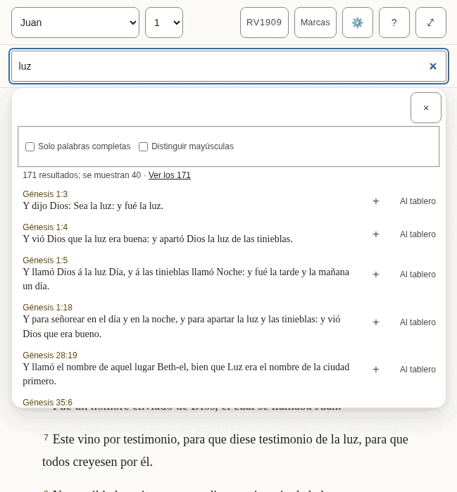

*The suggestions under the box.*

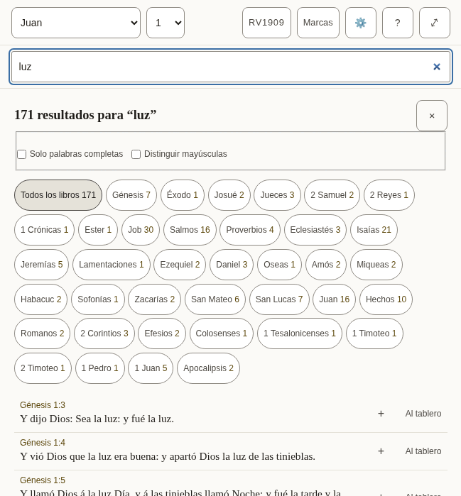

*Every match, with the count for each book.*

- [ ] The counts read naturally with a small number and with a large one.
- [ ] The two options ("Whole words only", "Match case") are understood without explanation.
- [ ] Every text in the table below is correct and sounds natural.
- [ ] Nothing in the pictures is cut off, overlapping or badly broken across lines.

**The 31 texts of this part**

| Key | English | Español (México) |
|---|---|---|
| `search.label` | Search or go to a reference | Buscar o ir a una referencia |
| `search.placeholder` | Search, or go to "John 3:16" | Busca, o ve a “Juan 3:16” |
| `search.hint` | Enter opens the passage, or every match. Down arrow moves into the suggestions. | Enter abre el pasaje o todos los resultados. La flecha hacia abajo entra en las sugerencias. |
| `search.suggestions` | Suggestions | Sugerencias |
| `search.goTo` | Go to John 1:2 | Ir a Juan 1:2 |
| `search.close` | Close suggestions | Cerrar las sugerencias |
| `search.matching` | Matching | Coincidencia |
| `search.wholeWords` | Whole words only | Solo palabras completas |
| `search.wholeWordsHint` | Finds love but not loveth. Off, the search also looks inside longer words. | Encuentra amor pero no amores. Sin esta opción, la búsqueda también mira dentro de palabras más largas. |
| `search.matchCase` | Match case | Distinguir mayúsculas |
| `search.matchCaseHint` | Capital letters matter: God and god are different. | Las mayúsculas cuentan: Dios y dios son distintos. |
| `search.noMatches` | No matches | Sin resultados |
| `search.matches` | 1 match 1,382 matches | 1 resultado 1,382 resultados |
| `search.showing` | ␣— showing 40 | ; se muestran 40 |
| `search.seeAll` | See all 1,382 | Ver los 1,382 |
| `search.insert` | Insert John 1:2 into the open note | Insertar Juan 1:2 en la nota abierta |
| `search.toCanvas` The name of a result's Canvas button: its visible word first (2.5.3). | Canvas — put John 1:2 on the board | Al tablero: pon Juan 1:2 en el tablero |
| `search.weakBelow` | Below: inside a longer word | Abajo: dentro de una palabra más larga |
| `search.announceNone` | No matches for “light” | Sin resultados para “luz” |
| `search.announceCount` | 1 match for “light” 1,382 matches for “light” | 1 resultado para “luz” 1,382 resultados para “luz” |
| `results.label` | Search results | Resultados de búsqueda |
| `results.heading` `{count}` is replaced by the total, in its own element. | {count} match for “light” {count} matches for “light” | {count} resultado para “luz” {count} resultados para “luz” |
| `results.close` | Close search results | Cerrar los resultados de búsqueda |
| `results.filter` | Filter by book | Filtrar por libro |
| `results.allBooks` | All books | Todos los libros |
| `results.weakBelow` | Below: “light” inside a longer word | Abajo: “luz” dentro de una palabra más larga |
| `results.insert` | Quote John 1:2 into the open note | Citar Juan 1:2 en la nota abierta |
| `results.insertTitle` | Quote into the open note | Citar en la nota abierta |
| `results.showing` | Showing 100 of 1,382 | Se muestran 100 de 1,382 |
| `results.inBook` | ␣in John | ␣en Juan |
| `results.more` | Show 100 more | Mostrar 100 más |

### The panels

Opened from the bar. They take the place of the chapter while they are open.

#### 2.5 Marks

Each of the five colours is a collection of the verses marked with it, and can be given a name of the reader’s own.

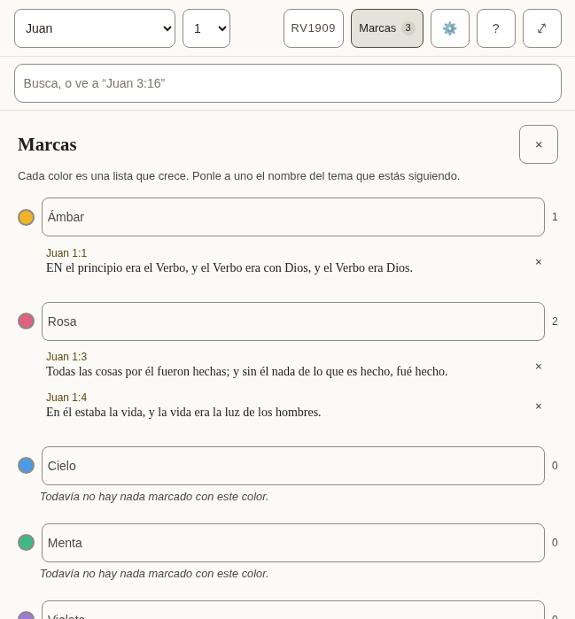

*Three marked verses in two collections.*

- [ ] The colour names are the everyday words for those colours.
- [ ] Every text in the table below is correct and sounds natural.
- [ ] Nothing in the pictures is cut off, overlapping or badly broken across lines.

**The 9 texts of this part**

| Key | English | Español (México) |
|---|---|---|
| `marks.label` | Marked verses | Versículos marcados |
| `marks.title` | Marks | Marcas |
| `marks.close` | Close marks | Cerrar las marcas |
| `marks.hint` | Each colour is a running list. Name one for the subject you are tracking. | Cada color es una lista que crece. Ponle a uno el nombre del tema que estás siguiendo. |
| `marks.nameFor` | Name for the amber collection | Nombre de la colección ámbar |
| `marks.empty` | Nothing marked in this colour yet. | Todavía no hay nada marcado con este color. |
| `marks.remove` | Remove the mark on John 1:2 | Quitar la marca de Juan 1:2 |
| `marks.removed` | Mark removed. Undo is available in the Marks bar. | Se quitó la marca. Puedes deshacerlo en la barra de Marcas. |
| `marks.restored` | Mark restored | Se restauró la marca |

#### 2.6 Translations, and reading two side by side

Where a Bible is downloaded, read, compared with the one being read, or removed. Each shows its size before it is downloaded.

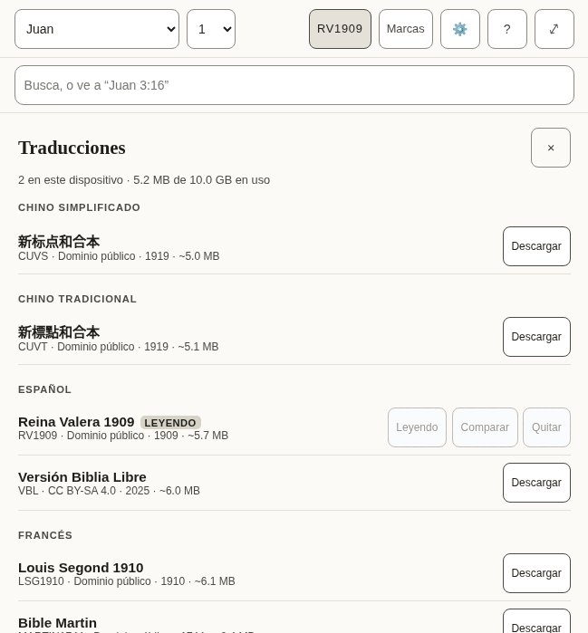

*The list of translations, by language.*

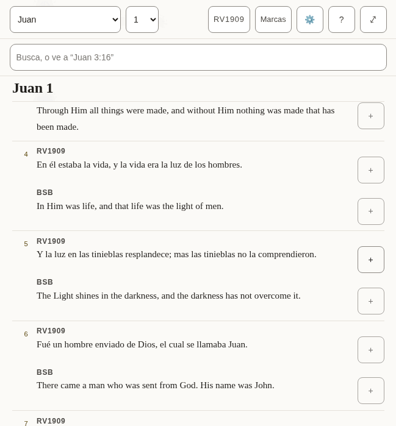

*Two translations, verse by verse.*

- [ ] The language headings are how this language names those languages.
- [ ] The note about what removing a translation does and does not touch is plain.
- [ ] Every text in the table below is correct and sounds natural.
- [ ] Nothing in the pictures is cut off, overlapping or badly broken across lines.

**The 32 texts of this part**

| Key | English | Español (México) |
|---|---|---|
| `library.title` | Translations | Traducciones |
| `library.close` | Close translations | Cerrar las traducciones |
| `library.onDevice` | 2 on this device | 2 en este dispositivo |
| `library.used` | 11.8 MB of 1.9 GB used | 11.8 MB de 1.9 GB en uso |
| `library.about` | about 5.4 MB | unos 5.4 MB |
| `library.licences.public-domain` | Public domain | Dominio público |
| `library.licences.cc-by-4.0` | CC BY 4.0 | CC BY 4.0 |
| `library.licences.cc-by-sa-4.0` | CC BY-SA 4.0 | CC BY-SA 4.0 |
| `library.licences.cc0` | CC0 | CC0 |
| `library.licences.custom-free` | Free licence | Licencia libre |
| `library.reading` | Reading | Leyendo |
| `library.comparing` | Comparing | Comparando |
| `library.read` | Read | Leer |
| `library.compare` | Compare | Comparar |
| `library.compareTitle` | Show beside the translation you are reading | Mostrar junto a la traducción que estás leyendo |
| `library.downloading` | Downloading Berean Standard Bible | Descargando Reina Valera 1909 |
| `library.download` | Download | Descargar |
| `library.removeActive` | Remove Berean Standard Bible — switch to another translation first | Quitar Reina Valera 1909: primero cambia a otra traducción |
| `library.removeFromDevice` | Remove Berean Standard Bible from this device | Quitar Reina Valera 1909 de este dispositivo |
| `library.note` | A downloaded translation stays on this device and can be read offline. Removing one never touches your notes or marks: both belong to the passage, not to a translation. | Una traducción descargada se queda en este dispositivo y se puede leer sin conexión. Quitar una nunca toca tus notas ni tus marcas: ambas pertenecen al pasaje, no a una traducción. |
| `library.progress` | Berean Standard Bible: 50% downloaded | Reina Valera 1909: 50% descargado |
| `library.downloaded` | Berean Standard Bible downloaded | Se descargó Reina Valera 1909 |
| `library.failed` | Berean Standard Bible: No connection — try again when you are online. | Reina Valera 1909: Sin conexión. Inténtalo de nuevo cuando tengas internet. |
| `library.failedOnline` | The download did not finish. Try again later. | La descarga no terminó. Inténtalo de nuevo más tarde. |
| `library.offline` | No connection — try again when you are online. | Sin conexión. Inténtalo de nuevo cuando tengas internet. |
| `compare.label` | Translations side by side | Traducciones lado a lado |
| `compare.compared` | Translations compared | Traducciones comparadas |
| `compare.stop` | Stop comparing KJV | Dejar de comparar BSB |
| `compare.verse` | Verse | Versículo |
| `compare.verseBefore` | Verse␣ | Versículo␣ |
| `compare.missing` | Not in KJV | No está en BSB |
| `compare.quote` | Quote KJV verse 16 | Citar el versículo 16 de BSB |

#### 2.7 Settings

How the text looks, the interface language, where the reader’s work is kept, and whether an assistant may help.

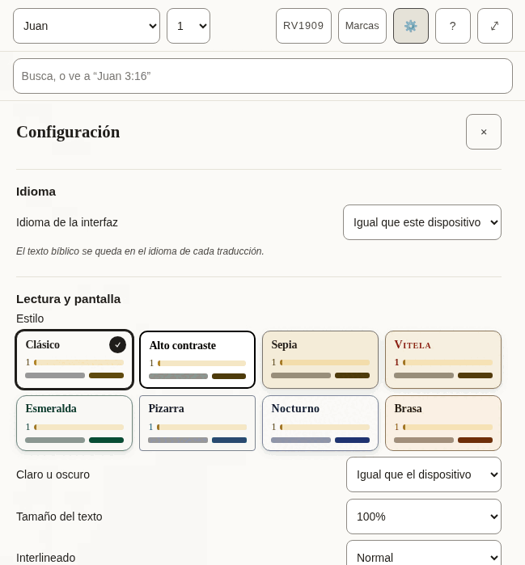

*The top of Settings.*

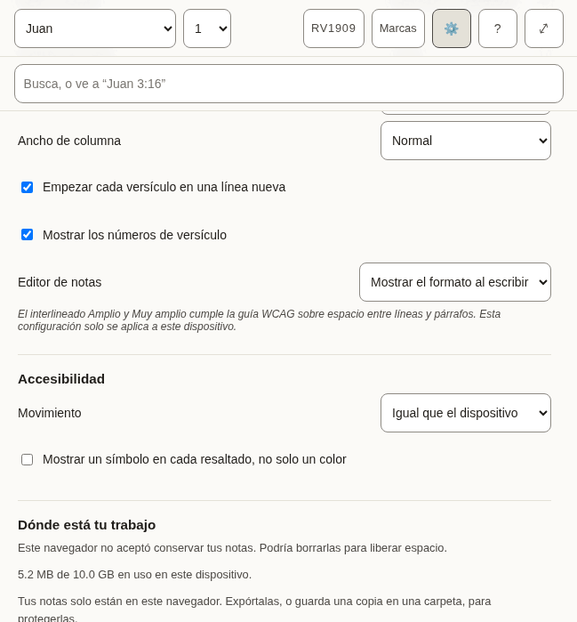

*Further down.*

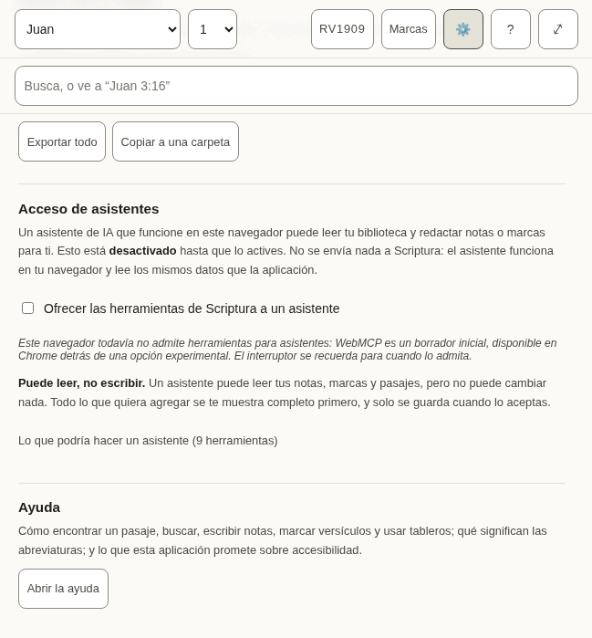

*The end.*

- [ ] Each label and the choices under it read as one thought.
- [ ] The style names are evocative, not literal (Vellum, Emerald, Nocturne): they should sound like names, not descriptions.
- [ ] The explanations in smaller type are complete sentences and easy to follow.
- [ ] Every text in the table below is correct and sounds natural.
- [ ] Nothing in the pictures is cut off, overlapping or badly broken across lines.

**The 66 texts of this part**

| Key | English | Español (México) |
|---|---|---|
| `settings.title` | Settings | Configuración |
| `settings.close` | Close settings | Cerrar la configuración |
| `settings.display` | Reading &amp; display | Lectura y pantalla |
| `settings.style` | Style | Estilo |
| `settings.styles.classic` | Classic | Clásico |
| `settings.styles.contrast` | High contrast | Alto contraste |
| `settings.styles.sepia` | Sepia | Sepia |
| `settings.styles.vellum` | Vellum | Vitela |
| `settings.styles.emerald` | Emerald | Esmeralda |
| `settings.styles.slate` | Slate | Pizarra |
| `settings.styles.nocturne` | Nocturne | Nocturno |
| `settings.styles.ember` | Ember | Brasa |
| `settings.appearance` | Light or dark | Claro u oscuro |
| `settings.appearances.system` | Follow the device | Igual que el dispositivo |
| `settings.appearances.light` | Light | Claro |
| `settings.appearances.dark` | Dark | Oscuro |
| `settings.textSize` | Text size | Tamaño del texto |
| `settings.spacing` | Line spacing | Interlineado |
| `settings.spacings.normal` | Normal | Normal |
| `settings.spacings.relaxed` | Relaxed | Amplio |
| `settings.spacings.loose` | Loose | Muy amplio |
| `settings.measure` | Column width | Ancho de columna |
| `settings.measures.narrow` | Narrow | Angosto |
| `settings.measures.normal` | Normal | Normal |
| `settings.measures.wide` | Wide | Ancho |
| `settings.measures.full` | Full | Completo |
| `settings.editor` | Note editor | Editor de notas |
| `settings.editors.live` | Show formatting as you write | Mostrar el formato al escribir |
| `settings.editors.plain` | Plain text | Texto simple |
| `settings.displayNote` | Relaxed and Loose spacing meet the WCAG guidance for line and paragraph spacing. These settings apply to this device only. | El interlineado Amplio y Muy amplio cumple la guía WCAG sobre espacio entre líneas y párrafos. Esta configuración solo se aplica a este dispositivo. |
| `settings.accessibility` | Accessibility | Accesibilidad |
| `settings.motion` | Motion | Movimiento |
| `settings.motions.system` | Follow the device | Igual que el dispositivo |
| `settings.motions.reduce` | Reduce motion | Reducir el movimiento |
| `settings.markers` | Show a symbol on every highlight, not only a colour | Mostrar un símbolo en cada resaltado, no solo un color |
| `settings.verseLines` | Start each verse on a new line | Empezar cada versículo en una línea nueva |
| `settings.verseNumbers` | Show verse numbers | Mostrar los números de versículo |
| `settings.recedeMenus` | On a small screen, hide the menus while reading | En pantallas pequeñas, ocultar los menús al leer |
| `settings.storage` | Where your work lives | Dónde está tu trabajo |
| `settings.persistence.persisted` | This browser has agreed to keep your notes. Clearing site data still removes them. | Este navegador aceptó conservar tus notas. Borrar los datos del sitio todavía las elimina. |
| `settings.persistence.denied` | This browser has not agreed to keep your notes. It may delete them to free up space. | Este navegador no aceptó conservar tus notas. Podría borrarlas para liberar espacio. |
| `settings.persistence.unsupported` | This browser will not say whether it keeps your notes. Assume it may delete them. | Este navegador no dice si conserva tus notas. Supón que podría borrarlas. |
| `settings.persistence.unknown` | Checking… | Comprobando… |
| `settings.usedOnDevice` | 11.8 MB of 1.9 GB used on this device. | 11.8 MB de 1.9 GB en uso en este dispositivo. |
| `settings.mirrored` | Your notes are also saved to a folder you chose. | Tus notas también se guardan en una carpeta que elegiste. |
| `settings.notMirrored` | Your notes live only in this browser. Export them, or save a copy to a folder, to keep them safe. | Tus notas solo están en este navegador. Expórtalas, o guarda una copia en una carpeta, para protegerlas. |
| `settings.exportAll` | Export everything | Exportar todo |
| `settings.anotherFolder` | Choose another folder | Elegir otra carpeta |
| `settings.mirror` | Mirror to a folder | Copiar a una carpeta |
| `settings.assistant` | Assistant access | Acceso de asistentes |
| `settings.assistantIntro` | An AI assistant running in this browser can read your library and draft notes or marks for you. This is **off** until you turn it on. Nothing is sent to Scriptura: the assistant runs in your browser and reads the same data the app does. | Un asistente de IA que funcione en este navegador puede leer tu biblioteca y redactar notas o marcas para ti. Esto está **desactivado** hasta que lo actives. No se envía nada a Scriptura: el asistente funciona en tu navegador y lee los mismos datos que la aplicación. |
| `settings.assistantToggle` | Offer Scriptura’s tools to an assistant | Ofrecer las herramientas de Scriptura a un asistente |
| `settings.assistantSupported` | This browser supports assistant tools. | Este navegador admite herramientas para asistentes. |
| `settings.assistantUnsupported` | This browser does not support assistant tools yet — WebMCP is an early draft, available in Chrome behind a flag. The switch is remembered for when it does. | Este navegador todavía no admite herramientas para asistentes: WebMCP es un borrador inicial, disponible en Chrome detrás de una opción experimental. El interruptor se recuerda para cuando lo admita. |
| `settings.assistantReadOnly` | **It can read, not write.** An assistant can read your notes, marks and passages, but it cannot change anything. Anything it wants to add is shown to you in full first, and is saved only when you accept it. | **Puede leer, no escribir.** Un asistente puede leer tus notas, marcas y pasajes, pero no puede cambiar nada. Todo lo que quiera agregar se te muestra completo primero, y solo se guarda cuando lo aceptas. |
| `settings.assistantTools` | What an assistant would be able to do (9 tools) | Lo que podría hacer un asistente (9 herramientas) |
| `settings.toolReads` | reads | lee |
| `settings.toolNeedsApproval` | needs your approval | necesita tu aprobación |
| `settings.toolsInEnglish` Shown only in the other languages, beside the tool descriptions, which stay English. | The descriptions are in English, as the assistant reads them. | Las descripciones están en inglés, tal como las lee el asistente. |
| `settings.help` | Help | Ayuda |
| `settings.helpIntro` | How to find a passage, search, write notes, mark verses and use boards; what the abbreviations mean; and what this app promises about accessibility. | Cómo encontrar un pasaje, buscar, escribir notas, marcar versículos y usar tableros; qué significan las abreviaturas; y lo que esta aplicación promete sobre accesibilidad. |
| `settings.openHelp` | Open help | Abrir la ayuda |
| `settings.language` | Language | Idioma |
| `settings.languageLabel` | Interface language | Idioma de la interfaz |
| `settings.languageSystem` | Match this device | Igual que este dispositivo |
| `settings.languageNote` | Bible text stays in the language of each translation. | El texto bíblico se queda en el idioma de cada traducción. |

#### 2.8 Help

The longest text in the app, and the one a reader turns to when stuck. It includes a list of terms and abbreviations, and a statement about accessibility.

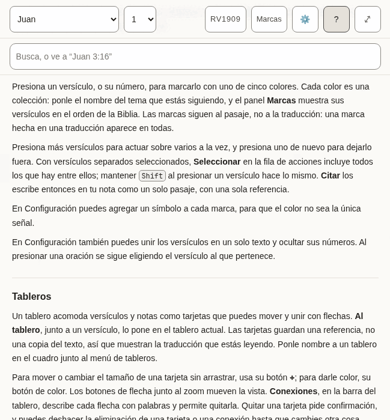

*The top of Help.*

- [ ] It reads well from start to finish as an explanation, not as a list of translated sentences.
- [ ] The examples of references are ones that work in a Bible in this language.
- [ ] The names of keys (Enter, Shift, Escape) are how this language’s keyboards and manuals name them.
- [ ] Every text in the table below is correct and sounds natural.
- [ ] Nothing in the pictures is cut off, overlapping or badly broken across lines.

**The 76 texts of this part**

| Key | English | Español (México) |
|---|---|---|
| `help.title` | Help | Ayuda |
| `help.close` | Close help | Cerrar la ayuda |
| `help.sections.finding.heading` | Finding a passage | Encontrar un pasaje |
| `help.sections.finding.blocks.1.p` | Type a reference in the search box and press Enter. All of these work: | Escribe una referencia en el cuadro de búsqueda y presiona Enter. Todas estas funcionan: |
| `help.sections.finding.blocks.2.ul.1` | `John 3:16` — one verse. | `Juan 3:16`: un versículo. |
| `help.sections.finding.blocks.2.ul.2` | `John 3:16-18` — a range of verses. | `Juan 3:16-18`: varios versículos seguidos. |
| `help.sections.finding.blocks.2.ul.3` | `John 3` — a whole chapter. | `Juan 3`: un capítulo completo. |
| `help.sections.finding.blocks.2.ul.4` | `Juan 3:16` or `Jean 3:16` — the book name in the translation you are reading. | `Juan 3:16` o `Jean 3:16`: el nombre del libro en la traducción que estás leyendo. |
| `help.sections.finding.blocks.2.ul.5` | `Jhn 3:16` — an abbreviation. `43 3:16` — the book number. | `Jhn 3:16`: una abreviatura. `43 3:16`: el número del libro. |
| `help.sections.finding.blocks.3.p` | You can also pick the book and chapter from the two menus in the bar. | También puedes elegir el libro y el capítulo en los dos menús de la barra. |
| `help.sections.finding.blocks.4.p` | On a small screen the menus step aside while you read, write or arrange a board. Press the **▾** button beside the title to bring them back; in a chapter or a note, scrolling back a little does the same. In Settings you can stop them moving by themselves. | En una pantalla pequeña los menús se apartan mientras lees, escribes u ordenas un tablero. Presiona el botón **▾** junto al título para que vuelvan; en un capítulo o en una nota, basta con desplazarte un poco hacia atrás. En Configuración puedes hacer que no se muevan solos. |
| `help.sections.searching.heading` | Searching | Buscar |
| `help.sections.searching.blocks.1.p` | Anything that is not a reference is a search. Search looks inside words, so `love` also finds *loveth* and *beloved*. Accents do not matter: `amo` finds *amó*. | Todo lo que no es una referencia es una búsqueda. La búsqueda mira dentro de las palabras, así que `amor` también encuentra *amores* y *enamorados*. Los acentos no importan: `amo` encuentra *amó*. |
| `help.sections.searching.blocks.2.ul.1` | Put a phrase in quotes to find it exactly: `"in the beginning"`. | Pon una frase entre comillas para encontrarla tal cual: `"en el principio"`. |
| `help.sections.searching.blocks.2.ul.2` | Put a minus sign before a word to leave verses with it out: `God -love`. | Pon un signo de menos antes de una palabra para dejar fuera los versículos que la tienen: `Dios -amor`. |
| `help.sections.searching.blocks.2.ul.3` | **Whole words only** stops the search looking inside longer words. | **Solo palabras completas** hace que la búsqueda no mire dentro de palabras más largas. |
| `help.sections.searching.blocks.2.ul.4` | **Match case** makes capital letters matter. | **Distinguir mayúsculas** hace que las mayúsculas cuenten. |
| `help.sections.searching.blocks.3.p` | The first results are verses where your word stands alone; verses where it sits inside a longer word come after a line that says so. Press Enter on a search to see every match, counted by book. | Primero aparecen los versículos donde tu palabra está sola; después de una línea que lo indica, los versículos donde aparece dentro de una palabra más larga. Presiona Enter en una búsqueda para ver todos los resultados, contados por libro. |
| `help.sections.notes.heading` | Notes | Notas |
| `help.sections.notes.blocks.1.p` | Notes are plain text with Markdown. Formatting takes shape as you write, and its symbols come back on the line you are editing; to see only the Markdown, choose **Plain text** under Note editor in Settings. The toolbar above the note adds headings, bold, italic, lists and quotes; press a tool again to take the formatting off. With Plain text, **Preview** shows the note as it will read. | Las notas son texto simple con Markdown. El formato se ve mientras escribes, y sus símbolos reaparecen en la línea que estás editando; para ver solo el Markdown, elige **Texto simple** en Editor de notas, en Configuración. La barra encima de la nota agrega títulos, negritas, cursivas, listas y citas; presiona otra vez una herramienta para quitar el formato. Con Texto simple, **Vista previa** muestra la nota como se leerá. |
| `help.sections.notes.blocks.2.p` | A link to a passage looks like `[[john 3:16]]`. Add `@kjv` to say which translation: `[[john 3:16@kjv]]`. Put the cursor inside a link and a **Go to** button opens it. **Quote** beside a verse copies the verse into your note with its reference and a link. | Un enlace a un pasaje se ve así: `[[john 3:16]]`. Agrega `@rv1909` para indicar la traducción: `[[john 3:16@rv1909]]`. Pon el cursor dentro de un enlace y un botón **Ir a** lo abre. **Citar**, junto a un versículo, copia el versículo en tu nota con su referencia y un enlace. |
| `help.sections.notes.blocks.3.p` | Notes are saved on this device as you type. **Export** downloads every note and board as text files in a zip. | Las notas se guardan en este dispositivo mientras escribes. **Exportar** descarga todas las notas y tableros como archivos de texto en un zip. |
| `help.sections.marks.heading` | Marks | Marcas |
| `help.sections.marks.blocks.1.p` | Press a verse, or its number, to mark it in one of five colours. Each colour is a collection: name it for the subject you are following, and the **Marks** panel lists its verses in Bible order. Marks follow the passage, not the translation, so a mark made in one translation shows in all of them. | Presiona un versículo, o su número, para marcarlo con uno de cinco colores. Cada color es una colección: ponle el nombre del tema que estás siguiendo, y el panel **Marcas** muestra sus versículos en el orden de la Biblia. Las marcas siguen al pasaje, no a la traducción: una marca hecha en una traducción aparece en todas. |
| `help.sections.marks.blocks.2.p` | Press more verses to act on several at once, and press one again to leave it out. With verses apart selected, **Select** in the row of actions takes in every verse between them; holding <kbd>Shift</kbd> while you press a verse does the same. **Quote** then writes them into your note as one passage under one reference. | Presiona más versículos para actuar sobre varios a la vez, y presiona uno de nuevo para dejarlo fuera. Con versículos separados seleccionados, **Seleccionar** en la fila de acciones incluye todos los que hay entre ellos; mantener <kbd>Shift</kbd> al presionar un versículo hace lo mismo. **Citar** los escribe entonces en tu nota como un solo pasaje, con una sola referencia. |
| `help.sections.marks.blocks.3.p` | In Settings you can add a symbol to every mark, so colour is not the only sign. | En Configuración puedes agregar un símbolo a cada marca, para que el color no sea la única señal. |
| `help.sections.marks.blocks.4.p` | In Settings you can also run the verses together as one text and hide their numbers. Pressing a sentence still picks the verse it belongs to. | En Configuración también puedes unir los versículos en un solo texto y ocultar sus números. Al presionar una oración se sigue eligiendo el versículo al que pertenece. |
| `help.sections.boards.heading` | Boards | Tableros |
| `help.sections.boards.blocks.1.p` | A board lays verses and notes out as cards you can move and join with arrows. **Canvas** beside a verse puts it on the current board. Cards hold a reference, not a copy of the text, so they show the translation you are reading. Give a board a name in the box beside the board menu. | Un tablero acomoda versículos y notas como tarjetas que puedes mover y unir con flechas. **Al tablero**, junto a un versículo, lo pone en el tablero actual. Las tarjetas guardan una referencia, no una copia del texto, así que muestran la traducción que estás leyendo. Ponle nombre a un tablero en el cuadro junto al menú de tableros. |
| `help.sections.boards.blocks.2.p` | To move or resize a card without dragging, use its **✥** button; to colour it, its colour button. The arrow buttons beside the zoom move the view. **Connections**, in the board's bar, lists every arrow in words and removes one. Removing a card asks first, and removing a card or a connection can be undone until you change something else. | Para mover o cambiar el tamaño de una tarjeta sin arrastrar, usa su botón **✥**; para darle color, su botón de color. Los botones de flecha junto al zoom mueven la vista. **Conexiones**, en la barra del tablero, describe cada flecha con palabras y permite quitarla. Quitar una tarjeta pide confirmación, y puedes deshacer la eliminación de una tarjeta o una conexión hasta que cambies otra cosa. |
| `help.sections.translations.heading` | Translations | Traducciones |
| `help.sections.translations.blocks.1.p` | The library lists every translation, grouped by language, with its size. Download one to read it offline; **Compare** shows it beside the one you are reading, verse by verse. Removing a translation never touches your notes or marks. | La biblioteca muestra todas las traducciones, agrupadas por idioma, con su tamaño. Descarga una para leerla sin conexión; **Comparar** la muestra junto a la que estás leyendo, versículo por versículo. Quitar una traducción nunca toca tus notas ni tus marcas. |
| `help.sections.keyboard.heading` | Keyboard | Teclado |
| `help.sections.keyboard.blocks.1.ul.1` | <kbd>Tab</kbd> and <kbd>Shift</kbd>+<kbd>Tab</kbd> move between controls. The first press offers to skip to the text or the notes. | <kbd>Tab</kbd> y <kbd>Shift</kbd>+<kbd>Tab</kbd> pasan de un control a otro. La primera vez ofrece saltar al texto o a las notas. |
| `help.sections.keyboard.blocks.1.ul.2` | <kbd>Escape</kbd> closes whatever opened last: a panel, the verse actions, the search suggestions. | <kbd>Escape</kbd> cierra lo último que se abrió: un panel, las acciones del versículo, las sugerencias de búsqueda. |
| `help.sections.keyboard.blocks.1.ul.3` | <kbd>Enter</kbd> on a verse number selects it and opens the actions; the arrow keys move along them. <kbd>Enter</kbd> on another number adds that verse, and <kbd>Shift</kbd>+<kbd>Enter</kbd> takes in every verse up to it. | <kbd>Enter</kbd> sobre el número de un versículo lo selecciona y abre las acciones; las flechas se mueven entre ellas. <kbd>Enter</kbd> sobre otro número agrega ese versículo, y <kbd>Shift</kbd>+<kbd>Enter</kbd> incluye todos los versículos hasta él. |
| `help.sections.keyboard.blocks.1.ul.4` | On the divider between the panes, the arrow keys, <kbd>Home</kbd> and <kbd>End</kbd> resize; the two small buttons do the same. | En el divisor entre los paneles, las flechas, <kbd>Inicio</kbd> y <kbd>Fin</kbd> cambian el tamaño; los dos botones pequeños hacen lo mismo. |
| `help.sections.keyboard.blocks.1.ul.5` | In a note, <kbd>Shift</kbd>+<kbd>Tab</kbd> reaches the formatting tools; the arrow keys move between them. | En una nota, <kbd>Shift</kbd>+<kbd>Tab</kbd> llega a las herramientas de formato; las flechas se mueven entre ellas. |
| `help.sections.keyboard.blocks.1.ul.6` | On a board, cards take focus: the arrow keys move a card, <kbd>Alt</kbd> with an arrow resizes it, and <kbd>Delete</kbd> asks to remove it. With the board itself focused, the arrow keys move the view and <kbd>+</kbd> and <kbd>−</kbd> zoom. | En un tablero, las tarjetas reciben el foco: las flechas mueven una tarjeta, <kbd>Alt</kbd> con una flecha cambia su tamaño y <kbd>Supr</kbd> pide quitarla. Con el foco en el tablero, las flechas mueven la vista y <kbd>+</kbd> y <kbd>−</kbd> hacen zoom. |
| `help.abbreviations` | Abbreviations | Abreviaturas |
| `help.abbreviationsCaption` | What each abbreviation means | Qué significa cada abreviatura |
| `help.short` | Short | Abreviatura |
| `help.meaning` | Meaning | Significado |
| `help.terms.1.1` | CC BY-SA 4.0 | CC BY-SA 4.0 |
| `help.terms.1.2` | Creative Commons Attribution–ShareAlike 4.0: a free licence that asks you to credit the source and share changes under the same terms. | Creative Commons Atribución-CompartirIgual 4.0: una licencia libre que pide citar la fuente y compartir los cambios con las mismas condiciones. |
| `help.terms.2.1` | CC0 | CC0 |
| `help.terms.2.2` | Creative Commons Zero: the author has waived all rights; the text is free to use. | Creative Commons Cero: el autor renunció a todos sus derechos; el texto es de uso libre. |
| `help.terms.3.1` | OT | OT |
| `help.terms.3.2` | Old Testament. | Antiguo Testamento (en inglés, Old Testament). |
| `help.terms.4.1` | NT | NT |
| `help.terms.4.2` | New Testament. | Nuevo Testamento. |
| `help.terms.5.1` | PWA | PWA |
| `help.terms.5.2` | Progressive web app: a website you can install and use offline. | Aplicación web progresiva: un sitio web que puedes instalar y usar sin conexión. |
| `help.terms.6.1` | WCAG | WCAG |
| `help.terms.6.2` | Web Content Accessibility Guidelines, the standard this app is measured against. | Pautas de Accesibilidad para el Contenido Web, el estándar con el que se mide esta aplicación. |
| `help.glossaryHeading` | Words used here | Palabras que se usan aquí |
| `help.glossary.1.1` | Collection | Colección |
| `help.glossary.1.2` | Every verse you mark in one colour. Name a colour for the subject you are following, and the Marks panel lists those verses in Bible order. | Todos los versículos que marcas con un color. Ponle a un color el nombre del tema que sigues, y el panel Marcas muestra esos versículos en el orden de la Biblia. |
| `help.glossary.2.1` | Board | Tablero |
| `help.glossary.2.2` | A space where verses and notes are laid out as cards and joined with arrows. Boards are saved and exported with your notes. | Un espacio donde los versículos y las notas se acomodan como tarjetas unidas con flechas. Los tableros se guardan y se exportan con tus notas. |
| `help.glossary.3.1` | Card | Tarjeta |
| `help.glossary.3.2` | One item on a board: a verse, a note, or text you typed. A verse card shows the verse from whichever translation you are reading. | Un elemento de un tablero: un versículo, una nota o un texto que escribiste. Una tarjeta de versículo muestra el versículo en la traducción que estás leyendo. |
| `help.glossary.4.1` | Translation | Traducción |
| `help.glossary.4.2` | One version of the Bible, in one language. Every translation here is free to copy. | Una versión de la Biblia, en un idioma. Todas las traducciones de aquí se pueden copiar libremente. |
| `help.glossary.5.1` | Whole words only | Solo palabras completas |
| `help.glossary.5.2` | A search option. With it on, "love" finds love but not loveth. With it off, it finds both. | Una opción de búsqueda. Activada, "amor" encuentra amor pero no amores. Desactivada, encuentra las dos. |
| `help.glossary.6.1` | Match case | Distinguir mayúsculas |
| `help.glossary.6.2` | A search option. With it on, "God" and "god" are different. | Una opción de búsqueda. Activada, "Dios" y "dios" son distintos. |
| `help.glossary.7.1` | Mirror to a folder | Copiar a una carpeta |
| `help.glossary.7.2` | Keep a copy of your notes as text files in a folder on this computer, updated as you write. Works in Chrome and Edge. | Guardar una copia de tus notas como archivos de texto en una carpeta de esta computadora, actualizada mientras escribes. Funciona en Chrome y Edge. |
| `help.glossary.8.1` | Assistant tools | Herramientas para asistentes |
| `help.glossary.8.2` | A way for an AI assistant running in your browser to read your library and suggest notes or marks. Off unless you turn it on; nothing is saved without your approval. | Una forma de que un asistente de IA que funcione en tu navegador lea tu biblioteca y sugiera notas o marcas. Está desactivada salvo que la actives; no se guarda nada sin tu aprobación. |
| `help.accessibilityHeading` | Accessibility | Accesibilidad |
| `help.accessibility.1` | This app aims to meet the Web Content Accessibility Guidelines 2.2 at Level AAA for everything the app itself shows: its controls, its text, its colours and its behaviour. Every control can be reached by keyboard, is at least 44 by 44 pixels, shows where focus is, and has a name. Text is at least 7:1 against its background in every colour theme, and you can change the size, spacing and colours in Settings. | Esta aplicación busca cumplir las Pautas de Accesibilidad para el Contenido Web 2.2 en el nivel AAA en todo lo que la propia aplicación muestra: sus controles, su texto, sus colores y su comportamiento. Cada control se puede alcanzar con el teclado, mide al menos 44 por 44 píxeles, muestra dónde está el foco y tiene un nombre. El texto tiene un contraste de al menos 7:1 con su fondo en todos los temas de color, y en Configuración puedes cambiar el tamaño, el espaciado y los colores. |
| `help.accessibility.2` | Two things are outside that promise. The Bible text is shown as it was published: how hard it is to read, and how its words are said, belong to each translation, not to this app. The same is true of what you write in your notes. | Dos cosas quedan fuera de esa promesa. El texto bíblico se muestra tal como se publicó: qué tan difícil es de leer, y cómo se pronuncian sus palabras, dependen de cada traducción, no de esta aplicación. Lo mismo vale para lo que escribes en tus notas. |
| `help.accessibility.3` | What is checked by machine is checked on every change. What needs a person — a screen reader on a phone, the app under a Windows contrast theme — is checked by hand, less often. If something does not work for you, please report it at the project's issue tracker on GitHub (`AlanRoman117/scriptura`). | Lo que revisa una máquina se revisa en cada cambio. Lo que necesita a una persona, como un lector de pantalla en un celular o la aplicación con un tema de contraste de Windows, se revisa a mano, con menos frecuencia. Si algo no te funciona, repórtalo en el registro de problemas del proyecto en GitHub (`AlanRoman117/scriptura`). |

### Met less often

Boards, the questions asked before something is deleted, and the notices. Many of these texts are spoken by a screen reader and never shown.

#### 2.9 Boards (the canvas)

A surface where verses and notes are laid out as cards and joined with arrows. Most of its texts are the names of buttons, heard by a screen reader.

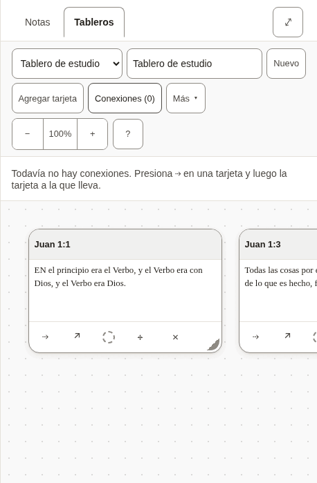

*Two verses on a board, with the list of connections open.*

- [ ] The words for a board, a card and a connection are used the same way here as everywhere else.
- [ ] Every text in the table below is correct and sounds natural.
- [ ] Nothing in the pictures is cut off, overlapping or badly broken across lines.

**The 93 texts of this part**

| Key | English | Español (México) |
|---|---|---|
| `canvas.new` A new board. | New | Nuevo |
| `canvas.more` Beside the Bible, the button the less-used board actions fold behind. | More | Más |
| `canvas.startOne` | Start one | Empieza uno |
| `canvas.label` | Boards | Tableros |
| `canvas.heading` | Board: John 1 | Tablero: Juan 1 |
| `canvas.noneOpenHeading` | none open | ninguno abierto |
| `canvas.picker` | Board | Tablero |
| `canvas.showMenus` | Show the board menus | Mostrar los menús del tablero |
| `canvas.hideMenus` | Hide the board menus | Ocultar los menús del tablero |
| `canvas.name` | Board name | Nombre del tablero |
| `canvas.none` | No boards yet | Todavía no hay tableros |
| `canvas.undo` | Undo: put back John 1:1 Undo: put back the connection John 1:1 → John 1:14 | Deshacer: volver a poner Juan 1:1 Deshacer: volver a poner la conexión Juan 1:1 → Juan 1:14 |
| `canvas.putBack` | John 1:1 put back The connection John 1:1 → John 1:14 put back | Se volvió a poner Juan 1:1 Se volvió a poner la conexión Juan 1:1 → Juan 1:14 |
| `canvas.removed` | John 1:1 removed. Undo is in the board's bar. The connection John 1:1 → John 1:14 removed. Undo is in the board's bar. | Se quitó Juan 1:1. Puedes deshacerlo en la barra del tablero. Se quitó la conexión Juan 1:1 → Juan 1:14. Puedes deshacerlo en la barra del tablero. |
| `canvas.addCard` | Add card | Agregar tarjeta |
| `canvas.addNote` | Add note | Agregar nota |
| `canvas.addNoteName` | Add note — put the newest note on the board | Agregar nota: pon la nota más reciente en el tablero |
| `canvas.addNoteNoNotes` | Add note — write a note first | Agregar nota: primero escribe una nota |
| `canvas.toNote` | Add to note | Agregar a la nota |
| `canvas.toNoteName` | Add to note — put this board into the note you have open | Agregar a la nota: pon este tablero en la nota que tienes abierta |
| `canvas.connections` | Connections (2) | Conexiones (2) |
| `canvas.connectionsLabel` | Connections | Conexiones |
| `canvas.deleteBoard` | Delete board | Eliminar tablero |
| `canvas.zoom` | Zoom | Zoom |
| `canvas.zoomOut` | Zoom out | Alejar |
| `canvas.zoomIn` | Zoom in | Acercar |
| `canvas.zoomReset` | Zoom 120%. Reset to full size, showing your cards | Zoom 120%. Volver al tamaño completo, mostrando tus tarjetas |
| `canvas.moveView` | Move the view | Mover la vista |
| `canvas.viewLeft` | Move the view left | Mover la vista a la izquierda |
| `canvas.viewUp` | Move the view up | Mover la vista hacia arriba |
| `canvas.viewDown` | Move the view down | Mover la vista hacia abajo |
| `canvas.viewRight` | Move the view right | Mover la vista a la derecha |
| `canvas.help` | Help — boards, keyboard, and what the abbreviations mean | Ayuda: tableros, teclado y el significado de las abreviaturas |
| `canvas.noConnections` | No connections yet. Press ⇢ on a card, then the card it leads to. | Todavía no hay conexiones. Presiona ⇢ en una tarjeta y luego la tarjeta a la que lleva. |
| `canvas.removeConnection` | Remove the connection John 1:1 → John 1:14 | Quitar la conexión Juan 1:1 → Juan 1:14 |
| `canvas.missingCard` | a missing card | una tarjeta que ya no está |
| `canvas.edge` | John 1:1 → John 1:14 | Juan 1:1 → Juan 1:14 |
| `canvas.frame` | Board canvas, 1 card Board canvas, 4 cards | Área del tablero, 1 tarjeta Área del tablero, 4 tarjetas |
| `canvas.frameHint` | Arrow keys move the view; plus and minus zoom. Each card takes focus: arrow keys move it, and Alt with an arrow resizes it. | Las flechas mueven la vista; más y menos hacen zoom. Cada tarjeta recibe el foco: las flechas la mueven, y Alt con una flecha cambia su tamaño. |
| `canvas.verseCard` | Verse card | Tarjeta de versículo |
| `canvas.noteCard` | Note card | Tarjeta de nota |
| `canvas.card` | Card | Tarjeta |
| `canvas.cardName` | Verse card: John 1:1, Amber (amber) Verse card: John 1:1 | Tarjeta de versículo: Juan 1:1, Ámbar (ámbar) Tarjeta de versículo: Juan 1:1 |
| `canvas.colourName` | Amber (amber) | Ámbar (ámbar) |
| `canvas.cardTitle` | Card title | Título de la tarjeta |
| `canvas.cardTitlePlaceholder` | Card | Tarjeta |
| `canvas.cardText` | Card text | Texto de la tarjeta |
| `canvas.cardTextPlaceholder` | Write here… | Escribe aquí… |
| `canvas.cardBody` | John 1:1 — text | Juan 1:1: texto |
| `canvas.connect` | Connect John 1:1 to another card | Conectar Juan 1:1 con otra tarjeta |
| `canvas.connectPrompt` | Choose the card to connect to: press it, or Enter on it. Escape cancels. | Elige la tarjeta a la que quieres conectar: presiónala, o presiona Enter sobre ella. Escape cancela. |
| `canvas.connected` | Connected John 1:1 to John 1:14 | Se conectó Juan 1:1 con Juan 1:14 |
| `canvas.open` | Open John 1:1 in the reader | Abrir Juan 1:1 en el lector |
| `canvas.colour` | Colour: Amber (amber). Change the colour of John 1:1 Colour: none. Change the colour of John 1:1 | Color: Ámbar (ámbar). Cambiar el color de Juan 1:1 Color: ninguno. Cambiar el color de Juan 1:1 |
| `canvas.adjust` | Move or resize John 1:1 without dragging | Mover o cambiar el tamaño de Juan 1:1 sin arrastrar |
| `canvas.takeOff` | Take John 1:1 off the board | Quitar Juan 1:1 del tablero |
| `canvas.empty` | Nothing on this board yet. Add a card here, or use **Canvas** beside a verse while reading. | Este tablero todavía está vacío. Agrega una tarjeta aquí, o usa **Al tablero** junto a un versículo mientras lees. |
| `canvas.adjustPanel` | Move and resize John 1:1 | Mover y cambiar el tamaño de Juan 1:1 |
| `canvas.colourPanel` | Colour of John 1:1 | Color de Juan 1:1 |
| `canvas.adjustTitle` | Move and resize | Mover y cambiar tamaño |
| `canvas.colourTitle` | Colour | Color |
| `canvas.panelTitle` | Move and resize: John 1:1 | Mover y cambiar tamaño: Juan 1:1 |
| `canvas.move` | Move | Mover |
| `canvas.moveLeft` | Move left | Mover a la izquierda |
| `canvas.moveUp` | Move up | Mover hacia arriba |
| `canvas.moveDown` | Move down | Mover hacia abajo |
| `canvas.moveRight` | Move right | Mover a la derecha |
| `canvas.size` | Size | Tamaño |
| `canvas.narrower` | Narrower | Más angosta |
| `canvas.wider` | Wider | Más ancha |
| `canvas.shorter` | Shorter | Más baja |
| `canvas.taller` | Taller | Más alta |
| `canvas.colours` | Colours | Colores |
| `canvas.noColour` | No colour | Sin color |
| `canvas.moved` | John 1:1: moved to 320, 180 | Juan 1:1: se movió a 320, 180 |
| `canvas.resized` | John 1:1: 280 wide, 180 tall | Juan 1:1: 280 de ancho, 180 de alto |
| `canvas.coloured` | John 1:1: Amber (amber) | Juan 1:1: Ámbar (ámbar) |
| `canvas.uncoloured` | John 1:1: no colour | Juan 1:1: sin color |
| `canvas.noneOpen` | No board open. | No hay ningún tablero abierto. |
| `cards.verseMissing` | Not in this translation. | No está en esta traducción. |
| `cards.untitledNote` | Untitled note | Nota sin título |
| `cards.untitledBoard` | Untitled board | Tablero sin título |
| `cards.emptyNote` | Empty note. | Nota vacía. |
| `cards.deletedNote` | This note has been deleted. | Esta nota se eliminó. |
| `cards.card` | Card | Tarjeta |
| `cards.emptyBoard` | _Empty board._ | _Tablero vacío._ |
| `cards.connections` | Connections | Conexiones |
| `cards.missingCard` | (missing card) | (tarjeta que ya no está) |
| `embed.scrolls` | Board: John 1, scrolls sideways | Tablero: Juan 1; se desplaza hacia los lados |
| `embed.picture` | Board: John 1, 1 cards Board: John 1, 4 cards | Tablero: Juan 1, 1 tarjeta Tablero: Juan 1, 4 tarjetas |
| `embed.empty` | This board is empty. | Este tablero está vacío. |
| `embed.missing` | A board was embedded here, but it no longer exists. | Aquí había un tablero, pero ya no existe. |
| `embed.open` | Open board | Abrir el tablero |

#### 2.10 Questions before something is deleted

Deleting a note or a board, or removing a card, a mark or a translation, asks first. The question names what will go, and says whether it can come back.

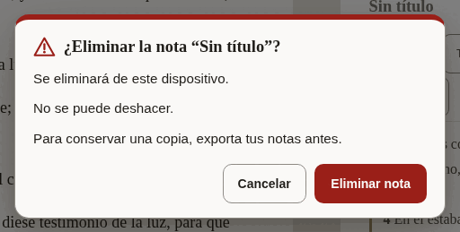

*The question before a note is deleted.*

- [ ] It is unmistakable what will be deleted and that it cannot be undone.
- [ ] The button that deletes says what it deletes.
- [ ] Every text in the table below is correct and sounds natural.
- [ ] Nothing in the pictures is cut off, overlapping or badly broken across lines.

**The 26 texts of this part**

| Key | English | Español (México) |
|---|---|---|
| `confirm.permanent` | You cannot undo this. | No se puede deshacer. |
| `confirm.undoable` | You can undo this until your next change. | Puedes deshacerlo hasta tu próximo cambio. |
| `confirm.note.title` | Delete the note “John 1”? | ¿Eliminar la nota “Juan 1”? |
| `confirm.note.gone` | It will be deleted from this device. | Se eliminará de este dispositivo. |
| `confirm.note.keepCopy` | To keep a copy, export your notes first. | Para conservar una copia, exporta tus notas antes. |
| `confirm.note.action` | Delete note | Eliminar nota |
| `confirm.note.done` | Deleted the note “John 1” | Se eliminó la nota “Juan 1” |
| `confirm.board.title` | Delete the board “John 1”? | ¿Eliminar el tablero “Juan 1”? |
| `confirm.board.cards` | The board and its card will be deleted. The board and its 4 cards will be deleted. | Se eliminarán el tablero y su tarjeta. Se eliminarán el tablero y sus 4 tarjetas. |
| `confirm.board.empty` | The board is empty. | El tablero está vacío. |
| `confirm.board.kept` | Your notes are not changed. | Tus notas no cambian. |
| `confirm.board.action` | Delete board | Eliminar tablero |
| `confirm.board.done` | Deleted the board “John 1” | Se eliminó el tablero “Juan 1” |
| `confirm.card.title` | Remove John 1:1 from the board? | ¿Quitar Juan 1:1 del tablero? |
| `confirm.card.connections` | Its connection is removed too. Its 3 connections are removed too. | También se quita su conexión. También se quitan sus 3 conexiones. |
| `confirm.card.noteKept` | The note itself is not changed. | La nota en sí no cambia. |
| `confirm.card.action` | Remove card | Quitar tarjeta |
| `confirm.mark.title` | Remove the mark on John 1:2? | ¿Quitar la marca de Juan 1:2? |
| `confirm.mark.leaves` | The verse leaves the collection “Amber”. | El versículo sale de la colección “Ámbar”. |
| `confirm.mark.action` | Remove mark | Quitar marca |
| `confirm.translation.title` | Remove Berean Standard Bible from this device? | ¿Quitar Reina Valera 1909 de este dispositivo? |
| `confirm.translation.frees` | This frees about 5.4 MB. | Se liberarán unos 5.4 MB. |
| `confirm.translation.kept` | Your notes and marks are not changed. | Tus notas y marcas no cambian. |
| `confirm.translation.again` | You can download it again when you are online. | Puedes volver a descargarla cuando tengas conexión. |
| `confirm.translation.action` | Remove translation | Quitar traducción |
| `confirm.translation.done` | Removed Berean Standard Bible from this device | Se quitó Reina Valera 1909 de este dispositivo |

#### 2.11 Notices

A line about where the reader’s work is kept, the offer of a newer version, and the notice on this preview.

- [ ] The notice about storage is honest without being alarming.
- [ ] Every text in the table below is correct and sounds natural.

**The 23 texts of this part**

| Key | English | Español (México) |
|---|---|---|
| `durability.label` | Where your notes are kept | Dónde se guardan tus notas |
| `durability.denied` | This browser may delete your notes to free up space. Save a copy. | Este navegador podría borrar tus notas para liberar espacio. Guarda una copia. |
| `durability.stale` | You have not exported your notes for a while. | Hace tiempo que no exportas tus notas. |
| `durability.local` | Your notes live in this browser only. | Tus notas solo están en este navegador. |
| `durability.saveFolder` | Save to a folder | Guardar en una carpeta |
| `durability.saveFolderTitle` | Keep a copy as .md files in a folder you choose | Guardar una copia como archivos .md en una carpeta que elijas |
| `durability.exportNow` | Export now | Exportar ahora |
| `durability.dismiss` | Dismiss this notice | Cerrar este aviso |
| `update.label` | A new version is ready | Hay una versión nueva |
| `update.ready` | A new version of Scriptura is ready. | Hay una versión nueva de Scriptura. |
| `update.readyAnnounce` | A new version of Scriptura is ready. Reload when it suits you. | Hay una versión nueva de Scriptura. Recarga cuando te convenga. |
| `update.reload` | Reload | Recargar |
| `update.reloading` | Reloading… | Recargando… |
| `update.later` | Later | Más tarde |
| `previewBuild.label` | Preview | Versión preliminar |
| `previewBuild.intro` | **Preview.** An early build for the people reviewing its translations. | **Versión preliminar.** Una versión temprana para quienes revisan sus traducciones. |
| `previewBuild.report` | Report a translation correction on GitHub (opens in a new tab) | Reportar una corrección de traducción en GitHub (se abre en una pestaña nueva) |
| `previewBuild.reportShort` The notice's short link; `newTab` completes its name for a screen reader. | Report a correction | Reportar una corrección |
| `previewBuild.newTab` | (on GitHub, opens in a new tab) | (en GitHub, se abre en una pestaña nueva) |
| `previewBuild.hide` | Hide | Ocultar |
| `previewBuild.heading` | About this preview | Acerca de esta versión preliminar |
| `previewBuild.about` | This build is for the people checking the interface in Spanish, French, Japanese, Chinese and Portuguese. Nothing you do here is sent anywhere: your notes and marks stay in this browser. To report a word that is wrong or unclear, use the link below. It opens a short form on GitHub, which needs a free account. | Esta versión es para quienes revisan la interfaz en español, francés, japonés, chino y portugués. Nada de lo que hagas aquí se envía a ningún lado: tus notas y marcas se quedan en este navegador. Para reportar una palabra incorrecta o poco clara, usa el enlace de abajo. Abre un formulario breve en GitHub, que requiere una cuenta gratuita. |
| `previewBuild.version` | Version: 0.1.0 | Versión: 0.1.0 |

#### 2.12 Panes, tabs and the sheet

The names of the two panes, the tabs that choose between notes and a board, and the buttons that resize them. Mostly heard, not seen.

- [ ] Every text in the table below is correct and sounds natural.

**The 20 texts of this part**

| Key | English | Español (México) |
|---|---|---|
| `layout.scripture` | Scripture | Escrituras |
| `layout.notes` | Notes | Notas |
| `layout.expandNotes` | Expand notes | Expandir notas |
| `layout.collapseNotes` | Collapse notes | Contraer notas |
| `layout.gripWithNews` | Expand notes, Quoted John 1:3-5 | Expandir notas. Se citó Juan 1:3-5 |
| `layout.sheetHint` | Drag, or use the up and down arrow keys, to make the notes taller or shorter. | Arrastra, o usa las flechas arriba y abajo, para hacer las notas más altas o más bajas. |
| `layout.notesMoreRoom` | Give the notes more room | Dar más espacio a las notas |
| `layout.bibleMoreRoom` | Give the Bible more room | Dar más espacio a la Biblia |
| `layout.resize` | Resize panes | Cambiar el tamaño de los paneles |
| `layout.split` Both shares arrive formatted as percentages. | 56% Bible, 44% notes | 56% Biblia, 44% notas |
| `layout.showNotes` | Show notes | Mostrar notas |
| `layout.paneBible` | Bible | la Biblia |
| `layout.paneNotes` | Notes | las notas |
| `layout.sides` The side pane holds the notes or the canvas; these name the switch and the canvas side. | Notes or canvas | Notas o tableros |
| `layout.paneBoard` | Canvas | los tableros |
| `layout.expandBoard` | Expand canvas | Expandir tableros |
| `layout.collapseBoard` | Collapse canvas | Contraer tableros |
| `layout.showBoard` | Show canvas | Mostrar tableros |
| `layout.maximize` | Maximize Bible | Maximizar la Biblia |
| `layout.restore` | Restore Bible | Restaurar la Biblia |

#### 2.13 What an assistant proposes

When the reader has allowed an assistant to help, what it wants to add is shown first and waits for a yes.

- [ ] Every text in the table below is correct and sounds natural.

**The 10 texts of this part**

| Key | English | Español (México) |
|---|---|---|
| `proposal.noteTitle` | A note has been drafted for you | Se redactó una nota para ti |
| `proposal.marksTitle` | Verses suggested for marking | Versículos sugeridos para marcar |
| `proposal.lede` | An assistant proposed this. Nothing has been saved — review it, change anything you like, and it only takes effect when you accept. | Un asistente propuso esto. No se ha guardado nada: revísalo, cambia lo que quieras, y solo se aplica cuando lo aceptas. |
| `proposal.titleInput` | Proposed note title | Título propuesto para la nota |
| `proposal.bodyInput` | Proposed note body | Texto propuesto para la nota |
| `proposal.into` `{collection}` is replaced by the collection's name, in bold. | Into {collection} (amber) | En {collection} (ámbar) |
| `proposal.missing` | Not in this translation. | No está en esta traducción. |
| `proposal.discard` | Discard | Descartar |
| `proposal.save` | Save this note | Guardar esta nota |
| `proposal.mark` | Mark 1 verse Mark 3 verses | Marcar 1 versículo Marcar 3 versículos |

---

## Part 3: Try it yourself

Open **<https://alanroman117.github.io/Scriptura/>** on a computer, and then on a phone if you can.

The app follows your browser's language. If it does not open in Español (México), choose the gear in the bar at the top, then the first choice in the panel, and pick **Español (México)**.

A picture shows words standing still. What you are looking for here is what only use can show: a word that does not fit its button, a message that arrives at the wrong moment, a sentence that is right alone and wrong after the one before it.

- [ ] Accept the Bible the app offers in your language, and read the first chapter of John.
- [ ] Press a verse, then two more. Read what the row says, then press **Citar**.
- [ ] Read the note that was made, and the line beneath it.
- [ ] Type a word into the search box and read the count. Open the full list of results.
- [ ] Type a reference, such as "Juan 3:16", and press <kbd>Enter</kbd>.
- [ ] Mark a verse with a colour, then open **Marcas** and give that colour a name.
- [ ] Open **Traducciones**: download another Bible, compare it with yours, then remove it and read the question it asks.
- [ ] Open **Configuración** and read it from top to bottom, changing each choice once.
- [ ] Open **Ayuda** and read it as a newcomer would.
- [ ] Put two verses on a board (**Al tablero**), open the board, and join them.
- [ ] Delete the note and read the question it asks.
- [ ] On a phone: do the first three steps again, upright and on its side.
- [ ] If you use a screen reader: listen to the bar at the top, to a verse being selected, and to a quote being made. The interface should be spoken in your language, and the Bible in its own.

While you do this:

- [ ] No text is cut off, runs out of its button, or sits on top of another.
- [ ] No English appears where your language should be. (The names of Bibles are as their publishers wrote them, and what an assistant may do, in Settings, is in English on purpose.)
- [ ] Numbers, sizes and counts look right as they change.
- [ ] Nothing reads as rude, childish, or stiffer than the rest.

---

## Your notes

<!-- YOURS: everything below this line is kept when the guide is written again. -->

### What should change

One row for each correction. Add as many rows as you need.

| Where (the key, or the screen) | What is wrong | What it should say |
|---|---|---|
| | | |
| | | |
| | | |
| | | |
| | | |
| | | |

### Anything else

What a table cannot hold: the tone as a whole, a word you would change everywhere, something that confused you.

> 

### Your verdict

- [ ] It can be published as it is.
- [ ] It can be published once the corrections above are made.
- [ ] It needs another reading after the corrections.

| | |
|---|---|
| Reviewed by | |
| Date | |
| Version tested (Help, "About this preview") | |
| Device and browser | |
| Parts done (1, 2, 3) | |
