# The Scriptura reader in Français (France): a guide for its reviewer

The reader's interface has been drafted in French (France) and has not yet been read by someone whose language it is. You are that reader. Nothing here is final until you say so.

This guide puts every word in front of you without your having to hunt for it, in three parts:

| Part | What you do | About |
|---|---|---|
| [1. First pass](#part-1-first-pass) | Read the voice, the words used everywhere, and how numbers are written. | 15 minutes |
| [2. Screen by screen](#part-2-screen-by-screen) | Look at each picture, then read every text that belongs to it. | 60 to 90 minutes |
| [3. Try it yourself](#part-3-try-it-yourself) | Use the app in your language and look for what a picture cannot show. | 30 minutes |

Part 1 alone already tells us a great deal. If you can give only a quarter of an hour, give it to Part 1.

## How to send corrections

- **In this file:** write them in [Your notes](#your-notes) at the end and send the file back. A ticked box anywhere above means "I checked this and it is right."
- **Or on the web:** [the correction form for Français (France)](https://github.com/AlanRoman117/Scriptura/issues/new?template=translation-fr.yml).
- Either way, give the **key** from the first column of a table (for example `verseActions.quote`) so we can find the text, and what it should say instead.

## How to read the tables

- Each row is one text. **Key** is its name in the program, **English** is the original, and **Français (France)** is what is being reviewed.
- The small print under a key, where there is some, is the programmer's own note on that text. It often says whether the text is shown on the screen or only spoken by a screen reader, which a blind reader uses.
- Names and numbers inside a text are examples: "JEAN 1:3-5", "Louis Segond 1910", "1 382". The app puts the real ones there. Where a text changes with a number, it is shown with one and with several.
- A word in braces, such as `{count}`, is a place where the app puts a number or a name. Leave it as it is; it may move within the sentence.
- `␣` marks a space at the start or end of a text that has to stay, and <kbd>Enter</kbd> is a key on the keyboard.
- The pictures were taken with the Bible "Louis Segond 1910" open, so the names of books are that Bible's own.

---

## Part 1: First pass

### 1.1 The voice

The text is meant to be written in this register: **vous**, with quotation marks « » with no-break spaces.

- [ ] The reader is addressed as *vous* throughout: never *tu*.
- [ ] Guillemets « » and a space before `:` `;` `!` `?`. The app adds the no-break spaces itself: check that they fall in the right places.
- [ ] A French word where one is in use, not an anglicism.
- [ ] It reads as written French, not as a translation from English.

### 1.2 The words used everywhere

These are the names of the app's own things. Each is used the same way on every screen, so one that is wrong is wrong everywhere.

| In English | In Français (France) | Right? |
|---|---|---|
| Notes / note | Notes / note | |
| Marks / mark (verb) | Marques / marquer | |
| Collection | Collection | |
| Board | Tableau | |
| Card | Fiche | |
| Connection | Connexion | |
| Quote | Citer | |
| Link | Lier | |
| Canvas (put on a board) | Au tableau | |
| Translation | Traduction | |
| Scripture | Texte biblique | |
| Passage | Passage | |
| Book / chapter / verse | Livre / chapitre / verset | |
| Search | Rechercher | |
| Whole words only | Mots entiers uniquement | |
| Match case | Respecter la casse | |
| Settings | Paramètres | |
| Help | Aide | |
| Export | Exporter | |
| Preview / Write | Aperçu / Écrire | |
| Delete / Remove | Supprimer / Retirer | |
| Delete the note “…”? (the confirmation) | Supprimer la note « … » ? | |
| You cannot undo this. | Vous ne pourrez pas annuler. | |
| Untitled | Sans titre | |
| Bold / Italic glyphs | G / I | |

- [ ] Each is the word a reader of the Bible in French (France) would expect.
- [ ] None of them is used for two different things.

### 1.3 Numbers and counts

How the app writes a number, a percentage and a size in this language, and how one text changes with the number in it.

| | Written as |
|---|---|
| One thousand three hundred and eighty-two | 1 382 |
| Fifty-eight per cent | 58 % |
| The size of a download | 5,4 Mo |
| 0 search results | 0 résultat |
| 1 search result | 1 résultat |
| 2 search results | 2 résultats |
| 5 search results | 5 résultats |
| 1382 search results | 1 382 résultats |
| 1 verse selected | 1 verset · JEAN 1:3 |
| 2 verses selected | 2 versets · JEAN 1:3-4 |
| 5 verses selected | 5 versets · JEAN 1:3-7 |

- [ ] Thousands are grouped, and the percentage is written, the way this language does it.
- [ ] Every count above is grammatical, zero and one included.

---

## Part 2: Screen by screen

For each screen: look at the picture first, then tick what you have checked, then read the table. The order is the order in which a reader meets things.

### What every reader sees

If time is short, these four screens matter most: they are the app on an ordinary day.

#### 2.1 The first visit, and reading a chapter

The bar across the top chooses the book, the chapter and the translation, and opens Marks, Settings and Help. A reader whose language is not English is first offered a Bible in it.

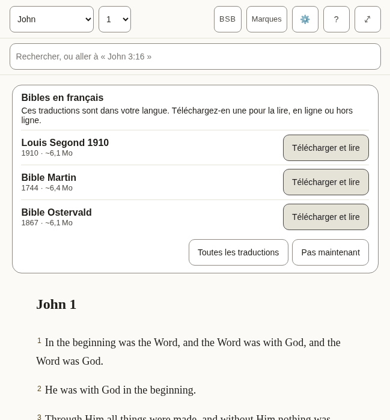

*What a new reader sees: the offer of a Bible in this language, over the English one the app arrives with.*

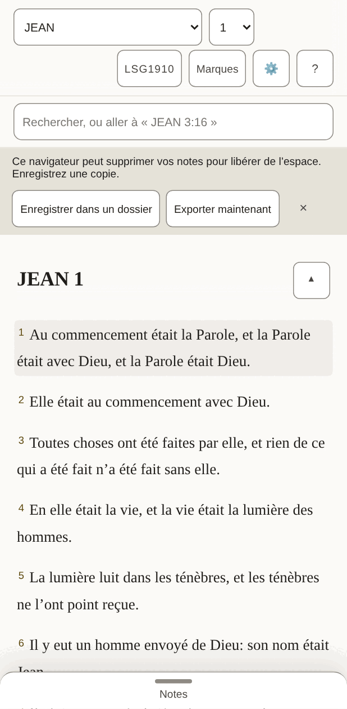

*The same, on a phone, once a Bible in this language is open.*

- [ ] The offer reads as an invitation, and its buttons are clear about what they will do.
- [ ] Nothing in the bar is cut short or squeezed, on the phone above all.
- [ ] Every text in the table below is correct and sounds natural.
- [ ] Nothing in the pictures is cut off, overlapping or badly broken across lines.

**The 48 texts of this part**

| Key | English | Français (France) |
|---|---|---|
| `app.name` | Scriptura Reader | Scriptura Reader |
| `app.downloading` | Downloading the text for offline use… | Téléchargement du texte pour une lecture hors ligne… |
| `app.opening` | Opening… | Ouverture… |
| `app.bootFailed` | The Bible text could not be opened. Reload to try again. | Le texte biblique n’a pas pu être ouvert. Rechargez pour réessayer. |
| `app.skipToScripture` | Skip to scripture | Aller au texte biblique |
| `app.skipToNotes` | Skip to notes | Aller aux notes |
| `app.skipToBoard` | Skip to the canvas | Aller aux tableaux |
| `app.title` | John 1 · BSB · Scriptura | JEAN 1 · LSG1910 · Scriptura |
| `app.passageTitle` | John 1 · BSB | JEAN 1 · LSG1910 |
| `app.boardTitle` | John 1 · Boards | JEAN 1 · Tableaux |
| `app.opened` | Settings opened | Panneau Paramètres ouvert |
| `app.closed` | Settings closed | Panneau Paramètres fermé |
| `app.boardSaveFailed` | Could not save the board — export your notes | Impossible d’enregistrer le tableau : exportez vos notes |
| `app.languageChanged` | The interface is now in English. | L’interface est maintenant en français. |
| `reader.passage` | Passage | Passage |
| `reader.book` | Book | Livre |
| `reader.chapter` | Chapter | Chapitre |
| `reader.translationChip` | BSB — Berean Standard Bible. Choose or add a translation | LSG1910 : Louis Segond 1910. Choisir ou ajouter une traduction |
| `reader.marks` | Marks | Marques |
| `reader.marksChip` | Marks (7) — verses you have marked, by colour | Marques (7) : les versets que vous avez marqués, par couleur |
| `reader.settingsChip` | Settings — display, storage, export, and assistant access | Paramètres : affichage, stockage, exportation et accès des assistants |
| `reader.helpChip` | Help — finding passages, searching, notes, marks, boards, keyboard, and what the abbreviations mean | Aide : trouver un passage, rechercher, notes, marques, tableaux, clavier et sens des abréviations |
| `reader.selectVerse` A verse's number: a toggle that adds the verse to the selection or takes it out. | Select John 1:2 | Sélectionner JEAN 1:2 |
| `reader.selectVerseIn` | Select John 1:2 — in Amber (amber) | Sélectionner JEAN 1:2 : dans Ambre (ambre) |
| `reader.selection` Said when the selection changes and focus does not move to say it. | 1 verse selected: John 1:3 3 verses selected: John 1:3-5 | 1 verset sélectionné : JEAN 1:3 3 versets sélectionnés : JEAN 1:3-5 |
| `reader.selectionCleared` | Selection cleared | Sélection annulée |
| `reader.chapterMissing` | This chapter is not in Berean Standard Bible. | Ce chapitre ne figure pas dans Louis Segond 1910. |
| `reader.readingAnnounce` | Reading Berean Standard Bible | Lecture de Louis Segond 1910 |
| `reader.showMenus` The button at the end of the chapter title, on a small screen: named for what a press will do. | Show the reading menus | Afficher les menus de lecture |
| `reader.hideMenus` | Hide the reading menus | Masquer les menus de lecture |
| `panels.marks` | Marks | Marques |
| `panels.translations` | Translations | Traductions |
| `panels.settings` | Settings | Paramètres |
| `panels.help` | Help | Aide |
| `panels.results` | Search results | Résultats de recherche |
| `common.cancel` | Cancel | Annuler |
| `common.untitledNote` | Untitled | Sans titre |
| `common.untitledBoard` | Untitled board | Tableau sans titre |
| `common.source` | Berean Standard Bible source | Source de Louis Segond 1910 |
| `common.undoRemove` | Undo remove | Annuler le retrait |
| `common.remove` | Remove | Retirer |
| `common.done` | Done | Terminé |
| `offer.title` | Bibles in English | Bibles en français |
| `offer.intro` | These translations are in your language. Download one to read it, online or offline. | Ces traductions sont dans votre langue. Téléchargez-en une pour la lire, en ligne ou hors ligne. |
| `offer.downloadAndRead` | Download and read | Télécharger et lire |
| `offer.downloadAndReadName` | Download and read Berean Standard Bible | Télécharger et lire Louis Segond 1910 |
| `offer.allTranslations` | All translations | Toutes les traductions |
| `offer.notNow` | Not now | Pas maintenant |

#### 2.2 Selecting verses and acting on them

Pressing a verse selects it and opens a row of actions: five colours to mark it with, then Quote, Link and Canvas. Pressing more verses adds them, and the row says how many it holds.

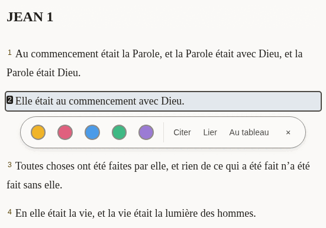

*One verse selected.*

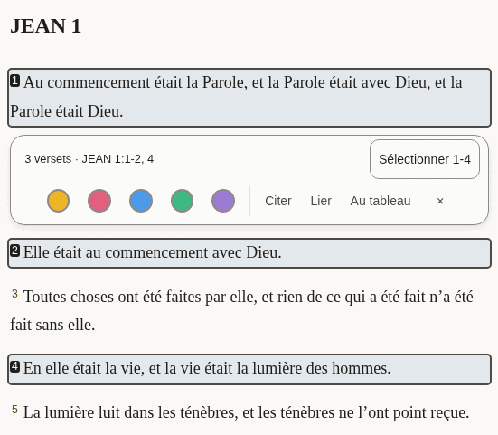

*Three verses selected, two of them together and one apart: the row says so, and offers to take in the verses between.*

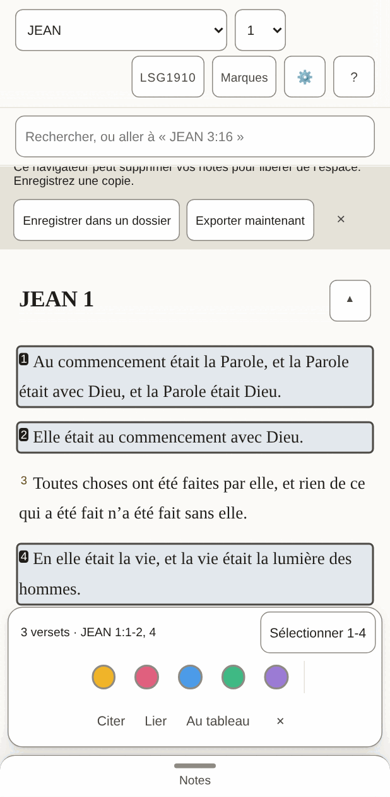

*On a phone the row sits at the bottom of the screen.*

- [ ] The summary ("3 verses · …") and the button beside it fit on one line.
- [ ] The three words for the actions are short enough to sit side by side on a phone.
- [ ] Every text in the table below is correct and sounds natural.
- [ ] Nothing in the pictures is cut off, overlapping or badly broken across lines.

**The 24 texts of this part**

| Key | English | Français (France) |
|---|---|---|
| `verseActions.group` | Actions for John 1:2 | Actions pour JEAN 1:2 |
| `verseActions.mark` | Mark as Amber (amber) | Marquer dans Ambre (ambre) |
| `verseActions.quote` | Quote | Citer |
| `verseActions.link` | Link | Lier |
| `verseActions.canvas` | Canvas | Au tableau |
| `verseActions.canvasName` | Canvas — put this verse on the board | Au tableau : placer ce verset sur le tableau |
| `verseActions.close` | Close actions for John 1:2 | Fermer les actions de JEAN 1:2 |
| `verseActions.groupMany` The row's name when it holds several verses. | Actions for 1 verse: John 1:3 Actions for 3 verses: John 1:3-5 | Actions pour 1 verset : JEAN 1:3 Actions pour 3 versets : JEAN 1:3-5 |
| `verseActions.summary` Shown in the row while several are selected, so what it will act on is in words. | 1 verse · John 1:3 3 verses · John 1:3-5 | 1 verset · JEAN 1:3 3 versets · JEAN 1:3-5 |
| `verseActions.fill` The button that takes in every verse between the first and the last selected: "Select 3-18". | Select 3-18 | Sélectionner 3-18 |
| `verseActions.canvasNameMany` | Canvas — put these verses on the board | Au tableau : placer ces versets sur le tableau |
| `verseActions.clear` | Clear the selection | Annuler la sélection |
| `verseActions.marked` | Marked 1 verse as Amber (amber) Marked 3 verses as Amber (amber) | 1 verset marqué dans Ambre (ambre) 3 versets marqués dans Ambre (ambre) |
| `verseActions.unmarked` | Cleared Amber (amber) from 1 verse Cleared Amber (amber) from 3 verses | 1 verset retiré de Ambre (ambre) 3 versets retirés de Ambre (ambre) |
| `colours.amber` | Amber | Ambre |
| `colours.rose` | Rose | Rose |
| `colours.sky` | Sky | Ciel |
| `colours.mint` | Mint | Menthe |
| `colours.violet` | Violet | Violet |
| `colourWords.amber` | amber | ambre |
| `colourWords.rose` | rose | rose |
| `colourWords.sky` | sky | ciel |
| `colourWords.mint` | mint | menthe |
| `colourWords.violet` | violet | violet |

#### 2.3 Notes

The pane beside the Bible, where a reader writes. A quoted passage arrives with its reference, and a line under the note says what was just done and whether it is saved.

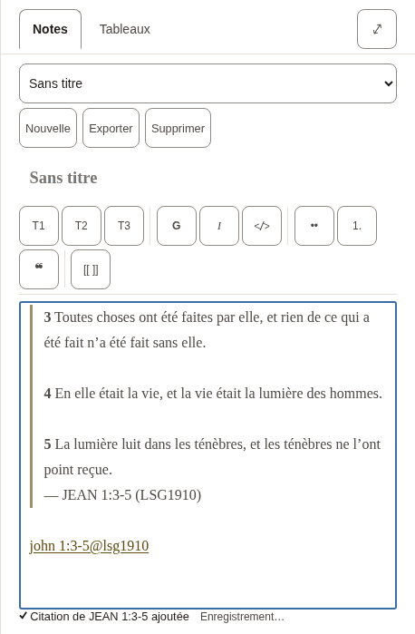

*A new note with three verses quoted into it.*

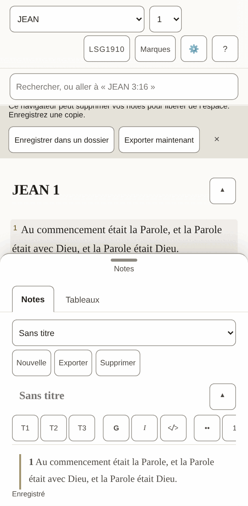

*On a phone the notes are a sheet that slides up over the text.*

- [ ] The formatting buttons carry one or two letters each (bold, italic, headings): they should be the letters a writer in this language expects.
- [ ] The line under the note ("Quoted …", "Saved") reads as a short report, not a sentence cut in two.
- [ ] Every text in the table below is correct and sounds natural.
- [ ] Nothing in the pictures is cut off, overlapping or badly broken across lines.

**The 51 texts of this part**

| Key | English | Français (France) |
|---|---|---|
| `notes.new` A new note. Nouns have gender in other languages, so notes and boards each say it. | New | Nouvelle |
| `notes.startOne` | Start one | En créer une |
| `notes.heading` | Notes | Notes |
| `notes.picker` | Note | Note |
| `notes.showMenus` | Show the note menus | Afficher les menus de la note |
| `notes.hideMenus` | Hide the note menus | Masquer les menus de la note |
| `notes.none` | No notes yet | Aucune note pour l’instant |
| `notes.preview` | Preview | Aperçu |
| `notes.write` | Write | Écrire |
| `notes.previewTitle` | See it rendered | Voir la mise en forme |
| `notes.writeTitle` | Back to writing | Revenir à l’écriture |
| `notes.canvas` | Canvas | Tableaux |
| `notes.canvasTitle` | Lay verses and notes out on a board | Disposer des versets et des notes sur un tableau |
| `notes.export` | Export | Exporter |
| `notes.exportTitle` | Download every note and board as Markdown in a .zip | Télécharger toutes les notes et tous les tableaux en Markdown dans un .zip |
| `notes.delete` | Delete | Supprimer |
| `notes.title` | Note title | Titre de la note |
| `notes.body` | Note body | Texte de la note |
| `notes.placeholder` | Write here… | Écrivez ici… |
| `notes.goTo` | Go to John 1:3-5 | Aller à JEAN 1:3-5 |
| `notes.noneOpen` | No note open. | Aucune note ouverte. |
| `notes.saveFailed` | Could not save — export your notes | Impossible d’enregistrer : exportez vos notes |
| `notes.saving` | Saving… | Enregistrement… |
| `notes.saved` | Saved | Enregistré |
| `notes.linkIn` | John 1:3-5 (KJV) | JEAN 1:3-5 (BSB) |
| `notes.linkMissing` | John 1:3-5 (KJV — not downloaded) | JEAN 1:3-5 (BSB, non téléchargée) |
| `tools.label` | Formatting | Mise en forme |
| `tools.heading` | Heading 2 | Titre 2 |
| `tools.headingGlyph` | H2 | T2 |
| `tools.bold` | Bold | Gras |
| `tools.boldGlyph` | B | G |
| `tools.italic` | Italic | Italique |
| `tools.italicGlyph` | I | I |
| `tools.code` | Code | Code |
| `tools.bullets` | Bulleted list | Liste à puces |
| `tools.numbers` | Numbered list | Liste numérotée |
| `tools.quote` | Quote | Citation |
| `tools.link` | Link to a passage | Lien vers un passage |
| `insert.quoted` | Quoted John 1:3-5 | Citation de JEAN 1:3-5 ajoutée |
| `insert.quotedFrom` | Quoted John 1:3-5 (BSB) | Citation de JEAN 1:3-5 (LSG1910) ajoutée |
| `insert.linked` | Linked John 1:3-5 | Lien vers JEAN 1:3-5 ajouté |
| `insert.addedBoard` | Added the board “John 1” | Tableau « JEAN 1 » ajouté |
| `insert.addedToBoard` | Added John 1:3-5 to “John 1” | JEAN 1:3-5 ajouté au tableau « JEAN 1 » |
| `insert.alreadyOnBoard` | John 1:3-5 is already on “John 1” | JEAN 1:3-5 est déjà sur le tableau « JEAN 1 » |
| `insert.inNewNote` | Quoted John 1:3-5 in a new note | Citation de JEAN 1:3-5 ajoutée dans une nouvelle note |
| `insert.inNote` | Quoted John 1:3-5 in “John 1” | Citation de JEAN 1:3-5 ajoutée dans « JEAN 1 » |
| `insert.inUntitledNote` | Quoted John 1:3-5 in an untitled note | Citation de JEAN 1:3-5 ajoutée dans une note sans titre |
| `insert.studyBoard` | Study board | Tableau d’étude |
| `preview.empty` | Nothing written yet. | Rien n’est encore écrit. |
| `preview.editHere` | Edit here (block 3) | Modifier ici (bloc 3) |
| `preview.goTo` | Go to John 1:3-5 | Aller à JEAN 1:3-5 |

#### 2.4 Search

One box does two things: a reference goes straight to the passage, anything else searches the open Bible. The short list under the box is for jumping; the full list counts every match, book by book.

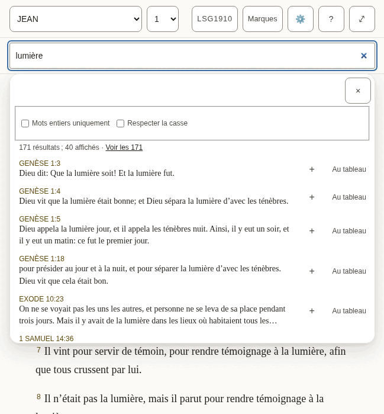

*The suggestions under the box.*

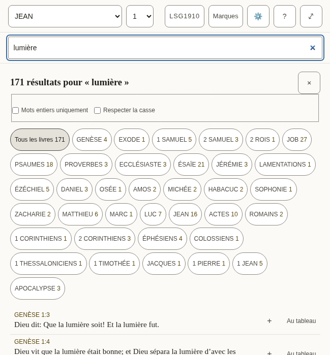

*Every match, with the count for each book.*

- [ ] The counts read naturally with a small number and with a large one.
- [ ] The two options ("Whole words only", "Match case") are understood without explanation.
- [ ] Every text in the table below is correct and sounds natural.
- [ ] Nothing in the pictures is cut off, overlapping or badly broken across lines.

**The 31 texts of this part**

| Key | English | Français (France) |
|---|---|---|
| `search.label` | Search or go to a reference | Rechercher ou aller à une référence |
| `search.placeholder` | Search, or go to "John 3:16" | Rechercher, ou aller à « JEAN 3:16 » |
| `search.hint` | Enter opens the passage, or every match. Down arrow moves into the suggestions. | Entrée ouvre le passage, ou tous les résultats. La flèche vers le bas entre dans les suggestions. |
| `search.suggestions` | Suggestions | Suggestions |
| `search.goTo` | Go to John 1:2 | Aller à JEAN 1:2 |
| `search.close` | Close suggestions | Fermer les suggestions |
| `search.matching` | Matching | Correspondance |
| `search.wholeWords` | Whole words only | Mots entiers uniquement |
| `search.wholeWordsHint` | Finds love but not loveth. Off, the search also looks inside longer words. | Trouve amour mais pas amours. Sans cette option, la recherche regarde aussi à l’intérieur des mots plus longs. |
| `search.matchCase` | Match case | Respecter la casse |
| `search.matchCaseHint` | Capital letters matter: God and god are different. | Les majuscules comptent : Dieu et dieu sont différents. |
| `search.noMatches` | No matches | Aucun résultat |
| `search.matches` | 1 match 1,382 matches | 1 résultat 1 382 résultats |
| `search.showing` | ␣— showing 40 | ␣; 40 affichés |
| `search.seeAll` | See all 1,382 | Voir les 1 382 |
| `search.insert` | Insert John 1:2 into the open note | Insérer JEAN 1:2 dans la note ouverte |
| `search.toCanvas` The name of a result's Canvas button: its visible word first (2.5.3). | Canvas — put John 1:2 on the board | Au tableau : placer JEAN 1:2 sur le tableau |
| `search.weakBelow` | Below: inside a longer word | Ci-dessous : à l’intérieur d’un mot plus long |
| `search.announceNone` | No matches for “light” | Aucun résultat pour « lumière » |
| `search.announceCount` | 1 match for “light” 1,382 matches for “light” | 1 résultat pour « lumière » 1 382 résultats pour « lumière » |
| `results.label` | Search results | Résultats de recherche |
| `results.heading` `{count}` is replaced by the total, in its own element. | {count} match for “light” {count} matches for “light” | {count} résultat pour « lumière » {count} résultats pour « lumière » |
| `results.close` | Close search results | Fermer les résultats de recherche |
| `results.filter` | Filter by book | Filtrer par livre |
| `results.allBooks` | All books | Tous les livres |
| `results.weakBelow` | Below: “light” inside a longer word | Ci-dessous : « lumière » à l’intérieur d’un mot plus long |
| `results.insert` | Quote John 1:2 into the open note | Citer JEAN 1:2 dans la note ouverte |
| `results.insertTitle` | Quote into the open note | Citer dans la note ouverte |
| `results.showing` | Showing 100 of 1,382 | 100 affichés sur 1 382 |
| `results.inBook` | ␣in John | ␣dans JEAN |
| `results.more` | Show 100 more | Afficher 100 de plus |

### The panels

Opened from the bar. They take the place of the chapter while they are open.

#### 2.5 Marks

Each of the five colours is a collection of the verses marked with it, and can be given a name of the reader’s own.

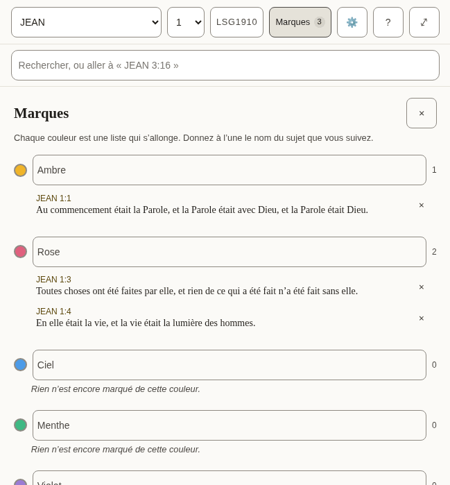

*Three marked verses in two collections.*

- [ ] The colour names are the everyday words for those colours.
- [ ] Every text in the table below is correct and sounds natural.
- [ ] Nothing in the pictures is cut off, overlapping or badly broken across lines.

**The 9 texts of this part**

| Key | English | Français (France) |
|---|---|---|
| `marks.label` | Marked verses | Versets marqués |
| `marks.title` | Marks | Marques |
| `marks.close` | Close marks | Fermer les marques |
| `marks.hint` | Each colour is a running list. Name one for the subject you are tracking. | Chaque couleur est une liste qui s’allonge. Donnez à l’une le nom du sujet que vous suivez. |
| `marks.nameFor` | Name for the amber collection | Nom de la collection ambre |
| `marks.empty` | Nothing marked in this colour yet. | Rien n’est encore marqué de cette couleur. |
| `marks.remove` | Remove the mark on John 1:2 | Retirer la marque de JEAN 1:2 |
| `marks.removed` | Mark removed. Undo is available in the Marks bar. | Marque retirée. Vous pouvez annuler depuis la barre des Marques. |
| `marks.restored` | Mark restored | Marque rétablie |

#### 2.6 Translations, and reading two side by side

Where a Bible is downloaded, read, compared with the one being read, or removed. Each shows its size before it is downloaded.

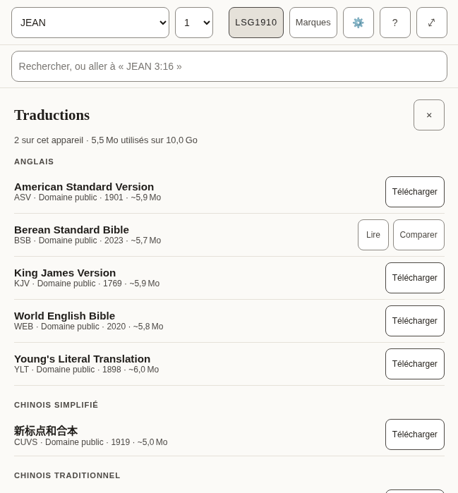

*The list of translations, by language.*

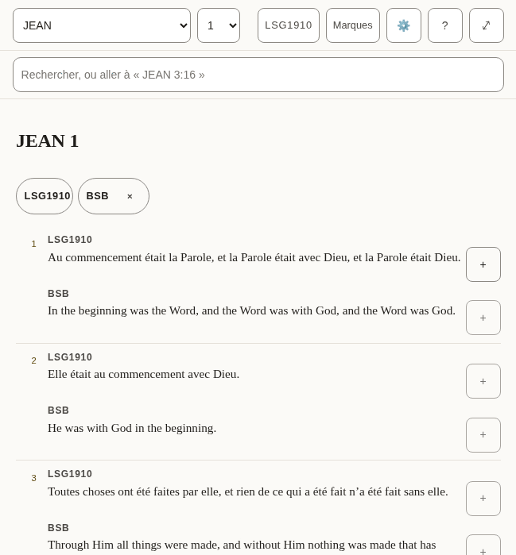

*Two translations, verse by verse.*

- [ ] The language headings are how this language names those languages.
- [ ] The note about what removing a translation does and does not touch is plain.
- [ ] Every text in the table below is correct and sounds natural.
- [ ] Nothing in the pictures is cut off, overlapping or badly broken across lines.

**The 32 texts of this part**

| Key | English | Français (France) |
|---|---|---|
| `library.title` | Translations | Traductions |
| `library.close` | Close translations | Fermer les traductions |
| `library.onDevice` | 2 on this device | 2 sur cet appareil |
| `library.used` | 11.8 MB of 1.9 GB used | 11,8 Mo utilisés sur 1,9 Go |
| `library.about` | about 5.4 MB | environ 5,4 Mo |
| `library.licences.public-domain` | Public domain | Domaine public |
| `library.licences.cc-by-4.0` | CC BY 4.0 | CC BY 4.0 |
| `library.licences.cc-by-sa-4.0` | CC BY-SA 4.0 | CC BY-SA 4.0 |
| `library.licences.cc0` | CC0 | CC0 |
| `library.licences.custom-free` | Free licence | Licence libre |
| `library.reading` | Reading | En lecture |
| `library.comparing` | Comparing | En comparaison |
| `library.read` | Read | Lire |
| `library.compare` | Compare | Comparer |
| `library.compareTitle` | Show beside the translation you are reading | Afficher à côté de la traduction que vous lisez |
| `library.downloading` | Downloading Berean Standard Bible | Téléchargement de Louis Segond 1910 |
| `library.download` | Download | Télécharger |
| `library.removeActive` | Remove Berean Standard Bible — switch to another translation first | Retirer Louis Segond 1910 : passez d’abord à une autre traduction |
| `library.removeFromDevice` | Remove Berean Standard Bible from this device | Retirer Louis Segond 1910 de cet appareil |
| `library.note` | A downloaded translation stays on this device and can be read offline. Removing one never touches your notes or marks: both belong to the passage, not to a translation. | Une traduction téléchargée reste sur cet appareil et peut être lue hors ligne. En retirer une ne touche jamais à vos notes ni à vos marques : elles appartiennent au passage, pas à une traduction. |
| `library.progress` | Berean Standard Bible: 50% downloaded | Louis Segond 1910 : 50 % téléchargés |
| `library.downloaded` | Berean Standard Bible downloaded | Louis Segond 1910 téléchargée |
| `library.failed` | Berean Standard Bible: No connection — try again when you are online. | Louis Segond 1910 : Pas de connexion. Réessayez quand vous serez en ligne. |
| `library.failedOnline` | The download did not finish. Try again later. | Le téléchargement n’a pas abouti. Réessayez plus tard. |
| `library.offline` | No connection — try again when you are online. | Pas de connexion. Réessayez quand vous serez en ligne. |
| `compare.label` | Translations side by side | Traductions côte à côte |
| `compare.compared` | Translations compared | Traductions comparées |
| `compare.stop` | Stop comparing KJV | Arrêter de comparer BSB |
| `compare.verse` | Verse | Verset |
| `compare.verseBefore` | Verse␣ | Verset␣ |
| `compare.missing` | Not in KJV | Absent de BSB |
| `compare.quote` | Quote KJV verse 16 | Citer le verset 16 de BSB |

#### 2.7 Settings

How the text looks, the interface language, where the reader’s work is kept, and whether an assistant may help.

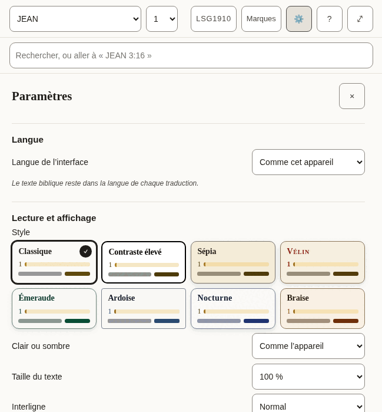

*The top of Settings.*

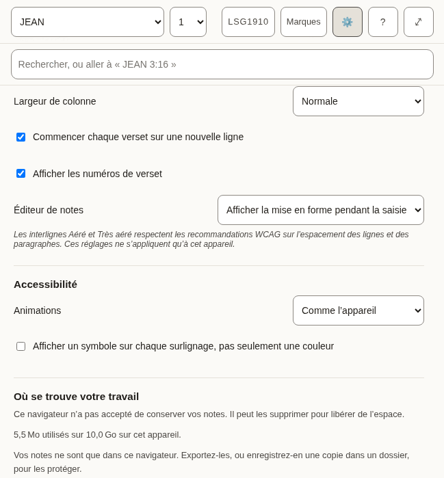

*Further down.*

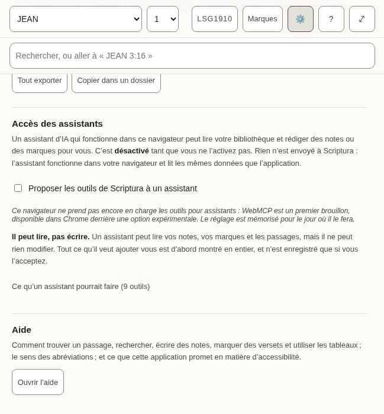

*The end.*

- [ ] Each label and the choices under it read as one thought.
- [ ] The style names are evocative, not literal (Vellum, Emerald, Nocturne): they should sound like names, not descriptions.
- [ ] The explanations in smaller type are complete sentences and easy to follow.
- [ ] Every text in the table below is correct and sounds natural.
- [ ] Nothing in the pictures is cut off, overlapping or badly broken across lines.

**The 66 texts of this part**

| Key | English | Français (France) |
|---|---|---|
| `settings.title` | Settings | Paramètres |
| `settings.close` | Close settings | Fermer les paramètres |
| `settings.display` | Reading &amp; display | Lecture et affichage |
| `settings.style` | Style | Style |
| `settings.styles.classic` | Classic | Classique |
| `settings.styles.contrast` | High contrast | Contraste élevé |
| `settings.styles.sepia` | Sepia | Sépia |
| `settings.styles.vellum` | Vellum | Vélin |
| `settings.styles.emerald` | Emerald | Émeraude |
| `settings.styles.slate` | Slate | Ardoise |
| `settings.styles.nocturne` | Nocturne | Nocturne |
| `settings.styles.ember` | Ember | Braise |
| `settings.appearance` | Light or dark | Clair ou sombre |
| `settings.appearances.system` | Follow the device | Comme l’appareil |
| `settings.appearances.light` | Light | Clair |
| `settings.appearances.dark` | Dark | Sombre |
| `settings.textSize` | Text size | Taille du texte |
| `settings.spacing` | Line spacing | Interligne |
| `settings.spacings.normal` | Normal | Normal |
| `settings.spacings.relaxed` | Relaxed | Aéré |
| `settings.spacings.loose` | Loose | Très aéré |
| `settings.measure` | Column width | Largeur de colonne |
| `settings.measures.narrow` | Narrow | Étroite |
| `settings.measures.normal` | Normal | Normale |
| `settings.measures.wide` | Wide | Large |
| `settings.measures.full` | Full | Pleine |
| `settings.editor` | Note editor | Éditeur de notes |
| `settings.editors.live` | Show formatting as you write | Afficher la mise en forme pendant la saisie |
| `settings.editors.plain` | Plain text | Texte brut |
| `settings.displayNote` | Relaxed and Loose spacing meet the WCAG guidance for line and paragraph spacing. These settings apply to this device only. | Les interlignes Aéré et Très aéré respectent les recommandations WCAG sur l’espacement des lignes et des paragraphes. Ces réglages ne s’appliquent qu’à cet appareil. |
| `settings.accessibility` | Accessibility | Accessibilité |
| `settings.motion` | Motion | Animations |
| `settings.motions.system` | Follow the device | Comme l’appareil |
| `settings.motions.reduce` | Reduce motion | Réduire les animations |
| `settings.markers` | Show a symbol on every highlight, not only a colour | Afficher un symbole sur chaque surlignage, pas seulement une couleur |
| `settings.verseLines` | Start each verse on a new line | Commencer chaque verset sur une nouvelle ligne |
| `settings.verseNumbers` | Show verse numbers | Afficher les numéros de verset |
| `settings.recedeMenus` | On a small screen, hide the menus while reading | Sur un petit écran, masquer les menus pendant la lecture |
| `settings.storage` | Where your work lives | Où se trouve votre travail |
| `settings.persistence.persisted` | This browser has agreed to keep your notes. Clearing site data still removes them. | Ce navigateur a accepté de conserver vos notes. Effacer les données du site les supprime tout de même. |
| `settings.persistence.denied` | This browser has not agreed to keep your notes. It may delete them to free up space. | Ce navigateur n’a pas accepté de conserver vos notes. Il peut les supprimer pour libérer de l’espace. |
| `settings.persistence.unsupported` | This browser will not say whether it keeps your notes. Assume it may delete them. | Ce navigateur n’indique pas s’il conserve vos notes. Partez du principe qu’il peut les supprimer. |
| `settings.persistence.unknown` | Checking… | Vérification… |
| `settings.usedOnDevice` | 11.8 MB of 1.9 GB used on this device. | 11,8 Mo utilisés sur 1,9 Go sur cet appareil. |
| `settings.mirrored` | Your notes are also saved to a folder you chose. | Vos notes sont aussi enregistrées dans un dossier que vous avez choisi. |
| `settings.notMirrored` | Your notes live only in this browser. Export them, or save a copy to a folder, to keep them safe. | Vos notes ne sont que dans ce navigateur. Exportez-les, ou enregistrez-en une copie dans un dossier, pour les protéger. |
| `settings.exportAll` | Export everything | Tout exporter |
| `settings.anotherFolder` | Choose another folder | Choisir un autre dossier |
| `settings.mirror` | Mirror to a folder | Copier dans un dossier |
| `settings.assistant` | Assistant access | Accès des assistants |
| `settings.assistantIntro` | An AI assistant running in this browser can read your library and draft notes or marks for you. This is **off** until you turn it on. Nothing is sent to Scriptura: the assistant runs in your browser and reads the same data the app does. | Un assistant d’IA qui fonctionne dans ce navigateur peut lire votre bibliothèque et rédiger des notes ou des marques pour vous. C’est **désactivé** tant que vous ne l’activez pas. Rien n’est envoyé à Scriptura : l’assistant fonctionne dans votre navigateur et lit les mêmes données que l’application. |
| `settings.assistantToggle` | Offer Scriptura’s tools to an assistant | Proposer les outils de Scriptura à un assistant |
| `settings.assistantSupported` | This browser supports assistant tools. | Ce navigateur prend en charge les outils pour assistants. |
| `settings.assistantUnsupported` | This browser does not support assistant tools yet — WebMCP is an early draft, available in Chrome behind a flag. The switch is remembered for when it does. | Ce navigateur ne prend pas encore en charge les outils pour assistants : WebMCP est un premier brouillon, disponible dans Chrome derrière une option expérimentale. Le réglage est mémorisé pour le jour où il le fera. |
| `settings.assistantReadOnly` | **It can read, not write.** An assistant can read your notes, marks and passages, but it cannot change anything. Anything it wants to add is shown to you in full first, and is saved only when you accept it. | **Il peut lire, pas écrire.** Un assistant peut lire vos notes, vos marques et les passages, mais il ne peut rien modifier. Tout ce qu’il veut ajouter vous est d’abord montré en entier, et n’est enregistré que si vous l’acceptez. |
| `settings.assistantTools` | What an assistant would be able to do (9 tools) | Ce qu’un assistant pourrait faire (9 outils) |
| `settings.toolReads` | reads | lecture |
| `settings.toolNeedsApproval` | needs your approval | votre accord est nécessaire |
| `settings.toolsInEnglish` Shown only in the other languages, beside the tool descriptions, which stay English. | The descriptions are in English, as the assistant reads them. | Les descriptions sont en anglais, telles que l’assistant les lit. |
| `settings.help` | Help | Aide |
| `settings.helpIntro` | How to find a passage, search, write notes, mark verses and use boards; what the abbreviations mean; and what this app promises about accessibility. | Comment trouver un passage, rechercher, écrire des notes, marquer des versets et utiliser les tableaux ; le sens des abréviations ; et ce que cette application promet en matière d’accessibilité. |
| `settings.openHelp` | Open help | Ouvrir l’aide |
| `settings.language` | Language | Langue |
| `settings.languageLabel` | Interface language | Langue de l’interface |
| `settings.languageSystem` | Match this device | Comme cet appareil |
| `settings.languageNote` | Bible text stays in the language of each translation. | Le texte biblique reste dans la langue de chaque traduction. |

#### 2.8 Help

The longest text in the app, and the one a reader turns to when stuck. It includes a list of terms and abbreviations, and a statement about accessibility.

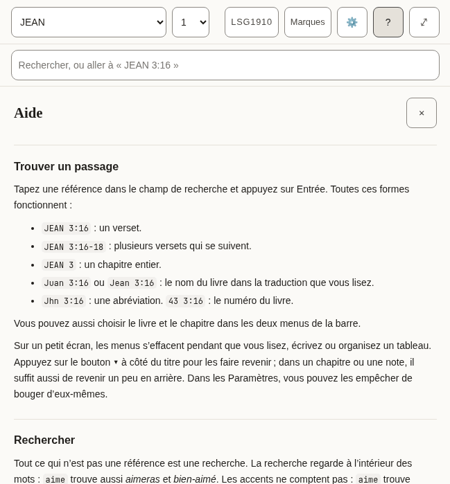

*The top of Help.*

- [ ] It reads well from start to finish as an explanation, not as a list of translated sentences.
- [ ] The examples of references are ones that work in a Bible in this language.
- [ ] The names of keys (Enter, Shift, Escape) are how this language’s keyboards and manuals name them.
- [ ] Every text in the table below is correct and sounds natural.
- [ ] Nothing in the pictures is cut off, overlapping or badly broken across lines.

**The 76 texts of this part**

| Key | English | Français (France) |
|---|---|---|
| `help.title` | Help | Aide |
| `help.close` | Close help | Fermer l’aide |
| `help.sections.finding.heading` | Finding a passage | Trouver un passage |
| `help.sections.finding.blocks.1.p` | Type a reference in the search box and press Enter. All of these work: | Tapez une référence dans le champ de recherche et appuyez sur Entrée. Toutes ces formes fonctionnent : |
| `help.sections.finding.blocks.2.ul.1` | `John 3:16` — one verse. | `JEAN 3:16` : un verset. |
| `help.sections.finding.blocks.2.ul.2` | `John 3:16-18` — a range of verses. | `JEAN 3:16-18` : plusieurs versets qui se suivent. |
| `help.sections.finding.blocks.2.ul.3` | `John 3` — a whole chapter. | `JEAN 3` : un chapitre entier. |
| `help.sections.finding.blocks.2.ul.4` | `Juan 3:16` or `Jean 3:16` — the book name in the translation you are reading. | `Juan 3:16` ou `Jean 3:16` : le nom du livre dans la traduction que vous lisez. |
| `help.sections.finding.blocks.2.ul.5` | `Jhn 3:16` — an abbreviation. `43 3:16` — the book number. | `Jhn 3:16` : une abréviation. `43 3:16` : le numéro du livre. |
| `help.sections.finding.blocks.3.p` | You can also pick the book and chapter from the two menus in the bar. | Vous pouvez aussi choisir le livre et le chapitre dans les deux menus de la barre. |
| `help.sections.finding.blocks.4.p` | On a small screen the menus step aside while you read, write or arrange a board. Press the **▾** button beside the title to bring them back; in a chapter or a note, scrolling back a little does the same. In Settings you can stop them moving by themselves. | Sur un petit écran, les menus s’effacent pendant que vous lisez, écrivez ou organisez un tableau. Appuyez sur le bouton **▾** à côté du titre pour les faire revenir ; dans un chapitre ou une note, il suffit aussi de revenir un peu en arrière. Dans les Paramètres, vous pouvez les empêcher de bouger d’eux-mêmes. |
| `help.sections.searching.heading` | Searching | Rechercher |
| `help.sections.searching.blocks.1.p` | Anything that is not a reference is a search. Search looks inside words, so `love` also finds *loveth* and *beloved*. Accents do not matter: `amo` finds *amó*. | Tout ce qui n’est pas une référence est une recherche. La recherche regarde à l’intérieur des mots : `aime` trouve aussi *aimeras* et *bien-aimé*. Les accents ne comptent pas : `aime` trouve *aimé*. |
| `help.sections.searching.blocks.2.ul.1` | Put a phrase in quotes to find it exactly: `"in the beginning"`. | Mettez une expression entre guillemets pour la trouver telle quelle : `"au commencement"`. |
| `help.sections.searching.blocks.2.ul.2` | Put a minus sign before a word to leave verses with it out: `God -love`. | Mettez un signe moins devant un mot pour écarter les versets qui le contiennent : `Dieu -amour`. |
| `help.sections.searching.blocks.2.ul.3` | **Whole words only** stops the search looking inside longer words. | **Mots entiers uniquement** empêche la recherche de regarder à l’intérieur de mots plus longs. |
| `help.sections.searching.blocks.2.ul.4` | **Match case** makes capital letters matter. | **Respecter la casse** tient compte des majuscules. |
| `help.sections.searching.blocks.3.p` | The first results are verses where your word stands alone; verses where it sits inside a longer word come after a line that says so. Press Enter on a search to see every match, counted by book. | Les premiers résultats sont les versets où votre mot est seul ; ceux où il se trouve à l’intérieur d’un mot plus long viennent après une ligne qui l’indique. Appuyez sur Entrée dans une recherche pour voir tous les résultats, comptés par livre. |
| `help.sections.notes.heading` | Notes | Notes |
| `help.sections.notes.blocks.1.p` | Notes are plain text with Markdown. Formatting takes shape as you write, and its symbols come back on the line you are editing; to see only the Markdown, choose **Plain text** under Note editor in Settings. The toolbar above the note adds headings, bold, italic, lists and quotes; press a tool again to take the formatting off. With Plain text, **Preview** shows the note as it will read. | Les notes sont du texte simple en Markdown. La mise en forme apparaît pendant la saisie, et ses symboles reviennent sur la ligne en cours de modification ; pour ne voir que le Markdown, choisissez **Texte brut** dans Éditeur de notes, dans les Paramètres. La barre au-dessus de la note ajoute des titres, du gras, de l’italique, des listes et des citations ; appuyez de nouveau sur un outil pour retirer la mise en forme. En Texte brut, **Aperçu** montre la note telle qu’elle se lira. |
| `help.sections.notes.blocks.2.p` | A link to a passage looks like `[[john 3:16]]`. Add `@kjv` to say which translation: `[[john 3:16@kjv]]`. Put the cursor inside a link and a **Go to** button opens it. **Quote** beside a verse copies the verse into your note with its reference and a link. | Un lien vers un passage s’écrit `[[john 3:16]]`. Ajoutez `@lsg1910` pour préciser la traduction : `[[john 3:16@lsg1910]]`. Placez le curseur dans un lien et un bouton **Aller à** l’ouvre. **Citer**, à côté d’un verset, copie le verset dans votre note avec sa référence et un lien. |
| `help.sections.notes.blocks.3.p` | Notes are saved on this device as you type. **Export** downloads every note and board as text files in a zip. | Les notes sont enregistrées sur cet appareil pendant que vous écrivez. **Exporter** télécharge toutes les notes et tous les tableaux sous forme de fichiers texte dans une archive zip. |
| `help.sections.marks.heading` | Marks | Marques |
| `help.sections.marks.blocks.1.p` | Press a verse, or its number, to mark it in one of five colours. Each colour is a collection: name it for the subject you are following, and the **Marks** panel lists its verses in Bible order. Marks follow the passage, not the translation, so a mark made in one translation shows in all of them. | Appuyez sur un verset, ou sur son numéro, pour le marquer d’une des cinq couleurs. Chaque couleur est une collection : donnez-lui le nom du sujet que vous suivez, et le panneau **Marques** en liste les versets dans l’ordre de la Bible. Les marques suivent le passage, pas la traduction : une marque faite dans une traduction apparaît dans toutes. |
| `help.sections.marks.blocks.2.p` | Press more verses to act on several at once, and press one again to leave it out. With verses apart selected, **Select** in the row of actions takes in every verse between them; holding <kbd>Shift</kbd> while you press a verse does the same. **Quote** then writes them into your note as one passage under one reference. | Appuyez sur d’autres versets pour agir sur plusieurs à la fois, et appuyez de nouveau sur l’un d’eux pour l’écarter. Quand des versets éloignés sont sélectionnés, **Sélectionner** dans la rangée d’actions prend tous les versets qui les séparent ; maintenir <kbd>Maj</kbd> en appuyant sur un verset fait de même. **Citer** les écrit alors dans votre note comme un seul passage, sous une seule référence. |
| `help.sections.marks.blocks.3.p` | In Settings you can add a symbol to every mark, so colour is not the only sign. | Dans les Paramètres, vous pouvez ajouter un symbole à chaque marque, pour que la couleur ne soit pas le seul signe. |
| `help.sections.marks.blocks.4.p` | In Settings you can also run the verses together as one text and hide their numbers. Pressing a sentence still picks the verse it belongs to. | Dans les Paramètres, vous pouvez aussi lire les versets à la suite, comme un seul texte, et masquer leurs numéros. Appuyer sur une phrase choisit toujours le verset auquel elle appartient. |
| `help.sections.boards.heading` | Boards | Tableaux |
| `help.sections.boards.blocks.1.p` | A board lays verses and notes out as cards you can move and join with arrows. **Canvas** beside a verse puts it on the current board. Cards hold a reference, not a copy of the text, so they show the translation you are reading. Give a board a name in the box beside the board menu. | Un tableau dispose des versets et des notes sous forme de fiches que vous pouvez déplacer et relier par des flèches. **Au tableau**, à côté d’un verset, le place sur le tableau en cours. Les fiches gardent une référence, pas une copie du texte : elles affichent la traduction que vous lisez. Donnez un nom au tableau dans le champ à côté du menu des tableaux. |
| `help.sections.boards.blocks.2.p` | To move or resize a card without dragging, use its **✥** button; to colour it, its colour button. The arrow buttons beside the zoom move the view. **Connections**, in the board's bar, lists every arrow in words and removes one. Removing a card asks first, and removing a card or a connection can be undone until you change something else. | Pour déplacer ou redimensionner une fiche sans la faire glisser, utilisez son bouton **✥** ; pour la colorer, son bouton de couleur. Les boutons fléchés à côté du zoom déplacent la vue. **Connexions**, dans la barre du tableau, décrit chaque flèche en toutes lettres et permet d’en retirer une. Retirer une fiche demande confirmation, et le retrait d’une fiche ou d’une connexion peut être annulé tant que vous ne modifiez rien d’autre. |
| `help.sections.translations.heading` | Translations | Traductions |
| `help.sections.translations.blocks.1.p` | The library lists every translation, grouped by language, with its size. Download one to read it offline; **Compare** shows it beside the one you are reading, verse by verse. Removing a translation never touches your notes or marks. | La bibliothèque présente toutes les traductions, regroupées par langue, avec leur taille. Téléchargez-en une pour la lire hors ligne ; **Comparer** l’affiche à côté de celle que vous lisez, verset par verset. Retirer une traduction ne touche jamais à vos notes ni à vos marques. |
| `help.sections.keyboard.heading` | Keyboard | Clavier |
| `help.sections.keyboard.blocks.1.ul.1` | <kbd>Tab</kbd> and <kbd>Shift</kbd>+<kbd>Tab</kbd> move between controls. The first press offers to skip to the text or the notes. | <kbd>Tab</kbd> et <kbd>Maj</kbd>+<kbd>Tab</kbd> passent d’une commande à l’autre. La première pression propose d’aller directement au texte ou aux notes. |
| `help.sections.keyboard.blocks.1.ul.2` | <kbd>Escape</kbd> closes whatever opened last: a panel, the verse actions, the search suggestions. | <kbd>Échap</kbd> ferme ce qui a été ouvert en dernier : un panneau, les actions d’un verset, les suggestions de recherche. |
| `help.sections.keyboard.blocks.1.ul.3` | <kbd>Enter</kbd> on a verse number selects it and opens the actions; the arrow keys move along them. <kbd>Enter</kbd> on another number adds that verse, and <kbd>Shift</kbd>+<kbd>Enter</kbd> takes in every verse up to it. | <kbd>Entrée</kbd> sur le numéro d’un verset le sélectionne et ouvre les actions ; les flèches passent de l’une à l’autre. <kbd>Entrée</kbd> sur un autre numéro ajoute ce verset, et <kbd>Maj</kbd>+<kbd>Entrée</kbd> prend tous les versets jusqu’à lui. |
| `help.sections.keyboard.blocks.1.ul.4` | On the divider between the panes, the arrow keys, <kbd>Home</kbd> and <kbd>End</kbd> resize; the two small buttons do the same. | Sur le séparateur entre les panneaux, les flèches, <kbd>Début</kbd> et <kbd>Fin</kbd> changent la largeur ; les deux petits boutons font de même. |
| `help.sections.keyboard.blocks.1.ul.5` | In a note, <kbd>Shift</kbd>+<kbd>Tab</kbd> reaches the formatting tools; the arrow keys move between them. | Dans une note, <kbd>Maj</kbd>+<kbd>Tab</kbd> atteint les outils de mise en forme ; les flèches passent de l’un à l’autre. |
| `help.sections.keyboard.blocks.1.ul.6` | On a board, cards take focus: the arrow keys move a card, <kbd>Alt</kbd> with an arrow resizes it, and <kbd>Delete</kbd> asks to remove it. With the board itself focused, the arrow keys move the view and <kbd>+</kbd> and <kbd>−</kbd> zoom. | Sur un tableau, les fiches prennent le focus : les flèches déplacent une fiche, <kbd>Alt</kbd> avec une flèche la redimensionne, et <kbd>Suppr</kbd> propose de la retirer. Quand le tableau lui-même a le focus, les flèches déplacent la vue et <kbd>+</kbd> et <kbd>−</kbd> zooment. |
| `help.abbreviations` | Abbreviations | Abréviations |
| `help.abbreviationsCaption` | What each abbreviation means | Ce que signifie chaque abréviation |
| `help.short` | Short | Abréviation |
| `help.meaning` | Meaning | Signification |
| `help.terms.1.1` | CC BY-SA 4.0 | CC BY-SA 4.0 |
| `help.terms.1.2` | Creative Commons Attribution–ShareAlike 4.0: a free licence that asks you to credit the source and share changes under the same terms. | Creative Commons Attribution – Partage dans les mêmes conditions 4.0 : une licence libre qui demande de citer la source et de partager les modifications aux mêmes conditions. |
| `help.terms.2.1` | CC0 | CC0 |
| `help.terms.2.2` | Creative Commons Zero: the author has waived all rights; the text is free to use. | Creative Commons Zéro : l’auteur a renoncé à tous ses droits ; le texte est libre d’utilisation. |
| `help.terms.3.1` | OT | OT |
| `help.terms.3.2` | Old Testament. | Ancien Testament (en anglais, Old Testament). |
| `help.terms.4.1` | NT | NT |
| `help.terms.4.2` | New Testament. | Nouveau Testament. |
| `help.terms.5.1` | PWA | PWA |
| `help.terms.5.2` | Progressive web app: a website you can install and use offline. | Application web progressive : un site web que l’on peut installer et utiliser hors ligne. |
| `help.terms.6.1` | WCAG | WCAG |
| `help.terms.6.2` | Web Content Accessibility Guidelines, the standard this app is measured against. | Règles pour l’accessibilité des contenus web, la norme selon laquelle cette application est évaluée. |
| `help.glossaryHeading` | Words used here | Mots employés ici |
| `help.glossary.1.1` | Collection | Collection |
| `help.glossary.1.2` | Every verse you mark in one colour. Name a colour for the subject you are following, and the Marks panel lists those verses in Bible order. | Tous les versets que vous marquez d’une couleur. Donnez à une couleur le nom du sujet que vous suivez, et le panneau Marques liste ces versets dans l’ordre de la Bible. |
| `help.glossary.2.1` | Board | Tableau |
| `help.glossary.2.2` | A space where verses and notes are laid out as cards and joined with arrows. Boards are saved and exported with your notes. | Un espace où versets et notes sont disposés en fiches reliées par des flèches. Les tableaux sont enregistrés et exportés avec vos notes. |
| `help.glossary.3.1` | Card | Fiche |
| `help.glossary.3.2` | One item on a board: a verse, a note, or text you typed. A verse card shows the verse from whichever translation you are reading. | Un élément d’un tableau : un verset, une note ou un texte que vous avez tapé. Une fiche de verset affiche le verset dans la traduction que vous lisez. |
| `help.glossary.4.1` | Translation | Traduction |
| `help.glossary.4.2` | One version of the Bible, in one language. Every translation here is free to copy. | Une version de la Bible, dans une langue. Toutes les traductions proposées ici peuvent être copiées librement. |
| `help.glossary.5.1` | Whole words only | Mots entiers uniquement |
| `help.glossary.5.2` | A search option. With it on, "love" finds love but not loveth. With it off, it finds both. | Une option de recherche. Activée, « amour » trouve amour mais pas amours. Désactivée, elle trouve les deux. |
| `help.glossary.6.1` | Match case | Respecter la casse |
| `help.glossary.6.2` | A search option. With it on, "God" and "god" are different. | Une option de recherche. Activée, « Dieu » et « dieu » sont différents. |
| `help.glossary.7.1` | Mirror to a folder | Copier dans un dossier |
| `help.glossary.7.2` | Keep a copy of your notes as text files in a folder on this computer, updated as you write. Works in Chrome and Edge. | Garder une copie de vos notes en fichiers texte dans un dossier de cet ordinateur, mise à jour pendant que vous écrivez. Fonctionne dans Chrome et Edge. |
| `help.glossary.8.1` | Assistant tools | Outils pour assistants |
| `help.glossary.8.2` | A way for an AI assistant running in your browser to read your library and suggest notes or marks. Off unless you turn it on; nothing is saved without your approval. | Un moyen pour un assistant d’IA fonctionnant dans votre navigateur de lire votre bibliothèque et de proposer des notes ou des marques. Désactivé sauf si vous l’activez ; rien n’est enregistré sans votre accord. |
| `help.accessibilityHeading` | Accessibility | Accessibilité |
| `help.accessibility.1` | This app aims to meet the Web Content Accessibility Guidelines 2.2 at Level AAA for everything the app itself shows: its controls, its text, its colours and its behaviour. Every control can be reached by keyboard, is at least 44 by 44 pixels, shows where focus is, and has a name. Text is at least 7:1 against its background in every colour theme, and you can change the size, spacing and colours in Settings. | Cette application vise le niveau AAA des Règles pour l’accessibilité des contenus web (WCAG) 2.2 pour tout ce qu’elle affiche elle-même : ses commandes, son texte, ses couleurs et son comportement. Chaque commande est accessible au clavier, mesure au moins 44 pixels sur 44, montre où se trouve le focus et porte un nom. Le texte a un contraste d’au moins 7:1 avec son fond dans tous les thèmes de couleur, et vous pouvez changer la taille, l’espacement et les couleurs dans les Paramètres. |
| `help.accessibility.2` | Two things are outside that promise. The Bible text is shown as it was published: how hard it is to read, and how its words are said, belong to each translation, not to this app. The same is true of what you write in your notes. | Deux choses échappent à cette promesse. Le texte biblique est affiché tel qu’il a été publié : sa difficulté de lecture et la prononciation de ses mots relèvent de chaque traduction, pas de cette application. Il en va de même pour ce que vous écrivez dans vos notes. |
| `help.accessibility.3` | What is checked by machine is checked on every change. What needs a person — a screen reader on a phone, the app under a Windows contrast theme — is checked by hand, less often. If something does not work for you, please report it at the project's issue tracker on GitHub (`AlanRoman117/scriptura`). | Ce qu’une machine peut vérifier est vérifié à chaque modification. Ce qui demande une personne, comme un lecteur d’écran sur un téléphone ou l’application sous un thème de contraste Windows, est vérifié à la main, moins souvent. Si quelque chose ne fonctionne pas pour vous, signalez-le dans le suivi des problèmes du projet sur GitHub (`AlanRoman117/scriptura`). |

### Met less often

Boards, the questions asked before something is deleted, and the notices. Many of these texts are spoken by a screen reader and never shown.

#### 2.9 Boards (the canvas)

A surface where verses and notes are laid out as cards and joined with arrows. Most of its texts are the names of buttons, heard by a screen reader.

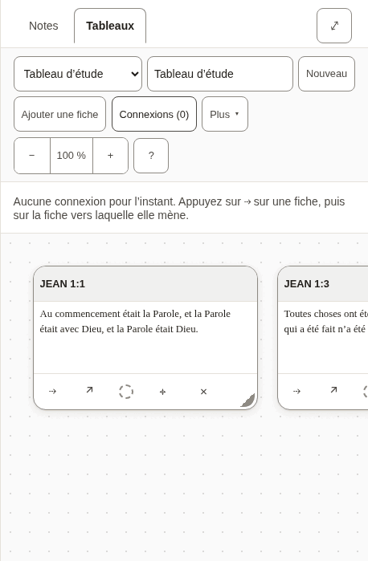

*Two verses on a board, with the list of connections open.*

- [ ] The words for a board, a card and a connection are used the same way here as everywhere else.
- [ ] Every text in the table below is correct and sounds natural.
- [ ] Nothing in the pictures is cut off, overlapping or badly broken across lines.

**The 93 texts of this part**

| Key | English | Français (France) |
|---|---|---|
| `canvas.new` A new board. | New | Nouveau |
| `canvas.more` Beside the Bible, the button the less-used board actions fold behind. | More | Plus |
| `canvas.startOne` | Start one | En créer un |
| `canvas.label` | Boards | Tableaux |
| `canvas.heading` | Board: John 1 | Tableau : JEAN 1 |
| `canvas.noneOpenHeading` | none open | aucun ouvert |
| `canvas.picker` | Board | Tableau |
| `canvas.showMenus` | Show the board menus | Afficher les menus du tableau |
| `canvas.hideMenus` | Hide the board menus | Masquer les menus du tableau |
| `canvas.name` | Board name | Nom du tableau |
| `canvas.none` | No boards yet | Aucun tableau pour l’instant |
| `canvas.undo` | Undo: put back John 1:1 Undo: put back the connection John 1:1 → John 1:14 | Annuler : remettre la fiche JEAN 1:1 Annuler : remettre la connexion JEAN 1:1 → JEAN 1:14 |
| `canvas.putBack` | John 1:1 put back The connection John 1:1 → John 1:14 put back | Fiche remise : JEAN 1:1 Connexion remise : JEAN 1:1 → JEAN 1:14 |
| `canvas.removed` | John 1:1 removed. Undo is in the board's bar. The connection John 1:1 → John 1:14 removed. Undo is in the board's bar. | Fiche retirée : JEAN 1:1. Vous pouvez annuler depuis la barre du tableau. Connexion retirée : JEAN 1:1 → JEAN 1:14. Vous pouvez annuler depuis la barre du tableau. |
| `canvas.addCard` | Add card | Ajouter une fiche |
| `canvas.addNote` | Add note | Ajouter une note |
| `canvas.addNoteName` | Add note — put the newest note on the board | Ajouter une note : placer la note la plus récente sur le tableau |
| `canvas.addNoteNoNotes` | Add note — write a note first | Ajouter une note : écrivez d’abord une note |
| `canvas.toNote` | Add to note | Ajouter à la note |
| `canvas.toNoteName` | Add to note — put this board into the note you have open | Ajouter à la note : placer ce tableau dans la note ouverte |
| `canvas.connections` | Connections (2) | Connexions (2) |
| `canvas.connectionsLabel` | Connections | Connexions |
| `canvas.deleteBoard` | Delete board | Supprimer le tableau |
| `canvas.zoom` | Zoom | Zoom |
| `canvas.zoomOut` | Zoom out | Zoom arrière |
| `canvas.zoomIn` | Zoom in | Zoom avant |
| `canvas.zoomReset` | Zoom 120%. Reset to full size, showing your cards | Zoom 120 %. Revenir à la taille réelle, en montrant vos fiches |
| `canvas.moveView` | Move the view | Déplacer la vue |
| `canvas.viewLeft` | Move the view left | Déplacer la vue vers la gauche |
| `canvas.viewUp` | Move the view up | Déplacer la vue vers le haut |
| `canvas.viewDown` | Move the view down | Déplacer la vue vers le bas |
| `canvas.viewRight` | Move the view right | Déplacer la vue vers la droite |
| `canvas.help` | Help — boards, keyboard, and what the abbreviations mean | Aide : tableaux, clavier et sens des abréviations |
| `canvas.noConnections` | No connections yet. Press ⇢ on a card, then the card it leads to. | Aucune connexion pour l’instant. Appuyez sur ⇢ sur une fiche, puis sur la fiche vers laquelle elle mène. |
| `canvas.removeConnection` | Remove the connection John 1:1 → John 1:14 | Retirer la connexion JEAN 1:1 → JEAN 1:14 |
| `canvas.missingCard` | a missing card | une fiche disparue |
| `canvas.edge` | John 1:1 → John 1:14 | JEAN 1:1 → JEAN 1:14 |
| `canvas.frame` | Board canvas, 1 card Board canvas, 4 cards | Surface du tableau, 1 fiche Surface du tableau, 4 fiches |
| `canvas.frameHint` | Arrow keys move the view; plus and minus zoom. Each card takes focus: arrow keys move it, and Alt with an arrow resizes it. | Les flèches déplacent la vue ; plus et moins zooment. Chaque fiche prend le focus : les flèches la déplacent, et Alt avec une flèche la redimensionne. |
| `canvas.verseCard` | Verse card | Fiche de verset |
| `canvas.noteCard` | Note card | Fiche de note |
| `canvas.card` | Card | Fiche |
| `canvas.cardName` | Verse card: John 1:1, Amber (amber) Verse card: John 1:1 | Fiche de verset : JEAN 1:1, Ambre (ambre) Fiche de verset : JEAN 1:1 |
| `canvas.colourName` | Amber (amber) | Ambre (ambre) |
| `canvas.cardTitle` | Card title | Titre de la fiche |
| `canvas.cardTitlePlaceholder` | Card | Fiche |
| `canvas.cardText` | Card text | Texte de la fiche |
| `canvas.cardTextPlaceholder` | Write here… | Écrivez ici… |
| `canvas.cardBody` | John 1:1 — text | JEAN 1:1 : texte |
| `canvas.connect` | Connect John 1:1 to another card | Relier JEAN 1:1 à une autre fiche |
| `canvas.connectPrompt` | Choose the card to connect to: press it, or Enter on it. Escape cancels. | Choisissez la fiche à relier : appuyez dessus, ou sur Entrée. Échap annule. |
| `canvas.connected` | Connected John 1:1 to John 1:14 | Connexion créée : JEAN 1:1 → JEAN 1:14 |
| `canvas.open` | Open John 1:1 in the reader | Ouvrir JEAN 1:1 dans le lecteur |
| `canvas.colour` | Colour: Amber (amber). Change the colour of John 1:1 Colour: none. Change the colour of John 1:1 | Couleur : Ambre (ambre). Changer la couleur de JEAN 1:1 Couleur : aucune. Changer la couleur de JEAN 1:1 |
| `canvas.adjust` | Move or resize John 1:1 without dragging | Déplacer ou redimensionner JEAN 1:1 sans glisser |
| `canvas.takeOff` | Take John 1:1 off the board | Retirer JEAN 1:1 du tableau |
| `canvas.empty` | Nothing on this board yet. Add a card here, or use **Canvas** beside a verse while reading. | Ce tableau est encore vide. Ajoutez une fiche ici, ou utilisez **Au tableau** à côté d’un verset pendant la lecture. |
| `canvas.adjustPanel` | Move and resize John 1:1 | Déplacer et redimensionner JEAN 1:1 |
| `canvas.colourPanel` | Colour of John 1:1 | Couleur de JEAN 1:1 |
| `canvas.adjustTitle` | Move and resize | Déplacer et redimensionner |
| `canvas.colourTitle` | Colour | Couleur |
| `canvas.panelTitle` | Move and resize: John 1:1 | Déplacer et redimensionner : JEAN 1:1 |
| `canvas.move` | Move | Déplacer |
| `canvas.moveLeft` | Move left | Déplacer vers la gauche |
| `canvas.moveUp` | Move up | Déplacer vers le haut |
| `canvas.moveDown` | Move down | Déplacer vers le bas |
| `canvas.moveRight` | Move right | Déplacer vers la droite |
| `canvas.size` | Size | Taille |
| `canvas.narrower` | Narrower | Plus étroite |
| `canvas.wider` | Wider | Plus large |
| `canvas.shorter` | Shorter | Moins haute |
| `canvas.taller` | Taller | Plus haute |
| `canvas.colours` | Colours | Couleurs |
| `canvas.noColour` | No colour | Sans couleur |
| `canvas.moved` | John 1:1: moved to 320, 180 | JEAN 1:1 : déplacée en 320, 180 |
| `canvas.resized` | John 1:1: 280 wide, 180 tall | JEAN 1:1 : 280 de large, 180 de haut |
| `canvas.coloured` | John 1:1: Amber (amber) | JEAN 1:1 : Ambre (ambre) |
| `canvas.uncoloured` | John 1:1: no colour | JEAN 1:1 : sans couleur |
| `canvas.noneOpen` | No board open. | Aucun tableau ouvert. |
| `cards.verseMissing` | Not in this translation. | Absent de cette traduction. |
| `cards.untitledNote` | Untitled note | Note sans titre |
| `cards.untitledBoard` | Untitled board | Tableau sans titre |
| `cards.emptyNote` | Empty note. | Note vide. |
| `cards.deletedNote` | This note has been deleted. | Cette note a été supprimée. |
| `cards.card` | Card | Fiche |
| `cards.emptyBoard` | _Empty board._ | _Tableau vide._ |
| `cards.connections` | Connections | Connexions |
| `cards.missingCard` | (missing card) | (fiche disparue) |
| `embed.scrolls` | Board: John 1, scrolls sideways | Tableau : JEAN 1, défile horizontalement |
| `embed.picture` | Board: John 1, 1 cards Board: John 1, 4 cards | Tableau : JEAN 1, 1 fiche Tableau : JEAN 1, 4 fiches |
| `embed.empty` | This board is empty. | Ce tableau est vide. |
| `embed.missing` | A board was embedded here, but it no longer exists. | Un tableau était intégré ici, mais il n’existe plus. |
| `embed.open` | Open board | Ouvrir le tableau |

#### 2.10 Questions before something is deleted

Deleting a note or a board, or removing a card, a mark or a translation, asks first. The question names what will go, and says whether it can come back.

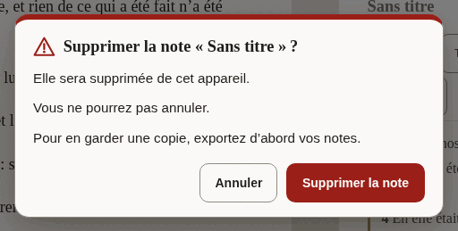

*The question before a note is deleted.*

- [ ] It is unmistakable what will be deleted and that it cannot be undone.
- [ ] The button that deletes says what it deletes.
- [ ] Every text in the table below is correct and sounds natural.
- [ ] Nothing in the pictures is cut off, overlapping or badly broken across lines.

**The 26 texts of this part**

| Key | English | Français (France) |
|---|---|---|
| `confirm.permanent` | You cannot undo this. | Vous ne pourrez pas annuler. |
| `confirm.undoable` | You can undo this until your next change. | Vous pourrez annuler jusqu’à votre prochaine modification. |
| `confirm.note.title` | Delete the note “John 1”? | Supprimer la note « JEAN 1 » ? |
| `confirm.note.gone` | It will be deleted from this device. | Elle sera supprimée de cet appareil. |
| `confirm.note.keepCopy` | To keep a copy, export your notes first. | Pour en garder une copie, exportez d’abord vos notes. |
| `confirm.note.action` | Delete note | Supprimer la note |
| `confirm.note.done` | Deleted the note “John 1” | Note « JEAN 1 » supprimée |
| `confirm.board.title` | Delete the board “John 1”? | Supprimer le tableau « JEAN 1 » ? |
| `confirm.board.cards` | The board and its card will be deleted. The board and its 4 cards will be deleted. | Le tableau et sa fiche seront supprimés. Le tableau et ses 4 fiches seront supprimés. |
| `confirm.board.empty` | The board is empty. | Le tableau est vide. |
| `confirm.board.kept` | Your notes are not changed. | Vos notes ne sont pas modifiées. |
| `confirm.board.action` | Delete board | Supprimer le tableau |
| `confirm.board.done` | Deleted the board “John 1” | Tableau « JEAN 1 » supprimé |
| `confirm.card.title` | Remove John 1:1 from the board? | Retirer JEAN 1:1 du tableau ? |
| `confirm.card.connections` | Its connection is removed too. Its 3 connections are removed too. | Sa connexion sera aussi retirée. Ses 3 connexions seront aussi retirées. |
| `confirm.card.noteKept` | The note itself is not changed. | La note elle-même n’est pas modifiée. |
| `confirm.card.action` | Remove card | Retirer la fiche |
| `confirm.mark.title` | Remove the mark on John 1:2? | Retirer la marque de JEAN 1:2 ? |
| `confirm.mark.leaves` | The verse leaves the collection “Amber”. | Le verset quittera la collection « Ambre ». |
| `confirm.mark.action` | Remove mark | Retirer la marque |
| `confirm.translation.title` | Remove Berean Standard Bible from this device? | Retirer Louis Segond 1910 de cet appareil ? |
| `confirm.translation.frees` | This frees about 5.4 MB. | Environ 5,4 Mo seront libérés. |
| `confirm.translation.kept` | Your notes and marks are not changed. | Vos notes et vos marques ne sont pas modifiées. |
| `confirm.translation.again` | You can download it again when you are online. | Vous pourrez la télécharger de nouveau une fois en ligne. |
| `confirm.translation.action` | Remove translation | Retirer la traduction |
| `confirm.translation.done` | Removed Berean Standard Bible from this device | Traduction Louis Segond 1910 retirée de cet appareil |

#### 2.11 Notices

A line about where the reader’s work is kept, the offer of a newer version, and the notice on this preview.

- [ ] The notice about storage is honest without being alarming.
- [ ] Every text in the table below is correct and sounds natural.

**The 23 texts of this part**

| Key | English | Français (France) |
|---|---|---|
| `durability.label` | Where your notes are kept | Où vos notes sont conservées |
| `durability.denied` | This browser may delete your notes to free up space. Save a copy. | Ce navigateur peut supprimer vos notes pour libérer de l’espace. Enregistrez une copie. |
| `durability.stale` | You have not exported your notes for a while. | Vous n’avez pas exporté vos notes depuis un moment. |
| `durability.local` | Your notes live in this browser only. | Vos notes ne sont que dans ce navigateur. |
| `durability.saveFolder` | Save to a folder | Enregistrer dans un dossier |
| `durability.saveFolderTitle` | Keep a copy as .md files in a folder you choose | Garder une copie en fichiers .md dans un dossier de votre choix |
| `durability.exportNow` | Export now | Exporter maintenant |
| `durability.dismiss` | Dismiss this notice | Fermer cet avis |
| `update.label` | A new version is ready | Une nouvelle version est prête |
| `update.ready` | A new version of Scriptura is ready. | Une nouvelle version de Scriptura est prête. |
| `update.readyAnnounce` | A new version of Scriptura is ready. Reload when it suits you. | Une nouvelle version de Scriptura est prête. Rechargez quand cela vous convient. |
| `update.reload` | Reload | Recharger |
| `update.reloading` | Reloading… | Rechargement… |
| `update.later` | Later | Plus tard |
| `previewBuild.label` | Preview | Préversion |
| `previewBuild.intro` | **Preview.** An early build for the people reviewing its translations. | **Préversion.** Une version anticipée pour les personnes qui relisent ses traductions. |
| `previewBuild.report` | Report a translation correction on GitHub (opens in a new tab) | Signaler une correction de traduction sur GitHub (s’ouvre dans un nouvel onglet) |
| `previewBuild.reportShort` The notice's short link; `newTab` completes its name for a screen reader. | Report a correction | Signaler une correction |
| `previewBuild.newTab` | (on GitHub, opens in a new tab) | (sur GitHub, s’ouvre dans un nouvel onglet) |
| `previewBuild.hide` | Hide | Masquer |
| `previewBuild.heading` | About this preview | À propos de cette préversion |
| `previewBuild.about` | This build is for the people checking the interface in Spanish, French, Japanese, Chinese and Portuguese. Nothing you do here is sent anywhere: your notes and marks stay in this browser. To report a word that is wrong or unclear, use the link below. It opens a short form on GitHub, which needs a free account. | Cette version est destinée aux personnes qui relisent l’interface en espagnol, en français, en japonais, en chinois et en portugais. Rien de ce que vous faites ici n’est envoyé : vos notes et vos marques restent dans ce navigateur. Pour signaler un mot incorrect ou peu clair, utilisez le lien ci-dessous. Il ouvre un court formulaire sur GitHub, qui demande un compte gratuit. |
| `previewBuild.version` | Version: 0.1.0 | Version : 0.1.0 |

#### 2.12 Panes, tabs and the sheet

The names of the two panes, the tabs that choose between notes and a board, and the buttons that resize them. Mostly heard, not seen.

- [ ] Every text in the table below is correct and sounds natural.

**The 20 texts of this part**

| Key | English | Français (France) |
|---|---|---|
| `layout.scripture` | Scripture | Texte biblique |
| `layout.notes` | Notes | Notes |
| `layout.expandNotes` | Expand notes | Agrandir les notes |
| `layout.collapseNotes` | Collapse notes | Réduire les notes |
| `layout.gripWithNews` | Expand notes, Quoted John 1:3-5 | Agrandir les notes. Citation de JEAN 1:3-5 ajoutée |
| `layout.sheetHint` | Drag, or use the up and down arrow keys, to make the notes taller or shorter. | Faites glisser, ou utilisez les flèches haut et bas, pour agrandir ou réduire les notes. |
| `layout.notesMoreRoom` | Give the notes more room | Donner plus de place aux notes |
| `layout.bibleMoreRoom` | Give the Bible more room | Donner plus de place à la Bible |
| `layout.resize` | Resize panes | Redimensionner les panneaux |
| `layout.split` Both shares arrive formatted as percentages. | 56% Bible, 44% notes | Bible 56 %, notes 44 % |
| `layout.showNotes` | Show notes | Afficher les notes |
| `layout.paneBible` | Bible | la Bible |
| `layout.paneNotes` | Notes | les notes |
| `layout.sides` The side pane holds the notes or the canvas; these name the switch and the canvas side. | Notes or canvas | Notes ou tableaux |
| `layout.paneBoard` | Canvas | les tableaux |
| `layout.expandBoard` | Expand canvas | Agrandir les tableaux |
| `layout.collapseBoard` | Collapse canvas | Réduire les tableaux |
| `layout.showBoard` | Show canvas | Afficher les tableaux |
| `layout.maximize` | Maximize Bible | Agrandir la Bible |
| `layout.restore` | Restore Bible | Rétablir la Bible |

#### 2.13 What an assistant proposes

When the reader has allowed an assistant to help, what it wants to add is shown first and waits for a yes.

- [ ] Every text in the table below is correct and sounds natural.

**The 10 texts of this part**

| Key | English | Français (France) |
|---|---|---|
| `proposal.noteTitle` | A note has been drafted for you | Une note a été rédigée pour vous |
| `proposal.marksTitle` | Verses suggested for marking | Versets proposés à marquer |
| `proposal.lede` | An assistant proposed this. Nothing has been saved — review it, change anything you like, and it only takes effect when you accept. | Un assistant a proposé ceci. Rien n’a été enregistré : relisez, modifiez ce que vous voulez, et rien ne s’applique avant que vous acceptiez. |
| `proposal.titleInput` | Proposed note title | Titre proposé pour la note |
| `proposal.bodyInput` | Proposed note body | Texte proposé pour la note |
| `proposal.into` `{collection}` is replaced by the collection's name, in bold. | Into {collection} (amber) | Dans {collection} (ambre) |
| `proposal.missing` | Not in this translation. | Absent de cette traduction. |
| `proposal.discard` | Discard | Écarter |
| `proposal.save` | Save this note | Enregistrer cette note |
| `proposal.mark` | Mark 1 verse Mark 3 verses | Marquer 1 verset Marquer 3 versets |

---

## Part 3: Try it yourself

Open **<https://alanroman117.github.io/Scriptura/>** on a computer, and then on a phone if you can.

The app follows your browser's language. If it does not open in Français (France), choose the gear in the bar at the top, then the first choice in the panel, and pick **Français (France)**.

A picture shows words standing still. What you are looking for here is what only use can show: a word that does not fit its button, a message that arrives at the wrong moment, a sentence that is right alone and wrong after the one before it.

- [ ] Accept the Bible the app offers in your language, and read the first chapter of John.
- [ ] Press a verse, then two more. Read what the row says, then press **Citer**.
- [ ] Read the note that was made, and the line beneath it.
- [ ] Type a word into the search box and read the count. Open the full list of results.
- [ ] Type a reference, such as "JEAN 3:16", and press <kbd>Enter</kbd>.
- [ ] Mark a verse with a colour, then open **Marques** and give that colour a name.
- [ ] Open **Traductions**: download another Bible, compare it with yours, then remove it and read the question it asks.
- [ ] Open **Paramètres** and read it from top to bottom, changing each choice once.
- [ ] Open **Aide** and read it as a newcomer would.
- [ ] Put two verses on a board (**Au tableau**), open the board, and join them.
- [ ] Delete the note and read the question it asks.
- [ ] On a phone: do the first three steps again, upright and on its side.
- [ ] If you use a screen reader: listen to the bar at the top, to a verse being selected, and to a quote being made. The interface should be spoken in your language, and the Bible in its own.

While you do this:

- [ ] No text is cut off, runs out of its button, or sits on top of another.
- [ ] No English appears where your language should be. (The names of Bibles are as their publishers wrote them, and what an assistant may do, in Settings, is in English on purpose.)
- [ ] Numbers, sizes and counts look right as they change.
- [ ] Nothing reads as rude, childish, or stiffer than the rest.

---

## Your notes

<!-- YOURS: everything below this line is kept when the guide is written again. -->

### What should change

One row for each correction. Add as many rows as you need.

| Where (the key, or the screen) | What is wrong | What it should say |
|---|---|---|
| | | |
| | | |
| | | |
| | | |
| | | |
| | | |

### Anything else

What a table cannot hold: the tone as a whole, a word you would change everywhere, something that confused you.

> 

### Your verdict

- [ ] It can be published as it is.
- [ ] It can be published once the corrections above are made.
- [ ] It needs another reading after the corrections.

| | |
|---|---|
| Reviewed by | |
| Date | |
| Version tested (Help, "About this preview") | |
| Device and browser | |
| Parts done (1, 2, 3) | |
