# The Scriptura reader in 日本語 (日本): a guide for its reviewer

The reader's interface has been drafted in Japanese (Japan) and has not yet been read by someone whose language it is. You are that reader. Nothing here is final until you say so.

This guide puts every word in front of you without your having to hunt for it, in three parts:

| Part | What you do | About |
|---|---|---|
| [1. First pass](#part-1-first-pass) | Read the voice, the words used everywhere, and how numbers are written. | 15 minutes |
| [2. Screen by screen](#part-2-screen-by-screen) | Look at each picture, then read every text that belongs to it. | 60 to 90 minutes |
| [3. Try it yourself](#part-3-try-it-yourself) | Use the app in your language and look for what a picture cannot show. | 30 minutes |

Part 1 alone already tells us a great deal. If you can give only a quarter of an hour, give it to Part 1.

## How to send corrections

- **In this file:** write them in [Your notes](#your-notes) at the end and send the file back. A ticked box anywhere above means "I checked this and it is right."
- **Or on the web:** [the correction form for 日本語 (日本)](https://github.com/AlanRoman117/Scriptura/issues/new?template=translation-ja.yml).
- Either way, give the **key** from the first column of a table (for example `verseActions.quote`) so we can find the text, and what it should say instead.

## How to read the tables

- Each row is one text. **Key** is its name in the program, **English** is the original, and **日本語 (日本)** is what is being reviewed.
- The small print under a key, where there is some, is the programmer's own note on that text. It often says whether the text is shown on the screen or only spoken by a screen reader, which a blind reader uses.
- Names and numbers inside a text are examples: "ヨハネによる福音書 1:3-5", "文語訳聖書 (Classical)", "1,382". The app puts the real ones there. Where a text changes with a number, it is shown with one and with several.
- A word in braces, such as `{count}`, is a place where the app puts a number or a name. Leave it as it is; it may move within the sentence.
- `␣` marks a space at the start or end of a text that has to stay, and <kbd>Enter</kbd> is a key on the keyboard.
- The pictures were taken with the Bible "文語訳聖書 (Classical)" open, so the names of books are that Bible's own.

---

## Part 1: First pass

### 1.1 The voice

The text is meant to be written in this register: **です・ます**, with quotation marks 「」.

- [ ] The です・ます style throughout.
- [ ] Corner brackets 「」 and full-width punctuation (、。：？), with no half-width mark straight after Japanese text.
- [ ] Loanwords in katakana and native words are chosen the same way each time (ノート, ボード, マーク).
- [ ] It reads as natural Japanese, not as a literal translation from English.

### 1.2 The words used everywhere

These are the names of the app's own things. Each is used the same way on every screen, so one that is wrong is wrong everywhere.

| In English | In 日本語 (日本) | Right? |
|---|---|---|
| Notes / note | ノート | |
| Marks / mark (verb) | マーク / マークする | |
| Collection | コレクション | |
| Board | ボード | |
| Card | カード | |
| Connection | つながり | |
| Quote | 引用 | |
| Link | リンク | |
| Canvas (put on a board) | ボードへ | |
| Translation | 翻訳・訳 | |
| Scripture | 聖書本文 | |
| Passage | 箇所 | |
| Book / chapter / verse | 書 / 章 / 節 | |
| Search | 検索 | |
| Whole words only | 単語単位で検索 | |
| Match case | 大文字と小文字を区別 | |
| Settings | 設定 | |
| Help | ヘルプ | |
| Export | エクスポート | |
| Preview / Write | プレビュー / 編集 | |
| Delete / Remove | 削除 | |
| Delete the note “…”? (the confirmation) | ノート「…」を削除しますか？ | |
| You cannot undo this. | この操作は元に戻せません。 | |
| Untitled | 無題 | |
| Bold / Italic glyphs | B / I | |

- [ ] Each is the word a reader of the Bible in Japanese (Japan) would expect.
- [ ] None of them is used for two different things.

### 1.3 Numbers and counts

How the app writes a number, a percentage and a size in this language, and how one text changes with the number in it.

| | Written as |
|---|---|
| One thousand three hundred and eighty-two | 1,382 |
| Fifty-eight per cent | 58% |
| The size of a download | 5.4 MB |
| 0 search results | 0件 |
| 1 search result | 1件 |
| 2 search results | 2件 |
| 5 search results | 5件 |
| 1382 search results | 1,382件 |
| 1 verse selected | 1節・ヨハネによる福音書 1:3 |
| 2 verses selected | 2節・ヨハネによる福音書 1:3-4 |
| 5 verses selected | 5節・ヨハネによる福音書 1:3-7 |

- [ ] Thousands are grouped, and the percentage is written, the way this language does it.
- [ ] Every count above is grammatical, zero and one included.

---

## Part 2: Screen by screen

For each screen: look at the picture first, then tick what you have checked, then read the table. The order is the order in which a reader meets things.

### What every reader sees

If time is short, these four screens matter most: they are the app on an ordinary day.

#### 2.1 The first visit, and reading a chapter

The bar across the top chooses the book, the chapter and the translation, and opens Marks, Settings and Help. A reader whose language is not English is first offered a Bible in it.

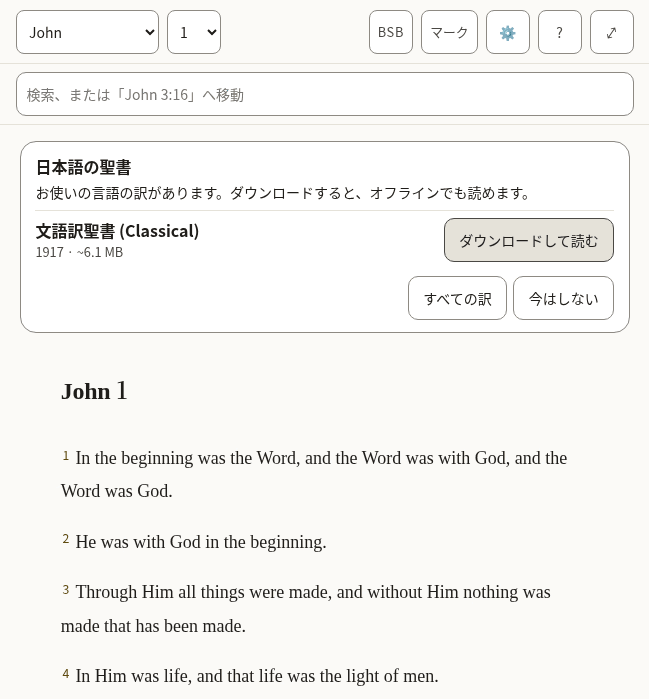

*What a new reader sees: the offer of a Bible in this language, over the English one the app arrives with.*

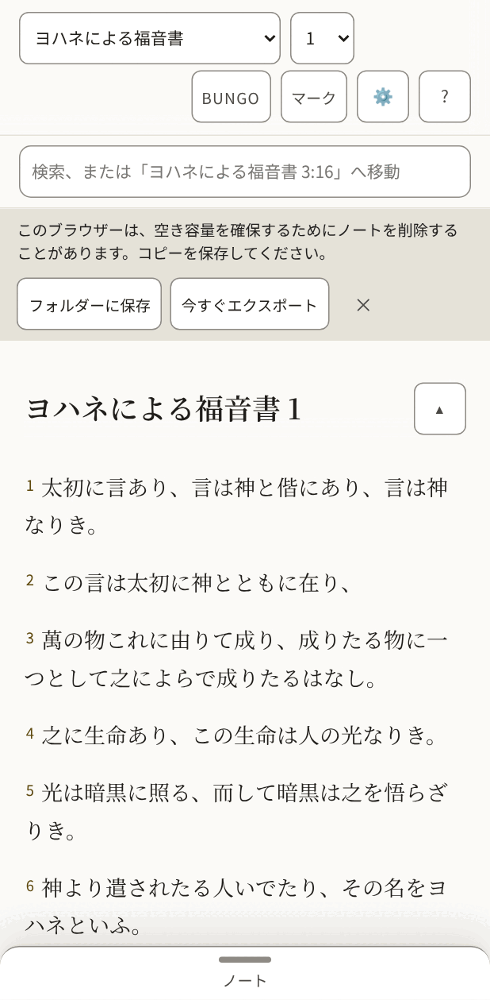

*The same, on a phone, once a Bible in this language is open.*

- [ ] The offer reads as an invitation, and its buttons are clear about what they will do.
- [ ] Nothing in the bar is cut short or squeezed, on the phone above all.
- [ ] Every text in the table below is correct and sounds natural.
- [ ] Nothing in the pictures is cut off, overlapping or badly broken across lines.

**The 48 texts of this part**

| Key | English | 日本語 (日本) |
|---|---|---|
| `app.name` | Scriptura Reader | Scriptura Reader |
| `app.downloading` | Downloading the text for offline use… | オフラインで読むために本文をダウンロードしています… |
| `app.opening` | Opening… | 開いています… |
| `app.bootFailed` | The Bible text could not be opened. Reload to try again. | 聖書本文を開けませんでした。再読み込みしてもう一度お試しください。 |
| `app.skipToScripture` | Skip to scripture | 聖書本文へ移動 |
| `app.skipToNotes` | Skip to notes | ノートへ移動 |
| `app.skipToBoard` | Skip to the canvas | ボードへ移動 |
| `app.title` | John 1 · BSB · Scriptura | ヨハネによる福音書 1 · BUNGO · Scriptura |
| `app.passageTitle` | John 1 · BSB | ヨハネによる福音書 1 · BUNGO |
| `app.boardTitle` | John 1 · Boards | ヨハネによる福音書 1 · ボード |
| `app.opened` | Settings opened | 設定を開きました |
| `app.closed` | Settings closed | 設定を閉じました |
| `app.boardSaveFailed` | Could not save the board — export your notes | ボードを保存できませんでした。ノートをエクスポートしてください |
| `app.languageChanged` | The interface is now in English. | 表示言語を日本語に切り替えました。 |
| `reader.passage` | Passage | 箇所 |
| `reader.book` | Book | 書 |
| `reader.chapter` | Chapter | 章 |
| `reader.translationChip` | BSB — Berean Standard Bible. Choose or add a translation | BUNGO：文語訳聖書 (Classical)。訳を選ぶ、または追加する |
| `reader.marks` | Marks | マーク |
| `reader.marksChip` The Marks button's name. It holds the word and the count the button shows, in that order and without brackets, so someone using voice control can say what they see (WCAG 2.5.3). | Marks 7 — verses you have marked, by colour | マーク 7件：マークした節を色ごとに表示 |
| `reader.settingsChip` | Settings — display, storage, export, and assistant access | 設定：表示、保存、エクスポート、アシスタントのアクセス |
| `reader.helpChip` | Help — finding passages, searching, notes, marks, boards, keyboard, and what the abbreviations mean | ヘルプ：箇所の開き方、検索、ノート、マーク、ボード、キーボード、略語の意味 |
| `reader.selectVerse` A verse's number: a toggle that adds the verse to the selection or takes it out. | Select John 1:2 | ヨハネによる福音書 1:2を選択 |
| `reader.selectVerseIn` | Select John 1:2 — in Amber (amber) | ヨハネによる福音書 1:2を選択（琥珀色にマーク済み） |
| `reader.selection` Said when the selection changes and focus does not move to say it. | 1 verse selected: John 1:3 3 verses selected: John 1:3-5 | 1節を選択中：ヨハネによる福音書 1:3 3節を選択中：ヨハネによる福音書 1:3-5 |
| `reader.selectionCleared` | Selection cleared | 選択を解除しました |
| `reader.chapterMissing` | This chapter is not in Berean Standard Bible. | この章は文語訳聖書 (Classical)にありません。 |
| `reader.readingAnnounce` | Reading Berean Standard Bible | 文語訳聖書 (Classical)を表示しています |
| `reader.showMenus` The button at the end of the chapter title, on a small screen: named for what a press will do. | Show the reading menus | 聖書のメニューを表示する |
| `reader.hideMenus` | Hide the reading menus | 聖書のメニューを隠す |
| `panels.marks` | Marks | マーク |
| `panels.translations` | Translations | 翻訳 |
| `panels.settings` | Settings | 設定 |
| `panels.help` | Help | ヘルプ |
| `panels.results` | Search results | 検索結果 |
| `common.cancel` | Cancel | キャンセル |
| `common.untitledNote` | Untitled | 無題 |
| `common.untitledBoard` | Untitled board | 無題のボード |
| `common.source` | Berean Standard Bible source | 文語訳聖書 (Classical)の出典 |
| `common.undoRemove` | Undo remove | 元に戻す |
| `common.remove` | Remove | 削除 |
| `common.done` | Done | 完了 |
| `offer.title` | Bibles in English | 日本語の聖書 |
| `offer.intro` | These translations are in your language. Download one to read it, online or offline. | お使いの言語の訳があります。ダウンロードすると、オフラインでも読めます。 |
| `offer.downloadAndRead` | Download and read | ダウンロードして読む |
| `offer.downloadAndReadName` | Download and read Berean Standard Bible | ダウンロードして読む：文語訳聖書 (Classical) |
| `offer.allTranslations` | All translations | すべての訳 |
| `offer.notNow` | Not now | 今はしない |

#### 2.2 Selecting verses and acting on them

Pressing a verse selects it and opens a row of actions: five colours to mark it with, then Quote, Link and Canvas. Pressing more verses adds them, and the row says how many it holds.

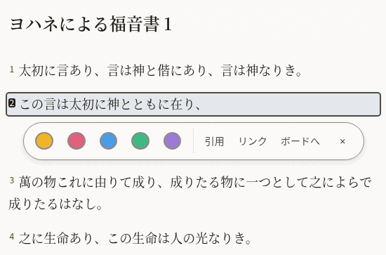

*One verse selected.*

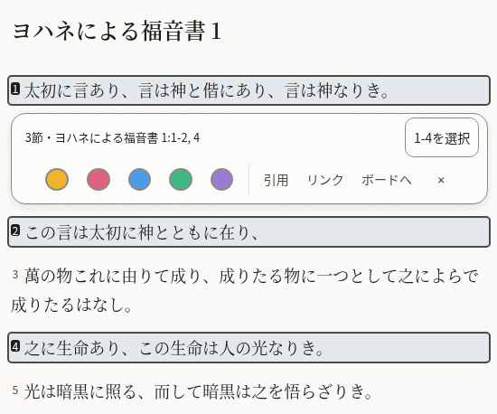

*Three verses selected, two of them together and one apart: the row says so, and offers to take in the verses between.*

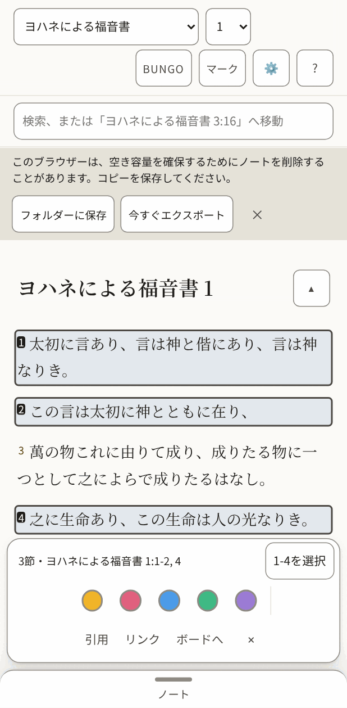

*On a phone the row sits at the bottom of the screen.*

- [ ] The summary ("3 verses · …") and the button beside it fit on one line.
- [ ] The three words for the actions are short enough to sit side by side on a phone.
- [ ] Every text in the table below is correct and sounds natural.
- [ ] Nothing in the pictures is cut off, overlapping or badly broken across lines.

**The 24 texts of this part**

| Key | English | 日本語 (日本) |
|---|---|---|
| `verseActions.group` | Actions for John 1:2 | ヨハネによる福音書 1:2の操作 |
| `verseActions.mark` | Mark as Amber (amber) | 琥珀色でマーク |
| `verseActions.quote` | Quote | 引用 |
| `verseActions.link` | Link | リンク |
| `verseActions.canvas` | Canvas | ボードへ |
| `verseActions.canvasName` | Canvas — put this verse on the board | ボードへ：この節をボードに加える |
| `verseActions.close` | Close actions for John 1:2 | ヨハネによる福音書 1:2の操作を閉じる |
| `verseActions.groupMany` The row's name when it holds several verses. | Actions for 1 verse: John 1:3 Actions for 3 verses: John 1:3-5 | 1節の操作：ヨハネによる福音書 1:3 3節の操作：ヨハネによる福音書 1:3-5 |
| `verseActions.summary` Shown in the row while several are selected, so what it will act on is in words. | 1 verse · John 1:3 3 verses · John 1:3-5 | 1節・ヨハネによる福音書 1:3 3節・ヨハネによる福音書 1:3-5 |
| `verseActions.fill` The button that takes in every verse between the first and the last selected: "Select 3-18". | Select 3-18 | 3-18を選択 |
| `verseActions.canvasNameMany` | Canvas — put these verses on the board | ボードへ：これらの節をボードに加える |
| `verseActions.clear` | Clear the selection | 選択を解除 |
| `verseActions.marked` | Marked 1 verse as Amber (amber) Marked 3 verses as Amber (amber) | 1節を琥珀色でマークしました 3節を琥珀色でマークしました |
| `verseActions.unmarked` | Cleared Amber (amber) from 1 verse Cleared Amber (amber) from 3 verses | 1節の琥珀色のマークを外しました 3節の琥珀色のマークを外しました |
| `colours.amber` | Amber | 琥珀色 |
| `colours.rose` | Rose | ばら色 |
| `colours.sky` | Sky | 空色 |
| `colours.mint` | Mint | ミント |
| `colours.violet` | Violet | すみれ色 |
| `colourWords.amber` | amber | 琥珀色 |
| `colourWords.rose` | rose | ばら色 |
| `colourWords.sky` | sky | 空色 |
| `colourWords.mint` | mint | ミント |
| `colourWords.violet` | violet | すみれ色 |

#### 2.3 Notes

The pane beside the Bible, where a reader writes. A quoted passage arrives with its reference, and a line under the note says what was just done and whether it is saved.

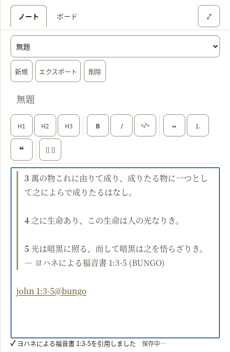

*A new note with three verses quoted into it.*

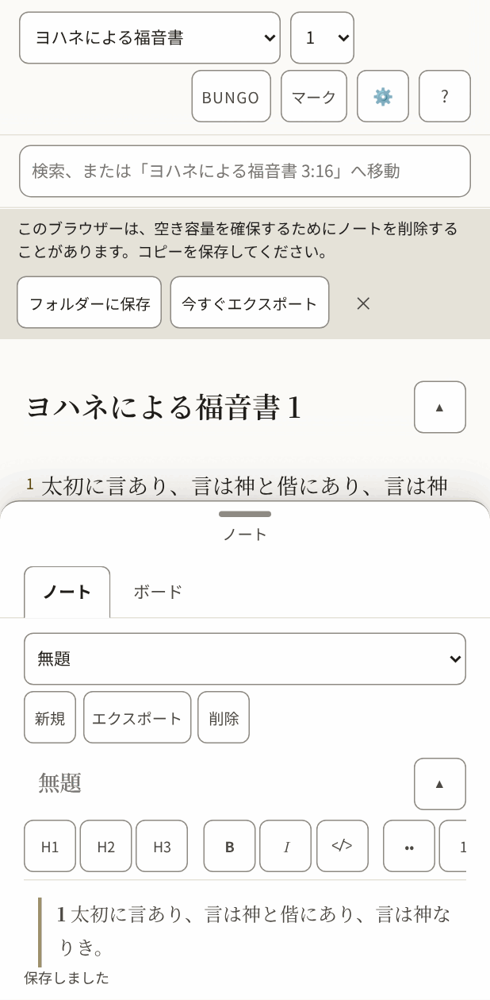

*On a phone the notes are a sheet that slides up over the text.*

- [ ] The formatting buttons carry one or two letters each (bold, italic, headings): they should be the letters a writer in this language expects.
- [ ] The line under the note ("Quoted …", "Saved") reads as a short report, not a sentence cut in two.
- [ ] Every text in the table below is correct and sounds natural.
- [ ] Nothing in the pictures is cut off, overlapping or badly broken across lines.

**The 51 texts of this part**

| Key | English | 日本語 (日本) |
|---|---|---|
| `notes.new` A new note. Nouns have gender in other languages, so notes and boards each say it. | New | 新規 |
| `notes.startOne` | Start one | 作成する |
| `notes.heading` | Notes | ノート |
| `notes.picker` | Note | ノート |
| `notes.showMenus` | Show the note menus | ノートのメニューを表示する |
| `notes.hideMenus` | Hide the note menus | ノートのメニューを隠す |
| `notes.none` | No notes yet | ノートはまだありません |
| `notes.preview` | Preview | プレビュー |
| `notes.write` | Write | 編集 |
| `notes.previewTitle` | See it rendered | 仕上がりを表示 |
| `notes.writeTitle` | Back to writing | 編集に戻る |
| `notes.canvas` | Canvas | ボード |
| `notes.canvasTitle` | Lay verses and notes out on a board | 節やノートをボードに並べる |
| `notes.export` | Export | エクスポート |
| `notes.exportTitle` | Download every note and board as Markdown in a .zip | すべてのノートとボードを Markdown にして .zip でダウンロード |
| `notes.delete` | Delete | 削除 |
| `notes.title` | Note title | ノートのタイトル |
| `notes.body` | Note body | ノートの本文 |
| `notes.placeholder` | Write here… | ここに入力… |
| `notes.goTo` | Go to John 1:3-5 | ヨハネによる福音書 1:3-5へ移動 |
| `notes.noneOpen` | No note open. | 開いているノートはありません。 |
| `notes.saveFailed` | Could not save — export your notes | 保存できませんでした。ノートをエクスポートしてください |
| `notes.saving` | Saving… | 保存中… |
| `notes.saved` | Saved | 保存しました |
| `notes.linkIn` | John 1:3-5 (KJV) | ヨハネによる福音書 1:3-5（BSB） |
| `notes.linkMissing` | John 1:3-5 (KJV — not downloaded) | ヨハネによる福音書 1:3-5（BSB、未ダウンロード） |
| `tools.label` | Formatting | 書式 |
| `tools.heading` Said for the H1, H2 and H3 buttons. It starts with the letters the button shows (headingGlyph), so someone using voice control can say what they see (WCAG 2.5.3). | H2, heading 2 | H2、見出し2 |
| `tools.headingGlyph` | H2 | H2 |
| `tools.bold` | Bold | 太字 |
| `tools.boldGlyph` | B | B |
| `tools.italic` | Italic | 斜体 |
| `tools.italicGlyph` | I | I |
| `tools.code` | Code | コード |
| `tools.bullets` | Bulleted list | 箇条書き |
| `tools.numbers` The numbered-list button shows "1.", so its name starts with it, as the heading buttons' do (WCAG 2.5.3). | 1. Numbered list | 1. 番号付きリスト |
| `tools.quote` | Quote | 引用 |
| `tools.link` | Link to a passage | 箇所へのリンク |
| `insert.quoted` | Quoted John 1:3-5 | ヨハネによる福音書 1:3-5を引用しました |
| `insert.quotedFrom` | Quoted John 1:3-5 (BSB) | ヨハネによる福音書 1:3-5（BUNGO）を引用しました |
| `insert.linked` | Linked John 1:3-5 | ヨハネによる福音書 1:3-5へのリンクを追加しました |
| `insert.addedBoard` | Added the board “John 1” | ボード「ヨハネによる福音書 1」を追加しました |
| `insert.addedToBoard` | Added John 1:3-5 to “John 1” | ヨハネによる福音書 1:3-5をボード「ヨハネによる福音書 1」に追加しました |
| `insert.alreadyOnBoard` | John 1:3-5 is already on “John 1” | ヨハネによる福音書 1:3-5はすでにボード「ヨハネによる福音書 1」にあります |
| `insert.inNewNote` | Quoted John 1:3-5 in a new note | 新しいノートに：ヨハネによる福音書 1:3-5を引用しました |
| `insert.inNote` | Quoted John 1:3-5 in “John 1” | ノート「ヨハネによる福音書 1」に：ヨハネによる福音書 1:3-5を引用しました |
| `insert.inUntitledNote` | Quoted John 1:3-5 in an untitled note | 無題のノートに：ヨハネによる福音書 1:3-5を引用しました |
| `insert.studyBoard` | Study board | 学びのボード |
| `preview.empty` | Nothing written yet. | まだ何も書かれていません。 |
| `preview.editHere` | Edit here (block 3) | ここを編集（ブロック3） |
| `preview.goTo` | Go to John 1:3-5 | ヨハネによる福音書 1:3-5へ移動 |

#### 2.4 Search

One box does two things: a reference goes straight to the passage, anything else searches the open Bible. The short list under the box is for jumping; the full list counts every match, book by book.

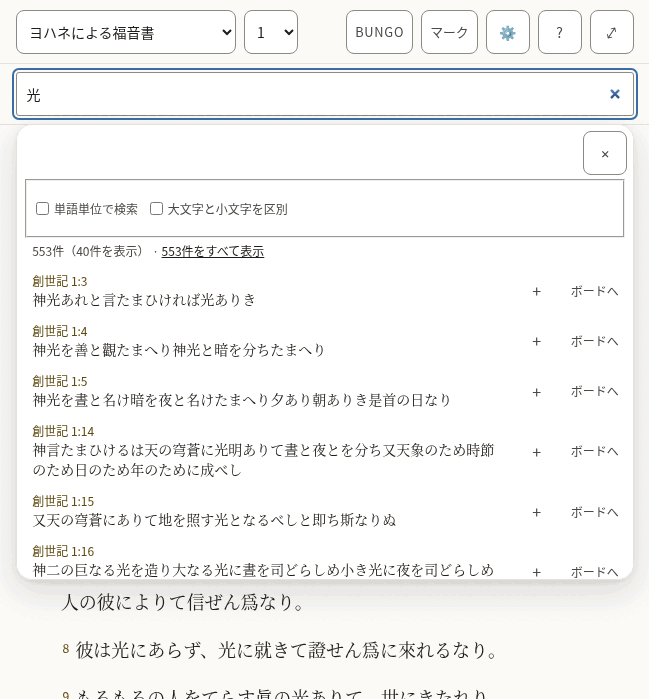

*The suggestions under the box.*

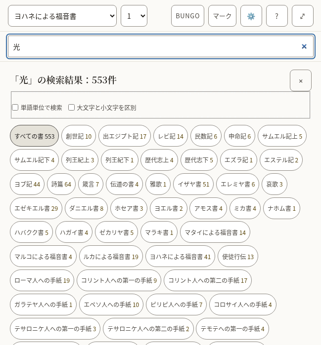

*Every match, with the count for each book.*

- [ ] The counts read naturally with a small number and with a large one.
- [ ] The two options ("Whole words only", "Match case") are understood without explanation.
- [ ] Every text in the table below is correct and sounds natural.
- [ ] Nothing in the pictures is cut off, overlapping or badly broken across lines.

**The 31 texts of this part**

| Key | English | 日本語 (日本) |
|---|---|---|
| `search.label` | Search or go to a reference | 検索、または参照箇所へ移動 |
| `search.placeholder` | Search, or go to "John 3:16" | 検索、または「ヨハネによる福音書 3:16」へ移動 |
| `search.hint` | Enter opens the passage, or every match. Down arrow moves into the suggestions. | Enter で箇所、またはすべての検索結果を開きます。下矢印キーで候補に移動します。 |
| `search.suggestions` | Suggestions | 候補 |
| `search.goTo` | Go to John 1:2 | ヨハネによる福音書 1:2へ移動 |
| `search.close` | Close suggestions | 候補を閉じる |
| `search.matching` | Matching | 一致の条件 |
| `search.wholeWords` | Whole words only | 単語単位で検索 |
| `search.wholeWordsHint` | Finds love but not loveth. Off, the search also looks inside longer words. | 英語などで、love は見つけても loveth は見つけません。日本語の本文では結果は変わりません。 |
| `search.matchCase` | Match case | 大文字と小文字を区別 |
| `search.matchCaseHint` | Capital letters matter: God and god are different. | 大文字と小文字を区別します。God と god は別の語になります。 |
| `search.noMatches` | No matches | 該当なし |
| `search.matches` | 1 match 1,382 matches | 1件 1,382件 |
| `search.showing` | ␣— showing 40 | （40件を表示） |
| `search.seeAll` | See all 1,382 | 1,382件をすべて表示 |
| `search.insert` | Insert John 1:2 into the open note | ヨハネによる福音書 1:2を開いているノートに挿入 |
| `search.toCanvas` The name of a result's Canvas button: its visible word first (2.5.3). | Canvas — put John 1:2 on the board | ボードへ：ヨハネによる福音書 1:2をボードに加える |
| `search.weakBelow` | Below: inside a longer word | ここから下：長い語の一部として一致 |
| `search.announceNone` | No matches for “light” | 「光」は見つかりませんでした |
| `search.announceCount` | 1 match for “light” 1,382 matches for “light” | 「光」の検索結果：1件 「光」の検索結果：1,382件 |
| `results.label` | Search results | 検索結果 |
| `results.heading` `{count}` is replaced by the total, in its own element. | {count} match for “light” {count} matches for “light” | 「光」の検索結果：{count}件 「光」の検索結果：{count}件 |
| `results.close` | Close search results | 検索結果を閉じる |
| `results.filter` | Filter by book | 書で絞り込む |
| `results.allBooks` | All books | すべての書 |
| `results.weakBelow` | Below: “light” inside a longer word | ここから下：「光」が長い語の一部として一致 |
| `results.insert` | Quote John 1:2 into the open note | ヨハネによる福音書 1:2を開いているノートに引用 |
| `results.insertTitle` | Quote into the open note | 開いているノートに引用 |
| `results.showing` | Showing 100 of 1,382 | 1,382件中100件を表示 |
| `results.inBook` | ␣in John | （ヨハネによる福音書） |
| `results.more` | Show 100 more | さらに100件を表示 |

### The panels

Opened from the bar. They take the place of the chapter while they are open.

#### 2.5 Marks

Each of the five colours is a collection of the verses marked with it, and can be given a name of the reader’s own.

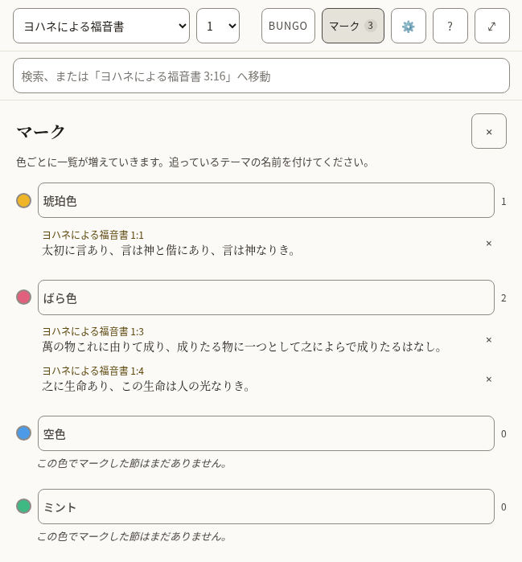

*Three marked verses in two collections.*

- [ ] The colour names are the everyday words for those colours.
- [ ] Every text in the table below is correct and sounds natural.
- [ ] Nothing in the pictures is cut off, overlapping or badly broken across lines.

**The 9 texts of this part**

| Key | English | 日本語 (日本) |
|---|---|---|
| `marks.label` | Marked verses | マークした節 |
| `marks.title` | Marks | マーク |
| `marks.close` | Close marks | マークを閉じる |
| `marks.hint` | Each colour is a running list. Name one for the subject you are tracking. | 色ごとに一覧が増えていきます。追っているテーマの名前を付けてください。 |
| `marks.nameFor` | Name for the amber collection | 琥珀色のコレクションの名前 |
| `marks.empty` | Nothing marked in this colour yet. | この色でマークした節はまだありません。 |
| `marks.remove` | Remove the mark on John 1:2 | ヨハネによる福音書 1:2のマークを削除 |
| `marks.removed` | Mark removed. Undo is available in the Marks bar. | マークを削除しました。マークのバーで元に戻せます。 |
| `marks.restored` | Mark restored | マークを元に戻しました |

#### 2.6 Translations, and reading two side by side

Where a Bible is downloaded, read, compared with the one being read, or removed. Each shows its size before it is downloaded.

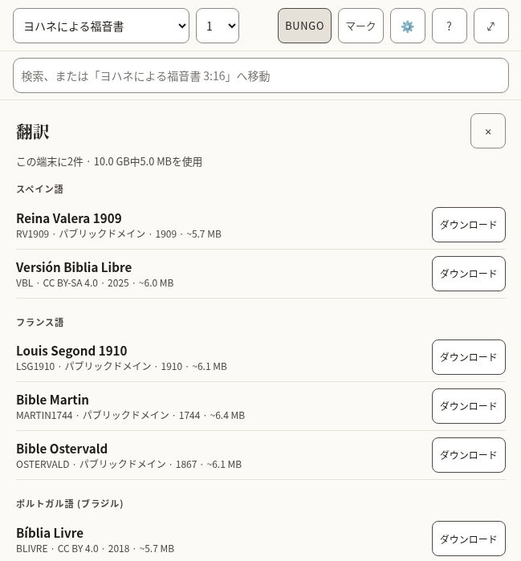

*The list of translations, by language.*

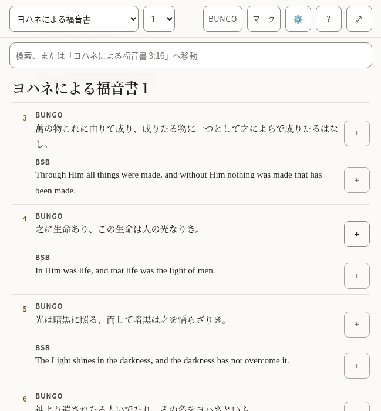

*Two translations, verse by verse.*

- [ ] The language headings are how this language names those languages.
- [ ] The note about what removing a translation does and does not touch is plain.
- [ ] Every text in the table below is correct and sounds natural.
- [ ] Nothing in the pictures is cut off, overlapping or badly broken across lines.

**The 32 texts of this part**

| Key | English | 日本語 (日本) |
|---|---|---|
| `library.title` | Translations | 翻訳 |
| `library.close` | Close translations | 翻訳を閉じる |
| `library.onDevice` | 2 on this device | この端末に2件 |
| `library.used` | 11.8 MB of 1.9 GB used | 1.9 GB中11.8 MBを使用 |
| `library.about` | about 5.4 MB | 約5.4 MB |
| `library.licences.public-domain` | Public domain | パブリックドメイン |
| `library.licences.cc-by-4.0` | CC BY 4.0 | CC BY 4.0 |
| `library.licences.cc-by-sa-4.0` | CC BY-SA 4.0 | CC BY-SA 4.0 |
| `library.licences.cc0` | CC0 | CC0 |
| `library.licences.custom-free` | Free licence | 自由なライセンス |
| `library.reading` | Reading | 表示中 |
| `library.comparing` | Comparing | 比較中 |
| `library.read` | Read | 読む |
| `library.compare` | Compare | 比較 |
| `library.compareTitle` | Show beside the translation you are reading | 読んでいる訳の横に表示します |
| `library.downloading` | Downloading Berean Standard Bible | 文語訳聖書 (Classical)をダウンロード中 |
| `library.download` | Download | ダウンロード |
| `library.removeActive` | Remove Berean Standard Bible — switch to another translation first | 文語訳聖書 (Classical)を削除（先にほかの訳に切り替えてください） |
| `library.removeFromDevice` | Remove Berean Standard Bible from this device | 文語訳聖書 (Classical)をこの端末から削除 |
| `library.note` | A downloaded translation stays on this device and can be read offline. Removing one never touches your notes or marks: both belong to the passage, not to a translation. | ダウンロードした訳はこの端末に残り、オフラインで読めます。訳を削除しても、ノートやマークは消えません。どちらも訳ではなく箇所に付いているからです。 |
| `library.progress` | Berean Standard Bible: 50% downloaded | 文語訳聖書 (Classical)：50%をダウンロードしました |
| `library.downloaded` | Berean Standard Bible downloaded | 文語訳聖書 (Classical)のダウンロードが完了しました |
| `library.failed` | Berean Standard Bible: No connection — try again when you are online. | 文語訳聖書 (Classical)：接続がありません。オンラインになってからもう一度お試しください。 |
| `library.failedOnline` | The download did not finish. Try again later. | ダウンロードを完了できませんでした。しばらくしてからもう一度お試しください。 |
| `library.offline` | No connection — try again when you are online. | 接続がありません。オンラインになってからもう一度お試しください。 |
| `compare.label` | Translations side by side | 訳の並列表示 |
| `compare.compared` | Translations compared | 比較している訳 |
| `compare.stop` | Stop comparing KJV | BSBの比較をやめる |
| `compare.verse` | Verse | 節 |
| `compare.verseBefore` | Verse␣ | 節␣ |
| `compare.missing` | Not in KJV | BSBにはありません |
| `compare.quote` | Quote KJV verse 16 | BSBの16節を引用 |

#### 2.7 Settings

How the text looks, the interface language, where the reader’s work is kept, and whether an assistant may help.

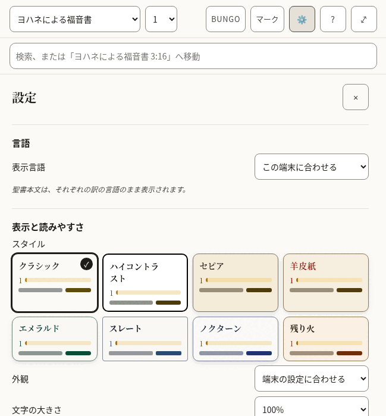

*The top of Settings.*

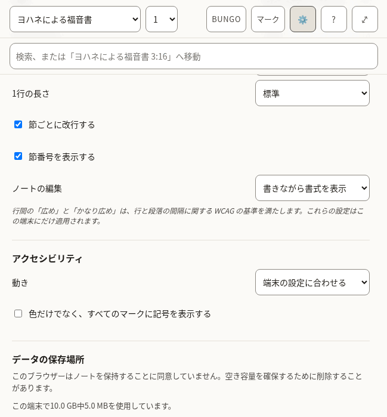

*Further down.*

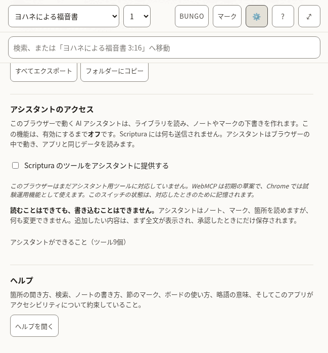

*The end.*

- [ ] Each label and the choices under it read as one thought.
- [ ] The style names are evocative, not literal (Vellum, Emerald, Nocturne): they should sound like names, not descriptions.
- [ ] The explanations in smaller type are complete sentences and easy to follow.
- [ ] Every text in the table below is correct and sounds natural.
- [ ] Nothing in the pictures is cut off, overlapping or badly broken across lines.

**The 66 texts of this part**

| Key | English | 日本語 (日本) |
|---|---|---|
| `settings.title` | Settings | 設定 |
| `settings.close` | Close settings | 設定を閉じる |
| `settings.display` | Reading &amp; display | 表示と読みやすさ |
| `settings.style` | Style | スタイル |
| `settings.styles.classic` | Classic | クラシック |
| `settings.styles.contrast` | High contrast | ハイコントラスト |
| `settings.styles.sepia` | Sepia | セピア |
| `settings.styles.vellum` | Vellum | 羊皮紙 |
| `settings.styles.emerald` | Emerald | エメラルド |
| `settings.styles.slate` | Slate | スレート |
| `settings.styles.nocturne` | Nocturne | ノクターン |
| `settings.styles.ember` | Ember | 残り火 |
| `settings.appearance` | Light or dark | 外観 |
| `settings.appearances.system` | Follow the device | 端末の設定に合わせる |
| `settings.appearances.light` | Light | ライト |
| `settings.appearances.dark` | Dark | ダーク |
| `settings.textSize` | Text size | 文字の大きさ |
| `settings.spacing` | Line spacing | 行間 |
| `settings.spacings.normal` | Normal | 標準 |
| `settings.spacings.relaxed` | Relaxed | 広め |
| `settings.spacings.loose` | Loose | かなり広め |
| `settings.measure` | Column width | 1行の長さ |
| `settings.measures.narrow` | Narrow | 短め |
| `settings.measures.normal` | Normal | 標準 |
| `settings.measures.wide` | Wide | 長め |
| `settings.measures.full` | Full | 幅いっぱい |
| `settings.editor` | Note editor | ノートの編集 |
| `settings.editors.live` | Show formatting as you write | 書きながら書式を表示 |
| `settings.editors.plain` | Plain text | プレーンテキスト |
| `settings.displayNote` | Relaxed and Loose spacing meet the WCAG guidance for line and paragraph spacing. These settings apply to this device only. | 行間の「広め」と「かなり広め」は、行と段落の間隔に関する WCAG の基準を満たします。これらの設定はこの端末にだけ適用されます。 |
| `settings.accessibility` | Accessibility | アクセシビリティ |
| `settings.motion` | Motion | 動き |
| `settings.motions.system` | Follow the device | 端末の設定に合わせる |
| `settings.motions.reduce` | Reduce motion | 動きを減らす |
| `settings.markers` | Show a symbol on every highlight, not only a colour | 色だけでなく、すべてのマークに記号を表示する |
| `settings.verseLines` | Start each verse on a new line | 節ごとに改行する |
| `settings.verseNumbers` | Show verse numbers | 節番号を表示する |
| `settings.recedeMenus` | On a small screen, hide the menus while reading | 小さい画面では、読んでいる間メニューを隠す |
| `settings.storage` | Where your work lives | データの保存場所 |
| `settings.persistence.persisted` | This browser has agreed to keep your notes. Clearing site data still removes them. | このブラウザーはノートを保持することに同意しています。ただし、サイトのデータを消去するとノートも消えます。 |
| `settings.persistence.denied` | This browser has not agreed to keep your notes. It may delete them to free up space. | このブラウザーはノートを保持することに同意していません。空き容量を確保するために削除することがあります。 |
| `settings.persistence.unsupported` | This browser will not say whether it keeps your notes. Assume it may delete them. | このブラウザーは、ノートを保持するかどうかを示しません。削除されることがあると考えてください。 |
| `settings.persistence.unknown` | Checking… | 確認しています… |
| `settings.usedOnDevice` | 11.8 MB of 1.9 GB used on this device. | この端末で1.9 GB中11.8 MBを使用しています。 |
| `settings.mirrored` | Your notes are also saved to a folder you chose. | ノートは、選んだフォルダーにも保存されています。 |
| `settings.notMirrored` | Your notes live only in this browser. Export them, or save a copy to a folder, to keep them safe. | ノートはこのブラウザーの中にだけあります。安全のため、エクスポートするか、フォルダーにコピーを保存してください。 |
| `settings.exportAll` | Export everything | すべてエクスポート |
| `settings.anotherFolder` | Choose another folder | 別のフォルダーを選ぶ |
| `settings.mirror` | Mirror to a folder | フォルダーにコピー |
| `settings.assistant` | Assistant access | アシスタントのアクセス |
| `settings.assistantIntro` | An AI assistant running in this browser can read your library and draft notes or marks for you. This is **off** until you turn it on. Nothing is sent to Scriptura: the assistant runs in your browser and reads the same data the app does. | このブラウザーで動く AI アシスタントは、ライブラリを読み、ノートやマークの下書きを作れます。この機能は、有効にするまで**オフ**です。Scriptura には何も送信されません。アシスタントはブラウザーの中で動き、アプリと同じデータを読みます。 |
| `settings.assistantToggle` | Offer Scriptura’s tools to an assistant | Scriptura のツールをアシスタントに提供する |
| `settings.assistantSupported` | This browser supports assistant tools. | このブラウザーはアシスタント用ツールに対応しています。 |
| `settings.assistantUnsupported` | This browser does not support assistant tools yet — WebMCP is an early draft, available in Chrome behind a flag. The switch is remembered for when it does. | このブラウザーはまだアシスタント用ツールに対応していません。WebMCP は初期の草案で、Chrome では試験運用機能として使えます。このスイッチの状態は、対応したときのために記憶されます。 |
| `settings.assistantReadOnly` | **It can read, not write.** An assistant can read your notes, marks and passages, but it cannot change anything. Anything it wants to add is shown to you in full first, and is saved only when you accept it. | **読むことはできても、書き込むことはできません。**アシスタントはノート、マーク、箇所を読めますが、何も変更できません。追加したい内容は、まず全文が表示され、承認したときにだけ保存されます。 |
| `settings.assistantTools` | What an assistant would be able to do (9 tools) | アシスタントができること（ツール9個） |
| `settings.toolReads` | reads | 読み取り |
| `settings.toolNeedsApproval` | needs your approval | 承認が必要 |
| `settings.toolsInEnglish` Shown only in the other languages, beside the tool descriptions, which stay English. | The descriptions are in English, as the assistant reads them. | 説明は、アシスタントが読むとおり英語で表示しています。 |
| `settings.help` | Help | ヘルプ |
| `settings.helpIntro` | How to find a passage, search, write notes, mark verses and use boards; what the abbreviations mean; and what this app promises about accessibility. | 箇所の開き方、検索、ノートの書き方、節のマーク、ボードの使い方、略語の意味、そしてこのアプリがアクセシビリティについて約束していること。 |
| `settings.openHelp` | Open help | ヘルプを開く |
| `settings.language` | Language | 言語 |
| `settings.languageLabel` | Interface language | 表示言語 |
| `settings.languageSystem` | Match this device | この端末に合わせる |
| `settings.languageNote` | Bible text stays in the language of each translation. | 聖書本文は、それぞれの訳の言語のまま表示されます。 |

#### 2.8 Help

The longest text in the app, and the one a reader turns to when stuck. It includes a list of terms and abbreviations, and a statement about accessibility.

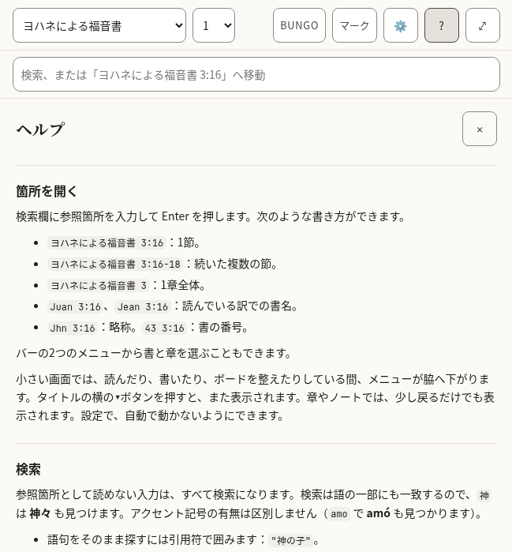

*The top of Help.*

- [ ] It reads well from start to finish as an explanation, not as a list of translated sentences.
- [ ] The examples of references are ones that work in a Bible in this language.
- [ ] The names of keys (Enter, Shift, Escape) are how this language’s keyboards and manuals name them.
- [ ] Every text in the table below is correct and sounds natural.
- [ ] Nothing in the pictures is cut off, overlapping or badly broken across lines.

**The 76 texts of this part**

| Key | English | 日本語 (日本) |
|---|---|---|
| `help.title` | Help | ヘルプ |
| `help.close` | Close help | ヘルプを閉じる |
| `help.sections.finding.heading` | Finding a passage | 箇所を開く |
| `help.sections.finding.blocks.1.p` | Type a reference in the search box and press Enter. All of these work: | 検索欄に参照箇所を入力して Enter を押します。次のような書き方ができます。 |
| `help.sections.finding.blocks.2.ul.1` | `John 3:16` — one verse. | `ヨハネによる福音書 3:16`：1節。 |
| `help.sections.finding.blocks.2.ul.2` | `John 3:16-18` — a range of verses. | `ヨハネによる福音書 3:16-18`：続いた複数の節。 |
| `help.sections.finding.blocks.2.ul.3` | `John 3` — a whole chapter. | `ヨハネによる福音書 3`：1章全体。 |
| `help.sections.finding.blocks.2.ul.4` | `Juan 3:16` or `Jean 3:16` — the book name in the translation you are reading. | `Juan 3:16`、`Jean 3:16`：読んでいる訳での書名。 |
| `help.sections.finding.blocks.2.ul.5` | `Jhn 3:16` — an abbreviation. `43 3:16` — the book number. | `Jhn 3:16`：略称。`43 3:16`：書の番号。 |
| `help.sections.finding.blocks.3.p` | You can also pick the book and chapter from the two menus in the bar. | バーの2つのメニューから書と章を選ぶこともできます。 |
| `help.sections.finding.blocks.4.p` | On a small screen the menus step aside while you read, write or arrange a board. Press the **▾** button beside the title to bring them back; in a chapter or a note, scrolling back a little does the same. In Settings you can stop them moving by themselves. | 小さい画面では、読んだり、書いたり、ボードを整えたりしている間、メニューが脇へ下がります。タイトルの横の**▾**ボタンを押すと、また表示されます。章やノートでは、少し戻るだけでも表示されます。設定で、自動で動かないようにできます。 |
| `help.sections.searching.heading` | Searching | 検索 |
| `help.sections.searching.blocks.1.p` | Anything that is not a reference is a search. Search looks inside words, so `love` also finds *loveth* and *beloved*. Accents do not matter: `amo` finds *amó*. | 参照箇所として読めない入力は、すべて検索になります。検索は語の一部にも一致するので、`神` は *神々* も見つけます。アクセント記号の有無は区別しません（`amo` で *amó* も見つかります）。 |
| `help.sections.searching.blocks.2.ul.1` | Put a phrase in quotes to find it exactly: `"in the beginning"`. | 語句をそのまま探すには引用符で囲みます：`"神の子"`。 |
| `help.sections.searching.blocks.2.ul.2` | Put a minus sign before a word to leave verses with it out: `God -love`. | 語の前にマイナス記号を付けると、その語を含む節を除きます：`神 -愛`。 |
| `help.sections.searching.blocks.2.ul.3` | **Whole words only** stops the search looking inside longer words. | **単語単位で検索**を有効にすると、長い語の一部には一致しなくなります。英語など、単語の区切りがある言語の本文で使います。 |
| `help.sections.searching.blocks.2.ul.4` | **Match case** makes capital letters matter. | **大文字と小文字を区別**を有効にすると、大文字と小文字が別の文字として扱われます。 |
| `help.sections.searching.blocks.3.p` | The first results are verses where your word stands alone; verses where it sits inside a longer word come after a line that says so. Press Enter on a search to see every match, counted by book. | 最初に、検索語が単独で現れる節が並び、区切り線のあとに、長い語の一部として現れる節が続きます。検索中に Enter を押すと、すべての結果を書ごとの件数とともに表示します。 |
| `help.sections.notes.heading` | Notes | ノート |
| `help.sections.notes.blocks.1.p` | Notes are plain text with Markdown. Formatting takes shape as you write, and its symbols come back on the line you are editing; to see only the Markdown, choose **Plain text** under Note editor in Settings. The toolbar above the note adds headings, bold, italic, lists and quotes; press a tool again to take the formatting off. With Plain text, **Preview** shows the note as it will read. | ノートは Markdown で書くテキストです。書式は書いているそばから反映され、編集中の行では記号が表示されます。Markdown をそのまま見たいときは、設定の「ノートの編集」で**プレーンテキスト**を選んでください。ノートの上のツールバーで、見出し、太字、斜体、リスト、引用を付けられます。同じツールをもう一度押すと書式が外れます。プレーンテキストのときは、**プレビュー**で仕上がりを確認できます。 |
| `help.sections.notes.blocks.2.p` | A link to a passage looks like `[[john 3:16]]`. Add `@kjv` to say which translation: `[[john 3:16@kjv]]`. Put the cursor inside a link and a **Go to** button opens it. **Quote** beside a verse copies the verse into your note with its reference and a link. | 箇所へのリンクは `[[john 3:16]]` のように書きます。訳を指定するには `@bungo` を付けます：`[[john 3:16@bungo]]`。リンクの中にカーソルを置くと、**移動**ボタンで開けます。節の横の**引用**を押すと、その節が参照箇所とリンク付きでノートに入ります。 |
| `help.sections.notes.blocks.3.p` | Notes are saved on this device as you type. **Export** downloads every note and board as text files in a zip. | ノートは入力するそばからこの端末に保存されます。**エクスポート**を押すと、すべてのノートとボードをテキストファイルにして zip でダウンロードします。 |
| `help.sections.marks.heading` | Marks | マーク |
| `help.sections.marks.blocks.1.p` | Press a verse, or its number, to mark it in one of five colours. Each colour is a collection: name it for the subject you are following, and the **Marks** panel lists its verses in Bible order. Marks follow the passage, not the translation, so a mark made in one translation shows in all of them. | 節またはその番号を押すと、5色のいずれかでマークできます。色はそれぞれコレクションです。追っているテーマの名前を付けると、**マーク**パネルにその節が聖書の順に並びます。マークは訳ではなく箇所に付くので、ある訳で付けたマークはすべての訳に表示されます。 |
| `help.sections.marks.blocks.2.p` | Press more verses to act on several at once, and press one again to leave it out. With verses apart selected, **Select** in the row of actions takes in every verse between them; holding <kbd>Shift</kbd> while you press a verse does the same. **Quote** then writes them into your note as one passage under one reference. | ほかの節も押すと、複数の節をまとめて操作できます。もう一度押すと、その節は外れます。離れた節を選んでいるときは、操作の列にある**選択**で、その間の節がすべて選ばれます。<kbd>Shift</kbd> を押しながら節を押しても同じです。**引用**すると、ひとつの箇所として、ひとつの参照でノートに書き込まれます。 |
| `help.sections.marks.blocks.3.p` | In Settings you can add a symbol to every mark, so colour is not the only sign. | 設定で、すべてのマークに記号を付けることもできます。色だけに頼らずに区別できます。 |
| `help.sections.marks.blocks.4.p` | In Settings you can also run the verses together as one text and hide their numbers. Pressing a sentence still picks the verse it belongs to. | 設定で、節を続けて一つの文章として表示し、節番号を隠すこともできます。文を押すと、その文を含む節が選ばれます。 |
| `help.sections.boards.heading` | Boards | ボード |
| `help.sections.boards.blocks.1.p` | A board lays verses and notes out as cards you can move and join with arrows. **Canvas** beside a verse puts it on the current board. Cards hold a reference, not a copy of the text, so they show the translation you are reading. Give a board a name in the box beside the board menu. | ボードは、節やノートをカードとして並べ、矢印でつなげる場所です。節の横の**ボードへ**を押すと、その節が今のボードに加わります。カードには本文の写しではなく参照箇所が入っているので、読んでいる訳で表示されます。ボードの名前は、ボードのメニューの横の欄で付けられます。 |
| `help.sections.boards.blocks.2.p` | To move or resize a card without dragging, use its **✥** button; to colour it, its colour button. The arrow buttons beside the zoom move the view. **Connections**, in the board's bar, lists every arrow in words and removes one. Removing a card asks first, and removing a card or a connection can be undone until you change something else. | ドラッグせずにカードを移動・サイズ変更するには**✥**ボタンを、色を付けるには色のボタンを使います。ズームの横の矢印ボタンで表示位置を動かせます。ボードのバーの**つながり**には、すべての矢印が文章で並び、そこから削除できます。カードの削除は確認してから行われ、カードやつながりの削除は、ほかの変更をするまで元に戻せます。 |
| `help.sections.translations.heading` | Translations | 翻訳 |
| `help.sections.translations.blocks.1.p` | The library lists every translation, grouped by language, with its size. Download one to read it offline; **Compare** shows it beside the one you are reading, verse by verse. Removing a translation never touches your notes or marks. | ライブラリには、すべての翻訳が言語ごとにサイズとともに並びます。ダウンロードするとオフラインで読めます。**比較**を押すと、読んでいる訳の横に節ごとに並べて表示します。翻訳を削除しても、ノートやマークには影響しません。 |
| `help.sections.keyboard.heading` | Keyboard | キーボード |
| `help.sections.keyboard.blocks.1.ul.1` | <kbd>Tab</kbd> and <kbd>Shift</kbd>+<kbd>Tab</kbd> move between controls. The first press offers to skip to the text or the notes. | <kbd>Tab</kbd> と <kbd>Shift</kbd>+<kbd>Tab</kbd> でコントロール間を移動します。最初に押すと、本文やノートへ直接移動する案内が出ます。 |
| `help.sections.keyboard.blocks.1.ul.2` | <kbd>Escape</kbd> closes whatever opened last: a panel, the verse actions, the search suggestions. | <kbd>Esc</kbd> は、最後に開いたもの（パネル、節の操作、検索候補）を閉じます。 |
| `help.sections.keyboard.blocks.1.ul.3` | <kbd>Enter</kbd> on a verse number selects it and opens the actions; the arrow keys move along them. <kbd>Enter</kbd> on another number adds that verse, and <kbd>Shift</kbd>+<kbd>Enter</kbd> takes in every verse up to it. | 節の番号で <kbd>Enter</kbd> を押すと、その節が選ばれて操作が開き、矢印キーで操作間を移動します。別の番号で <kbd>Enter</kbd> を押すとその節が加わり、<kbd>Shift</kbd>+<kbd>Enter</kbd> でそこまでの節がすべて選ばれます。 |
| `help.sections.keyboard.blocks.1.ul.4` | On the divider between the panes, the arrow keys, <kbd>Home</kbd> and <kbd>End</kbd> resize; the two small buttons do the same. | パネルの間の仕切りでは、矢印キー、<kbd>Home</kbd>、<kbd>End</kbd> で幅を変えられます。横の2つの小さなボタンでも同じことができます。 |
| `help.sections.keyboard.blocks.1.ul.5` | In a note, <kbd>Shift</kbd>+<kbd>Tab</kbd> reaches the formatting tools; the arrow keys move between them. | ノートでは、<kbd>Shift</kbd>+<kbd>Tab</kbd> で書式ツールに移動し、矢印キーでツール間を移動します。 |
| `help.sections.keyboard.blocks.1.ul.6` | On a board, cards take focus: the arrow keys move a card, <kbd>Alt</kbd> with an arrow resizes it, and <kbd>Delete</kbd> asks to remove it. With the board itself focused, the arrow keys move the view and <kbd>+</kbd> and <kbd>−</kbd> zoom. | ボードではカードにフォーカスが移ります。矢印キーでカードを動かし、<kbd>Alt</kbd> と矢印キーでサイズを変え、<kbd>Delete</kbd> で削除の確認が出ます。ボード自体にフォーカスがあるときは、矢印キーで表示位置が動き、<kbd>+</kbd> と <kbd>−</kbd> でズームします。 |
| `help.abbreviations` | Abbreviations | 略語 |
| `help.abbreviationsCaption` | What each abbreviation means | 略語の意味 |
| `help.short` | Short | 略語 |
| `help.meaning` | Meaning | 意味 |
| `help.terms.1.1` | CC BY-SA 4.0 | CC BY-SA 4.0 |
| `help.terms.1.2` | Creative Commons Attribution–ShareAlike 4.0: a free licence that asks you to credit the source and share changes under the same terms. | クリエイティブ・コモンズ 表示-継承 4.0：出典を示し、変更を同じ条件で共有することを求める自由なライセンス。 |
| `help.terms.2.1` | CC0 | CC0 |
| `help.terms.2.2` | Creative Commons Zero: the author has waived all rights; the text is free to use. | クリエイティブ・コモンズ・ゼロ：著作者がすべての権利を放棄しており、自由に使えます。 |
| `help.terms.3.1` | OT | OT |
| `help.terms.3.2` | Old Testament. | 旧約聖書（英語の Old Testament）。 |
| `help.terms.4.1` | NT | NT |
| `help.terms.4.2` | New Testament. | 新約聖書（英語の New Testament）。 |
| `help.terms.5.1` | PWA | PWA |
| `help.terms.5.2` | Progressive web app: a website you can install and use offline. | プログレッシブウェブアプリ：インストールしてオフラインでも使えるウェブサイト。 |
| `help.terms.6.1` | WCAG | WCAG |
| `help.terms.6.2` | Web Content Accessibility Guidelines, the standard this app is measured against. | ウェブコンテンツ・アクセシビリティ・ガイドライン。このアプリが準拠を目指す基準です。 |
| `help.glossaryHeading` | Words used here | このアプリの用語 |
| `help.glossary.1.1` | Collection | コレクション |
| `help.glossary.1.2` | Every verse you mark in one colour. Name a colour for the subject you are following, and the Marks panel lists those verses in Bible order. | 1つの色でマークしたすべての節。追っているテーマの名前を色に付けると、マークパネルにその節が聖書の順に並びます。 |
| `help.glossary.2.1` | Board | ボード |
| `help.glossary.2.2` | A space where verses and notes are laid out as cards and joined with arrows. Boards are saved and exported with your notes. | 節やノートをカードとして並べ、矢印でつなぐ場所。ボードはノートと一緒に保存・エクスポートされます。 |
| `help.glossary.3.1` | Card | カード |
| `help.glossary.3.2` | One item on a board: a verse, a note, or text you typed. A verse card shows the verse from whichever translation you are reading. | ボード上の1つの項目。節、ノート、または入力したテキストです。節のカードは、読んでいる訳でその節を表示します。 |
| `help.glossary.4.1` | Translation | 翻訳 |
| `help.glossary.4.2` | One version of the Bible, in one language. Every translation here is free to copy. | 1つの言語で書かれた聖書の1つの版。ここにある訳はどれも自由に複製できます。 |
| `help.glossary.5.1` | Whole words only | 単語単位で検索 |
| `help.glossary.5.2` | A search option. With it on, "love" finds love but not loveth. With it off, it finds both. | 検索の設定の一つ。有効にすると、英語の "love" は love に一致し、loveth には一致しません。無効にすると両方に一致します。 |
| `help.glossary.6.1` | Match case | 大文字と小文字を区別 |
| `help.glossary.6.2` | A search option. With it on, "God" and "god" are different. | 検索の設定の一つ。有効にすると、"God" と "god" は別の語になります。 |
| `help.glossary.7.1` | Mirror to a folder | フォルダーにコピー |
| `help.glossary.7.2` | Keep a copy of your notes as text files in a folder on this computer, updated as you write. Works in Chrome and Edge. | ノートのコピーを、このコンピューターのフォルダーにテキストファイルとして置き、書くたびに更新します。Chrome と Edge で使えます。 |
| `help.glossary.8.1` | Assistant tools | アシスタント用ツール |
| `help.glossary.8.2` | A way for an AI assistant running in your browser to read your library and suggest notes or marks. Off unless you turn it on; nothing is saved without your approval. | ブラウザーで動く AI アシスタントが、ライブラリを読んでノートやマークを提案するための仕組み。有効にしない限りオフで、承認なしには何も保存されません。 |
| `help.accessibilityHeading` | Accessibility | アクセシビリティ |
| `help.accessibility.1` | This app aims to meet the Web Content Accessibility Guidelines 2.2 at Level AAA for everything the app itself shows: its controls, its text, its colours and its behaviour. Every control can be reached by keyboard, is at least 44 by 44 pixels, shows where focus is, and has a name. Text is at least 7:1 against its background in every colour theme, and you can change the size, spacing and colours in Settings. | このアプリは、アプリ自身が表示するもの（コントロール、文章、色、動作）について、ウェブコンテンツ・アクセシビリティ・ガイドライン（WCAG）2.2 のレベル AAA を満たすことを目指しています。すべてのコントロールはキーボードで操作でき、44×44 ピクセル以上の大きさがあり、フォーカスの位置を示し、名前を持っています。文字と背景のコントラストはどの配色でも 7:1 以上で、文字の大きさ、間隔、配色は設定で変えられます。 |
| `help.accessibility.2` | Two things are outside that promise. The Bible text is shown as it was published: how hard it is to read, and how its words are said, belong to each translation, not to this app. The same is true of what you write in your notes. | この約束の対象外が2つあります。聖書本文は刊行されたとおりに表示されるため、その読みやすさや語の読み方は各訳によるもので、このアプリによるものではありません。ノートに書いた内容も同様です。 |
| `help.accessibility.3` | What is checked by machine is checked on every change. What needs a person — a screen reader on a phone, the app under a Windows contrast theme — is checked by hand, less often. If something does not work for you, please report it at the project's issue tracker on GitHub (`AlanRoman117/scriptura`). | 機械で確認できることは、変更のたびに確認しています。人の確認が必要なこと（スマートフォンのスクリーンリーダーや、Windows のコントラストテーマでの表示など）は、手作業で、頻度を下げて確認しています。うまく使えない点があれば、GitHub のプロジェクトの Issue（`AlanRoman117/scriptura`）でお知らせください。 |

### Met less often

Boards, the questions asked before something is deleted, and the notices. Many of these texts are spoken by a screen reader and never shown.

#### 2.9 Boards (the canvas)

A surface where verses and notes are laid out as cards and joined with arrows. Most of its texts are the names of buttons, heard by a screen reader.

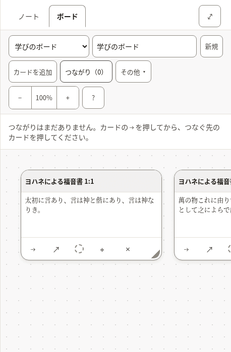

*Two verses on a board, with the list of connections open.*

- [ ] The words for a board, a card and a connection are used the same way here as everywhere else.
- [ ] Every text in the table below is correct and sounds natural.
- [ ] Nothing in the pictures is cut off, overlapping or badly broken across lines.

**The 93 texts of this part**

| Key | English | 日本語 (日本) |
|---|---|---|
| `canvas.new` A new board. | New | 新規 |
| `canvas.more` Beside the Bible, the button the less-used board actions fold behind. | More | その他 |
| `canvas.startOne` | Start one | 作成する |
| `canvas.label` | Boards | ボード |
| `canvas.heading` | Board: John 1 | ボード：ヨハネによる福音書 1 |
| `canvas.noneOpenHeading` | none open | 開いているボードはありません |
| `canvas.picker` | Board | ボード |
| `canvas.showMenus` | Show the board menus | ボードのメニューを表示する |
| `canvas.hideMenus` | Hide the board menus | ボードのメニューを隠す |
| `canvas.name` | Board name | ボードの名前 |
| `canvas.none` | No boards yet | ボードはまだありません |
| `canvas.undo` | Undo: put back John 1:1 Undo: put back the connection John 1:1 → John 1:14 | 元に戻す：カード「ヨハネによる福音書 1:1」を戻す 元に戻す：つながり「ヨハネによる福音書 1:1 → ヨハネによる福音書 1:14」を戻す |
| `canvas.putBack` | John 1:1 put back The connection John 1:1 → John 1:14 put back | カード「ヨハネによる福音書 1:1」を元に戻しました つながり「ヨハネによる福音書 1:1 → ヨハネによる福音書 1:14」を元に戻しました |
| `canvas.removed` | John 1:1 removed. Undo is in the board's bar. The connection John 1:1 → John 1:14 removed. Undo is in the board's bar. | カード「ヨハネによる福音書 1:1」を削除しました。ボードのバーで元に戻せます。 つながり「ヨハネによる福音書 1:1 → ヨハネによる福音書 1:14」を削除しました。ボードのバーで元に戻せます。 |
| `canvas.addCard` | Add card | カードを追加 |
| `canvas.addNote` | Add note | ノートを追加 |
| `canvas.addNoteName` | Add note — put the newest note on the board | ノートを追加：いちばん新しいノートをボードに加える |
| `canvas.addNoteNoNotes` | Add note — write a note first | ノートを追加：先にノートを書いてください |
| `canvas.toNote` | Add to note | ノートに追加 |
| `canvas.toNoteName` | Add to note — put this board into the note you have open | ノートに追加：このボードを開いているノートに入れる |
| `canvas.connections` | Connections (2) | つながり（2） |
| `canvas.connectionsLabel` | Connections | つながり |
| `canvas.deleteBoard` | Delete board | ボードを削除 |
| `canvas.zoom` | Zoom | ズーム |
| `canvas.zoomOut` | Zoom out | 縮小 |
| `canvas.zoomIn` | Zoom in | 拡大 |
| `canvas.zoomReset` | Zoom 120%. Reset to full size, showing your cards | ズーム 120%。等倍に戻してカードを表示 |
| `canvas.moveView` | Move the view | 表示位置を動かす |
| `canvas.viewLeft` | Move the view left | 表示位置を左へ |
| `canvas.viewUp` | Move the view up | 表示位置を上へ |
| `canvas.viewDown` | Move the view down | 表示位置を下へ |
| `canvas.viewRight` | Move the view right | 表示位置を右へ |
| `canvas.help` | Help — boards, keyboard, and what the abbreviations mean | ヘルプ：ボード、キーボード、略語の意味 |
| `canvas.noConnections` | No connections yet. Press ⇢ on a card, then the card it leads to. | つながりはまだありません。カードの ⇢ を押してから、つなぐ先のカードを押してください。 |
| `canvas.removeConnection` | Remove the connection John 1:1 → John 1:14 | つながり「ヨハネによる福音書 1:1 → ヨハネによる福音書 1:14」を削除 |
| `canvas.missingCard` | a missing card | 見つからないカード |
| `canvas.edge` | John 1:1 → John 1:14 | ヨハネによる福音書 1:1 → ヨハネによる福音書 1:14 |
| `canvas.frame` | Board canvas, 1 card Board canvas, 4 cards | ボードの表示領域、カード1枚 ボードの表示領域、カード4枚 |
| `canvas.frameHint` | Arrow keys move the view; plus and minus zoom. Each card takes focus: arrow keys move it, and Alt with an arrow resizes it. | 矢印キーで表示位置を動かし、プラスとマイナスでズームします。カードにはフォーカスが移ります。矢印キーで動かし、Alt と矢印キーでサイズを変えます。 |
| `canvas.verseCard` | Verse card | 節のカード |
| `canvas.noteCard` | Note card | ノートのカード |
| `canvas.card` | Card | カード |
| `canvas.cardName` | Verse card: John 1:1, Amber (amber) Verse card: John 1:1 | 節のカード：ヨハネによる福音書 1:1、琥珀色 節のカード：ヨハネによる福音書 1:1 |
| `canvas.colourName` | Amber (amber) | 琥珀色 |
| `canvas.cardTitle` | Card title | カードのタイトル |
| `canvas.cardTitlePlaceholder` | Card | カード |
| `canvas.cardText` | Card text | カードの本文 |
| `canvas.cardTextPlaceholder` | Write here… | ここに入力… |
| `canvas.cardBody` | John 1:1 — text | ヨハネによる福音書 1:1：本文 |
| `canvas.connect` | Connect John 1:1 to another card | ヨハネによる福音書 1:1をほかのカードとつなぐ |
| `canvas.connectPrompt` | Choose the card to connect to: press it, or Enter on it. Escape cancels. | つなぐ先のカードを選んでください。押すか、Enter を押します。Esc でキャンセルします。 |
| `canvas.connected` | Connected John 1:1 to John 1:14 | ヨハネによる福音書 1:1とヨハネによる福音書 1:14をつなぎました |
| `canvas.open` | Open John 1:1 in the reader | ヨハネによる福音書 1:1を読む画面で開く |
| `canvas.colour` | Colour: Amber (amber). Change the colour of John 1:1 Colour: none. Change the colour of John 1:1 | 色：琥珀色。ヨハネによる福音書 1:1の色を変える 色：なし。ヨハネによる福音書 1:1の色を変える |
| `canvas.adjust` | Move or resize John 1:1 without dragging | ヨハネによる福音書 1:1をドラッグせずに移動・サイズ変更 |
| `canvas.takeOff` | Take John 1:1 off the board | ヨハネによる福音書 1:1をボードから削除 |
| `canvas.empty` | Nothing on this board yet. Add a card here, or use **Canvas** beside a verse while reading. | このボードにはまだ何もありません。ここでカードを追加するか、読んでいるときに節の横の**ボードへ**を使ってください。 |
| `canvas.adjustPanel` | Move and resize John 1:1 | ヨハネによる福音書 1:1の移動とサイズ変更 |
| `canvas.colourPanel` | Colour of John 1:1 | ヨハネによる福音書 1:1の色 |
| `canvas.adjustTitle` | Move and resize | 移動とサイズ変更 |
| `canvas.colourTitle` | Colour | 色 |
| `canvas.panelTitle` | Move and resize: John 1:1 | 移動とサイズ変更：ヨハネによる福音書 1:1 |
| `canvas.move` | Move | 移動 |
| `canvas.moveLeft` | Move left | 左へ移動 |
| `canvas.moveUp` | Move up | 上へ移動 |
| `canvas.moveDown` | Move down | 下へ移動 |
| `canvas.moveRight` | Move right | 右へ移動 |
| `canvas.size` | Size | サイズ |
| `canvas.narrower` | Narrower | 幅を狭く |
| `canvas.wider` | Wider | 幅を広く |
| `canvas.shorter` | Shorter | 高さを低く |
| `canvas.taller` | Taller | 高さを高く |
| `canvas.colours` | Colours | 色 |
| `canvas.noColour` | No colour | 色なし |
| `canvas.moved` | John 1:1: moved to 320, 180 | ヨハネによる福音書 1:1：320, 180 に移動しました |
| `canvas.resized` | John 1:1: 280 wide, 180 tall | ヨハネによる福音書 1:1：幅 280、高さ 180 |
| `canvas.coloured` | John 1:1: Amber (amber) | ヨハネによる福音書 1:1：琥珀色 |
| `canvas.uncoloured` | John 1:1: no colour | ヨハネによる福音書 1:1：色なし |
| `canvas.noneOpen` | No board open. | 開いているボードはありません。 |
| `cards.verseMissing` | Not in this translation. | この訳にはありません。 |
| `cards.untitledNote` | Untitled note | 無題のノート |
| `cards.untitledBoard` | Untitled board | 無題のボード |
| `cards.emptyNote` | Empty note. | 空のノートです。 |
| `cards.deletedNote` | This note has been deleted. | このノートは削除されました。 |
| `cards.card` | Card | カード |
| `cards.emptyBoard` | _Empty board._ | _空のボード_ |
| `cards.connections` | Connections | つながり |
| `cards.missingCard` | (missing card) | （見つからないカード） |
| `embed.scrolls` | Board: John 1, scrolls sideways | ボード：ヨハネによる福音書 1（横にスクロールできます） |
| `embed.picture` | Board: John 1, 1 cards Board: John 1, 4 cards | ボード：ヨハネによる福音書 1、カード1枚 ボード：ヨハネによる福音書 1、カード4枚 |
| `embed.empty` | This board is empty. | このボードは空です。 |
| `embed.missing` | A board was embedded here, but it no longer exists. | ここにはボードが埋め込まれていましたが、そのボードはもうありません。 |
| `embed.open` | Open board | ボードを開く |

#### 2.10 Questions before something is deleted

Deleting a note or a board, or removing a card, a mark or a translation, asks first. The question names what will go, and says whether it can come back.

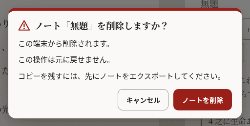

*The question before a note is deleted.*

- [ ] It is unmistakable what will be deleted and that it cannot be undone.
- [ ] The button that deletes says what it deletes.
- [ ] Every text in the table below is correct and sounds natural.
- [ ] Nothing in the pictures is cut off, overlapping or badly broken across lines.

**The 26 texts of this part**

| Key | English | 日本語 (日本) |
|---|---|---|
| `confirm.permanent` | You cannot undo this. | この操作は元に戻せません。 |
| `confirm.undoable` | You can undo this until your next change. | 次に変更を加えるまでは元に戻せます。 |
| `confirm.note.title` | Delete the note “John 1”? | ノート「ヨハネによる福音書 1」を削除しますか？ |
| `confirm.note.gone` | It will be deleted from this device. | この端末から削除されます。 |
| `confirm.note.keepCopy` | To keep a copy, export your notes first. | コピーを残すには、先にノートをエクスポートしてください。 |
| `confirm.note.action` | Delete note | ノートを削除 |
| `confirm.note.done` | Deleted the note “John 1” | ノート「ヨハネによる福音書 1」を削除しました |
| `confirm.board.title` | Delete the board “John 1”? | ボード「ヨハネによる福音書 1」を削除しますか？ |
| `confirm.board.cards` | The board and its card will be deleted. The board and its 4 cards will be deleted. | ボードとカード1枚が削除されます。 ボードとカード4枚が削除されます。 |
| `confirm.board.empty` | The board is empty. | このボードは空です。 |
| `confirm.board.kept` | Your notes are not changed. | ノートは変更されません。 |
| `confirm.board.action` | Delete board | ボードを削除 |
| `confirm.board.done` | Deleted the board “John 1” | ボード「ヨハネによる福音書 1」を削除しました |
| `confirm.card.title` | Remove John 1:1 from the board? | ヨハネによる福音書 1:1をボードから削除しますか？ |
| `confirm.card.connections` | Its connection is removed too. Its 3 connections are removed too. | つながり1件も削除されます。 つながり3件も削除されます。 |
| `confirm.card.noteKept` | The note itself is not changed. | ノート自体は変更されません。 |
| `confirm.card.action` | Remove card | カードを削除 |
| `confirm.mark.title` | Remove the mark on John 1:2? | ヨハネによる福音書 1:2のマークを削除しますか？ |
| `confirm.mark.leaves` | The verse leaves the collection “Amber”. | この節はコレクション「琥珀色」から外れます。 |
| `confirm.mark.action` | Remove mark | マークを削除 |
| `confirm.translation.title` | Remove Berean Standard Bible from this device? | 文語訳聖書 (Classical)をこの端末から削除しますか？ |
| `confirm.translation.frees` | This frees about 5.4 MB. | 約5.4 MBの空き容量が増えます。 |
| `confirm.translation.kept` | Your notes and marks are not changed. | ノートとマークは変更されません。 |
| `confirm.translation.again` | You can download it again when you are online. | オンラインのときに、もう一度ダウンロードできます。 |
| `confirm.translation.action` | Remove translation | 翻訳を削除 |
| `confirm.translation.done` | Removed Berean Standard Bible from this device | 文語訳聖書 (Classical)をこの端末から削除しました |

#### 2.11 Notices

A line about where the reader’s work is kept, the offer of a newer version, and the notice on this preview.

- [ ] The notice about storage is honest without being alarming.
- [ ] Every text in the table below is correct and sounds natural.

**The 23 texts of this part**

| Key | English | 日本語 (日本) |
|---|---|---|
| `durability.label` | Where your notes are kept | ノートの保存場所 |
| `durability.denied` | This browser may delete your notes to free up space. Save a copy. | このブラウザーは、空き容量を確保するためにノートを削除することがあります。コピーを保存してください。 |
| `durability.stale` | You have not exported your notes for a while. | しばらくノートをエクスポートしていません。 |
| `durability.local` | Your notes live in this browser only. | ノートはこのブラウザーの中にだけあります。 |
| `durability.saveFolder` | Save to a folder | フォルダーに保存 |
| `durability.saveFolderTitle` | Keep a copy as .md files in a folder you choose | 選んだフォルダーに .md ファイルとしてコピーを保存します |
| `durability.exportNow` | Export now | 今すぐエクスポート |
| `durability.dismiss` | Dismiss this notice | このお知らせを閉じる |
| `update.label` | A new version is ready | 新しいバージョンがあります |
| `update.ready` | A new version of Scriptura is ready. | Scriptura の新しいバージョンがあります。 |
| `update.readyAnnounce` | A new version of Scriptura is ready. Reload when it suits you. | Scriptura の新しいバージョンがあります。都合のよいときに再読み込みしてください。 |
| `update.reload` | Reload | 再読み込み |
| `update.reloading` | Reloading… | 再読み込み中… |
| `update.later` | Later | 後で |
| `previewBuild.label` | Preview | プレビュー版 |
| `previewBuild.intro` | **Preview.** An early build for the people reviewing its translations. | **プレビュー版です。**翻訳を確認していただく方のための早期版です。 |
| `previewBuild.report` | Report a translation correction on GitHub (opens in a new tab) | GitHubで翻訳の修正を報告する（新しいタブで開きます） |
| `previewBuild.reportShort` The notice's short link; `newTab` completes its name for a screen reader. | Report a correction | 修正を報告する |
| `previewBuild.newTab` | (on GitHub, opens in a new tab) | （GitHub、新しいタブで開きます） |
| `previewBuild.hide` | Hide | 非表示 |
| `previewBuild.heading` | About this preview | このプレビュー版について |
| `previewBuild.about` | This build is for the people checking the interface in Spanish, French, Japanese, Chinese and Portuguese. Nothing you do here is sent anywhere: your notes and marks stay in this browser. To report a word that is wrong or unclear, use the link below. It opens a short form on GitHub, which needs a free account. | この版は、スペイン語・フランス語・日本語・中国語・ポルトガル語の画面表示を確認していただく方のためのものです。ここでの操作内容はどこにも送信されません。ノートとマークはこのブラウザーの中に残ります。誤りやわかりにくい言葉を見つけたら、下のリンクから報告してください。GitHubの短いフォームが開きます（無料のアカウントが必要です）。 |
| `previewBuild.version` | Version: 0.1.0 | バージョン：0.1.0 |

#### 2.12 Panes, tabs and the sheet

The names of the two panes, the tabs that choose between notes and a board, and the buttons that resize them. Mostly heard, not seen.

- [ ] Every text in the table below is correct and sounds natural.

**The 20 texts of this part**

| Key | English | 日本語 (日本) |
|---|---|---|
| `layout.scripture` | Scripture | 聖書本文 |
| `layout.notes` | Notes | ノート |
| `layout.expandNotes` | Expand notes | ノートを広げる |
| `layout.collapseNotes` | Collapse notes | ノートを縮める |
| `layout.gripWithNews` | Expand notes, Quoted John 1:3-5 | ノートを広げる。ヨハネによる福音書 1:3-5を引用しました |
| `layout.sheetHint` | Drag, or use the up and down arrow keys, to make the notes taller or shorter. | ドラッグするか、上下の矢印キーで、ノートの高さを変えられます。 |
| `layout.notesMoreRoom` | Give the notes more room | ノートの幅を広げる |
| `layout.bibleMoreRoom` | Give the Bible more room | 聖書の幅を広げる |
| `layout.resize` | Resize panes | パネルの幅を変える |
| `layout.split` Both shares arrive formatted as percentages. | 56% Bible, 44% notes | 聖書 56%、ノート 44% |
| `layout.showNotes` | Show notes | ノートを表示 |
| `layout.paneBible` | Bible | 聖書 |
| `layout.paneNotes` | Notes | ノート |
| `layout.sides` The side pane holds the notes or the canvas; these name the switch and the canvas side. | Notes or canvas | ノートまたはボード |
| `layout.paneBoard` | Canvas | ボード |
| `layout.expandBoard` | Expand canvas | ボードを広げる |
| `layout.collapseBoard` | Collapse canvas | ボードを縮める |
| `layout.showBoard` | Show canvas | ボードを表示 |
| `layout.maximize` | Maximize Bible | 聖書を最大化 |
| `layout.restore` | Restore Bible | 聖書を元のサイズに戻す |

#### 2.13 What an assistant proposes

When the reader has allowed an assistant to help, what it wants to add is shown first and waits for a yes.

- [ ] Every text in the table below is correct and sounds natural.

**The 10 texts of this part**

| Key | English | 日本語 (日本) |
|---|---|---|
| `proposal.noteTitle` | A note has been drafted for you | ノートの下書きが作成されました |
| `proposal.marksTitle` | Verses suggested for marking | マークの候補になった節 |
| `proposal.lede` | An assistant proposed this. Nothing has been saved — review it, change anything you like, and it only takes effect when you accept. | アシスタントからの提案です。まだ何も保存されていません。内容を確認し、自由に変更してください。承認したときにだけ反映されます。 |
| `proposal.titleInput` | Proposed note title | 提案されたノートのタイトル |
| `proposal.bodyInput` | Proposed note body | 提案されたノートの本文 |
| `proposal.into` `{collection}` is replaced by the collection's name, in bold. | Into {collection} (amber) | {collection}（琥珀色の色）にマーク |
| `proposal.missing` | Not in this translation. | この訳にはありません。 |
| `proposal.discard` | Discard | 破棄 |
| `proposal.save` | Save this note | このノートを保存 |
| `proposal.mark` | Mark 1 verse Mark 3 verses | 1節をマーク 3節をマーク |

---

## Part 3: Try it yourself

Open **<https://alanroman117.github.io/Scriptura/>** on a computer, and then on a phone if you can.

The app follows your browser's language. If it does not open in 日本語 (日本), choose the gear in the bar at the top, then the first choice in the panel, and pick **日本語 (日本)**.

A picture shows words standing still. What you are looking for here is what only use can show: a word that does not fit its button, a message that arrives at the wrong moment, a sentence that is right alone and wrong after the one before it.

- [ ] Accept the Bible the app offers in your language, and read the first chapter of John.
- [ ] Press a verse, then two more. Read what the row says, then press **引用**.
- [ ] Read the note that was made, and the line beneath it.
- [ ] Type a word into the search box and read the count. Open the full list of results.
- [ ] Type a reference, such as "ヨハネによる福音書 3:16", and press <kbd>Enter</kbd>.
- [ ] Mark a verse with a colour, then open **マーク** and give that colour a name.
- [ ] Open **翻訳**: download another Bible, compare it with yours, then remove it and read the question it asks.
- [ ] Open **設定** and read it from top to bottom, changing each choice once.
- [ ] Open **ヘルプ** and read it as a newcomer would.
- [ ] Put two verses on a board (**ボードへ**), open the board, and join them.
- [ ] Delete the note and read the question it asks.
- [ ] On a phone: do the first three steps again, upright and on its side.
- [ ] If you use a screen reader: listen to the bar at the top, to a verse being selected, and to a quote being made. The interface should be spoken in your language, and the Bible in its own.

While you do this:

- [ ] No text is cut off, runs out of its button, or sits on top of another.
- [ ] No English appears where your language should be. (The names of Bibles are as their publishers wrote them, and what an assistant may do, in Settings, is in English on purpose.)
- [ ] Numbers, sizes and counts look right as they change.
- [ ] Nothing reads as rude, childish, or stiffer than the rest.

---

## Your notes

<!-- YOURS: everything below this line is kept when the guide is written again. -->

### What should change

One row for each correction. Add as many rows as you need.

| Where (the key, or the screen) | What is wrong | What it should say |
|---|---|---|
| | | |
| | | |
| | | |
| | | |
| | | |
| | | |

### Anything else

What a table cannot hold: the tone as a whole, a word you would change everywhere, something that confused you.

> 

### Your verdict

- [ ] It can be published as it is.
- [ ] It can be published once the corrections above are made.
- [ ] It needs another reading after the corrections.

| | |
|---|---|
| Reviewed by | |
| Date | |
| Version tested (Help, "About this preview") | |
| Device and browser | |
| Parts done (1, 2, 3) | |
