# The Scriptura reader in Português (Brasil): a guide for its reviewer

The reader's interface has been drafted in Portuguese (Brazil) and has not yet been read by someone whose language it is. You are that reader. Nothing here is final until you say so.

This guide puts every word in front of you without your having to hunt for it, in three parts:

| Part | What you do | About |
|---|---|---|
| [1. First pass](#part-1-first-pass) | Read the voice, the words used everywhere, and how numbers are written. | 15 minutes |
| [2. Screen by screen](#part-2-screen-by-screen) | Look at each picture, then read every text that belongs to it. | 60 to 90 minutes |
| [3. Try it yourself](#part-3-try-it-yourself) | Use the app in your language and look for what a picture cannot show. | 30 minutes |

Part 1 alone already tells us a great deal. If you can give only a quarter of an hour, give it to Part 1.

## How to send corrections

- **In this file:** write them in [Your notes](#your-notes) at the end and send the file back. A ticked box anywhere above means "I checked this and it is right."
- **Or on the web:** [the correction form for Português (Brasil)](https://github.com/AlanRoman117/Scriptura/issues/new?template=translation-pt.yml).
- Either way, give the **key** from the first column of a table (for example `verseActions.quote`) so we can find the text, and what it should say instead.

## How to read the tables

- Each row is one text. **Key** is its name in the program, **English** is the original, and **Português (Brasil)** is what is being reviewed.
- The small print under a key, where there is some, is the programmer's own note on that text. It often says whether the text is shown on the screen or only spoken by a screen reader, which a blind reader uses.
- Names and numbers inside a text are examples: "João 1:3-5", "Bíblia Livre", "1.382". The app puts the real ones there. Where a text changes with a number, it is shown with one and with several.
- A word in braces, such as `{count}`, is a place where the app puts a number or a name. Leave it as it is; it may move within the sentence.
- `␣` marks a space at the start or end of a text that has to stay, and <kbd>Enter</kbd> is a key on the keyboard.
- The pictures were taken with the Bible "Bíblia Livre" open, so the names of books are that Bible's own.

---

## Part 1: First pass

### 1.1 The voice

The text is meant to be written in this register: **você**, with quotation marks “ ”.

- [ ] The reader is addressed as *você* throughout.
- [ ] Brazilian Portuguese in vocabulary and spelling, not Portugal's (*tela*, not *ecrã*; *arquivo*, not *ficheiro*).
- [ ] Quotation marks “ ”.
- [ ] It sounds like someone writing in Portuguese, not like a translation from English.

### 1.2 The words used everywhere

These are the names of the app's own things. Each is used the same way on every screen, so one that is wrong is wrong everywhere.

| In English | In Português (Brasil) | Right? |
|---|---|---|
| Notes / note | Notas / nota | |
| Marks / mark (verb) | Marcas / marcar | |
| Collection | Coleção | |
| Board | Quadro | |
| Card | Cartão | |
| Connection | Conexão | |
| Quote | Citar | |
| Link | Vincular | |
| Canvas (put on a board) | Ao quadro | |
| Translation | Tradução | |
| Scripture | Texto bíblico | |
| Passage | Passagem | |
| Book / chapter / verse | Livro / capítulo / versículo | |
| Search | Pesquisar | |
| Whole words only | Apenas palavras inteiras | |
| Match case | Diferenciar maiúsculas | |
| Settings | Configurações | |
| Help | Ajuda | |
| Export | Exportar | |
| Preview / Write | Visualizar / Escrever | |
| Delete / Remove | Excluir / Remover | |
| Undo | Desfazer | |
| Folder | Pasta | |
| Assistant | Assistente | |
| Delete the note “…”? (the confirmation) | Excluir a nota “…”? | |
| You cannot undo this. | Isso não pode ser desfeito. | |
| Untitled | Sem título | |
| Bold / Italic glyphs | N / I | |

- [ ] Each is the word a reader of the Bible in Portuguese (Brazil) would expect.
- [ ] None of them is used for two different things.

### 1.3 Numbers and counts

How the app writes a number, a percentage and a size in this language, and how one text changes with the number in it.

| | Written as |
|---|---|
| One thousand three hundred and eighty-two | 1.382 |
| Fifty-eight per cent | 58% |
| The size of a download | 5,4 MB |
| 0 search results | 0 resultado |
| 1 search result | 1 resultado |
| 2 search results | 2 resultados |
| 5 search results | 5 resultados |
| 1382 search results | 1.382 resultados |
| 1 verse selected | 1 versículo · João 1:3 |
| 2 verses selected | 2 versículos · João 1:3-4 |
| 5 verses selected | 5 versículos · João 1:3-7 |

- [ ] Thousands are grouped, and the percentage is written, the way this language does it.
- [ ] Every count above is grammatical, zero and one included.

---

## Part 2: Screen by screen

For each screen: look at the picture first, then tick what you have checked, then read the table. The order is the order in which a reader meets things.

### What every reader sees

If time is short, these four screens matter most: they are the app on an ordinary day.

#### 2.1 The first visit, and reading a chapter

The bar across the top chooses the book, the chapter and the translation, and opens Marks, Settings and Help. A reader whose language is not English is first offered a Bible in it.

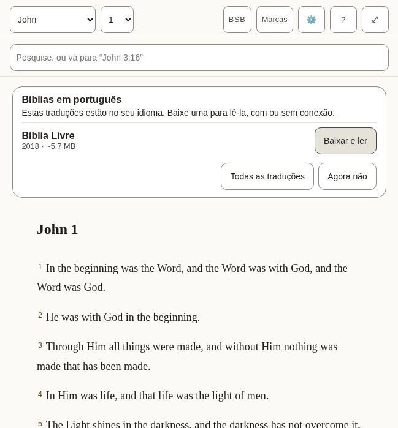

*What a new reader sees: the offer of a Bible in this language, over the English one the app arrives with.*

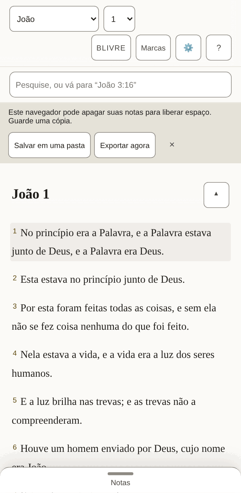

*The same, on a phone, once a Bible in this language is open.*

- [ ] The offer reads as an invitation, and its buttons are clear about what they will do.
- [ ] Nothing in the bar is cut short or squeezed, on the phone above all.
- [ ] Every text in the table below is correct and sounds natural.
- [ ] Nothing in the pictures is cut off, overlapping or badly broken across lines.

**The 48 texts of this part**

| Key | English | Português (Brasil) |
|---|---|---|
| `app.name` | Scriptura Reader | Scriptura Reader |
| `app.downloading` | Downloading the text for offline use… | Baixando o texto para uso offline… |
| `app.opening` | Opening… | Abrindo… |
| `app.bootFailed` | The Bible text could not be opened. Reload to try again. | Não foi possível abrir o texto bíblico. Recarregue para tentar de novo. |
| `app.skipToScripture` | Skip to scripture | Pular para o texto bíblico |
| `app.skipToNotes` | Skip to notes | Pular para as notas |
| `app.skipToBoard` | Skip to the canvas | Pular para os quadros |
| `app.title` | John 1 · BSB · Scriptura | João 1 · BLIVRE · Scriptura |
| `app.passageTitle` | John 1 · BSB | João 1 · BLIVRE |
| `app.boardTitle` | John 1 · Boards | João 1 · Quadros |
| `app.opened` | Settings opened | Painel Configurações aberto |
| `app.closed` | Settings closed | Painel Configurações fechado |
| `app.boardSaveFailed` | Could not save the board — export your notes | Não foi possível salvar o quadro — exporte suas notas |
| `app.languageChanged` | The interface is now in English. | A interface agora está em português. |
| `reader.passage` | Passage | Passagem |
| `reader.book` | Book | Livro |
| `reader.chapter` | Chapter | Capítulo |
| `reader.translationChip` | BSB — Berean Standard Bible. Choose or add a translation | BLIVRE — Bíblia Livre. Escolher ou adicionar uma tradução |
| `reader.marks` | Marks | Marcas |
| `reader.marksChip` The Marks button's name. It holds the word and the count the button shows, in that order and without brackets, so someone using voice control can say what they see (WCAG 2.5.3). | Marks 7 — verses you have marked, by colour | Marcas 7 — versículos que você marcou, por cor |
| `reader.settingsChip` | Settings — display, storage, export, and assistant access | Configurações — exibição, armazenamento, exportação e acesso do assistente |
| `reader.helpChip` | Help — finding passages, searching, notes, marks, boards, keyboard, and what the abbreviations mean | Ajuda — encontrar passagens, pesquisar, notas, marcas, quadros, teclado e o que significam as abreviações |
| `reader.selectVerse` A verse's number: a toggle that adds the verse to the selection or takes it out. | Select John 1:2 | Selecionar João 1:2 |
| `reader.selectVerseIn` | Select John 1:2 — in Amber (amber) | Selecionar João 1:2 — em Âmbar (âmbar) |
| `reader.selection` Said when the selection changes and focus does not move to say it. | 1 verse selected: John 1:3 3 verses selected: John 1:3-5 | 1 versículo selecionado: João 1:3 3 versículos selecionados: João 1:3-5 |
| `reader.selectionCleared` | Selection cleared | Seleção removida |
| `reader.chapterMissing` | This chapter is not in Berean Standard Bible. | Este capítulo não está em Bíblia Livre. |
| `reader.readingAnnounce` | Reading Berean Standard Bible | Lendo Bíblia Livre |
| `reader.showMenus` The button at the end of the chapter title, on a small screen: named for what a press will do. | Show the reading menus | Mostrar os menus de leitura |
| `reader.hideMenus` | Hide the reading menus | Ocultar os menus de leitura |
| `panels.marks` | Marks | Marcas |
| `panels.translations` | Translations | Traduções |
| `panels.settings` | Settings | Configurações |
| `panels.help` | Help | Ajuda |
| `panels.results` | Search results | Resultados da pesquisa |
| `common.cancel` | Cancel | Cancelar |
| `common.untitledNote` | Untitled | Sem título |
| `common.untitledBoard` | Untitled board | Quadro sem título |
| `common.source` | Berean Standard Bible source | Fonte de Bíblia Livre |
| `common.undoRemove` | Undo remove | Desfazer |
| `common.remove` | Remove | Remover |
| `common.done` | Done | Pronto |
| `offer.title` | Bibles in English | Bíblias em português |
| `offer.intro` | These translations are in your language. Download one to read it, online or offline. | Estas traduções estão no seu idioma. Baixe uma para lê-la, com ou sem conexão. |
| `offer.downloadAndRead` | Download and read | Baixar e ler |
| `offer.downloadAndReadName` | Download and read Berean Standard Bible | Baixar e ler Bíblia Livre |
| `offer.allTranslations` | All translations | Todas as traduções |
| `offer.notNow` | Not now | Agora não |

#### 2.2 Selecting verses and acting on them

Pressing a verse selects it and opens a row of actions: five colours to mark it with, then Quote, Link and Canvas. Pressing more verses adds them, and the row says how many it holds.

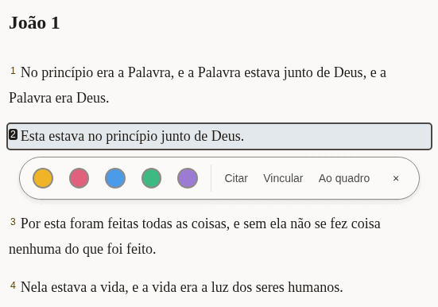

*One verse selected.*

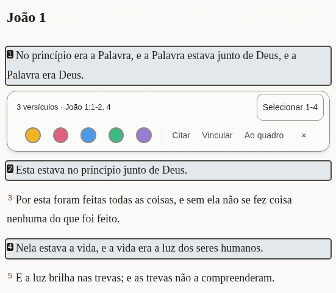

*Three verses selected, two of them together and one apart: the row says so, and offers to take in the verses between.*

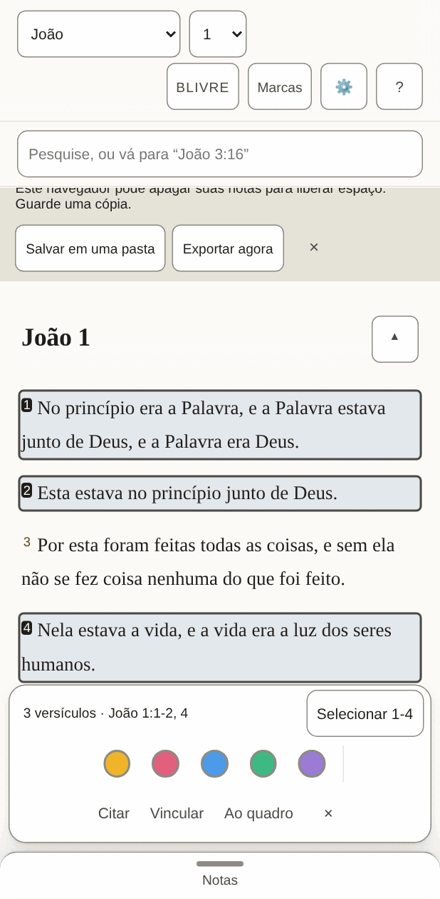

*On a phone the row sits at the bottom of the screen.*

- [ ] The summary ("3 verses · …") and the button beside it fit on one line.
- [ ] The three words for the actions are short enough to sit side by side on a phone.
- [ ] Every text in the table below is correct and sounds natural.
- [ ] Nothing in the pictures is cut off, overlapping or badly broken across lines.

**The 24 texts of this part**

| Key | English | Português (Brasil) |
|---|---|---|
| `verseActions.group` | Actions for John 1:2 | Ações para João 1:2 |
| `verseActions.mark` | Mark as Amber (amber) | Marcar como Âmbar (âmbar) |
| `verseActions.quote` | Quote | Citar |
| `verseActions.link` | Link | Vincular |
| `verseActions.canvas` | Canvas | Ao quadro |
| `verseActions.canvasName` | Canvas — put this verse on the board | Ao quadro — colocar este versículo no quadro |
| `verseActions.close` | Close actions for John 1:2 | Fechar as ações de João 1:2 |
| `verseActions.groupMany` The row's name when it holds several verses. | Actions for 1 verse: John 1:3 Actions for 3 verses: John 1:3-5 | Ações para 1 versículo: João 1:3 Ações para 3 versículos: João 1:3-5 |
| `verseActions.summary` Shown in the row while several are selected, so what it will act on is in words. | 1 verse · John 1:3 3 verses · John 1:3-5 | 1 versículo · João 1:3 3 versículos · João 1:3-5 |
| `verseActions.fill` The button that takes in every verse between the first and the last selected: "Select 3-18". | Select 3-18 | Selecionar 3-18 |
| `verseActions.canvasNameMany` | Canvas — put these verses on the board | Ao quadro — colocar estes versículos no quadro |
| `verseActions.clear` | Clear the selection | Remover a seleção |
| `verseActions.marked` | Marked 1 verse as Amber (amber) Marked 3 verses as Amber (amber) | 1 versículo marcado como Âmbar (âmbar) 3 versículos marcados como Âmbar (âmbar) |
| `verseActions.unmarked` | Cleared Amber (amber) from 1 verse Cleared Amber (amber) from 3 verses | 1 versículo retirado de Âmbar (âmbar) 3 versículos retirados de Âmbar (âmbar) |
| `colours.amber` | Amber | Âmbar |
| `colours.rose` | Rose | Rosa |
| `colours.sky` | Sky | Céu |
| `colours.mint` | Mint | Menta |
| `colours.violet` | Violet | Violeta |
| `colourWords.amber` | amber | âmbar |
| `colourWords.rose` | rose | rosa |
| `colourWords.sky` | sky | céu |
| `colourWords.mint` | mint | menta |
| `colourWords.violet` | violet | violeta |

#### 2.3 Notes

The pane beside the Bible, where a reader writes. A quoted passage arrives with its reference, and a line under the note says what was just done and whether it is saved.

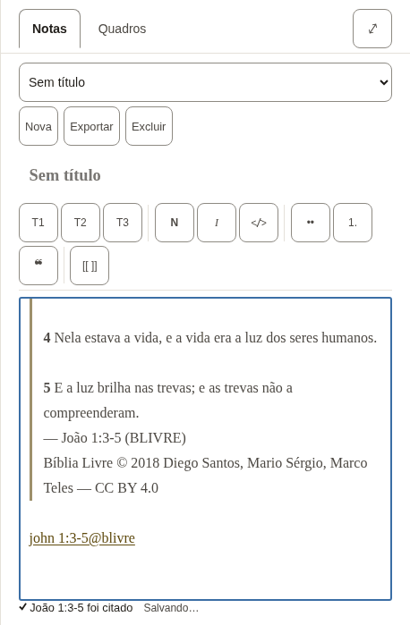

*A new note with three verses quoted into it.*

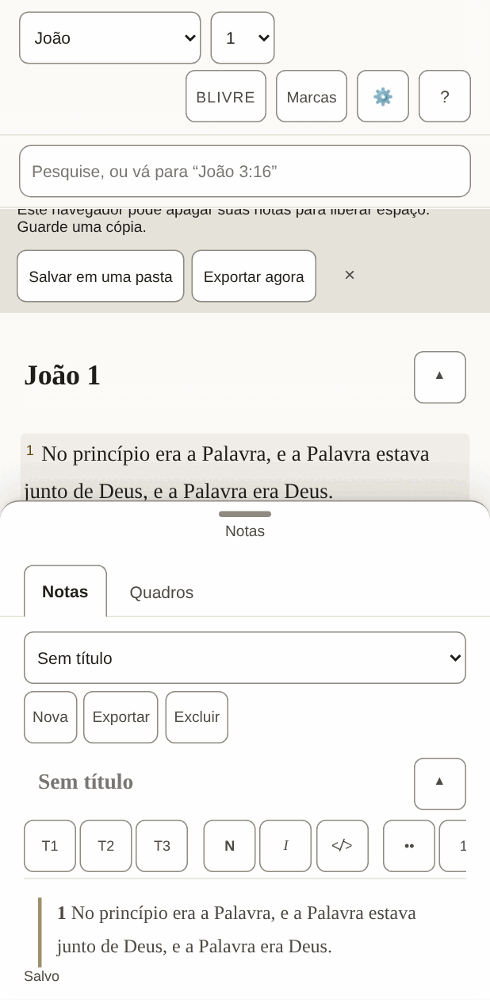

*On a phone the notes are a sheet that slides up over the text.*

- [ ] The formatting buttons carry one or two letters each (bold, italic, headings): they should be the letters a writer in this language expects.
- [ ] The line under the note ("Quoted …", "Saved") reads as a short report, not a sentence cut in two.
- [ ] Every text in the table below is correct and sounds natural.
- [ ] Nothing in the pictures is cut off, overlapping or badly broken across lines.

**The 51 texts of this part**

| Key | English | Português (Brasil) |
|---|---|---|
| `notes.new` A new note. Nouns have gender in other languages, so notes and boards each say it. | New | Nova |
| `notes.startOne` | Start one | Criar uma |
| `notes.heading` | Notes | Notas |
| `notes.picker` | Note | Nota |
| `notes.showMenus` | Show the note menus | Mostrar os menus da nota |
| `notes.hideMenus` | Hide the note menus | Ocultar os menus da nota |
| `notes.none` | No notes yet | Ainda não há notas |
| `notes.preview` | Preview | Visualizar |
| `notes.write` | Write | Escrever |
| `notes.previewTitle` | See it rendered | Ver como fica |
| `notes.writeTitle` | Back to writing | Voltar a escrever |
| `notes.canvas` | Canvas | Quadros |
| `notes.canvasTitle` | Lay verses and notes out on a board | Dispor versículos e notas em um quadro |
| `notes.export` | Export | Exportar |
| `notes.exportTitle` | Download every note and board as Markdown in a .zip | Baixar todas as notas e quadros em Markdown, em um .zip |
| `notes.delete` | Delete | Excluir |
| `notes.title` | Note title | Título da nota |
| `notes.body` | Note body | Corpo da nota |
| `notes.placeholder` | Write here… | Escreva aqui… |
| `notes.goTo` | Go to John 1:3-5 | Ir para João 1:3-5 |
| `notes.noneOpen` | No note open. | Nenhuma nota aberta. |
| `notes.saveFailed` | Could not save — export your notes | Não foi possível salvar — exporte suas notas |
| `notes.saving` | Saving… | Salvando… |
| `notes.saved` | Saved | Salvo |
| `notes.linkIn` | John 1:3-5 (KJV) | João 1:3-5 (BSB) |
| `notes.linkMissing` | John 1:3-5 (KJV — not downloaded) | João 1:3-5 (BSB — não baixada) |
| `tools.label` | Formatting | Formatação |
| `tools.heading` Said for the H1, H2 and H3 buttons. It starts with the letters the button shows (headingGlyph), so someone using voice control can say what they see (WCAG 2.5.3). | H2, heading 2 | T2, título 2 |
| `tools.headingGlyph` | H2 | T2 |
| `tools.bold` | Bold | Negrito |
| `tools.boldGlyph` | B | N |
| `tools.italic` | Italic | Itálico |
| `tools.italicGlyph` | I | I |
| `tools.code` | Code | Código |
| `tools.bullets` | Bulleted list | Lista com marcadores |
| `tools.numbers` The numbered-list button shows "1.", so its name starts with it, as the heading buttons' do (WCAG 2.5.3). | 1. Numbered list | 1. Lista numerada |
| `tools.quote` | Quote | Citação |
| `tools.link` | Link to a passage | Link para uma passagem |
| `insert.quoted` | Quoted John 1:3-5 | João 1:3-5 foi citado |
| `insert.quotedFrom` | Quoted John 1:3-5 (BSB) | João 1:3-5 (BLIVRE) foi citado |
| `insert.linked` | Linked John 1:3-5 | João 1:3-5 foi vinculado |
| `insert.addedBoard` | Added the board “John 1” | O quadro “João 1” foi adicionado |
| `insert.addedToBoard` | Added John 1:3-5 to “John 1” | João 1:3-5 foi adicionado ao quadro “João 1” |
| `insert.alreadyOnBoard` | John 1:3-5 is already on “John 1” | João 1:3-5 já está em “João 1” |
| `insert.inNewNote` | Quoted John 1:3-5 in a new note | João 1:3-5 foi citado em uma nota nova |
| `insert.inNote` | Quoted John 1:3-5 in “John 1” | João 1:3-5 foi citado em “João 1” |
| `insert.inUntitledNote` | Quoted John 1:3-5 in an untitled note | João 1:3-5 foi citado em uma nota sem título |
| `insert.studyBoard` | Study board | Quadro de estudo |
| `preview.empty` | Nothing written yet. | Ainda não há nada escrito. |
| `preview.editHere` | Edit here (block 3) | Editar aqui (bloco 3) |
| `preview.goTo` | Go to John 1:3-5 | Ir para João 1:3-5 |

#### 2.4 Search

One box does two things: a reference goes straight to the passage, anything else searches the open Bible. The short list under the box is for jumping; the full list counts every match, book by book.

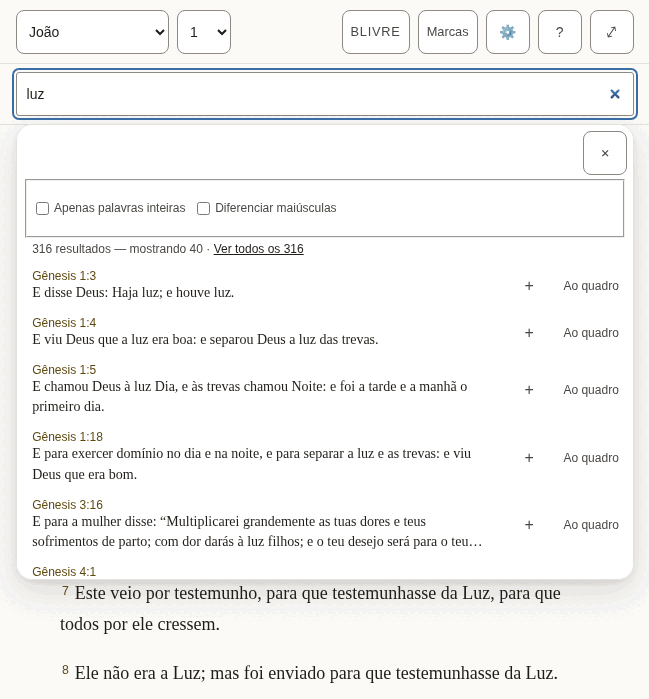

*The suggestions under the box.*

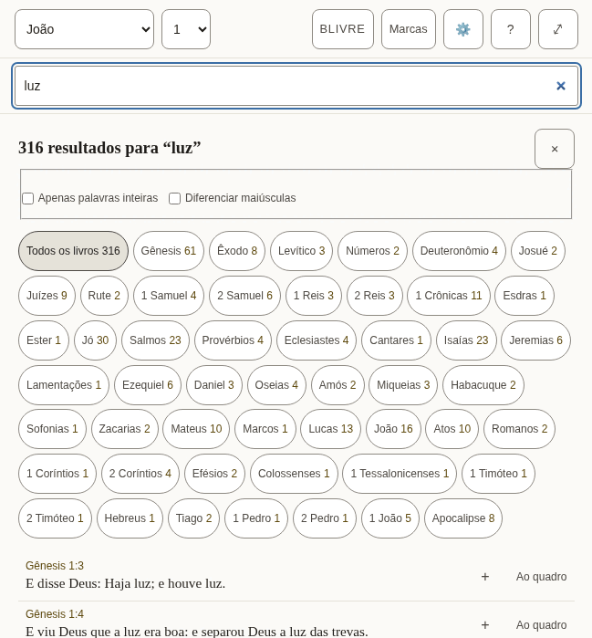

*Every match, with the count for each book.*

- [ ] The counts read naturally with a small number and with a large one.
- [ ] The two options ("Whole words only", "Match case") are understood without explanation.
- [ ] Every text in the table below is correct and sounds natural.
- [ ] Nothing in the pictures is cut off, overlapping or badly broken across lines.

**The 31 texts of this part**

| Key | English | Português (Brasil) |
|---|---|---|
| `search.label` | Search or go to a reference | Pesquisar ou ir para uma referência |
| `search.placeholder` | Search, or go to "John 3:16" | Pesquise, ou vá para “João 3:16” |
| `search.hint` | Enter opens the passage, or every match. Down arrow moves into the suggestions. | Enter abre a passagem, ou todos os resultados. A seta para baixo entra nas sugestões. |
| `search.suggestions` | Suggestions | Sugestões |
| `search.goTo` | Go to John 1:2 | Ir para João 1:2 |
| `search.close` | Close suggestions | Fechar as sugestões |
| `search.matching` | Matching | Correspondência |
| `search.wholeWords` | Whole words only | Apenas palavras inteiras |
| `search.wholeWordsHint` | Finds love but not loveth. Off, the search also looks inside longer words. | Encontra amor, mas não amoroso. Desligado, a pesquisa também olha dentro de palavras maiores. |
| `search.matchCase` | Match case | Diferenciar maiúsculas |
| `search.matchCaseHint` | Capital letters matter: God and god are different. | As maiúsculas contam: Deus e deus são diferentes. |
| `search.noMatches` | No matches | Nenhum resultado |
| `search.matches` | 1 match 1,382 matches | 1 resultado 1.382 resultados |
| `search.showing` | ␣— showing 40 | ␣— mostrando 40 |
| `search.seeAll` | See all 1,382 | Ver todos os 1.382 |
| `search.insert` | Insert John 1:2 into the open note | Inserir João 1:2 na nota aberta |
| `search.toCanvas` The name of a result's Canvas button: its visible word first (2.5.3). | Canvas — put John 1:2 on the board | Ao quadro — colocar João 1:2 no quadro |
| `search.weakBelow` | Below: inside a longer word | Abaixo: dentro de uma palavra maior |
| `search.announceNone` | No matches for “light” | Nenhum resultado para “luz” |
| `search.announceCount` | 1 match for “light” 1,382 matches for “light” | 1 resultado para “luz” 1.382 resultados para “luz” |
| `results.label` | Search results | Resultados da pesquisa |
| `results.heading` `{count}` is replaced by the total, in its own element. | {count} match for “light” {count} matches for “light” | {count} resultado para “luz” {count} resultados para “luz” |
| `results.close` | Close search results | Fechar os resultados |
| `results.filter` | Filter by book | Filtrar por livro |
| `results.allBooks` | All books | Todos os livros |
| `results.weakBelow` | Below: “light” inside a longer word | Abaixo: “luz” dentro de uma palavra maior |
| `results.insert` | Quote John 1:2 into the open note | Citar João 1:2 na nota aberta |
| `results.insertTitle` | Quote into the open note | Citar na nota aberta |
| `results.showing` | Showing 100 of 1,382 | Mostrando 100 de 1.382 |
| `results.inBook` | ␣in John | ␣em João |
| `results.more` | Show 100 more | Mostrar mais 100 |

### The panels

Opened from the bar. They take the place of the chapter while they are open.

#### 2.5 Marks

Each of the five colours is a collection of the verses marked with it, and can be given a name of the reader’s own.

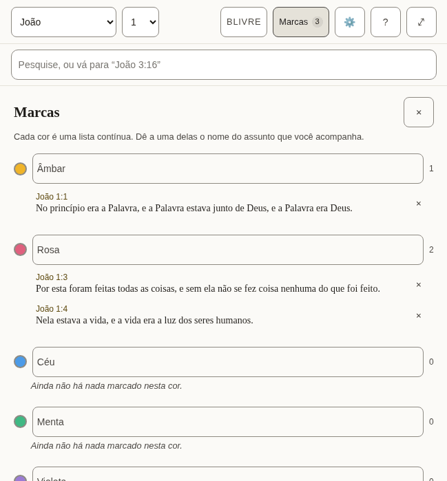

*Three marked verses in two collections.*

- [ ] The colour names are the everyday words for those colours.
- [ ] Every text in the table below is correct and sounds natural.
- [ ] Nothing in the pictures is cut off, overlapping or badly broken across lines.

**The 9 texts of this part**

| Key | English | Português (Brasil) |
|---|---|---|
| `marks.label` | Marked verses | Versículos marcados |
| `marks.title` | Marks | Marcas |
| `marks.close` | Close marks | Fechar as marcas |
| `marks.hint` | Each colour is a running list. Name one for the subject you are tracking. | Cada cor é uma lista contínua. Dê a uma delas o nome do assunto que você acompanha. |
| `marks.nameFor` | Name for the amber collection | Nome da coleção âmbar |
| `marks.empty` | Nothing marked in this colour yet. | Ainda não há nada marcado nesta cor. |
| `marks.remove` | Remove the mark on John 1:2 | Remover a marca em João 1:2 |
| `marks.removed` | Mark removed. Undo is available in the Marks bar. | A marca foi removida. Você pode desfazer na barra de Marcas. |
| `marks.restored` | Mark restored | A marca foi restaurada |

#### 2.6 Translations, and reading two side by side

Where a Bible is downloaded, read, compared with the one being read, or removed. Each shows its size before it is downloaded.

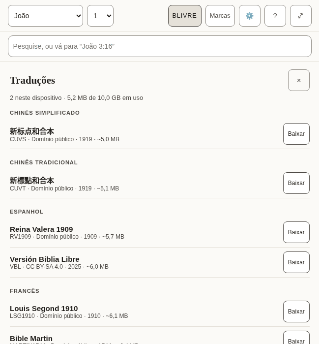

*The list of translations, by language.*

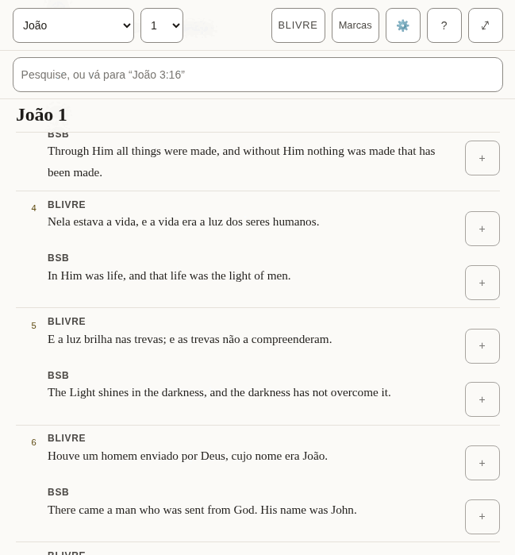

*Two translations, verse by verse.*

- [ ] The language headings are how this language names those languages.
- [ ] The note about what removing a translation does and does not touch is plain.
- [ ] Every text in the table below is correct and sounds natural.
- [ ] Nothing in the pictures is cut off, overlapping or badly broken across lines.

**The 32 texts of this part**

| Key | English | Português (Brasil) |
|---|---|---|
| `library.title` | Translations | Traduções |
| `library.close` | Close translations | Fechar as traduções |
| `library.onDevice` | 2 on this device | 2 neste dispositivo |
| `library.used` | 11.8 MB of 1.9 GB used | 11,8 MB de 1,9 GB em uso |
| `library.about` | about 5.4 MB | cerca de 5,4 MB |
| `library.licences.public-domain` | Public domain | Domínio público |
| `library.licences.cc-by-4.0` | CC BY 4.0 | CC BY 4.0 |
| `library.licences.cc-by-sa-4.0` | CC BY-SA 4.0 | CC BY-SA 4.0 |
| `library.licences.cc0` | CC0 | CC0 |
| `library.licences.custom-free` | Free licence | Licença livre |
| `library.reading` | Reading | Lendo |
| `library.comparing` | Comparing | Comparando |
| `library.read` | Read | Ler |
| `library.compare` | Compare | Comparar |
| `library.compareTitle` | Show beside the translation you are reading | Mostrar ao lado da tradução que você está lendo |
| `library.downloading` | Downloading Berean Standard Bible | Baixando Bíblia Livre |
| `library.download` | Download | Baixar |
| `library.removeActive` | Remove Berean Standard Bible — switch to another translation first | Remover Bíblia Livre — mude para outra tradução antes |
| `library.removeFromDevice` | Remove Berean Standard Bible from this device | Remover Bíblia Livre deste dispositivo |
| `library.note` | A downloaded translation stays on this device and can be read offline. Removing one never touches your notes or marks: both belong to the passage, not to a translation. | Uma tradução baixada fica neste dispositivo e pode ser lida offline. Removê-la nunca mexe nas suas notas nem nas suas marcas: as duas pertencem à passagem, não a uma tradução. |
| `library.progress` | Berean Standard Bible: 50% downloaded | Bíblia Livre: 50% baixado |
| `library.downloaded` | Berean Standard Bible downloaded | Bíblia Livre foi baixada |
| `library.failed` | Berean Standard Bible: No connection — try again when you are online. | Bíblia Livre: Sem conexão — tente de novo quando estiver online. |
| `library.failedOnline` | The download did not finish. Try again later. | O download não terminou. Tente de novo mais tarde. |
| `library.offline` | No connection — try again when you are online. | Sem conexão — tente de novo quando estiver online. |
| `compare.label` | Translations side by side | Traduções lado a lado |
| `compare.compared` | Translations compared | Traduções comparadas |
| `compare.stop` | Stop comparing KJV | Parar de comparar BSB |
| `compare.verse` | Verse | Versículo |
| `compare.verseBefore` | Verse␣ | Versículo␣ |
| `compare.missing` | Not in KJV | Não está em BSB |
| `compare.quote` | Quote KJV verse 16 | Citar o versículo 16 de BSB |

#### 2.7 Settings

How the text looks, the interface language, where the reader’s work is kept, and whether an assistant may help.

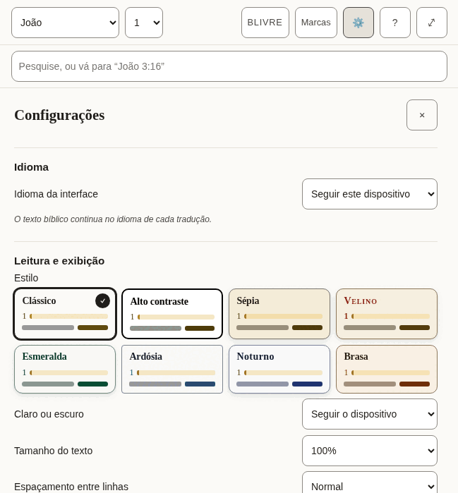

*The top of Settings.*

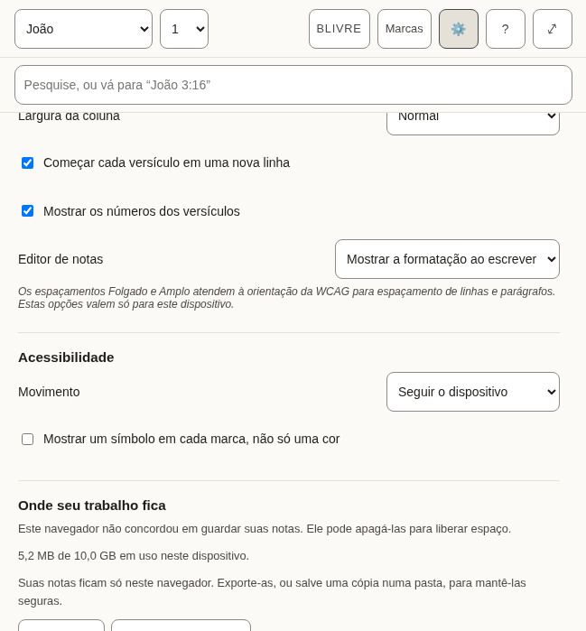

*Further down.*

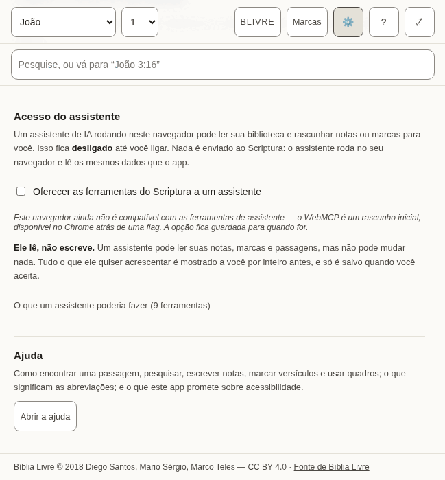

*The end.*

- [ ] Each label and the choices under it read as one thought.
- [ ] The style names are evocative, not literal (Vellum, Emerald, Nocturne): they should sound like names, not descriptions.
- [ ] The explanations in smaller type are complete sentences and easy to follow.
- [ ] Every text in the table below is correct and sounds natural.
- [ ] Nothing in the pictures is cut off, overlapping or badly broken across lines.

**The 66 texts of this part**

| Key | English | Português (Brasil) |
|---|---|---|
| `settings.title` | Settings | Configurações |
| `settings.close` | Close settings | Fechar as configurações |
| `settings.display` | Reading &amp; display | Leitura e exibição |
| `settings.style` | Style | Estilo |
| `settings.styles.classic` | Classic | Clássico |
| `settings.styles.contrast` | High contrast | Alto contraste |
| `settings.styles.sepia` | Sepia | Sépia |
| `settings.styles.vellum` | Vellum | Velino |
| `settings.styles.emerald` | Emerald | Esmeralda |
| `settings.styles.slate` | Slate | Ardósia |
| `settings.styles.nocturne` | Nocturne | Noturno |
| `settings.styles.ember` | Ember | Brasa |
| `settings.appearance` | Light or dark | Claro ou escuro |
| `settings.appearances.system` | Follow the device | Seguir o dispositivo |
| `settings.appearances.light` | Light | Claro |
| `settings.appearances.dark` | Dark | Escuro |
| `settings.textSize` | Text size | Tamanho do texto |
| `settings.spacing` | Line spacing | Espaçamento entre linhas |
| `settings.spacings.normal` | Normal | Normal |
| `settings.spacings.relaxed` | Relaxed | Folgado |
| `settings.spacings.loose` | Loose | Amplo |
| `settings.measure` | Column width | Largura da coluna |
| `settings.measures.narrow` | Narrow | Estreita |
| `settings.measures.normal` | Normal | Normal |
| `settings.measures.wide` | Wide | Larga |
| `settings.measures.full` | Full | Total |
| `settings.editor` | Note editor | Editor de notas |
| `settings.editors.live` | Show formatting as you write | Mostrar a formatação ao escrever |
| `settings.editors.plain` | Plain text | Texto simples |
| `settings.displayNote` | Relaxed and Loose spacing meet the WCAG guidance for line and paragraph spacing. These settings apply to this device only. | Os espaçamentos Folgado e Amplo atendem à orientação da WCAG para espaçamento de linhas e parágrafos. Estas opções valem só para este dispositivo. |
| `settings.accessibility` | Accessibility | Acessibilidade |
| `settings.motion` | Motion | Movimento |
| `settings.motions.system` | Follow the device | Seguir o dispositivo |
| `settings.motions.reduce` | Reduce motion | Reduzir o movimento |
| `settings.markers` | Show a symbol on every highlight, not only a colour | Mostrar um símbolo em cada marca, não só uma cor |
| `settings.verseLines` | Start each verse on a new line | Começar cada versículo em uma nova linha |
| `settings.verseNumbers` | Show verse numbers | Mostrar os números dos versículos |
| `settings.recedeMenus` | On a small screen, hide the menus while reading | Em telas pequenas, ocultar os menus durante a leitura |
| `settings.storage` | Where your work lives | Onde seu trabalho fica |
| `settings.persistence.persisted` | This browser has agreed to keep your notes. Clearing site data still removes them. | Este navegador concordou em guardar suas notas. Limpar os dados do site ainda as apaga. |
| `settings.persistence.denied` | This browser has not agreed to keep your notes. It may delete them to free up space. | Este navegador não concordou em guardar suas notas. Ele pode apagá-las para liberar espaço. |
| `settings.persistence.unsupported` | This browser will not say whether it keeps your notes. Assume it may delete them. | Este navegador não diz se guarda suas notas. Considere que ele pode apagá-las. |
| `settings.persistence.unknown` | Checking… | Verificando… |
| `settings.usedOnDevice` | 11.8 MB of 1.9 GB used on this device. | 11,8 MB de 1,9 GB em uso neste dispositivo. |
| `settings.mirrored` | Your notes are also saved to a folder you chose. | Suas notas também são salvas na pasta que você escolheu. |
| `settings.notMirrored` | Your notes live only in this browser. Export them, or save a copy to a folder, to keep them safe. | Suas notas ficam só neste navegador. Exporte-as, ou salve uma cópia numa pasta, para mantê-las seguras. |
| `settings.exportAll` | Export everything | Exportar tudo |
| `settings.anotherFolder` | Choose another folder | Escolher outra pasta |
| `settings.mirror` | Mirror to a folder | Espelhar em uma pasta |
| `settings.assistant` | Assistant access | Acesso do assistente |
| `settings.assistantIntro` | An AI assistant running in this browser can read your library and draft notes or marks for you. This is **off** until you turn it on. Nothing is sent to Scriptura: the assistant runs in your browser and reads the same data the app does. | Um assistente de IA rodando neste navegador pode ler sua biblioteca e rascunhar notas ou marcas para você. Isso fica **desligado** até você ligar. Nada é enviado ao Scriptura: o assistente roda no seu navegador e lê os mesmos dados que o app. |
| `settings.assistantToggle` | Offer Scriptura’s tools to an assistant | Oferecer as ferramentas do Scriptura a um assistente |
| `settings.assistantSupported` | This browser supports assistant tools. | Este navegador é compatível com as ferramentas de assistente. |
| `settings.assistantUnsupported` | This browser does not support assistant tools yet — WebMCP is an early draft, available in Chrome behind a flag. The switch is remembered for when it does. | Este navegador ainda não é compatível com as ferramentas de assistente — o WebMCP é um rascunho inicial, disponível no Chrome atrás de uma flag. A opção fica guardada para quando for. |
| `settings.assistantReadOnly` | **It can read, not write.** An assistant can read your notes, marks and passages, but it cannot change anything. Anything it wants to add is shown to you in full first, and is saved only when you accept it. | **Ele lê, não escreve.** Um assistente pode ler suas notas, marcas e passagens, mas não pode mudar nada. Tudo o que ele quiser acrescentar é mostrado a você por inteiro antes, e só é salvo quando você aceita. |
| `settings.assistantTools` | What an assistant would be able to do (9 tools) | O que um assistente poderia fazer (9 ferramentas) |
| `settings.toolReads` | reads | lê |
| `settings.toolNeedsApproval` | needs your approval | precisa da sua aprovação |
| `settings.toolsInEnglish` Shown only in the other languages, beside the tool descriptions, which stay English. | The descriptions are in English, as the assistant reads them. | As descrições estão em inglês, como o assistente as lê. |
| `settings.help` | Help | Ajuda |
| `settings.helpIntro` | How to find a passage, search, write notes, mark verses and use boards; what the abbreviations mean; and what this app promises about accessibility. | Como encontrar uma passagem, pesquisar, escrever notas, marcar versículos e usar quadros; o que significam as abreviações; e o que este app promete sobre acessibilidade. |
| `settings.openHelp` | Open help | Abrir a ajuda |
| `settings.language` | Language | Idioma |
| `settings.languageLabel` | Interface language | Idioma da interface |
| `settings.languageSystem` | Match this device | Seguir este dispositivo |
| `settings.languageNote` | Bible text stays in the language of each translation. | O texto bíblico continua no idioma de cada tradução. |

#### 2.8 Help

The longest text in the app, and the one a reader turns to when stuck. It includes a list of terms and abbreviations, and a statement about accessibility.

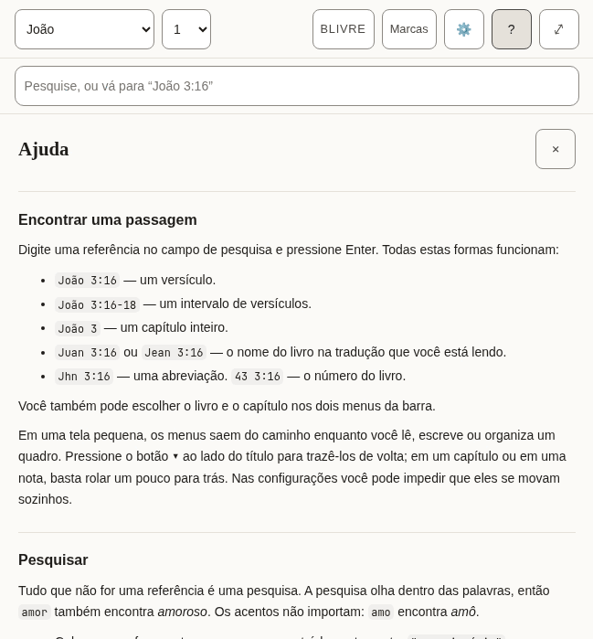

*The top of Help.*

- [ ] It reads well from start to finish as an explanation, not as a list of translated sentences.
- [ ] The examples of references are ones that work in a Bible in this language.
- [ ] The names of keys (Enter, Shift, Escape) are how this language’s keyboards and manuals name them.
- [ ] Every text in the table below is correct and sounds natural.
- [ ] Nothing in the pictures is cut off, overlapping or badly broken across lines.

**The 76 texts of this part**

| Key | English | Português (Brasil) |
|---|---|---|
| `help.title` | Help | Ajuda |
| `help.close` | Close help | Fechar a ajuda |
| `help.sections.finding.heading` | Finding a passage | Encontrar uma passagem |
| `help.sections.finding.blocks.1.p` | Type a reference in the search box and press Enter. All of these work: | Digite uma referência no campo de pesquisa e pressione Enter. Todas estas formas funcionam: |
| `help.sections.finding.blocks.2.ul.1` | `John 3:16` — one verse. | `João 3:16` — um versículo. |
| `help.sections.finding.blocks.2.ul.2` | `John 3:16-18` — a range of verses. | `João 3:16-18` — um intervalo de versículos. |
| `help.sections.finding.blocks.2.ul.3` | `John 3` — a whole chapter. | `João 3` — um capítulo inteiro. |
| `help.sections.finding.blocks.2.ul.4` | `Juan 3:16` or `Jean 3:16` — the book name in the translation you are reading. | `Juan 3:16` ou `Jean 3:16` — o nome do livro na tradução que você está lendo. |
| `help.sections.finding.blocks.2.ul.5` | `Jhn 3:16` — an abbreviation. `43 3:16` — the book number. | `Jhn 3:16` — uma abreviação. `43 3:16` — o número do livro. |
| `help.sections.finding.blocks.3.p` | You can also pick the book and chapter from the two menus in the bar. | Você também pode escolher o livro e o capítulo nos dois menus da barra. |
| `help.sections.finding.blocks.4.p` | On a small screen the menus step aside while you read, write or arrange a board. Press the **▾** button beside the title to bring them back; in a chapter or a note, scrolling back a little does the same. In Settings you can stop them moving by themselves. | Em uma tela pequena, os menus saem do caminho enquanto você lê, escreve ou organiza um quadro. Pressione o botão **▾** ao lado do título para trazê-los de volta; em um capítulo ou em uma nota, basta rolar um pouco para trás. Nas configurações você pode impedir que eles se movam sozinhos. |
| `help.sections.searching.heading` | Searching | Pesquisar |
| `help.sections.searching.blocks.1.p` | Anything that is not a reference is a search. Search looks inside words, so `love` also finds *loveth* and *beloved*. Accents do not matter: `amo` finds *amó*. | Tudo que não for uma referência é uma pesquisa. A pesquisa olha dentro das palavras, então `amor` também encontra *amoroso*. Os acentos não importam: `amo` encontra *amô*. |
| `help.sections.searching.blocks.2.ul.1` | Put a phrase in quotes to find it exactly: `"in the beginning"`. | Coloque uma frase entre aspas para encontrá-la exatamente: `"no princípio"`. |
| `help.sections.searching.blocks.2.ul.2` | Put a minus sign before a word to leave verses with it out: `God -love`. | Coloque um sinal de menos antes de uma palavra para deixar de fora os versículos que a contêm: `Deus -amor`. |
| `help.sections.searching.blocks.2.ul.3` | **Whole words only** stops the search looking inside longer words. | **Apenas palavras inteiras** impede que a pesquisa olhe dentro de palavras maiores. |
| `help.sections.searching.blocks.2.ul.4` | **Match case** makes capital letters matter. | **Diferenciar maiúsculas** faz as letras maiúsculas contarem. |
| `help.sections.searching.blocks.3.p` | The first results are verses where your word stands alone; verses where it sits inside a longer word come after a line that says so. Press Enter on a search to see every match, counted by book. | Primeiro vêm os versículos em que a palavra aparece sozinha; os versículos em que ela está dentro de uma palavra maior vêm depois de uma linha que avisa. Pressione Enter na pesquisa para ver todos os resultados, contados por livro. |
| `help.sections.notes.heading` | Notes | Notas |
| `help.sections.notes.blocks.1.p` | Notes are plain text with Markdown. Formatting takes shape as you write, and its symbols come back on the line you are editing; to see only the Markdown, choose **Plain text** under Note editor in Settings. The toolbar above the note adds headings, bold, italic, lists and quotes; press a tool again to take the formatting off. With Plain text, **Preview** shows the note as it will read. | As notas são texto simples com Markdown. A formatação aparece enquanto você escreve, e os símbolos voltam na linha que você está editando; para ver só o Markdown, escolha **Texto simples** em Editor de notas, nas Configurações. A barra acima da nota adiciona títulos, negrito, itálico, listas e citações; pressione a mesma ferramenta de novo para tirar a formatação. Com Texto simples, **Visualizar** mostra a nota como ela vai ficar. |
| `help.sections.notes.blocks.2.p` | A link to a passage looks like `[[john 3:16]]`. Add `@kjv` to say which translation: `[[john 3:16@kjv]]`. Put the cursor inside a link and a **Go to** button opens it. **Quote** beside a verse copies the verse into your note with its reference and a link. | Um link para uma passagem se escreve `[[john 3:16]]`. Acrescente `@kjv` para dizer a tradução: `[[john 3:16@kjv]]`. Coloque o cursor dentro de um link e o botão **Ir para** o abre. **Citar**, ao lado de um versículo, copia o versículo para a sua nota com a referência e um link. |
| `help.sections.notes.blocks.3.p` | Notes are saved on this device as you type. **Export** downloads every note and board as text files in a zip. | As notas são salvas neste dispositivo enquanto você escreve. **Exportar** baixa todas as notas e quadros como arquivos de texto em um .zip. |
| `help.sections.marks.heading` | Marks | Marcas |
| `help.sections.marks.blocks.1.p` | Press a verse, or its number, to mark it in one of five colours. Each colour is a collection: name it for the subject you are following, and the **Marks** panel lists its verses in Bible order. Marks follow the passage, not the translation, so a mark made in one translation shows in all of them. | Pressione um versículo, ou o número dele, para marcá-lo em uma de cinco cores. Cada cor é uma coleção: dê a ela o nome do assunto que você acompanha, e o painel **Marcas** lista os versículos na ordem da Bíblia. As marcas acompanham a passagem, não a tradução, então uma marca feita em uma tradução aparece em todas. |
| `help.sections.marks.blocks.2.p` | Press more verses to act on several at once, and press one again to leave it out. With verses apart selected, **Select** in the row of actions takes in every verse between them; holding <kbd>Shift</kbd> while you press a verse does the same. **Quote** then writes them into your note as one passage under one reference. | Pressione mais versículos para agir sobre vários de uma vez, e pressione um deles de novo para deixá-lo de fora. Com versículos separados selecionados, **Selecionar** na linha de ações inclui todos os que ficam entre eles; segurar <kbd>Shift</kbd> ao pressionar um versículo faz o mesmo. **Citar** então os escreve na sua nota como uma só passagem, com uma só referência. |
| `help.sections.marks.blocks.3.p` | In Settings you can add a symbol to every mark, so colour is not the only sign. | Nas configurações você pode acrescentar um símbolo a cada marca, para que a cor não seja o único sinal. |
| `help.sections.marks.blocks.4.p` | In Settings you can also run the verses together as one text and hide their numbers. Pressing a sentence still picks the verse it belongs to. | Nas configurações você também pode juntar os versículos em um só texto e ocultar os números. Pressionar uma frase continua escolhendo o versículo a que ela pertence. |
| `help.sections.boards.heading` | Boards | Quadros |
| `help.sections.boards.blocks.1.p` | A board lays verses and notes out as cards you can move and join with arrows. **Canvas** beside a verse puts it on the current board. Cards hold a reference, not a copy of the text, so they show the translation you are reading. Give a board a name in the box beside the board menu. | Um quadro dispõe versículos e notas como cartões que você pode mover e ligar com setas. **Ao quadro**, ao lado de um versículo, o coloca no quadro atual. Os cartões guardam uma referência, não uma cópia do texto, então mostram a tradução que você está lendo. Dê um nome ao quadro no campo ao lado do menu de quadros. |
| `help.sections.boards.blocks.2.p` | To move or resize a card without dragging, use its **✥** button; to colour it, its colour button. The arrow buttons beside the zoom move the view. **Connections**, in the board's bar, lists every arrow in words and removes one. Removing a card asks first, and removing a card or a connection can be undone until you change something else. | Para mover ou redimensionar um cartão sem arrastar, use o botão **✥**; para colori-lo, o botão de cor. Os botões de seta ao lado do zoom movem a vista. **Conexões**, na barra do quadro, descreve cada seta em palavras e permite remover uma. Remover um cartão pede confirmação, e remover um cartão ou uma conexão pode ser desfeito até você mudar outra coisa. |
| `help.sections.translations.heading` | Translations | Traduções |
| `help.sections.translations.blocks.1.p` | The library lists every translation, grouped by language, with its size. Download one to read it offline; **Compare** shows it beside the one you are reading, verse by verse. Removing a translation never touches your notes or marks. | A biblioteca lista todas as traduções, agrupadas por idioma, com o tamanho de cada uma. Baixe uma para lê-la offline; **Comparar** a mostra ao lado da que você está lendo, versículo por versículo. Remover uma tradução nunca mexe nas suas notas nem nas suas marcas. |
| `help.sections.keyboard.heading` | Keyboard | Teclado |
| `help.sections.keyboard.blocks.1.ul.1` | <kbd>Tab</kbd> and <kbd>Shift</kbd>+<kbd>Tab</kbd> move between controls. The first press offers to skip to the text or the notes. | <kbd>Tab</kbd> e <kbd>Shift</kbd>+<kbd>Tab</kbd> movem entre os controles. O primeiro toque oferece pular para o texto ou para as notas. |
| `help.sections.keyboard.blocks.1.ul.2` | <kbd>Escape</kbd> closes whatever opened last: a panel, the verse actions, the search suggestions. | <kbd>Esc</kbd> fecha o que abriu por último: um painel, as ações do versículo, as sugestões da pesquisa. |
| `help.sections.keyboard.blocks.1.ul.3` | <kbd>Enter</kbd> on a verse number selects it and opens the actions; the arrow keys move along them. <kbd>Enter</kbd> on another number adds that verse, and <kbd>Shift</kbd>+<kbd>Enter</kbd> takes in every verse up to it. | <kbd>Enter</kbd> no número de um versículo o seleciona e abre as ações; as setas movem entre elas. <kbd>Enter</kbd> em outro número acrescenta esse versículo, e <kbd>Shift</kbd>+<kbd>Enter</kbd> inclui todos os versículos até ele. |
| `help.sections.keyboard.blocks.1.ul.4` | On the divider between the panes, the arrow keys, <kbd>Home</kbd> and <kbd>End</kbd> resize; the two small buttons do the same. | Na divisória entre os painéis, as setas, <kbd>Home</kbd> e <kbd>End</kbd> redimensionam; os dois botões pequenos fazem o mesmo. |
| `help.sections.keyboard.blocks.1.ul.5` | In a note, <kbd>Shift</kbd>+<kbd>Tab</kbd> reaches the formatting tools; the arrow keys move between them. | Em uma nota, <kbd>Shift</kbd>+<kbd>Tab</kbd> chega às ferramentas de formatação; as setas movem entre elas. |
| `help.sections.keyboard.blocks.1.ul.6` | On a board, cards take focus: the arrow keys move a card, <kbd>Alt</kbd> with an arrow resizes it, and <kbd>Delete</kbd> asks to remove it. With the board itself focused, the arrow keys move the view and <kbd>+</kbd> and <kbd>−</kbd> zoom. | Em um quadro, os cartões recebem o foco: as setas movem um cartão, <kbd>Alt</kbd> com uma seta muda o tamanho e <kbd>Delete</kbd> pede para removê-lo. Com o quadro em foco, as setas movem a vista e <kbd>+</kbd> e <kbd>−</kbd> dão zoom. |
| `help.abbreviations` | Abbreviations | Abreviações |
| `help.abbreviationsCaption` | What each abbreviation means | O que significa cada abreviação |
| `help.short` | Short | Abreviação |
| `help.meaning` | Meaning | Significado |
| `help.terms.1.1` | CC BY-SA 4.0 | CC BY-SA 4.0 |
| `help.terms.1.2` | Creative Commons Attribution–ShareAlike 4.0: a free licence that asks you to credit the source and share changes under the same terms. | Creative Commons Atribuição–CompartilhaIgual 4.0: uma licença livre que pede que você credite a fonte e compartilhe as mudanças nos mesmos termos. |
| `help.terms.2.1` | CC0 | CC0 |
| `help.terms.2.2` | Creative Commons Zero: the author has waived all rights; the text is free to use. | Creative Commons Zero: o autor abriu mão de todos os direitos; o texto é livre para usar. |
| `help.terms.3.1` | OT | OT |
| `help.terms.3.2` | Old Testament. | Antigo Testamento (em inglês, Old Testament). |
| `help.terms.4.1` | NT | NT |
| `help.terms.4.2` | New Testament. | Novo Testamento. |
| `help.terms.5.1` | PWA | PWA |
| `help.terms.5.2` | Progressive web app: a website you can install and use offline. | Progressive web app: um site que você pode instalar e usar offline. |
| `help.terms.6.1` | WCAG | WCAG |
| `help.terms.6.2` | Web Content Accessibility Guidelines, the standard this app is measured against. | Web Content Accessibility Guidelines, o padrão pelo qual este app é medido. |
| `help.glossaryHeading` | Words used here | Palavras usadas aqui |
| `help.glossary.1.1` | Collection | Coleção |
| `help.glossary.1.2` | Every verse you mark in one colour. Name a colour for the subject you are following, and the Marks panel lists those verses in Bible order. | Todos os versículos que você marca em uma cor. Dê a uma cor o nome do assunto que você acompanha, e o painel Marcas lista esses versículos na ordem da Bíblia. |
| `help.glossary.2.1` | Board | Quadro |
| `help.glossary.2.2` | A space where verses and notes are laid out as cards and joined with arrows. Boards are saved and exported with your notes. | Um espaço onde versículos e notas ficam dispostos como cartões e ligados por setas. Os quadros são salvos e exportados junto com suas notas. |
| `help.glossary.3.1` | Card | Cartão |
| `help.glossary.3.2` | One item on a board: a verse, a note, or text you typed. A verse card shows the verse from whichever translation you are reading. | Um item de um quadro: um versículo, uma nota ou um texto que você escreveu. Um cartão de versículo mostra o versículo da tradução que você estiver lendo. |
| `help.glossary.4.1` | Translation | Tradução |
| `help.glossary.4.2` | One version of the Bible, in one language. Every translation here is free to copy. | Uma versão da Bíblia, em um idioma. Todas as traduções daqui são livres para copiar. |
| `help.glossary.5.1` | Whole words only | Apenas palavras inteiras |
| `help.glossary.5.2` | A search option. With it on, "love" finds love but not loveth. With it off, it finds both. | Uma opção da pesquisa. Ligada, “amor” encontra amor, mas não amoroso. Desligada, encontra os dois. |
| `help.glossary.6.1` | Match case | Diferenciar maiúsculas |
| `help.glossary.6.2` | A search option. With it on, "God" and "god" are different. | Uma opção da pesquisa. Ligada, “Deus” e “deus” são diferentes. |
| `help.glossary.7.1` | Mirror to a folder | Espelhar em uma pasta |
| `help.glossary.7.2` | Keep a copy of your notes as text files in a folder on this computer, updated as you write. Works in Chrome and Edge. | Guardar uma cópia das suas notas como arquivos de texto numa pasta deste computador, atualizada enquanto você escreve. Funciona no Chrome e no Edge. |
| `help.glossary.8.1` | Assistant tools | Ferramentas de assistente |
| `help.glossary.8.2` | A way for an AI assistant running in your browser to read your library and suggest notes or marks. Off unless you turn it on; nothing is saved without your approval. | Um jeito de um assistente de IA rodando no seu navegador ler sua biblioteca e sugerir notas ou marcas. Fica desligado até você ligar; nada é salvo sem a sua aprovação. |
| `help.accessibilityHeading` | Accessibility | Acessibilidade |
| `help.accessibility.1` | This app aims to meet the Web Content Accessibility Guidelines 2.2 at Level AAA for everything the app itself shows: its controls, its text, its colours and its behaviour. Every control can be reached by keyboard, is at least 44 by 44 pixels, shows where focus is, and has a name. Text is at least 7:1 against its background in every colour theme, and you can change the size, spacing and colours in Settings. | Este app busca atender às Diretrizes de Acessibilidade para Conteúdo Web 2.2 no nível AAA em tudo o que o próprio app mostra: seus controles, seu texto, suas cores e seu comportamento. Todo controle pode ser alcançado pelo teclado, tem pelo menos 44 por 44 pixels, mostra onde está o foco e tem um nome. O texto fica em pelo menos 7:1 contra o fundo em todos os temas de cor, e você pode mudar o tamanho, o espaçamento e as cores nas configurações. |
| `help.accessibility.2` | Two things are outside that promise. The Bible text is shown as it was published: how hard it is to read, and how its words are said, belong to each translation, not to this app. The same is true of what you write in your notes. | Duas coisas ficam fora dessa promessa. O texto bíblico é mostrado como foi publicado: a dificuldade de leitura e a pronúncia das palavras pertencem a cada tradução, não a este app. O mesmo vale para o que você escreve nas suas notas. |
| `help.accessibility.3` | What is checked by machine is checked on every change. What needs a person — a screen reader on a phone, the app under a Windows contrast theme — is checked by hand, less often. If something does not work for you, please report it at the project's issue tracker on GitHub (`AlanRoman117/scriptura`). | O que é verificado por máquina é verificado a cada mudança. O que precisa de uma pessoa — um leitor de tela no celular, o app sob um tema de contraste do Windows — é verificado à mão, com menos frequência. Se alguma coisa não funcionar para você, relate no rastreador de problemas do projeto no GitHub (`AlanRoman117/scriptura`). |

### Met less often

Boards, the questions asked before something is deleted, and the notices. Many of these texts are spoken by a screen reader and never shown.

#### 2.9 Boards (the canvas)

A surface where verses and notes are laid out as cards and joined with arrows. Most of its texts are the names of buttons, heard by a screen reader.

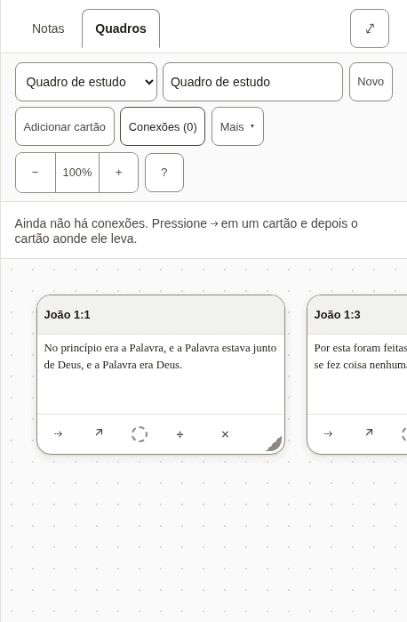

*Two verses on a board, with the list of connections open.*

- [ ] The words for a board, a card and a connection are used the same way here as everywhere else.
- [ ] Every text in the table below is correct and sounds natural.
- [ ] Nothing in the pictures is cut off, overlapping or badly broken across lines.

**The 93 texts of this part**

| Key | English | Português (Brasil) |
|---|---|---|
| `canvas.new` A new board. | New | Novo |
| `canvas.more` Beside the Bible, the button the less-used board actions fold behind. | More | Mais |
| `canvas.startOne` | Start one | Criar um |
| `canvas.label` | Boards | Quadros |
| `canvas.heading` | Board: John 1 | Quadro: João 1 |
| `canvas.noneOpenHeading` | none open | nenhum aberto |
| `canvas.picker` | Board | Quadro |
| `canvas.showMenus` | Show the board menus | Mostrar os menus do quadro |
| `canvas.hideMenus` | Hide the board menus | Ocultar os menus do quadro |
| `canvas.name` | Board name | Nome do quadro |
| `canvas.none` | No boards yet | Ainda não há quadros |
| `canvas.undo` | Undo: put back John 1:1 Undo: put back the connection John 1:1 → John 1:14 | Desfazer: recolocar João 1:1 Desfazer: recolocar a conexão João 1:1 → João 1:14 |
| `canvas.putBack` | John 1:1 put back The connection John 1:1 → John 1:14 put back | João 1:1 foi recolocado A conexão João 1:1 → João 1:14 foi recolocada |
| `canvas.removed` | John 1:1 removed. Undo is in the board's bar. The connection John 1:1 → John 1:14 removed. Undo is in the board's bar. | Cartão removido: João 1:1. Você pode desfazer na barra do quadro. Conexão removida: João 1:1 → João 1:14. Você pode desfazer na barra do quadro. |
| `canvas.addCard` | Add card | Adicionar cartão |
| `canvas.addNote` | Add note | Adicionar nota |
| `canvas.addNoteName` | Add note — put the newest note on the board | Adicionar nota — colocar a nota mais recente no quadro |
| `canvas.addNoteNoNotes` | Add note — write a note first | Adicionar nota — escreva uma nota antes |
| `canvas.toNote` | Add to note | Adicionar à nota |
| `canvas.toNoteName` | Add to note — put this board into the note you have open | Adicionar à nota — colocar este quadro na nota que você tem aberta |
| `canvas.connections` | Connections (2) | Conexões (2) |
| `canvas.connectionsLabel` | Connections | Conexões |
| `canvas.deleteBoard` | Delete board | Excluir quadro |
| `canvas.zoom` | Zoom | Zoom |
| `canvas.zoomOut` | Zoom out | Diminuir o zoom |
| `canvas.zoomIn` | Zoom in | Aumentar o zoom |
| `canvas.zoomReset` | Zoom 120%. Reset to full size, showing your cards | Zoom 120%. Voltar ao tamanho normal, mostrando seus cartões |
| `canvas.moveView` | Move the view | Mover a vista |
| `canvas.viewLeft` | Move the view left | Mover a vista para a esquerda |
| `canvas.viewUp` | Move the view up | Mover a vista para cima |
| `canvas.viewDown` | Move the view down | Mover a vista para baixo |
| `canvas.viewRight` | Move the view right | Mover a vista para a direita |
| `canvas.help` | Help — boards, keyboard, and what the abbreviations mean | Ajuda — quadros, teclado e o que significam as abreviações |
| `canvas.noConnections` | No connections yet. Press ⇢ on a card, then the card it leads to. | Ainda não há conexões. Pressione ⇢ em um cartão e depois o cartão aonde ele leva. |
| `canvas.removeConnection` | Remove the connection John 1:1 → John 1:14 | Remover a conexão João 1:1 → João 1:14 |
| `canvas.missingCard` | a missing card | um cartão que não existe |
| `canvas.edge` | John 1:1 → John 1:14 | João 1:1 → João 1:14 |
| `canvas.frame` | Board canvas, 1 card Board canvas, 4 cards | Área do quadro, 1 cartão Área do quadro, 4 cartões |
| `canvas.frameHint` | Arrow keys move the view; plus and minus zoom. Each card takes focus: arrow keys move it, and Alt with an arrow resizes it. | As setas movem a vista; mais e menos dão zoom. Cada cartão recebe o foco: as setas o movem, e Alt com uma seta muda o tamanho. |
| `canvas.verseCard` | Verse card | Cartão de versículo |
| `canvas.noteCard` | Note card | Cartão de nota |
| `canvas.card` | Card | Cartão |
| `canvas.cardName` | Verse card: John 1:1, Amber (amber) Verse card: John 1:1 | Cartão de versículo: João 1:1, Âmbar (âmbar) Cartão de versículo: João 1:1 |
| `canvas.colourName` | Amber (amber) | Âmbar (âmbar) |
| `canvas.cardTitle` | Card title | Título do cartão |
| `canvas.cardTitlePlaceholder` | Card | Cartão |
| `canvas.cardText` | Card text | Texto do cartão |
| `canvas.cardTextPlaceholder` | Write here… | Escreva aqui… |
| `canvas.cardBody` | John 1:1 — text | João 1:1 — texto |
| `canvas.connect` | Connect John 1:1 to another card | Conectar João 1:1 a outro cartão |
| `canvas.connectPrompt` | Choose the card to connect to: press it, or Enter on it. Escape cancels. | Escolha o cartão a conectar: pressione nele, ou Enter sobre ele. Esc cancela. |
| `canvas.connected` | Connected John 1:1 to John 1:14 | João 1:1 foi conectado a João 1:14 |
| `canvas.open` | Open John 1:1 in the reader | Abrir João 1:1 na leitura |
| `canvas.colour` | Colour: Amber (amber). Change the colour of John 1:1 Colour: none. Change the colour of John 1:1 | Cor: Âmbar (âmbar). Mudar a cor de João 1:1 Cor: nenhuma. Mudar a cor de João 1:1 |
| `canvas.adjust` | Move or resize John 1:1 without dragging | Mover ou redimensionar João 1:1 sem arrastar |
| `canvas.takeOff` | Take John 1:1 off the board | Tirar João 1:1 do quadro |
| `canvas.empty` | Nothing on this board yet. Add a card here, or use **Canvas** beside a verse while reading. | Ainda não há nada neste quadro. Adicione um cartão aqui, ou use **Ao quadro** ao lado de um versículo enquanto lê. |
| `canvas.adjustPanel` | Move and resize John 1:1 | Mover e redimensionar João 1:1 |
| `canvas.colourPanel` | Colour of John 1:1 | Cor de João 1:1 |
| `canvas.adjustTitle` | Move and resize | Mover e redimensionar |
| `canvas.colourTitle` | Colour | Cor |
| `canvas.panelTitle` | Move and resize: John 1:1 | Mover e redimensionar: João 1:1 |
| `canvas.move` | Move | Mover |
| `canvas.moveLeft` | Move left | Mover para a esquerda |
| `canvas.moveUp` | Move up | Mover para cima |
| `canvas.moveDown` | Move down | Mover para baixo |
| `canvas.moveRight` | Move right | Mover para a direita |
| `canvas.size` | Size | Tamanho |
| `canvas.narrower` | Narrower | Mais estreito |
| `canvas.wider` | Wider | Mais largo |
| `canvas.shorter` | Shorter | Mais baixo |
| `canvas.taller` | Taller | Mais alto |
| `canvas.colours` | Colours | Cores |
| `canvas.noColour` | No colour | Sem cor |
| `canvas.moved` | John 1:1: moved to 320, 180 | João 1:1: movido para 320, 180 |
| `canvas.resized` | John 1:1: 280 wide, 180 tall | João 1:1: 280 de largura, 180 de altura |
| `canvas.coloured` | John 1:1: Amber (amber) | João 1:1: Âmbar (âmbar) |
| `canvas.uncoloured` | John 1:1: no colour | João 1:1: sem cor |
| `canvas.noneOpen` | No board open. | Nenhum quadro aberto. |
| `cards.verseMissing` | Not in this translation. | Não está nesta tradução. |
| `cards.untitledNote` | Untitled note | Nota sem título |
| `cards.untitledBoard` | Untitled board | Quadro sem título |
| `cards.emptyNote` | Empty note. | Nota vazia. |
| `cards.deletedNote` | This note has been deleted. | Esta nota foi excluída. |
| `cards.card` | Card | Cartão |
| `cards.emptyBoard` | _Empty board._ | _Quadro vazio._ |
| `cards.connections` | Connections | Conexões |
| `cards.missingCard` | (missing card) | (cartão que não existe) |
| `embed.scrolls` | Board: John 1, scrolls sideways | Quadro: João 1, rola para os lados |
| `embed.picture` | Board: John 1, 1 cards Board: John 1, 4 cards | Quadro: João 1, 1 cartões Quadro: João 1, 4 cartões |
| `embed.empty` | This board is empty. | Este quadro está vazio. |
| `embed.missing` | A board was embedded here, but it no longer exists. | Um quadro foi inserido aqui, mas ele não existe mais. |
| `embed.open` | Open board | Abrir o quadro |

#### 2.10 Questions before something is deleted

Deleting a note or a board, or removing a card, a mark or a translation, asks first. The question names what will go, and says whether it can come back.

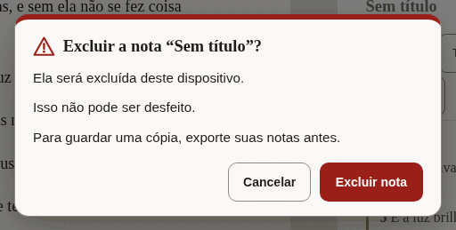

*The question before a note is deleted.*

- [ ] It is unmistakable what will be deleted and that it cannot be undone.
- [ ] The button that deletes says what it deletes.
- [ ] Every text in the table below is correct and sounds natural.
- [ ] Nothing in the pictures is cut off, overlapping or badly broken across lines.

**The 26 texts of this part**

| Key | English | Português (Brasil) |
|---|---|---|
| `confirm.permanent` | You cannot undo this. | Isso não pode ser desfeito. |
| `confirm.undoable` | You can undo this until your next change. | Você pode desfazer isso até a próxima mudança. |
| `confirm.note.title` | Delete the note “John 1”? | Excluir a nota “João 1”? |
| `confirm.note.gone` | It will be deleted from this device. | Ela será excluída deste dispositivo. |
| `confirm.note.keepCopy` | To keep a copy, export your notes first. | Para guardar uma cópia, exporte suas notas antes. |
| `confirm.note.action` | Delete note | Excluir nota |
| `confirm.note.done` | Deleted the note “John 1” | A nota “João 1” foi excluída |
| `confirm.board.title` | Delete the board “John 1”? | Excluir o quadro “João 1”? |
| `confirm.board.cards` | The board and its card will be deleted. The board and its 4 cards will be deleted. | O quadro e o cartão dele serão excluídos. O quadro e seus 4 cartões serão excluídos. |
| `confirm.board.empty` | The board is empty. | O quadro está vazio. |
| `confirm.board.kept` | Your notes are not changed. | Suas notas não mudam. |
| `confirm.board.action` | Delete board | Excluir quadro |
| `confirm.board.done` | Deleted the board “John 1” | O quadro “João 1” foi excluído |
| `confirm.card.title` | Remove John 1:1 from the board? | Remover João 1:1 do quadro? |
| `confirm.card.connections` | Its connection is removed too. Its 3 connections are removed too. | A conexão dele também será removida. Suas 3 conexões também serão removidas. |
| `confirm.card.noteKept` | The note itself is not changed. | A nota em si não muda. |
| `confirm.card.action` | Remove card | Remover cartão |
| `confirm.mark.title` | Remove the mark on John 1:2? | Remover a marca em João 1:2? |
| `confirm.mark.leaves` | The verse leaves the collection “Amber”. | O versículo sai da coleção “Âmbar”. |
| `confirm.mark.action` | Remove mark | Remover marca |
| `confirm.translation.title` | Remove Berean Standard Bible from this device? | Remover Bíblia Livre deste dispositivo? |
| `confirm.translation.frees` | This frees about 5.4 MB. | Isso libera cerca de 5,4 MB. |
| `confirm.translation.kept` | Your notes and marks are not changed. | Suas notas e marcas não mudam. |
| `confirm.translation.again` | You can download it again when you are online. | Você pode baixá-la de novo quando estiver online. |
| `confirm.translation.action` | Remove translation | Remover tradução |
| `confirm.translation.done` | Removed Berean Standard Bible from this device | Bíblia Livre foi removida deste dispositivo |

#### 2.11 Notices

A line about where the reader’s work is kept, the offer of a newer version, and the notice on this preview.

- [ ] The notice about storage is honest without being alarming.
- [ ] Every text in the table below is correct and sounds natural.

**The 23 texts of this part**

| Key | English | Português (Brasil) |
|---|---|---|
| `durability.label` | Where your notes are kept | Onde suas notas ficam |
| `durability.denied` | This browser may delete your notes to free up space. Save a copy. | Este navegador pode apagar suas notas para liberar espaço. Guarde uma cópia. |
| `durability.stale` | You have not exported your notes for a while. | Faz um tempo que você não exporta suas notas. |
| `durability.local` | Your notes live in this browser only. | Suas notas ficam só neste navegador. |
| `durability.saveFolder` | Save to a folder | Salvar em uma pasta |
| `durability.saveFolderTitle` | Keep a copy as .md files in a folder you choose | Guardar uma cópia em arquivos .md numa pasta que você escolher |
| `durability.exportNow` | Export now | Exportar agora |
| `durability.dismiss` | Dismiss this notice | Dispensar este aviso |
| `update.label` | A new version is ready | Uma nova versão está pronta |
| `update.ready` | A new version of Scriptura is ready. | Uma nova versão do Scriptura está pronta. |
| `update.readyAnnounce` | A new version of Scriptura is ready. Reload when it suits you. | Uma nova versão do Scriptura está pronta. Recarregue quando quiser. |
| `update.reload` | Reload | Recarregar |
| `update.reloading` | Reloading… | Recarregando… |
| `update.later` | Later | Depois |
| `previewBuild.label` | Preview | Versão prévia |
| `previewBuild.intro` | **Preview.** An early build for the people reviewing its translations. | **Versão prévia.** Uma versão inicial para quem revisa as traduções. |
| `previewBuild.report` | Report a translation correction on GitHub (opens in a new tab) | Relatar uma correção de tradução no GitHub (abre em uma nova aba) |
| `previewBuild.reportShort` The notice's short link; `newTab` completes its name for a screen reader. | Report a correction | Relatar uma correção |
| `previewBuild.newTab` | (on GitHub, opens in a new tab) | (no GitHub, abre em uma nova aba) |
| `previewBuild.hide` | Hide | Ocultar |
| `previewBuild.heading` | About this preview | Sobre esta versão prévia |
| `previewBuild.about` | This build is for the people checking the interface in Spanish, French, Japanese, Chinese and Portuguese. Nothing you do here is sent anywhere: your notes and marks stay in this browser. To report a word that is wrong or unclear, use the link below. It opens a short form on GitHub, which needs a free account. | Esta versão é para quem revisa a interface em espanhol, francês, japonês, chinês e português. Nada do que você faz aqui é enviado a lugar nenhum: suas notas e marcas ficam neste navegador. Para relatar uma palavra errada ou pouco clara, use o link abaixo. Ele abre um formulário curto no GitHub, que pede uma conta gratuita. |
| `previewBuild.version` | Version: 0.1.0 | Versão: 0.1.0 |

#### 2.12 Panes, tabs and the sheet

The names of the two panes, the tabs that choose between notes and a board, and the buttons that resize them. Mostly heard, not seen.

- [ ] Every text in the table below is correct and sounds natural.

**The 20 texts of this part**

| Key | English | Português (Brasil) |
|---|---|---|
| `layout.scripture` | Scripture | Texto bíblico |
| `layout.notes` | Notes | Notas |
| `layout.expandNotes` | Expand notes | Abrir as notas |
| `layout.collapseNotes` | Collapse notes | Fechar as notas |
| `layout.gripWithNews` | Expand notes, Quoted John 1:3-5 | Abrir as notas, João 1:3-5 foi citado |
| `layout.sheetHint` | Drag, or use the up and down arrow keys, to make the notes taller or shorter. | Arraste, ou use as setas para cima e para baixo, para deixar as notas maiores ou menores. |
| `layout.notesMoreRoom` | Give the notes more room | Dar mais espaço às notas |
| `layout.bibleMoreRoom` | Give the Bible more room | Dar mais espaço à Bíblia |
| `layout.resize` | Resize panes | Redimensionar os painéis |
| `layout.split` Both shares arrive formatted as percentages. | 56% Bible, 44% notes | 56% Bíblia, 44% notas |
| `layout.showNotes` | Show notes | Mostrar as notas |
| `layout.paneBible` | Bible | Bíblia |
| `layout.paneNotes` | Notes | Notas |
| `layout.sides` The side pane holds the notes or the canvas; these name the switch and the canvas side. | Notes or canvas | Notas ou quadros |
| `layout.paneBoard` | Canvas | Quadros |
| `layout.expandBoard` | Expand canvas | Abrir os quadros |
| `layout.collapseBoard` | Collapse canvas | Fechar os quadros |
| `layout.showBoard` | Show canvas | Mostrar os quadros |
| `layout.maximize` | Maximize Bible | Maximizar Bíblia |
| `layout.restore` | Restore Bible | Restaurar Bíblia |

#### 2.13 What an assistant proposes

When the reader has allowed an assistant to help, what it wants to add is shown first and waits for a yes.

- [ ] Every text in the table below is correct and sounds natural.

**The 10 texts of this part**

| Key | English | Português (Brasil) |
|---|---|---|
| `proposal.noteTitle` | A note has been drafted for you | Uma nota foi rascunhada para você |
| `proposal.marksTitle` | Verses suggested for marking | Versículos sugeridos para marcar |
| `proposal.lede` | An assistant proposed this. Nothing has been saved — review it, change anything you like, and it only takes effect when you accept. | Um assistente propôs isto. Nada foi salvo — revise, mude o que quiser, e só vale quando você aceitar. |
| `proposal.titleInput` | Proposed note title | Título proposto para a nota |
| `proposal.bodyInput` | Proposed note body | Corpo proposto para a nota |
| `proposal.into` `{collection}` is replaced by the collection's name, in bold. | Into {collection} (amber) | Em {collection} (âmbar) |
| `proposal.missing` | Not in this translation. | Não está nesta tradução. |
| `proposal.discard` | Discard | Descartar |
| `proposal.save` | Save this note | Salvar esta nota |
| `proposal.mark` | Mark 1 verse Mark 3 verses | Marcar 1 versículo Marcar 3 versículos |

---

## Part 3: Try it yourself

Open **<https://alanroman117.github.io/Scriptura/>** on a computer, and then on a phone if you can.

The app follows your browser's language. If it does not open in Português (Brasil), choose the gear in the bar at the top, then the first choice in the panel, and pick **Português (Brasil)**.

A picture shows words standing still. What you are looking for here is what only use can show: a word that does not fit its button, a message that arrives at the wrong moment, a sentence that is right alone and wrong after the one before it.

- [ ] Accept the Bible the app offers in your language, and read the first chapter of John.
- [ ] Press a verse, then two more. Read what the row says, then press **Citar**.
- [ ] Read the note that was made, and the line beneath it.
- [ ] Type a word into the search box and read the count. Open the full list of results.
- [ ] Type a reference, such as "João 3:16", and press <kbd>Enter</kbd>.
- [ ] Mark a verse with a colour, then open **Marcas** and give that colour a name.
- [ ] Open **Traduções**: download another Bible, compare it with yours, then remove it and read the question it asks.
- [ ] Open **Configurações** and read it from top to bottom, changing each choice once.
- [ ] Open **Ajuda** and read it as a newcomer would.
- [ ] Put two verses on a board (**Ao quadro**), open the board, and join them.
- [ ] Delete the note and read the question it asks.
- [ ] On a phone: do the first three steps again, upright and on its side.
- [ ] If you use a screen reader: listen to the bar at the top, to a verse being selected, and to a quote being made. The interface should be spoken in your language, and the Bible in its own.

While you do this:

- [ ] No text is cut off, runs out of its button, or sits on top of another.
- [ ] No English appears where your language should be. (The names of Bibles are as their publishers wrote them, and what an assistant may do, in Settings, is in English on purpose.)
- [ ] Numbers, sizes and counts look right as they change.
- [ ] Nothing reads as rude, childish, or stiffer than the rest.

---

## Your notes

<!-- YOURS: everything below this line is kept when the guide is written again. -->

### What should change

One row for each correction. Add as many rows as you need.

| Where (the key, or the screen) | What is wrong | What it should say |
|---|---|---|
| | | |
| | | |
| | | |
| | | |
| | | |
| | | |

### Anything else

What a table cannot hold: the tone as a whole, a word you would change everywhere, something that confused you.

> 

### Your verdict

- [ ] It can be published as it is.
- [ ] It can be published once the corrections above are made.
- [ ] It needs another reading after the corrections.

| | |
|---|---|
| Reviewed by | |
| Date | |
| Version tested (Help, "About this preview") | |
| Device and browser | |
| Parts done (1, 2, 3) | |
