# The Scriptura reader in 中文（简体）: a guide for its reviewer

The reader's interface has been drafted in Chinese (Simplified) and has not yet been read by someone whose language it is. You are that reader. Nothing here is final until you say so.

This guide puts every word in front of you without your having to hunt for it, in three parts:

| Part | What you do | About |
|---|---|---|
| [1. First pass](#part-1-first-pass) | Read the voice, the words used everywhere, and how numbers are written. | 15 minutes |
| [2. Screen by screen](#part-2-screen-by-screen) | Look at each picture, then read every text that belongs to it. | 60 to 90 minutes |
| [3. Try it yourself](#part-3-try-it-yourself) | Use the app in your language and look for what a picture cannot show. | 30 minutes |

Part 1 alone already tells us a great deal. If you can give only a quarter of an hour, give it to Part 1.

## How to send corrections

- **In this file:** write them in [Your notes](#your-notes) at the end and send the file back. A ticked box anywhere above means "I checked this and it is right."
- **Or on the web:** [the correction form for 中文（简体）](https://github.com/AlanRoman117/Scriptura/issues/new?template=translation-zh-hans.yml).
- Either way, give the **key** from the first column of a table (for example `verseActions.quote`) so we can find the text, and what it should say instead.

## How to read the tables

- Each row is one text. **Key** is its name in the program, **English** is the original, and **中文（简体）** is what is being reviewed.
- The small print under a key, where there is some, is the programmer's own note on that text. It often says whether the text is shown on the screen or only spoken by a screen reader, which a blind reader uses.
- Names and numbers inside a text are examples: "约翰福音 1:3-5", "新标点和合本", "1,382". The app puts the real ones there. Where a text changes with a number, it is shown with one and with several.
- A word in braces, such as `{count}`, is a place where the app puts a number or a name. Leave it as it is; it may move within the sentence.
- `␣` marks a space at the start or end of a text that has to stay, and <kbd>Enter</kbd> is a key on the keyboard.
- The pictures were taken with the Bible "新标点和合本" open, so the names of books are that Bible's own.

---

## Part 1: First pass

### 1.1 The voice

The text is meant to be written in this register: **plain, second person**, with quotation marks “ ”.

- [ ] The reader is addressed as 你, in a plain, even tone.
- [ ] The words are the ones readers in mainland China use (搜索, 设置, 保存, 导出, 文件夹, 帮助).
- [ ] Full-width punctuation (，。：？) and quotation marks “ ”, with no half-width mark straight after Chinese text.
- [ ] It reads as natural Chinese, not as a literal translation from English.

### 1.2 The words used everywhere

These are the names of the app's own things. Each is used the same way on every screen, so one that is wrong is wrong everywhere.

| In English | In 中文（简体） | Right? |
|---|---|---|
| Notes / note | 笔记 | |
| Marks / mark (verb) | 标记 | |
| Collection | 合集 | |
| Board | 看板 | |
| Card | 卡片 | |
| Connection | 连接 | |
| Quote | 引用 | |
| Link | 链接 | |
| Canvas (put on a board) | 加入看板 | |
| Translation | 译本 | |
| Scripture | 经文 | |
| Passage | 经文 | |
| Book / chapter / verse | 书卷 / 章 / 节 | |
| Search | 搜索 | |
| Whole words only | 仅整词 | |
| Match case | 区分大小写 | |
| Settings | 设置 | |
| Help | 帮助 | |
| Export | 导出 | |
| Preview / Write | 预览 / 编辑 | |
| Delete / Remove | 删除 / 移除 | |
| Undo | 撤销 | |
| Folder | 文件夹 | |
| Assistant | 助手 | |
| Delete the note “…”? (the confirmation) | 删除笔记“…”吗？ | |
| You cannot undo this. | 此操作无法撤销。 | |
| Untitled | 无标题 | |
| Bold / Italic glyphs | B / I | |

- [ ] Each is the word a reader of the Bible in Chinese (Simplified) would expect.
- [ ] None of them is used for two different things.

### 1.3 Numbers and counts

How the app writes a number, a percentage and a size in this language, and how one text changes with the number in it.

| | Written as |
|---|---|
| One thousand three hundred and eighty-two | 1,382 |
| Fifty-eight per cent | 58% |
| The size of a download | 5.4 MB |
| 0 search results | 0条结果 |
| 1 search result | 1条结果 |
| 2 search results | 2条结果 |
| 5 search results | 5条结果 |
| 1382 search results | 1,382条结果 |
| 1 verse selected | 1节 · 约翰福音 1:3 |
| 2 verses selected | 2节 · 约翰福音 1:3-4 |
| 5 verses selected | 5节 · 约翰福音 1:3-7 |

- [ ] Thousands are grouped, and the percentage is written, the way this language does it.
- [ ] Every count above is grammatical, zero and one included.

---

## Part 2: Screen by screen

For each screen: look at the picture first, then tick what you have checked, then read the table. The order is the order in which a reader meets things.

### What every reader sees

If time is short, these four screens matter most: they are the app on an ordinary day.

#### 2.1 The first visit, and reading a chapter

The bar across the top chooses the book, the chapter and the translation, and opens Marks, Settings and Help. A reader whose language is not English is first offered a Bible in it.

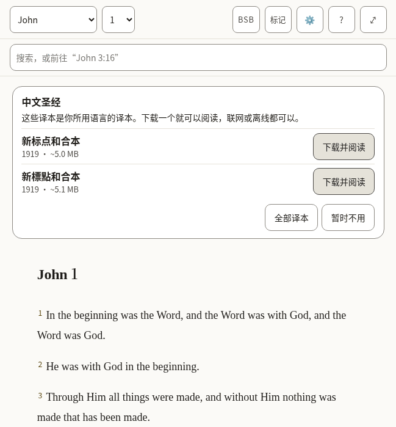

*What a new reader sees: the offer of a Bible in this language, over the English one the app arrives with.*

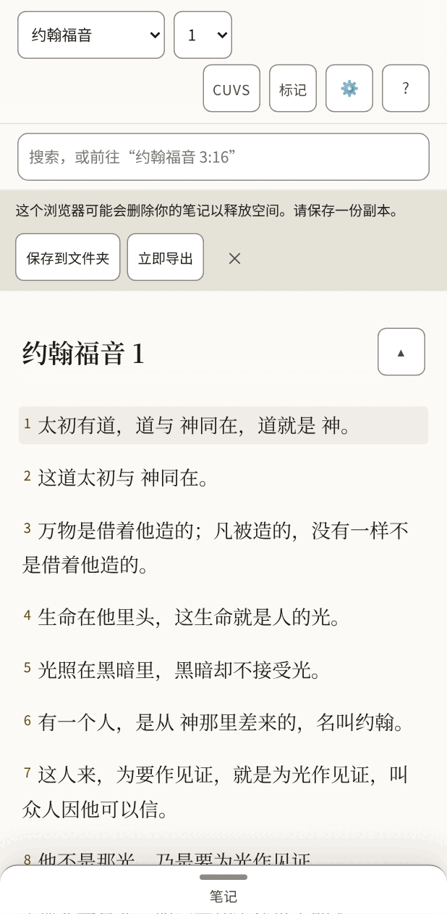

*The same, on a phone, once a Bible in this language is open.*

- [ ] The offer reads as an invitation, and its buttons are clear about what they will do.
- [ ] Nothing in the bar is cut short or squeezed, on the phone above all.
- [ ] Every text in the table below is correct and sounds natural.
- [ ] Nothing in the pictures is cut off, overlapping or badly broken across lines.

**The 48 texts of this part**

| Key | English | 中文（简体） |
|---|---|---|
| `app.name` | Scriptura Reader | Scriptura Reader |
| `app.downloading` | Downloading the text for offline use… | 正在下载经文，以便离线使用… |
| `app.opening` | Opening… | 正在打开… |
| `app.bootFailed` | The Bible text could not be opened. Reload to try again. | 无法打开经文。请重新加载后再试。 |
| `app.skipToScripture` | Skip to scripture | 跳到经文 |
| `app.skipToNotes` | Skip to notes | 跳到笔记 |
| `app.skipToBoard` | Skip to the canvas | 跳到看板 |
| `app.title` | John 1 · BSB · Scriptura | 约翰福音1 · CUVS · Scriptura |
| `app.passageTitle` | John 1 · BSB | 约翰福音1 · CUVS |
| `app.boardTitle` | John 1 · Boards | 约翰福音 1 · 看板 |
| `app.opened` | Settings opened | 已打开设置面板 |
| `app.closed` | Settings closed | 已关闭设置面板 |
| `app.boardSaveFailed` | Could not save the board — export your notes | 无法保存看板 — 请导出你的笔记 |
| `app.languageChanged` | The interface is now in English. | 界面现在是简体中文。 |
| `reader.passage` | Passage | 经文 |
| `reader.book` | Book | 书卷 |
| `reader.chapter` | Chapter | 章 |
| `reader.translationChip` | BSB — Berean Standard Bible. Choose or add a translation | CUVS — 新标点和合本。选择或添加译本 |
| `reader.marks` | Marks | 标记 |
| `reader.marksChip` The Marks button's name. It holds the word and the count the button shows, in that order and without brackets, so someone using voice control can say what they see (WCAG 2.5.3). | Marks 7 — verses you have marked, by colour | 标记 7 — 你标记过的经文，按颜色分组 |
| `reader.settingsChip` | Settings — display, storage, export, and assistant access | 设置 — 显示、存储、导出与助手权限 |
| `reader.helpChip` | Help — finding passages, searching, notes, marks, boards, keyboard, and what the abbreviations mean | 帮助 — 查找经文、搜索、笔记、标记、看板、键盘，以及各种缩写的含义 |
| `reader.selectVerse` A verse's number: a toggle that adds the verse to the selection or takes it out. | Select John 1:2 | 选择约翰福音 1:2 |
| `reader.selectVerseIn` | Select John 1:2 — in Amber (amber) | 选择约翰福音 1:2 — 在琥珀中 |
| `reader.selection` Said when the selection changes and focus does not move to say it. | 1 verse selected: John 1:3 3 verses selected: John 1:3-5 | 已选1节：约翰福音 1:3 已选3节：约翰福音 1:3-5 |
| `reader.selectionCleared` | Selection cleared | 已取消选择 |
| `reader.chapterMissing` | This chapter is not in Berean Standard Bible. | 新标点和合本中没有这一章。 |
| `reader.readingAnnounce` | Reading Berean Standard Bible | 正在阅读新标点和合本 |
| `reader.showMenus` The button at the end of the chapter title, on a small screen: named for what a press will do. | Show the reading menus | 显示阅读菜单 |
| `reader.hideMenus` | Hide the reading menus | 隐藏阅读菜单 |
| `panels.marks` | Marks | 标记 |
| `panels.translations` | Translations | 译本 |
| `panels.settings` | Settings | 设置 |
| `panels.help` | Help | 帮助 |
| `panels.results` | Search results | 搜索结果 |
| `common.cancel` | Cancel | 取消 |
| `common.untitledNote` | Untitled | 无标题 |
| `common.untitledBoard` | Untitled board | 无标题看板 |
| `common.source` | Berean Standard Bible source | 新标点和合本的来源 |
| `common.undoRemove` | Undo remove | 撤销 |
| `common.remove` | Remove | 移除 |
| `common.done` | Done | 完成 |
| `offer.title` | Bibles in English | 中文圣经 |
| `offer.intro` | These translations are in your language. Download one to read it, online or offline. | 这些译本是你所用语言的译本。下载一个就可以阅读，联网或离线都可以。 |
| `offer.downloadAndRead` | Download and read | 下载并阅读 |
| `offer.downloadAndReadName` | Download and read Berean Standard Bible | 下载并阅读新标点和合本 |
| `offer.allTranslations` | All translations | 全部译本 |
| `offer.notNow` | Not now | 暂时不用 |

#### 2.2 Selecting verses and acting on them

Pressing a verse selects it and opens a row of actions: five colours to mark it with, then Quote, Link and Canvas. Pressing more verses adds them, and the row says how many it holds.

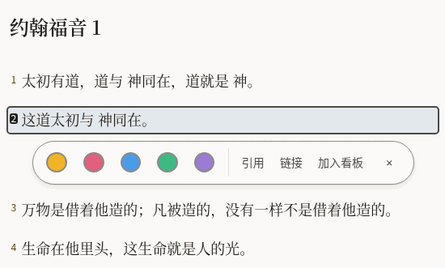

*One verse selected.*

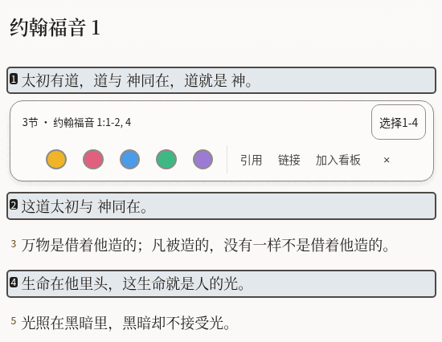

*Three verses selected, two of them together and one apart: the row says so, and offers to take in the verses between.*

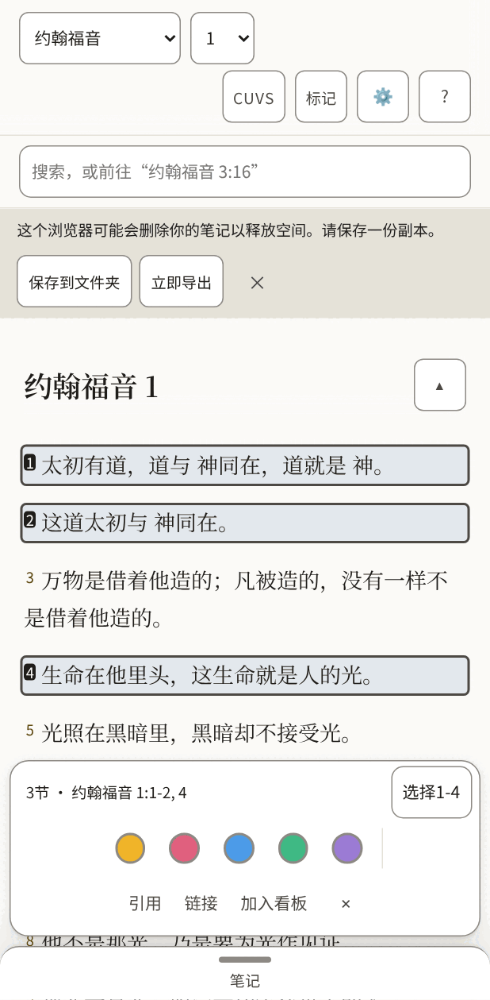

*On a phone the row sits at the bottom of the screen.*

- [ ] The summary ("3 verses · …") and the button beside it fit on one line.
- [ ] The three words for the actions are short enough to sit side by side on a phone.
- [ ] Every text in the table below is correct and sounds natural.
- [ ] Nothing in the pictures is cut off, overlapping or badly broken across lines.

**The 24 texts of this part**

| Key | English | 中文（简体） |
|---|---|---|
| `verseActions.group` | Actions for John 1:2 | 约翰福音 1:2的操作 |
| `verseActions.mark` | Mark as Amber (amber) | 标记为琥珀 |
| `verseActions.quote` | Quote | 引用 |
| `verseActions.link` | Link | 链接 |
| `verseActions.canvas` | Canvas | 加入看板 |
| `verseActions.canvasName` | Canvas — put this verse on the board | 加入看板 — 把这节经文放到看板上 |
| `verseActions.close` | Close actions for John 1:2 | 关闭约翰福音 1:2的操作 |
| `verseActions.groupMany` The row's name when it holds several verses. | Actions for 1 verse: John 1:3 Actions for 3 verses: John 1:3-5 | 1节经文的操作：约翰福音 1:3 3节经文的操作：约翰福音 1:3-5 |
| `verseActions.summary` Shown in the row while several are selected, so what it will act on is in words. | 1 verse · John 1:3 3 verses · John 1:3-5 | 1节 · 约翰福音 1:3 3节 · 约翰福音 1:3-5 |
| `verseActions.fill` The button that takes in every verse between the first and the last selected: "Select 3-18". | Select 3-18 | 选择3-18 |
| `verseActions.canvasNameMany` | Canvas — put these verses on the board | 加入看板 — 把这些经文放到看板上 |
| `verseActions.clear` | Clear the selection | 取消选择 |
| `verseActions.marked` | Marked 1 verse as Amber (amber) Marked 3 verses as Amber (amber) | 已把1节经文标记为琥珀 已把3节经文标记为琥珀 |
| `verseActions.unmarked` | Cleared Amber (amber) from 1 verse Cleared Amber (amber) from 3 verses | 已取消1节经文的琥珀标记 已取消3节经文的琥珀标记 |
| `colours.amber` | Amber | 琥珀 |
| `colours.rose` | Rose | 玫瑰 |
| `colours.sky` | Sky | 天蓝 |
| `colours.mint` | Mint | 薄荷 |
| `colours.violet` | Violet | 紫罗兰 |
| `colourWords.amber` | amber | 琥珀 |
| `colourWords.rose` | rose | 玫瑰 |
| `colourWords.sky` | sky | 天蓝 |
| `colourWords.mint` | mint | 薄荷 |
| `colourWords.violet` | violet | 紫罗兰 |

#### 2.3 Notes

The pane beside the Bible, where a reader writes. A quoted passage arrives with its reference, and a line under the note says what was just done and whether it is saved.

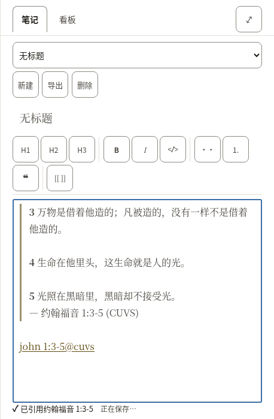

*A new note with three verses quoted into it.*

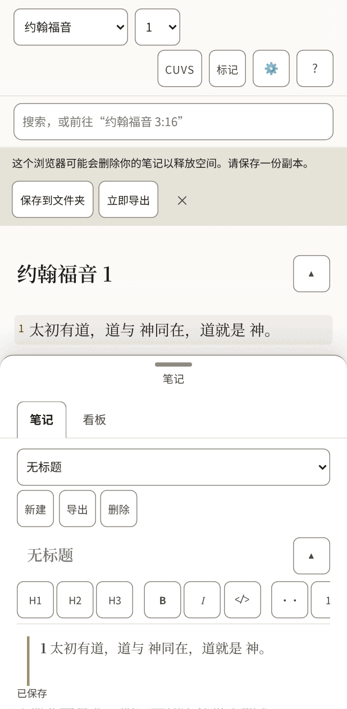

*On a phone the notes are a sheet that slides up over the text.*

- [ ] The formatting buttons carry one or two letters each (bold, italic, headings): they should be the letters a writer in this language expects.
- [ ] The line under the note ("Quoted …", "Saved") reads as a short report, not a sentence cut in two.
- [ ] Every text in the table below is correct and sounds natural.
- [ ] Nothing in the pictures is cut off, overlapping or badly broken across lines.

**The 51 texts of this part**

| Key | English | 中文（简体） |
|---|---|---|
| `notes.new` A new note. Nouns have gender in other languages, so notes and boards each say it. | New | 新建 |
| `notes.startOne` | Start one | 新建一条 |
| `notes.heading` | Notes | 笔记 |
| `notes.picker` | Note | 笔记 |
| `notes.showMenus` | Show the note menus | 显示笔记菜单 |
| `notes.hideMenus` | Hide the note menus | 隐藏笔记菜单 |
| `notes.none` | No notes yet | 还没有笔记 |
| `notes.preview` | Preview | 预览 |
| `notes.write` | Write | 编辑 |
| `notes.previewTitle` | See it rendered | 查看排版后的样子 |
| `notes.writeTitle` | Back to writing | 回到编辑 |
| `notes.canvas` | Canvas | 看板 |
| `notes.canvasTitle` | Lay verses and notes out on a board | 把经文和笔记排在看板上 |
| `notes.export` | Export | 导出 |
| `notes.exportTitle` | Download every note and board as Markdown in a .zip | 把所有笔记和看板以 Markdown 打包成 .zip 下载 |
| `notes.delete` | Delete | 删除 |
| `notes.title` | Note title | 笔记标题 |
| `notes.body` | Note body | 笔记正文 |
| `notes.placeholder` | Write here… | 在这里写… |
| `notes.goTo` | Go to John 1:3-5 | 前往约翰福音 1:3-5 |
| `notes.noneOpen` | No note open. | 没有打开的笔记。 |
| `notes.saveFailed` | Could not save — export your notes | 无法保存 — 请导出你的笔记 |
| `notes.saving` | Saving… | 正在保存… |
| `notes.saved` | Saved | 已保存 |
| `notes.linkIn` | John 1:3-5 (KJV) | 约翰福音 1:3-5（BSB） |
| `notes.linkMissing` | John 1:3-5 (KJV — not downloaded) | 约翰福音 1:3-5（BSB — 尚未下载） |
| `tools.label` | Formatting | 格式 |
| `tools.heading` Said for the H1, H2 and H3 buttons. It starts with the letters the button shows (headingGlyph), so someone using voice control can say what they see (WCAG 2.5.3). | H2, heading 2 | H2，2级标题 |
| `tools.headingGlyph` | H2 | H2 |
| `tools.bold` | Bold | 粗体 |
| `tools.boldGlyph` | B | B |
| `tools.italic` | Italic | 斜体 |
| `tools.italicGlyph` | I | I |
| `tools.code` | Code | 代码 |
| `tools.bullets` | Bulleted list | 项目符号列表 |
| `tools.numbers` The numbered-list button shows "1.", so its name starts with it, as the heading buttons' do (WCAG 2.5.3). | 1. Numbered list | 1. 编号列表 |
| `tools.quote` | Quote | 引用 |
| `tools.link` | Link to a passage | 经文链接 |
| `insert.quoted` | Quoted John 1:3-5 | 已引用约翰福音 1:3-5 |
| `insert.quotedFrom` | Quoted John 1:3-5 (BSB) | 已引用约翰福音 1:3-5（CUVS） |
| `insert.linked` | Linked John 1:3-5 | 已链接约翰福音 1:3-5 |
| `insert.addedBoard` | Added the board “John 1” | 已添加看板“约翰福音 1” |
| `insert.addedToBoard` | Added John 1:3-5 to “John 1” | 已把约翰福音 1:3-5加入看板“约翰福音 1” |
| `insert.alreadyOnBoard` | John 1:3-5 is already on “John 1” | 约翰福音 1:3-5已经在“约翰福音 1”上了 |
| `insert.inNewNote` | Quoted John 1:3-5 in a new note | 已引用约翰福音 1:3-5，在新笔记中 |
| `insert.inNote` | Quoted John 1:3-5 in “John 1” | 已引用约翰福音 1:3-5，在“约翰福音 1”中 |
| `insert.inUntitledNote` | Quoted John 1:3-5 in an untitled note | 已引用约翰福音 1:3-5，在无标题笔记中 |
| `insert.studyBoard` | Study board | 研读看板 |
| `preview.empty` | Nothing written yet. | 还没有写任何内容。 |
| `preview.editHere` | Edit here (block 3) | 在此编辑（第3段） |
| `preview.goTo` | Go to John 1:3-5 | 前往约翰福音 1:3-5 |

#### 2.4 Search

One box does two things: a reference goes straight to the passage, anything else searches the open Bible. The short list under the box is for jumping; the full list counts every match, book by book.

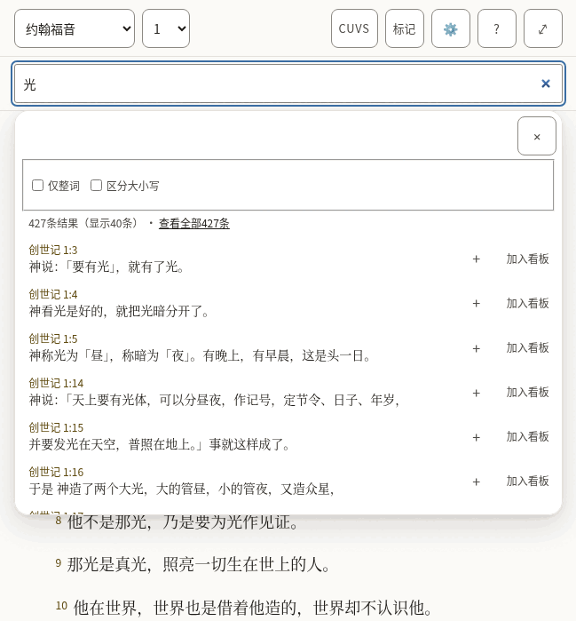

*The suggestions under the box.*

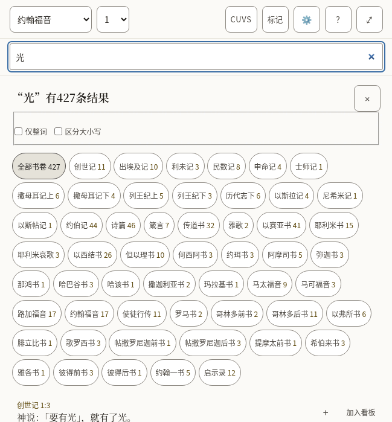

*Every match, with the count for each book.*

- [ ] The counts read naturally with a small number and with a large one.
- [ ] The two options ("Whole words only", "Match case") are understood without explanation.
- [ ] Every text in the table below is correct and sounds natural.
- [ ] Nothing in the pictures is cut off, overlapping or badly broken across lines.

**The 31 texts of this part**

| Key | English | 中文（简体） |
|---|---|---|
| `search.label` | Search or go to a reference | 搜索或前往某处经文 |
| `search.placeholder` | Search, or go to "John 3:16" | 搜索，或前往“约翰福音 3:16” |
| `search.hint` | Enter opens the passage, or every match. Down arrow moves into the suggestions. | Enter 打开该处经文，或显示全部结果。下方向键进入建议列表。 |
| `search.suggestions` | Suggestions | 建议 |
| `search.goTo` | Go to John 1:2 | 前往约翰福音 1:2 |
| `search.close` | Close suggestions | 关闭建议 |
| `search.matching` | Matching | 匹配方式 |
| `search.wholeWords` | Whole words only | 仅整词 |
| `search.wholeWordsHint` | Finds love but not loveth. Off, the search also looks inside longer words. | 只找 love，不找 loveth。关闭时，搜索也会查找更长词语的内部。 |
| `search.matchCase` | Match case | 区分大小写 |
| `search.matchCaseHint` | Capital letters matter: God and god are different. | 大小写起作用：God 和 god 不同。 |
| `search.noMatches` | No matches | 没有结果 |
| `search.matches` | 1 match 1,382 matches | 1条结果 1,382条结果 |
| `search.showing` | ␣— showing 40 | （显示40条） |
| `search.seeAll` | See all 1,382 | 查看全部1,382条 |
| `search.insert` | Insert John 1:2 into the open note | 把约翰福音 1:2插入打开的笔记 |
| `search.toCanvas` The name of a result's Canvas button: its visible word first (2.5.3). | Canvas — put John 1:2 on the board | 加入看板 — 把约翰福音 1:2放到看板上 |
| `search.weakBelow` | Below: inside a longer word | 以下：出现在更长的词语中 |
| `search.announceNone` | No matches for “light” | 没有“光”的结果 |
| `search.announceCount` | 1 match for “light” 1,382 matches for “light” | “光”有1条结果 “光”有1,382条结果 |
| `results.label` | Search results | 搜索结果 |
| `results.heading` `{count}` is replaced by the total, in its own element. | {count} match for “light” {count} matches for “light” | “光”有{count}条结果 “光”有{count}条结果 |
| `results.close` | Close search results | 关闭搜索结果 |
| `results.filter` | Filter by book | 按书卷筛选 |
| `results.allBooks` | All books | 全部书卷 |
| `results.weakBelow` | Below: “light” inside a longer word | 以下：“光”出现在更长的词语中 |
| `results.insert` | Quote John 1:2 into the open note | 把约翰福音 1:2引用到打开的笔记 |
| `results.insertTitle` | Quote into the open note | 引用到打开的笔记 |
| `results.showing` | Showing 100 of 1,382 | 显示1,382条中的100条 |
| `results.inBook` | ␣in John | ，在约翰福音中 |
| `results.more` | Show 100 more | 再显示100条 |

### The panels

Opened from the bar. They take the place of the chapter while they are open.

#### 2.5 Marks

Each of the five colours is a collection of the verses marked with it, and can be given a name of the reader’s own.

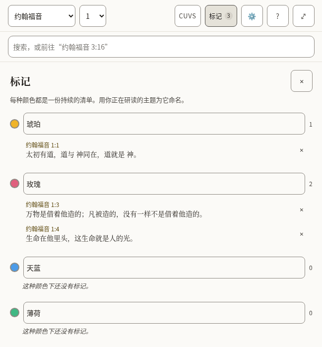

*Three marked verses in two collections.*

- [ ] The colour names are the everyday words for those colours.
- [ ] Every text in the table below is correct and sounds natural.
- [ ] Nothing in the pictures is cut off, overlapping or badly broken across lines.

**The 9 texts of this part**

| Key | English | 中文（简体） |
|---|---|---|
| `marks.label` | Marked verses | 标记过的经文 |
| `marks.title` | Marks | 标记 |
| `marks.close` | Close marks | 关闭标记 |
| `marks.hint` | Each colour is a running list. Name one for the subject you are tracking. | 每种颜色都是一份持续的清单。用你正在研读的主题为它命名。 |
| `marks.nameFor` | Name for the amber collection | 琥珀合集的名称 |
| `marks.empty` | Nothing marked in this colour yet. | 这种颜色下还没有标记。 |
| `marks.remove` | Remove the mark on John 1:2 | 移除约翰福音 1:2上的标记 |
| `marks.removed` | Mark removed. Undo is available in the Marks bar. | 标记已移除。可以在标记栏中撤销。 |
| `marks.restored` | Mark restored | 标记已恢复 |

#### 2.6 Translations, and reading two side by side

Where a Bible is downloaded, read, compared with the one being read, or removed. Each shows its size before it is downloaded.

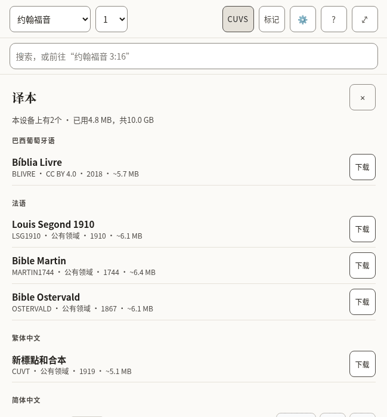

*The list of translations, by language.*

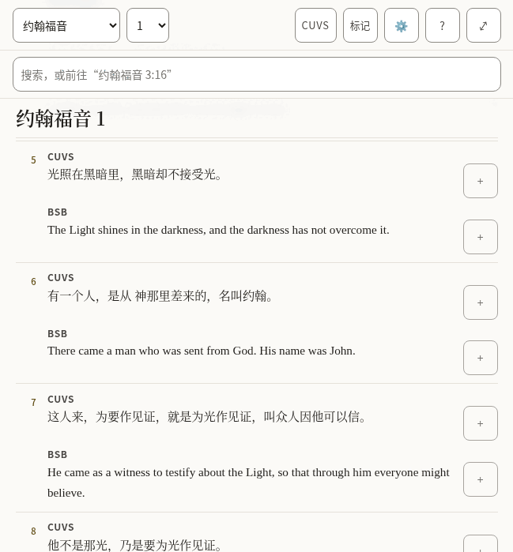

*Two translations, verse by verse.*

- [ ] The language headings are how this language names those languages.
- [ ] The note about what removing a translation does and does not touch is plain.
- [ ] Every text in the table below is correct and sounds natural.
- [ ] Nothing in the pictures is cut off, overlapping or badly broken across lines.

**The 32 texts of this part**

| Key | English | 中文（简体） |
|---|---|---|
| `library.title` | Translations | 译本 |
| `library.close` | Close translations | 关闭译本 |
| `library.onDevice` | 2 on this device | 本设备上有2个 |
| `library.used` | 11.8 MB of 1.9 GB used | 已用11.8 MB，共1.9 GB |
| `library.about` | about 5.4 MB | 约5.4 MB |
| `library.licences.public-domain` | Public domain | 公有领域 |
| `library.licences.cc-by-4.0` | CC BY 4.0 | CC BY 4.0 |
| `library.licences.cc-by-sa-4.0` | CC BY-SA 4.0 | CC BY-SA 4.0 |
| `library.licences.cc0` | CC0 | CC0 |
| `library.licences.custom-free` | Free licence | 自由许可 |
| `library.reading` | Reading | 正在阅读 |
| `library.comparing` | Comparing | 正在对照 |
| `library.read` | Read | 阅读 |
| `library.compare` | Compare | 对照 |
| `library.compareTitle` | Show beside the translation you are reading | 与你正在读的译本并排显示 |
| `library.downloading` | Downloading Berean Standard Bible | 正在下载新标点和合本 |
| `library.download` | Download | 下载 |
| `library.removeActive` | Remove Berean Standard Bible — switch to another translation first | 移除新标点和合本 — 请先切换到其他译本 |
| `library.removeFromDevice` | Remove Berean Standard Bible from this device | 从本设备上移除新标点和合本 |
| `library.note` | A downloaded translation stays on this device and can be read offline. Removing one never touches your notes or marks: both belong to the passage, not to a translation. | 下载后的译本保存在本设备上，可以离线阅读。移除译本不会影响你的笔记和标记：两者都属于经文本身，而不属于某个译本。 |
| `library.progress` | Berean Standard Bible: 50% downloaded | 新标点和合本：已下载50% |
| `library.downloaded` | Berean Standard Bible downloaded | 新标点和合本已下载 |
| `library.failed` | Berean Standard Bible: No connection — try again when you are online. | 新标点和合本：没有网络连接 — 联网后再试。 |
| `library.failedOnline` | The download did not finish. Try again later. | 下载没有完成。请稍后再试。 |
| `library.offline` | No connection — try again when you are online. | 没有网络连接 — 联网后再试。 |
| `compare.label` | Translations side by side | 译本并排对照 |
| `compare.compared` | Translations compared | 对照中的译本 |
| `compare.stop` | Stop comparing KJV | 停止对照BSB |
| `compare.verse` | Verse | 节 |
| `compare.verseBefore` | Verse␣ | 节␣ |
| `compare.missing` | Not in KJV | BSB中没有 |
| `compare.quote` | Quote KJV verse 16 | 引用BSB第16节 |

#### 2.7 Settings

How the text looks, the interface language, where the reader’s work is kept, and whether an assistant may help.

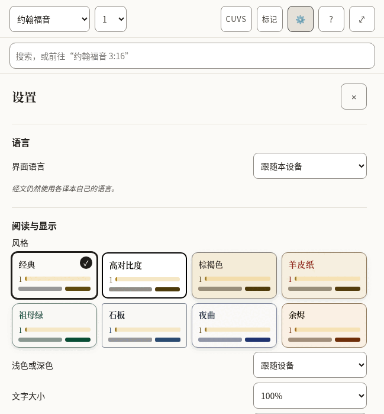

*The top of Settings.*

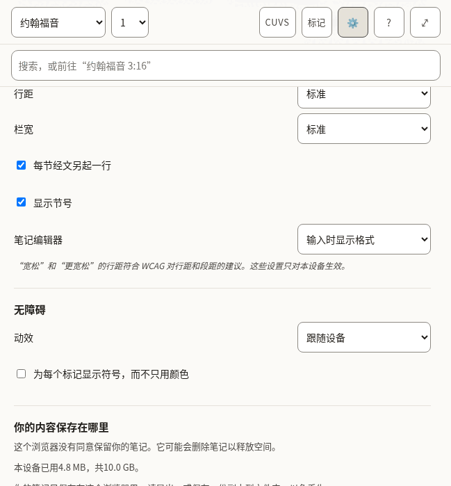

*Further down.*

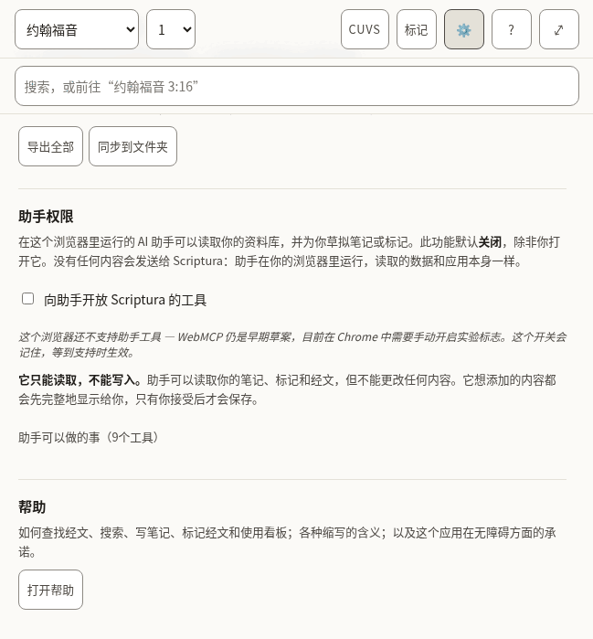

*The end.*

- [ ] Each label and the choices under it read as one thought.
- [ ] The style names are evocative, not literal (Vellum, Emerald, Nocturne): they should sound like names, not descriptions.
- [ ] The explanations in smaller type are complete sentences and easy to follow.
- [ ] Every text in the table below is correct and sounds natural.
- [ ] Nothing in the pictures is cut off, overlapping or badly broken across lines.

**The 66 texts of this part**

| Key | English | 中文（简体） |
|---|---|---|
| `settings.title` | Settings | 设置 |
| `settings.close` | Close settings | 关闭设置 |
| `settings.display` | Reading &amp; display | 阅读与显示 |
| `settings.style` | Style | 风格 |
| `settings.styles.classic` | Classic | 经典 |
| `settings.styles.contrast` | High contrast | 高对比度 |
| `settings.styles.sepia` | Sepia | 棕褐色 |
| `settings.styles.vellum` | Vellum | 羊皮纸 |
| `settings.styles.emerald` | Emerald | 祖母绿 |
| `settings.styles.slate` | Slate | 石板 |
| `settings.styles.nocturne` | Nocturne | 夜曲 |
| `settings.styles.ember` | Ember | 余烬 |
| `settings.appearance` | Light or dark | 浅色或深色 |
| `settings.appearances.system` | Follow the device | 跟随设备 |
| `settings.appearances.light` | Light | 浅色 |
| `settings.appearances.dark` | Dark | 深色 |
| `settings.textSize` | Text size | 文字大小 |
| `settings.spacing` | Line spacing | 行距 |
| `settings.spacings.normal` | Normal | 标准 |
| `settings.spacings.relaxed` | Relaxed | 宽松 |
| `settings.spacings.loose` | Loose | 更宽松 |
| `settings.measure` | Column width | 栏宽 |
| `settings.measures.narrow` | Narrow | 窄 |
| `settings.measures.normal` | Normal | 标准 |
| `settings.measures.wide` | Wide | 宽 |
| `settings.measures.full` | Full | 全宽 |
| `settings.editor` | Note editor | 笔记编辑器 |
| `settings.editors.live` | Show formatting as you write | 输入时显示格式 |
| `settings.editors.plain` | Plain text | 纯文本 |
| `settings.displayNote` | Relaxed and Loose spacing meet the WCAG guidance for line and paragraph spacing. These settings apply to this device only. | “宽松”和“更宽松”的行距符合 WCAG 对行距和段距的建议。这些设置只对本设备生效。 |
| `settings.accessibility` | Accessibility | 无障碍 |
| `settings.motion` | Motion | 动效 |
| `settings.motions.system` | Follow the device | 跟随设备 |
| `settings.motions.reduce` | Reduce motion | 减少动效 |
| `settings.markers` | Show a symbol on every highlight, not only a colour | 为每个标记显示符号，而不只用颜色 |
| `settings.verseLines` | Start each verse on a new line | 每节经文另起一行 |
| `settings.verseNumbers` | Show verse numbers | 显示节号 |
| `settings.recedeMenus` | On a small screen, hide the menus while reading | 在小屏幕上，阅读时隐藏菜单 |
| `settings.storage` | Where your work lives | 你的内容保存在哪里 |
| `settings.persistence.persisted` | This browser has agreed to keep your notes. Clearing site data still removes them. | 这个浏览器已同意保留你的笔记。清除网站数据仍会删除它们。 |
| `settings.persistence.denied` | This browser has not agreed to keep your notes. It may delete them to free up space. | 这个浏览器没有同意保留你的笔记。它可能会删除笔记以释放空间。 |
| `settings.persistence.unsupported` | This browser will not say whether it keeps your notes. Assume it may delete them. | 这个浏览器不会说明是否保留你的笔记。请当作它可能会删除。 |
| `settings.persistence.unknown` | Checking… | 正在检查… |
| `settings.usedOnDevice` | 11.8 MB of 1.9 GB used on this device. | 本设备已用11.8 MB，共1.9 GB。 |
| `settings.mirrored` | Your notes are also saved to a folder you chose. | 你的笔记也会保存到你选择的文件夹中。 |
| `settings.notMirrored` | Your notes live only in this browser. Export them, or save a copy to a folder, to keep them safe. | 你的笔记只保存在这个浏览器里。请导出，或保存一份副本到文件夹，以免丢失。 |
| `settings.exportAll` | Export everything | 导出全部 |
| `settings.anotherFolder` | Choose another folder | 选择其他文件夹 |
| `settings.mirror` | Mirror to a folder | 同步到文件夹 |
| `settings.assistant` | Assistant access | 助手权限 |
| `settings.assistantIntro` | An AI assistant running in this browser can read your library and draft notes or marks for you. This is **off** until you turn it on. Nothing is sent to Scriptura: the assistant runs in your browser and reads the same data the app does. | 在这个浏览器里运行的 AI 助手可以读取你的资料库，并为你草拟笔记或标记。此功能默认**关闭**，除非你打开它。没有任何内容会发送给 Scriptura：助手在你的浏览器里运行，读取的数据和应用本身一样。 |
| `settings.assistantToggle` | Offer Scriptura’s tools to an assistant | 向助手开放 Scriptura 的工具 |
| `settings.assistantSupported` | This browser supports assistant tools. | 这个浏览器支持助手工具。 |
| `settings.assistantUnsupported` | This browser does not support assistant tools yet — WebMCP is an early draft, available in Chrome behind a flag. The switch is remembered for when it does. | 这个浏览器还不支持助手工具 — WebMCP 仍是早期草案，目前在 Chrome 中需要手动开启实验标志。这个开关会记住，等到支持时生效。 |
| `settings.assistantReadOnly` | **It can read, not write.** An assistant can read your notes, marks and passages, but it cannot change anything. Anything it wants to add is shown to you in full first, and is saved only when you accept it. | **它只能读取，不能写入。**助手可以读取你的笔记、标记和经文，但不能更改任何内容。它想添加的内容都会先完整地显示给你，只有你接受后才会保存。 |
| `settings.assistantTools` | What an assistant would be able to do (9 tools) | 助手可以做的事（9个工具） |
| `settings.toolReads` | reads | 读取 |
| `settings.toolNeedsApproval` | needs your approval | 需要你的同意 |
| `settings.toolsInEnglish` Shown only in the other languages, beside the tool descriptions, which stay English. | The descriptions are in English, as the assistant reads them. | 工具说明是英文的，因为助手就是这样读取它们的。 |
| `settings.help` | Help | 帮助 |
| `settings.helpIntro` | How to find a passage, search, write notes, mark verses and use boards; what the abbreviations mean; and what this app promises about accessibility. | 如何查找经文、搜索、写笔记、标记经文和使用看板；各种缩写的含义；以及这个应用在无障碍方面的承诺。 |
| `settings.openHelp` | Open help | 打开帮助 |
| `settings.language` | Language | 语言 |
| `settings.languageLabel` | Interface language | 界面语言 |
| `settings.languageSystem` | Match this device | 跟随本设备 |
| `settings.languageNote` | Bible text stays in the language of each translation. | 经文仍然使用各译本自己的语言。 |

#### 2.8 Help

The longest text in the app, and the one a reader turns to when stuck. It includes a list of terms and abbreviations, and a statement about accessibility.

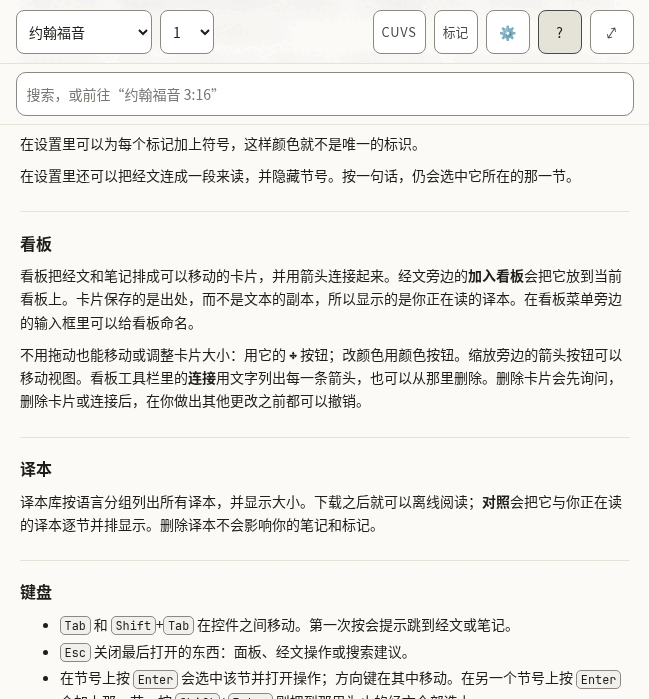

*The top of Help.*

- [ ] It reads well from start to finish as an explanation, not as a list of translated sentences.
- [ ] The examples of references are ones that work in a Bible in this language.
- [ ] The names of keys (Enter, Shift, Escape) are how this language’s keyboards and manuals name them.
- [ ] Every text in the table below is correct and sounds natural.
- [ ] Nothing in the pictures is cut off, overlapping or badly broken across lines.

**The 76 texts of this part**

| Key | English | 中文（简体） |
|---|---|---|
| `help.title` | Help | 帮助 |
| `help.close` | Close help | 关闭帮助 |
| `help.sections.finding.heading` | Finding a passage | 查找经文 |
| `help.sections.finding.blocks.1.p` | Type a reference in the search box and press Enter. All of these work: | 在搜索框中输入经文出处，然后按 Enter。下面这些写法都可以： |
| `help.sections.finding.blocks.2.ul.1` | `John 3:16` — one verse. | `约翰福音 3:16` — 一节经文。 |
| `help.sections.finding.blocks.2.ul.2` | `John 3:16-18` — a range of verses. | `约翰福音 3:16-18` — 一段经文。 |
| `help.sections.finding.blocks.2.ul.3` | `John 3` — a whole chapter. | `约翰福音 3` — 整章。 |
| `help.sections.finding.blocks.2.ul.4` | `Juan 3:16` or `Jean 3:16` — the book name in the translation you are reading. | `Juan 3:16` 或 `Jean 3:16` — 你正在读的译本里的书卷名。 |
| `help.sections.finding.blocks.2.ul.5` | `Jhn 3:16` — an abbreviation. `43 3:16` — the book number. | `Jhn 3:16` — 简称。`43 3:16` — 书卷编号。 |
| `help.sections.finding.blocks.3.p` | You can also pick the book and chapter from the two menus in the bar. | 也可以用工具栏上的两个菜单选择书卷和章。 |
| `help.sections.finding.blocks.4.p` | On a small screen the menus step aside while you read, write or arrange a board. Press the **▾** button beside the title to bring them back; in a chapter or a note, scrolling back a little does the same. In Settings you can stop them moving by themselves. | 在小屏幕上，阅读、书写或整理看板时，菜单会自动让开。按标题旁的 **▾** 按钮，就能让它们回来；在经文或笔记里，往回滚动一点也可以。在设置里可以让它们不再自动移动。 |
| `help.sections.searching.heading` | Searching | 搜索 |
| `help.sections.searching.blocks.1.p` | Anything that is not a reference is a search. Search looks inside words, so `love` also finds *loveth* and *beloved*. Accents do not matter: `amo` finds *amó*. | 不是经文出处的内容都会当作搜索。搜索会查找词语内部，所以 `爱` 也会找到*慈爱*。中文不受重音影响；在西文译本里，`amo` 也会找到*amó*。 |
| `help.sections.searching.blocks.2.ul.1` | Put a phrase in quotes to find it exactly: `"in the beginning"`. | 用引号括起来可以精确查找整句：`"起初"`。 |
| `help.sections.searching.blocks.2.ul.2` | Put a minus sign before a word to leave verses with it out: `God -love`. | 在词前加减号可以排除含该词的经文：`神 -爱`。 |
| `help.sections.searching.blocks.2.ul.3` | **Whole words only** stops the search looking inside longer words. | **仅整词**让搜索不再查找更长词语的内部。 |
| `help.sections.searching.blocks.2.ul.4` | **Match case** makes capital letters matter. | **区分大小写**让西文的大小写起作用。 |
| `help.sections.searching.blocks.3.p` | The first results are verses where your word stands alone; verses where it sits inside a longer word come after a line that says so. Press Enter on a search to see every match, counted by book. | 先列出该词单独出现的经文；出现在更长词语内部的经文排在一行说明之后。在搜索框按 Enter，可以看到全部结果，并按书卷统计。 |
| `help.sections.notes.heading` | Notes | 笔记 |
| `help.sections.notes.blocks.1.p` | Notes are plain text with Markdown. Formatting takes shape as you write, and its symbols come back on the line you are editing; to see only the Markdown, choose **Plain text** under Note editor in Settings. The toolbar above the note adds headings, bold, italic, lists and quotes; press a tool again to take the formatting off. With Plain text, **Preview** shows the note as it will read. | 笔记是带 Markdown 的纯文本。格式会在输入时显示，正在编辑的那一行会重新显示符号；如果只想看 Markdown，请在设置的“笔记编辑器”中选择**纯文本**。笔记上方的工具栏可以添加标题、粗体、斜体、列表和引用；再按一次同一个工具就会取消格式。使用纯文本时，**预览**显示笔记最终的样子。 |
| `help.sections.notes.blocks.2.p` | A link to a passage looks like `[[john 3:16]]`. Add `@kjv` to say which translation: `[[john 3:16@kjv]]`. Put the cursor inside a link and a **Go to** button opens it. **Quote** beside a verse copies the verse into your note with its reference and a link. | 指向经文的链接写作 `[[john 3:16]]`。加上 `@kjv` 可以指明译本：`[[john 3:16@kjv]]`。把光标放在链接里，**前往**按钮就会打开它。经文旁边的**引用**会把该节连同出处和链接一起复制到笔记中。 |
| `help.sections.notes.blocks.3.p` | Notes are saved on this device as you type. **Export** downloads every note and board as text files in a zip. | 笔记在你输入时就保存在本设备上。**导出**会把所有笔记和看板作为文本文件打包成 .zip 下载。 |
| `help.sections.marks.heading` | Marks | 标记 |
| `help.sections.marks.blocks.1.p` | Press a verse, or its number, to mark it in one of five colours. Each colour is a collection: name it for the subject you are following, and the **Marks** panel lists its verses in Bible order. Marks follow the passage, not the translation, so a mark made in one translation shows in all of them. | 按一节经文或它的节号，就可以用五种颜色之一标记它。每种颜色都是一个合集：用你正在研读的主题为它命名，**标记**面板会按圣经顺序列出这些经文。标记跟随经文本身，而不是译本，所以在一个译本里做的标记，在所有译本里都会显示。 |
| `help.sections.marks.blocks.2.p` | Press more verses to act on several at once, and press one again to leave it out. With verses apart selected, **Select** in the row of actions takes in every verse between them; holding <kbd>Shift</kbd> while you press a verse does the same. **Quote** then writes them into your note as one passage under one reference. | 再按其他经文，就可以一次处理好几节；再按一次，就把那一节去掉。选中了不相连的经文时，操作栏里的**选择**会把它们之间的经文全部选上；按住 <kbd>Shift</kbd> 再按一节经文，效果相同。这时**引用**会把它们作为一段经文、用一个出处写进笔记。 |
| `help.sections.marks.blocks.3.p` | In Settings you can add a symbol to every mark, so colour is not the only sign. | 在设置里可以为每个标记加上符号，这样颜色就不是唯一的标识。 |
| `help.sections.marks.blocks.4.p` | In Settings you can also run the verses together as one text and hide their numbers. Pressing a sentence still picks the verse it belongs to. | 在设置里还可以把经文连成一段来读，并隐藏节号。按一句话，仍会选中它所在的那一节。 |
| `help.sections.boards.heading` | Boards | 看板 |
| `help.sections.boards.blocks.1.p` | A board lays verses and notes out as cards you can move and join with arrows. **Canvas** beside a verse puts it on the current board. Cards hold a reference, not a copy of the text, so they show the translation you are reading. Give a board a name in the box beside the board menu. | 看板把经文和笔记排成可以移动的卡片，并用箭头连接起来。经文旁边的**加入看板**会把它放到当前看板上。卡片保存的是出处，而不是文本的副本，所以显示的是你正在读的译本。在看板菜单旁边的输入框里可以给看板命名。 |
| `help.sections.boards.blocks.2.p` | To move or resize a card without dragging, use its **✥** button; to colour it, its colour button. The arrow buttons beside the zoom move the view. **Connections**, in the board's bar, lists every arrow in words and removes one. Removing a card asks first, and removing a card or a connection can be undone until you change something else. | 不用拖动也能移动或调整卡片大小：用它的 **✥** 按钮；改颜色用颜色按钮。缩放旁边的箭头按钮可以移动视图。看板工具栏里的**连接**用文字列出每一条箭头，也可以从那里删除。删除卡片会先询问，删除卡片或连接后，在你做出其他更改之前都可以撤销。 |
| `help.sections.translations.heading` | Translations | 译本 |
| `help.sections.translations.blocks.1.p` | The library lists every translation, grouped by language, with its size. Download one to read it offline; **Compare** shows it beside the one you are reading, verse by verse. Removing a translation never touches your notes or marks. | 译本库按语言分组列出所有译本，并显示大小。下载之后就可以离线阅读；**对照**会把它与你正在读的译本逐节并排显示。删除译本不会影响你的笔记和标记。 |
| `help.sections.keyboard.heading` | Keyboard | 键盘 |
| `help.sections.keyboard.blocks.1.ul.1` | <kbd>Tab</kbd> and <kbd>Shift</kbd>+<kbd>Tab</kbd> move between controls. The first press offers to skip to the text or the notes. | <kbd>Tab</kbd> 和 <kbd>Shift</kbd>+<kbd>Tab</kbd> 在控件之间移动。第一次按会提示跳到经文或笔记。 |
| `help.sections.keyboard.blocks.1.ul.2` | <kbd>Escape</kbd> closes whatever opened last: a panel, the verse actions, the search suggestions. | <kbd>Esc</kbd> 关闭最后打开的东西：面板、经文操作或搜索建议。 |
| `help.sections.keyboard.blocks.1.ul.3` | <kbd>Enter</kbd> on a verse number selects it and opens the actions; the arrow keys move along them. <kbd>Enter</kbd> on another number adds that verse, and <kbd>Shift</kbd>+<kbd>Enter</kbd> takes in every verse up to it. | 在节号上按 <kbd>Enter</kbd> 会选中该节并打开操作；方向键在其中移动。在另一个节号上按 <kbd>Enter</kbd> 会加上那一节，按 <kbd>Shift</kbd>+<kbd>Enter</kbd> 则把到那里为止的经文全部选上。 |
| `help.sections.keyboard.blocks.1.ul.4` | On the divider between the panes, the arrow keys, <kbd>Home</kbd> and <kbd>End</kbd> resize; the two small buttons do the same. | 在两栏之间的分隔条上，方向键、<kbd>Home</kbd> 和 <kbd>End</kbd> 可以调整宽度；旁边的两个小按钮作用相同。 |
| `help.sections.keyboard.blocks.1.ul.5` | In a note, <kbd>Shift</kbd>+<kbd>Tab</kbd> reaches the formatting tools; the arrow keys move between them. | 在笔记中，<kbd>Shift</kbd>+<kbd>Tab</kbd> 可以到达格式工具；方向键在工具之间移动。 |
| `help.sections.keyboard.blocks.1.ul.6` | On a board, cards take focus: the arrow keys move a card, <kbd>Alt</kbd> with an arrow resizes it, and <kbd>Delete</kbd> asks to remove it. With the board itself focused, the arrow keys move the view and <kbd>+</kbd> and <kbd>−</kbd> zoom. | 在看板上，卡片可以获得焦点：方向键移动卡片，<kbd>Alt</kbd> 加方向键调整大小，<kbd>Delete</kbd> 会询问是否删除。焦点在看板本身时，方向键移动视图，<kbd>+</kbd> 和 <kbd>−</kbd> 缩放。 |
| `help.abbreviations` | Abbreviations | 缩写 |
| `help.abbreviationsCaption` | What each abbreviation means | 每个缩写的含义 |
| `help.short` | Short | 缩写 |
| `help.meaning` | Meaning | 含义 |
| `help.terms.1.1` | CC BY-SA 4.0 | CC BY-SA 4.0 |
| `help.terms.1.2` | Creative Commons Attribution–ShareAlike 4.0: a free licence that asks you to credit the source and share changes under the same terms. | 知识共享 署名-相同方式共享 4.0：一种自由许可协议，要求注明来源，并以相同方式共享修改。 |
| `help.terms.2.1` | CC0 | CC0 |
| `help.terms.2.2` | Creative Commons Zero: the author has waived all rights; the text is free to use. | 知识共享 零：作者放弃了全部权利，文本可以自由使用。 |
| `help.terms.3.1` | OT | OT |
| `help.terms.3.2` | Old Testament. | 旧约（英文 Old Testament）。 |
| `help.terms.4.1` | NT | NT |
| `help.terms.4.2` | New Testament. | 新约（英文 New Testament）。 |
| `help.terms.5.1` | PWA | PWA |
| `help.terms.5.2` | Progressive web app: a website you can install and use offline. | 渐进式网页应用：可以安装并离线使用的网站。 |
| `help.terms.6.1` | WCAG | WCAG |
| `help.terms.6.2` | Web Content Accessibility Guidelines, the standard this app is measured against. | 《网页内容无障碍指南》，本应用据此衡量自己。 |
| `help.glossaryHeading` | Words used here | 这里用到的词 |
| `help.glossary.1.1` | Collection | 合集 |
| `help.glossary.1.2` | Every verse you mark in one colour. Name a colour for the subject you are following, and the Marks panel lists those verses in Bible order. | 你用同一种颜色标记的所有经文。用你正在研读的主题为一种颜色命名，标记面板就会按圣经顺序列出这些经文。 |
| `help.glossary.2.1` | Board | 看板 |
| `help.glossary.2.2` | A space where verses and notes are laid out as cards and joined with arrows. Boards are saved and exported with your notes. | 把经文和笔记排成卡片、并用箭头连接起来的地方。看板会随笔记一起保存和导出。 |
| `help.glossary.3.1` | Card | 卡片 |
| `help.glossary.3.2` | One item on a board: a verse, a note, or text you typed. A verse card shows the verse from whichever translation you are reading. | 看板上的一项：一节经文、一条笔记，或者你输入的文字。经文卡片显示的是你当前所读译本中的经文。 |
| `help.glossary.4.1` | Translation | 译本 |
| `help.glossary.4.2` | One version of the Bible, in one language. Every translation here is free to copy. | 圣经的一个版本，用一种语言。这里的每个译本都可以自由复制。 |
| `help.glossary.5.1` | Whole words only | 仅整词 |
| `help.glossary.5.2` | A search option. With it on, "love" finds love but not loveth. With it off, it finds both. | 搜索选项。打开时，“love”只找 love，不找 loveth；关闭时两者都找。 |
| `help.glossary.6.1` | Match case | 区分大小写 |
| `help.glossary.6.2` | A search option. With it on, "God" and "god" are different. | 搜索选项。打开时，“God”和“god”不同。 |
| `help.glossary.7.1` | Mirror to a folder | 同步到文件夹 |
| `help.glossary.7.2` | Keep a copy of your notes as text files in a folder on this computer, updated as you write. Works in Chrome and Edge. | 在本电脑的某个文件夹中保留一份笔记的文本副本，并在你书写时更新。支持 Chrome 和 Edge。 |
| `help.glossary.8.1` | Assistant tools | 助手工具 |
| `help.glossary.8.2` | A way for an AI assistant running in your browser to read your library and suggest notes or marks. Off unless you turn it on; nothing is saved without your approval. | 让在你浏览器中运行的 AI 助手读取资料库并建议笔记或标记的方式。默认关闭；未经你同意不会保存任何内容。 |
| `help.accessibilityHeading` | Accessibility | 无障碍 |
| `help.accessibility.1` | This app aims to meet the Web Content Accessibility Guidelines 2.2 at Level AAA for everything the app itself shows: its controls, its text, its colours and its behaviour. Every control can be reached by keyboard, is at least 44 by 44 pixels, shows where focus is, and has a name. Text is at least 7:1 against its background in every colour theme, and you can change the size, spacing and colours in Settings. | 本应用力求在应用自身显示的一切内容上达到《网页内容无障碍指南》2.2 的 AAA 级：控件、文字、颜色和行为。每个控件都可以用键盘到达，尺寸至少为 44×44 像素，会显示焦点位置，并且有名称。在所有配色主题下，文字与背景的对比度至少为 7:1，你也可以在设置中更改字号、行距和颜色。 |
| `help.accessibility.2` | Two things are outside that promise. The Bible text is shown as it was published: how hard it is to read, and how its words are said, belong to each translation, not to this app. The same is true of what you write in your notes. | 有两件事不在这个承诺之内。经文按出版时的样子显示：它的阅读难度和读音属于各个译本，而不属于本应用。你写在笔记里的内容同样如此。 |
| `help.accessibility.3` | What is checked by machine is checked on every change. What needs a person — a screen reader on a phone, the app under a Windows contrast theme — is checked by hand, less often. If something does not work for you, please report it at the project's issue tracker on GitHub (`AlanRoman117/scriptura`). | 可以由机器检查的部分，每次更改都会检查。需要人来检查的部分 — 手机上的屏幕阅读器、Windows 高对比度主题下的应用 — 由人工检查，频率较低。如果有什么地方对你不管用，请在项目的 GitHub 问题区报告（`AlanRoman117/scriptura`）。 |

### Met less often

Boards, the questions asked before something is deleted, and the notices. Many of these texts are spoken by a screen reader and never shown.

#### 2.9 Boards (the canvas)

A surface where verses and notes are laid out as cards and joined with arrows. Most of its texts are the names of buttons, heard by a screen reader.

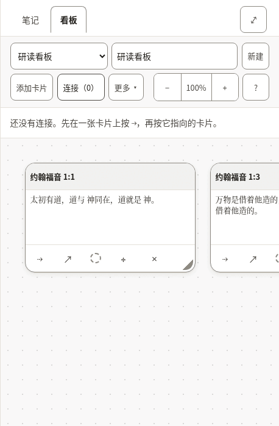

*Two verses on a board, with the list of connections open.*

- [ ] The words for a board, a card and a connection are used the same way here as everywhere else.
- [ ] Every text in the table below is correct and sounds natural.
- [ ] Nothing in the pictures is cut off, overlapping or badly broken across lines.

**The 93 texts of this part**

| Key | English | 中文（简体） |
|---|---|---|
| `canvas.new` A new board. | New | 新建 |
| `canvas.more` Beside the Bible, the button the less-used board actions fold behind. | More | 更多 |
| `canvas.startOne` | Start one | 新建一个 |
| `canvas.label` | Boards | 看板 |
| `canvas.heading` | Board: John 1 | 看板：约翰福音 1 |
| `canvas.noneOpenHeading` | none open | 未打开任何看板 |
| `canvas.picker` | Board | 看板 |
| `canvas.showMenus` | Show the board menus | 显示看板菜单 |
| `canvas.hideMenus` | Hide the board menus | 隐藏看板菜单 |
| `canvas.name` | Board name | 看板名称 |
| `canvas.none` | No boards yet | 还没有看板 |
| `canvas.undo` | Undo: put back John 1:1 Undo: put back the connection John 1:1 → John 1:14 | 撤销：恢复约翰福音 1:1 撤销：恢复连接约翰福音 1:1 → 约翰福音 1:14 |
| `canvas.putBack` | John 1:1 put back The connection John 1:1 → John 1:14 put back | 已恢复约翰福音 1:1 已恢复连接约翰福音 1:1 → 约翰福音 1:14 |
| `canvas.removed` | John 1:1 removed. Undo is in the board's bar. The connection John 1:1 → John 1:14 removed. Undo is in the board's bar. | 已移除卡片：约翰福音 1:1。可以在看板工具栏中撤销。 已移除连接：约翰福音 1:1 → 约翰福音 1:14。可以在看板工具栏中撤销。 |
| `canvas.addCard` | Add card | 添加卡片 |
| `canvas.addNote` | Add note | 添加笔记 |
| `canvas.addNoteName` | Add note — put the newest note on the board | 添加笔记 — 把最新的一条笔记放到看板上 |
| `canvas.addNoteNoNotes` | Add note — write a note first | 添加笔记 — 请先写一条笔记 |
| `canvas.toNote` | Add to note | 加入笔记 |
| `canvas.toNoteName` | Add to note — put this board into the note you have open | 加入笔记 — 把这个看板放进你打开的笔记里 |
| `canvas.connections` | Connections (2) | 连接（2） |
| `canvas.connectionsLabel` | Connections | 连接 |
| `canvas.deleteBoard` | Delete board | 删除看板 |
| `canvas.zoom` | Zoom | 缩放 |
| `canvas.zoomOut` | Zoom out | 缩小 |
| `canvas.zoomIn` | Zoom in | 放大 |
| `canvas.zoomReset` | Zoom 120%. Reset to full size, showing your cards | 缩放120%。恢复原始大小并显示你的卡片 |
| `canvas.moveView` | Move the view | 移动视图 |
| `canvas.viewLeft` | Move the view left | 视图左移 |
| `canvas.viewUp` | Move the view up | 视图上移 |
| `canvas.viewDown` | Move the view down | 视图下移 |
| `canvas.viewRight` | Move the view right | 视图右移 |
| `canvas.help` | Help — boards, keyboard, and what the abbreviations mean | 帮助 — 看板、键盘，以及各种缩写的含义 |
| `canvas.noConnections` | No connections yet. Press ⇢ on a card, then the card it leads to. | 还没有连接。先在一张卡片上按 ⇢，再按它指向的卡片。 |
| `canvas.removeConnection` | Remove the connection John 1:1 → John 1:14 | 移除连接约翰福音 1:1 → 约翰福音 1:14 |
| `canvas.missingCard` | a missing card | 一张已不存在的卡片 |
| `canvas.edge` | John 1:1 → John 1:14 | 约翰福音 1:1 → 约翰福音 1:14 |
| `canvas.frame` | Board canvas, 1 card Board canvas, 4 cards | 看板画布，1张卡片 看板画布，4张卡片 |
| `canvas.frameHint` | Arrow keys move the view; plus and minus zoom. Each card takes focus: arrow keys move it, and Alt with an arrow resizes it. | 方向键移动视图，加号和减号缩放。每张卡片都可以获得焦点：方向键移动卡片，Alt 加方向键调整大小。 |
| `canvas.verseCard` | Verse card | 经文卡片 |
| `canvas.noteCard` | Note card | 笔记卡片 |
| `canvas.card` | Card | 卡片 |
| `canvas.cardName` | Verse card: John 1:1, Amber (amber) Verse card: John 1:1 | 经文卡片：约翰福音 1:1，琥珀 经文卡片：约翰福音 1:1 |
| `canvas.colourName` | Amber (amber) | 琥珀 |
| `canvas.cardTitle` | Card title | 卡片标题 |
| `canvas.cardTitlePlaceholder` | Card | 卡片 |
| `canvas.cardText` | Card text | 卡片文字 |
| `canvas.cardTextPlaceholder` | Write here… | 在这里写… |
| `canvas.cardBody` | John 1:1 — text | 约翰福音 1:1 — 文字 |
| `canvas.connect` | Connect John 1:1 to another card | 把约翰福音 1:1连接到另一张卡片 |
| `canvas.connectPrompt` | Choose the card to connect to: press it, or Enter on it. Escape cancels. | 选择要连接到的卡片：按一下它，或在它上面按 Enter。Esc 取消。 |
| `canvas.connected` | Connected John 1:1 to John 1:14 | 已把约翰福音 1:1连接到约翰福音 1:14 |
| `canvas.open` | Open John 1:1 in the reader | 在阅读中打开约翰福音 1:1 |
| `canvas.colour` | Colour: Amber (amber). Change the colour of John 1:1 Colour: none. Change the colour of John 1:1 | 颜色：琥珀。更改约翰福音 1:1的颜色 颜色：无。更改约翰福音 1:1的颜色 |
| `canvas.adjust` | Move or resize John 1:1 without dragging | 不用拖动也能移动或调整约翰福音 1:1 |
| `canvas.takeOff` | Take John 1:1 off the board | 把约翰福音 1:1从看板上移除 |
| `canvas.empty` | Nothing on this board yet. Add a card here, or use **Canvas** beside a verse while reading. | 这个看板上还什么都没有。可以在这里添加卡片，或在阅读时用经文旁边的**加入看板**。 |
| `canvas.adjustPanel` | Move and resize John 1:1 | 移动并调整约翰福音 1:1 |
| `canvas.colourPanel` | Colour of John 1:1 | 约翰福音 1:1的颜色 |
| `canvas.adjustTitle` | Move and resize | 移动与调整 |
| `canvas.colourTitle` | Colour | 颜色 |
| `canvas.panelTitle` | Move and resize: John 1:1 | 移动与调整：约翰福音 1:1 |
| `canvas.move` | Move | 移动 |
| `canvas.moveLeft` | Move left | 左移 |
| `canvas.moveUp` | Move up | 上移 |
| `canvas.moveDown` | Move down | 下移 |
| `canvas.moveRight` | Move right | 右移 |
| `canvas.size` | Size | 大小 |
| `canvas.narrower` | Narrower | 更窄 |
| `canvas.wider` | Wider | 更宽 |
| `canvas.shorter` | Shorter | 更矮 |
| `canvas.taller` | Taller | 更高 |
| `canvas.colours` | Colours | 颜色 |
| `canvas.noColour` | No colour | 无颜色 |
| `canvas.moved` | John 1:1: moved to 320, 180 | 约翰福音 1:1：已移动到 320，180 |
| `canvas.resized` | John 1:1: 280 wide, 180 tall | 约翰福音 1:1：宽 280，高 180 |
| `canvas.coloured` | John 1:1: Amber (amber) | 约翰福音 1:1：琥珀 |
| `canvas.uncoloured` | John 1:1: no colour | 约翰福音 1:1：无颜色 |
| `canvas.noneOpen` | No board open. | 没有打开的看板。 |
| `cards.verseMissing` | Not in this translation. | 这个译本中没有。 |
| `cards.untitledNote` | Untitled note | 无标题笔记 |
| `cards.untitledBoard` | Untitled board | 无标题看板 |
| `cards.emptyNote` | Empty note. | 空笔记。 |
| `cards.deletedNote` | This note has been deleted. | 这条笔记已被删除。 |
| `cards.card` | Card | 卡片 |
| `cards.emptyBoard` | _Empty board._ | _空看板_ |
| `cards.connections` | Connections | 连接 |
| `cards.missingCard` | (missing card) | （已不存在的卡片） |
| `embed.scrolls` | Board: John 1, scrolls sideways | 看板：约翰福音 1，可左右滚动 |
| `embed.picture` | Board: John 1, 1 cards Board: John 1, 4 cards | 看板：约翰福音 1，1张卡片 看板：约翰福音 1，4张卡片 |
| `embed.empty` | This board is empty. | 这个看板是空的。 |
| `embed.missing` | A board was embedded here, but it no longer exists. | 这里曾嵌入一个看板，但它已经不存在了。 |
| `embed.open` | Open board | 打开看板 |

#### 2.10 Questions before something is deleted

Deleting a note or a board, or removing a card, a mark or a translation, asks first. The question names what will go, and says whether it can come back.

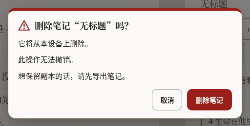

*The question before a note is deleted.*

- [ ] It is unmistakable what will be deleted and that it cannot be undone.
- [ ] The button that deletes says what it deletes.
- [ ] Every text in the table below is correct and sounds natural.
- [ ] Nothing in the pictures is cut off, overlapping or badly broken across lines.

**The 26 texts of this part**

| Key | English | 中文（简体） |
|---|---|---|
| `confirm.permanent` | You cannot undo this. | 此操作无法撤销。 |
| `confirm.undoable` | You can undo this until your next change. | 在你做出下一次更改之前都可以撤销。 |
| `confirm.note.title` | Delete the note “John 1”? | 删除笔记“约翰福音 1”吗？ |
| `confirm.note.gone` | It will be deleted from this device. | 它将从本设备上删除。 |
| `confirm.note.keepCopy` | To keep a copy, export your notes first. | 想保留副本的话，请先导出笔记。 |
| `confirm.note.action` | Delete note | 删除笔记 |
| `confirm.note.done` | Deleted the note “John 1” | 已删除笔记“约翰福音 1” |
| `confirm.board.title` | Delete the board “John 1”? | 删除看板“约翰福音 1”吗？ |
| `confirm.board.cards` | The board and its card will be deleted. The board and its 4 cards will be deleted. | 看板及其1张卡片都会被删除。 看板及其4张卡片都会被删除。 |
| `confirm.board.empty` | The board is empty. | 这个看板是空的。 |
| `confirm.board.kept` | Your notes are not changed. | 你的笔记不会改变。 |
| `confirm.board.action` | Delete board | 删除看板 |
| `confirm.board.done` | Deleted the board “John 1” | 已删除看板“约翰福音 1” |
| `confirm.card.title` | Remove John 1:1 from the board? | 把约翰福音 1:1从看板上移除吗？ |
| `confirm.card.connections` | Its connection is removed too. Its 3 connections are removed too. | 它的1条连接也会一并移除。 它的3条连接也会一并移除。 |
| `confirm.card.noteKept` | The note itself is not changed. | 笔记本身不会改变。 |
| `confirm.card.action` | Remove card | 移除卡片 |
| `confirm.mark.title` | Remove the mark on John 1:2? | 移除约翰福音 1:2上的标记吗？ |
| `confirm.mark.leaves` | The verse leaves the collection “Amber”. | 这节经文将离开合集“琥珀”。 |
| `confirm.mark.action` | Remove mark | 移除标记 |
| `confirm.translation.title` | Remove Berean Standard Bible from this device? | 从本设备上移除新标点和合本吗？ |
| `confirm.translation.frees` | This frees about 5.4 MB. | 这会释放约5.4 MB的空间。 |
| `confirm.translation.kept` | Your notes and marks are not changed. | 你的笔记和标记不会改变。 |
| `confirm.translation.again` | You can download it again when you are online. | 联网时可以再次下载。 |
| `confirm.translation.action` | Remove translation | 移除译本 |
| `confirm.translation.done` | Removed Berean Standard Bible from this device | 已从本设备上移除新标点和合本 |

#### 2.11 Notices

A line about where the reader’s work is kept, the offer of a newer version, and the notice on this preview.

- [ ] The notice about storage is honest without being alarming.
- [ ] Every text in the table below is correct and sounds natural.

**The 23 texts of this part**

| Key | English | 中文（简体） |
|---|---|---|
| `durability.label` | Where your notes are kept | 你的笔记保存在哪里 |
| `durability.denied` | This browser may delete your notes to free up space. Save a copy. | 这个浏览器可能会删除你的笔记以释放空间。请保存一份副本。 |
| `durability.stale` | You have not exported your notes for a while. | 你已经有一段时间没有导出笔记了。 |
| `durability.local` | Your notes live in this browser only. | 你的笔记只保存在这个浏览器里。 |
| `durability.saveFolder` | Save to a folder | 保存到文件夹 |
| `durability.saveFolderTitle` | Keep a copy as .md files in a folder you choose | 在你选择的文件夹中保留一份 .md 副本 |
| `durability.exportNow` | Export now | 立即导出 |
| `durability.dismiss` | Dismiss this notice | 关闭此提示 |
| `update.label` | A new version is ready | 新版本已就绪 |
| `update.ready` | A new version of Scriptura is ready. | Scriptura 的新版本已就绪。 |
| `update.readyAnnounce` | A new version of Scriptura is ready. Reload when it suits you. | Scriptura 的新版本已就绪。方便时重新加载即可。 |
| `update.reload` | Reload | 重新加载 |
| `update.reloading` | Reloading… | 正在重新加载… |
| `update.later` | Later | 稍后 |
| `previewBuild.label` | Preview | 预览版 |
| `previewBuild.intro` | **Preview.** An early build for the people reviewing its translations. | **预览版。**这是给翻译审校者使用的早期版本。 |
| `previewBuild.report` | Report a translation correction on GitHub (opens in a new tab) | 在 GitHub 上报告翻译问题（在新标签页中打开） |
| `previewBuild.reportShort` The notice's short link; `newTab` completes its name for a screen reader. | Report a correction | 报告翻译问题 |
| `previewBuild.newTab` | (on GitHub, opens in a new tab) | （在 GitHub 上，会在新标签页中打开） |
| `previewBuild.hide` | Hide | 隐藏 |
| `previewBuild.heading` | About this preview | 关于这个预览版 |
| `previewBuild.about` | This build is for the people checking the interface in Spanish, French, Japanese, Chinese and Portuguese. Nothing you do here is sent anywhere: your notes and marks stay in this browser. To report a word that is wrong or unclear, use the link below. It opens a short form on GitHub, which needs a free account. | 这个版本是给审校西班牙语、法语、日语、中文和葡萄牙语界面的人使用的。你在这里做的一切都不会被发送到任何地方：笔记和标记都留在这个浏览器里。发现用词错误或不清楚的地方，请用下面的链接报告。它会打开 GitHub 上的一个简短表单，需要一个免费账号。 |
| `previewBuild.version` | Version: 0.1.0 | 版本：0.1.0 |

#### 2.12 Panes, tabs and the sheet

The names of the two panes, the tabs that choose between notes and a board, and the buttons that resize them. Mostly heard, not seen.

- [ ] Every text in the table below is correct and sounds natural.

**The 20 texts of this part**

| Key | English | 中文（简体） |
|---|---|---|
| `layout.scripture` | Scripture | 经文 |
| `layout.notes` | Notes | 笔记 |
| `layout.expandNotes` | Expand notes | 展开笔记 |
| `layout.collapseNotes` | Collapse notes | 收起笔记 |
| `layout.gripWithNews` | Expand notes, Quoted John 1:3-5 | 展开笔记，已引用约翰福音 1:3-5 |
| `layout.sheetHint` | Drag, or use the up and down arrow keys, to make the notes taller or shorter. | 拖动，或用上下方向键，可以让笔记区更高或更矮。 |
| `layout.notesMoreRoom` | Give the notes more room | 给笔记更多空间 |
| `layout.bibleMoreRoom` | Give the Bible more room | 给圣经更多空间 |
| `layout.resize` | Resize panes | 调整两栏宽度 |
| `layout.split` Both shares arrive formatted as percentages. | 56% Bible, 44% notes | 圣经56%，笔记44% |
| `layout.showNotes` | Show notes | 显示笔记 |
| `layout.paneBible` | Bible | 圣经 |
| `layout.paneNotes` | Notes | 笔记 |
| `layout.sides` The side pane holds the notes or the canvas; these name the switch and the canvas side. | Notes or canvas | 笔记或看板 |
| `layout.paneBoard` | Canvas | 看板 |
| `layout.expandBoard` | Expand canvas | 展开看板 |
| `layout.collapseBoard` | Collapse canvas | 收起看板 |
| `layout.showBoard` | Show canvas | 显示看板 |
| `layout.maximize` | Maximize Bible | 最大化圣经 |
| `layout.restore` | Restore Bible | 还原圣经 |

#### 2.13 What an assistant proposes

When the reader has allowed an assistant to help, what it wants to add is shown first and waits for a yes.

- [ ] Every text in the table below is correct and sounds natural.

**The 10 texts of this part**

| Key | English | 中文（简体） |
|---|---|---|
| `proposal.noteTitle` | A note has been drafted for you | 已为你草拟了一条笔记 |
| `proposal.marksTitle` | Verses suggested for marking | 建议标记的经文 |
| `proposal.lede` | An assistant proposed this. Nothing has been saved — review it, change anything you like, and it only takes effect when you accept. | 这是助手提出的。什么都还没有保存 — 请先查看，随意修改，只有你接受后才会生效。 |
| `proposal.titleInput` | Proposed note title | 建议的笔记标题 |
| `proposal.bodyInput` | Proposed note body | 建议的笔记正文 |
| `proposal.into` `{collection}` is replaced by the collection's name, in bold. | Into {collection} (amber) | 加入{collection}（琥珀） |
| `proposal.missing` | Not in this translation. | 这个译本中没有。 |
| `proposal.discard` | Discard | 放弃 |
| `proposal.save` | Save this note | 保存这条笔记 |
| `proposal.mark` | Mark 1 verse Mark 3 verses | 标记1节经文 标记3节经文 |

---

## Part 3: Try it yourself

Open **<https://alanroman117.github.io/Scriptura/>** on a computer, and then on a phone if you can.

The app follows your browser's language. If it does not open in 中文（简体）, choose the gear in the bar at the top, then the first choice in the panel, and pick **中文（简体）**.

A picture shows words standing still. What you are looking for here is what only use can show: a word that does not fit its button, a message that arrives at the wrong moment, a sentence that is right alone and wrong after the one before it.

- [ ] Accept the Bible the app offers in your language, and read the first chapter of John.
- [ ] Press a verse, then two more. Read what the row says, then press **引用**.
- [ ] Read the note that was made, and the line beneath it.
- [ ] Type a word into the search box and read the count. Open the full list of results.
- [ ] Type a reference, such as "约翰福音 3:16", and press <kbd>Enter</kbd>.
- [ ] Mark a verse with a colour, then open **标记** and give that colour a name.
- [ ] Open **译本**: download another Bible, compare it with yours, then remove it and read the question it asks.
- [ ] Open **设置** and read it from top to bottom, changing each choice once.
- [ ] Open **帮助** and read it as a newcomer would.
- [ ] Put two verses on a board (**加入看板**), open the board, and join them.
- [ ] Delete the note and read the question it asks.
- [ ] On a phone: do the first three steps again, upright and on its side.
- [ ] If you use a screen reader: listen to the bar at the top, to a verse being selected, and to a quote being made. The interface should be spoken in your language, and the Bible in its own.

While you do this:

- [ ] No text is cut off, runs out of its button, or sits on top of another.
- [ ] No English appears where your language should be. (The names of Bibles are as their publishers wrote them, and what an assistant may do, in Settings, is in English on purpose.)
- [ ] Numbers, sizes and counts look right as they change.
- [ ] Nothing reads as rude, childish, or stiffer than the rest.

---

## Your notes

<!-- YOURS: everything below this line is kept when the guide is written again. -->

### What should change

One row for each correction. Add as many rows as you need.

| Where (the key, or the screen) | What is wrong | What it should say |
|---|---|---|
| | | |
| | | |
| | | |
| | | |
| | | |
| | | |

### Anything else

What a table cannot hold: the tone as a whole, a word you would change everywhere, something that confused you.

> 

### Your verdict

- [ ] It can be published as it is.
- [ ] It can be published once the corrections above are made.
- [ ] It needs another reading after the corrections.

| | |
|---|---|
| Reviewed by | |
| Date | |
| Version tested (Help, "About this preview") | |
| Device and browser | |
| Parts done (1, 2, 3) | |
