# The Scriptura reader in 中文（繁體）: a guide for its reviewer

The reader's interface has been drafted in Chinese (Traditional) and has not yet been read by someone whose language it is. You are that reader. Nothing here is final until you say so.

This guide puts every word in front of you without your having to hunt for it, in three parts:

| Part | What you do | About |
|---|---|---|
| [1. First pass](#part-1-first-pass) | Read the voice, the words used everywhere, and how numbers are written. | 15 minutes |
| [2. Screen by screen](#part-2-screen-by-screen) | Look at each picture, then read every text that belongs to it. | 60 to 90 minutes |
| [3. Try it yourself](#part-3-try-it-yourself) | Use the app in your language and look for what a picture cannot show. | 30 minutes |

Part 1 alone already tells us a great deal. If you can give only a quarter of an hour, give it to Part 1.

## How to send corrections

- **In this file:** write them in [Your notes](#your-notes) at the end and send the file back. A ticked box anywhere above means "I checked this and it is right."
- **Or on the web:** [the correction form for 中文（繁體）](https://github.com/AlanRoman117/Scriptura/issues/new?template=translation-zh-hant.yml).
- Either way, give the **key** from the first column of a table (for example `verseActions.quote`) so we can find the text, and what it should say instead.

## How to read the tables

- Each row is one text. **Key** is its name in the program, **English** is the original, and **中文（繁體）** is what is being reviewed.
- The small print under a key, where there is some, is the programmer's own note on that text. It often says whether the text is shown on the screen or only spoken by a screen reader, which a blind reader uses.
- Names and numbers inside a text are examples: "約翰福音 1:3-5", "新標點和合本", "1,382". The app puts the real ones there. Where a text changes with a number, it is shown with one and with several.
- A word in braces, such as `{count}`, is a place where the app puts a number or a name. Leave it as it is; it may move within the sentence.
- `␣` marks a space at the start or end of a text that has to stay, and <kbd>Enter</kbd> is a key on the keyboard.
- The pictures were taken with the Bible "新標點和合本" open, so the names of books are that Bible's own.

---

## Part 1: First pass

### 1.1 The voice

The text is meant to be written in this register: **plain, second person**, with quotation marks 「」.

- [ ] The reader is addressed as 你, in a plain, even tone.
- [ ] The words are the ones readers in Taiwan use (搜尋, 設定, 儲存, 匯出, 資料夾, 說明). This is its own text, not Simplified converted character by character: if a phrase reads like mainland Chinese in traditional characters, say so.
- [ ] Full-width punctuation (，。：？) and corner brackets 「」, with no half-width mark straight after Chinese text.
- [ ] It reads as natural Chinese, not as a literal translation from English.

### 1.2 The words used everywhere

These are the names of the app's own things. Each is used the same way on every screen, so one that is wrong is wrong everywhere.

| In English | In 中文（繁體） | Right? |
|---|---|---|
| Notes / note | 筆記 | |
| Marks / mark (verb) | 標記 | |
| Collection | 合集 | |
| Board | 看板 | |
| Card | 卡片 | |
| Connection | 連接 | |
| Quote | 引用 | |
| Link | 連結 | |
| Canvas (put on a board) | 加入看板 | |
| Translation | 譯本 | |
| Scripture | 經文 | |
| Passage | 經文段落 | |
| Book / chapter / verse | 書卷 / 章 / 節 | |
| Search | 搜尋 | |
| Whole words only | 僅完整字詞 | |
| Match case | 區分大小寫 | |
| Settings | 設定 | |
| Help | 說明 | |
| Export | 匯出 | |
| Preview / Write | 預覽 / 編輯 | |
| Delete / Remove | 刪除 / 移除 | |
| Undo | 復原 | |
| Folder | 資料夾 | |
| Assistant | 助理 | |
| Delete the note “…”? (the confirmation) | 要刪除筆記「…」嗎？ | |
| You cannot undo this. | 此動作無法復原。 | |
| Untitled | 無標題 | |
| Bold / Italic glyphs | B / I | |

- [ ] Each is the word a reader of the Bible in Chinese (Traditional) would expect.
- [ ] None of them is used for two different things.

### 1.3 Numbers and counts

How the app writes a number, a percentage and a size in this language, and how one text changes with the number in it.

| | Written as |
|---|---|
| One thousand three hundred and eighty-two | 1,382 |
| Fifty-eight per cent | 58% |
| The size of a download | 5.4 MB |
| 0 search results | 0筆結果 |
| 1 search result | 1筆結果 |
| 2 search results | 2筆結果 |
| 5 search results | 5筆結果 |
| 1382 search results | 1,382筆結果 |
| 1 verse selected | 1節 · 約翰福音 1:3 |
| 2 verses selected | 2節 · 約翰福音 1:3-4 |
| 5 verses selected | 5節 · 約翰福音 1:3-7 |

- [ ] Thousands are grouped, and the percentage is spaced, the way this language does it.
- [ ] Every count above is grammatical, zero and one included.

---

## Part 2: Screen by screen

For each screen: look at the picture first, then tick what you have checked, then read the table. The order is the order in which a reader meets things.

### What every reader sees

If time is short, these four screens matter most: they are the app on an ordinary day.

#### 2.1 The first visit, and reading a chapter

The bar across the top chooses the book, the chapter and the translation, and opens Marks, Settings and Help. A reader whose language is not English is first offered a Bible in it.

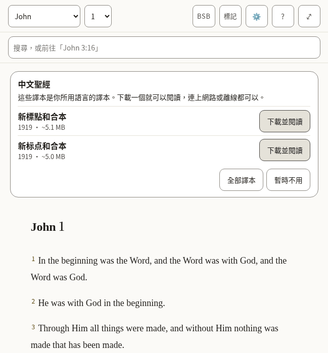

*What a new reader sees: the offer of a Bible in this language, over the English one the app arrives with.*

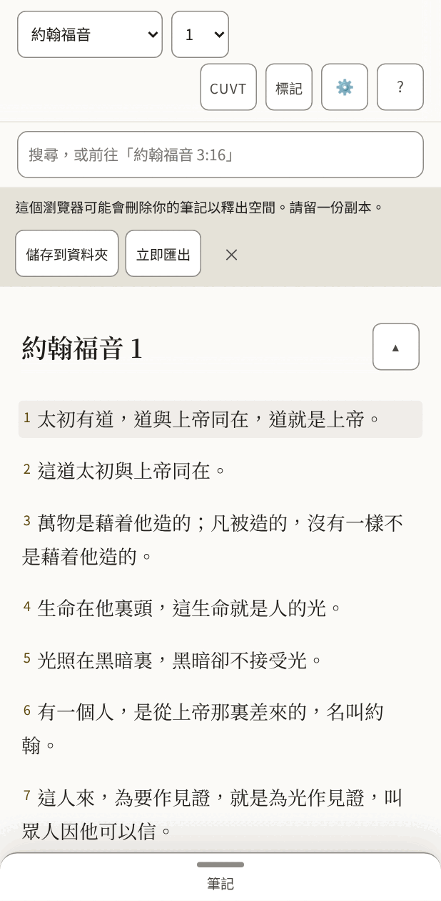

*The same, on a phone, once a Bible in this language is open.*

- [ ] The offer reads as an invitation, and its buttons are clear about what they will do.
- [ ] Nothing in the bar is cut short or squeezed, on the phone above all.
- [ ] Every text in the table below is correct and sounds natural.
- [ ] Nothing in the pictures is cut off, overlapping or badly broken across lines.

**The 48 texts of this part**

| Key | English | 中文（繁體） |
|---|---|---|
| `app.name` | Scriptura Reader | Scriptura Reader |
| `app.downloading` | Downloading the text for offline use… | 正在下載經文，以便離線使用… |
| `app.opening` | Opening… | 正在開啟… |
| `app.bootFailed` | The Bible text could not be opened. Reload to try again. | 無法開啟經文。請重新載入後再試。 |
| `app.skipToScripture` | Skip to scripture | 跳到經文 |
| `app.skipToNotes` | Skip to notes | 跳到筆記 |
| `app.skipToBoard` | Skip to the canvas | 跳到看板 |
| `app.title` | John 1 · BSB · Scriptura | 約翰福音1 · CUVT · Scriptura |
| `app.passageTitle` | John 1 · BSB | 約翰福音1 · CUVT |
| `app.boardTitle` | John 1 · Boards | 約翰福音 1 · 看板 |
| `app.opened` | Settings opened | 已開啟設定面板 |
| `app.closed` | Settings closed | 已關閉設定面板 |
| `app.boardSaveFailed` | Could not save the board — export your notes | 無法儲存看板 — 請匯出你的筆記 |
| `app.languageChanged` | The interface is now in English. | 介面現在是繁體中文。 |
| `reader.passage` | Passage | 經文 |
| `reader.book` | Book | 書卷 |
| `reader.chapter` | Chapter | 章 |
| `reader.translationChip` | BSB — Berean Standard Bible. Choose or add a translation | CUVT — 新標點和合本。選擇或加入譯本 |
| `reader.marks` | Marks | 標記 |
| `reader.marksChip` | Marks (7) — verses you have marked, by colour | 標記（7）— 你標記過的經文，按顏色分組 |
| `reader.settingsChip` | Settings — display, storage, export, and assistant access | 設定 — 顯示、儲存空間、匯出與助理權限 |
| `reader.helpChip` | Help — finding passages, searching, notes, marks, boards, keyboard, and what the abbreviations mean | 說明 — 尋找經文、搜尋、筆記、標記、看板、鍵盤，以及各種縮寫的意思 |
| `reader.selectVerse` A verse's number: a toggle that adds the verse to the selection or takes it out. | Select John 1:2 | 選取約翰福音 1:2 |
| `reader.selectVerseIn` | Select John 1:2 — in Amber (amber) | 選取約翰福音 1:2 — 在琥珀中 |
| `reader.selection` Said when the selection changes and focus does not move to say it. | 1 verse selected: John 1:3 3 verses selected: John 1:3-5 | 已選取1節：約翰福音 1:3 已選取3節：約翰福音 1:3-5 |
| `reader.selectionCleared` | Selection cleared | 已取消選取 |
| `reader.chapterMissing` | This chapter is not in Berean Standard Bible. | 新標點和合本中沒有這一章。 |
| `reader.readingAnnounce` | Reading Berean Standard Bible | 正在閱讀新標點和合本 |
| `reader.showMenus` The button at the end of the chapter title, on a small screen: named for what a press will do. | Show the reading menus | 顯示閱讀選單 |
| `reader.hideMenus` | Hide the reading menus | 隱藏閱讀選單 |
| `panels.marks` | Marks | 標記 |
| `panels.translations` | Translations | 譯本 |
| `panels.settings` | Settings | 設定 |
| `panels.help` | Help | 說明 |
| `panels.results` | Search results | 搜尋結果 |
| `common.cancel` | Cancel | 取消 |
| `common.untitledNote` | Untitled | 無標題 |
| `common.untitledBoard` | Untitled board | 無標題看板 |
| `common.source` | Berean Standard Bible source | 新標點和合本的來源 |
| `common.undoRemove` | Undo remove | 復原 |
| `common.remove` | Remove | 移除 |
| `common.done` | Done | 完成 |
| `offer.title` | Bibles in American English | 繁體中文聖經 |
| `offer.intro` | These translations are in your language. Download one to read it, online or offline. | 這些譯本是你所用語言的譯本。下載一個就可以閱讀，連上網路或離線都可以。 |
| `offer.downloadAndRead` | Download and read | 下載並閱讀 |
| `offer.downloadAndReadName` | Download and read Berean Standard Bible | 下載並閱讀新標點和合本 |
| `offer.allTranslations` | All translations | 全部譯本 |
| `offer.notNow` | Not now | 暫時不用 |

#### 2.2 Selecting verses and acting on them

Pressing a verse selects it and opens a row of actions: five colours to mark it with, then Quote, Link and Canvas. Pressing more verses adds them, and the row says how many it holds.

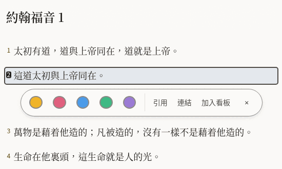

*One verse selected.*

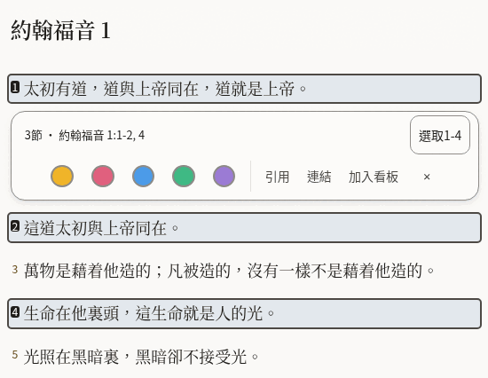

*Three verses selected, two of them together and one apart: the row says so, and offers to take in the verses between.*

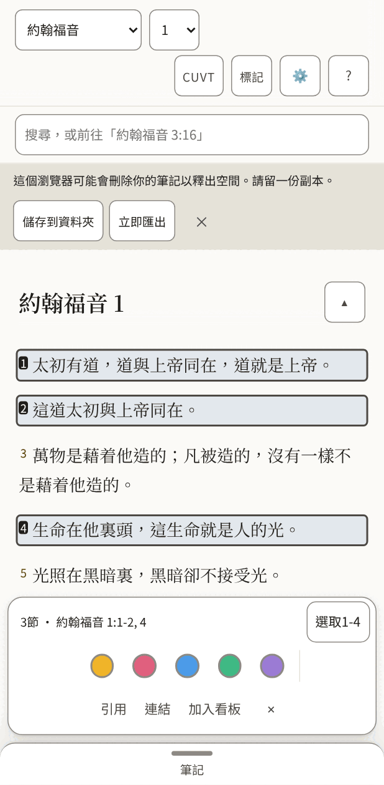

*On a phone the row sits at the bottom of the screen.*

- [ ] The summary ("3 verses · …") and the button beside it fit on one line.
- [ ] The three words for the actions are short enough to sit side by side on a phone.
- [ ] Every text in the table below is correct and sounds natural.
- [ ] Nothing in the pictures is cut off, overlapping or badly broken across lines.

**The 24 texts of this part**

| Key | English | 中文（繁體） |
|---|---|---|
| `verseActions.group` | Actions for John 1:2 | 約翰福音 1:2的操作 |
| `verseActions.mark` | Mark as Amber (amber) | 標記為琥珀 |
| `verseActions.quote` | Quote | 引用 |
| `verseActions.link` | Link | 連結 |
| `verseActions.canvas` | Canvas | 加入看板 |
| `verseActions.canvasName` | Canvas — put this verse on the board | 加入看板 — 把這節經文放到看板上 |
| `verseActions.close` | Close actions for John 1:2 | 關閉約翰福音 1:2的操作 |
| `verseActions.groupMany` The row's name when it holds several verses. | Actions for 1 verse: John 1:3 Actions for 3 verses: John 1:3-5 | 1節經文的操作：約翰福音 1:3 3節經文的操作：約翰福音 1:3-5 |
| `verseActions.summary` Shown in the row while several are selected, so what it will act on is in words. | 1 verse · John 1:3 3 verses · John 1:3-5 | 1節 · 約翰福音 1:3 3節 · 約翰福音 1:3-5 |
| `verseActions.fill` The button that takes in every verse between the first and the last selected: "Select 3-18". | Select 3-18 | 選取3-18 |
| `verseActions.canvasNameMany` | Canvas — put these verses on the board | 加入看板 — 把這些經文放到看板上 |
| `verseActions.clear` | Clear the selection | 取消選取 |
| `verseActions.marked` | Marked 1 verse as Amber (amber) Marked 3 verses as Amber (amber) | 已把1節經文標記為琥珀 已把3節經文標記為琥珀 |
| `verseActions.unmarked` | Cleared Amber (amber) from 1 verse Cleared Amber (amber) from 3 verses | 已取消1節經文的琥珀標記 已取消3節經文的琥珀標記 |
| `colours.amber` | Amber | 琥珀 |
| `colours.rose` | Rose | 玫瑰 |
| `colours.sky` | Sky | 天藍 |
| `colours.mint` | Mint | 薄荷 |
| `colours.violet` | Violet | 紫羅蘭 |
| `colourWords.amber` | amber | 琥珀 |
| `colourWords.rose` | rose | 玫瑰 |
| `colourWords.sky` | sky | 天藍 |
| `colourWords.mint` | mint | 薄荷 |
| `colourWords.violet` | violet | 紫羅蘭 |

#### 2.3 Notes

The pane beside the Bible, where a reader writes. A quoted passage arrives with its reference, and a line under the note says what was just done and whether it is saved.

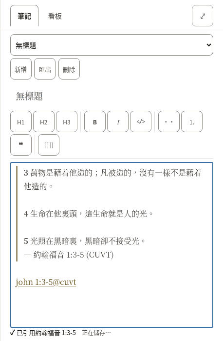

*A new note with three verses quoted into it.*

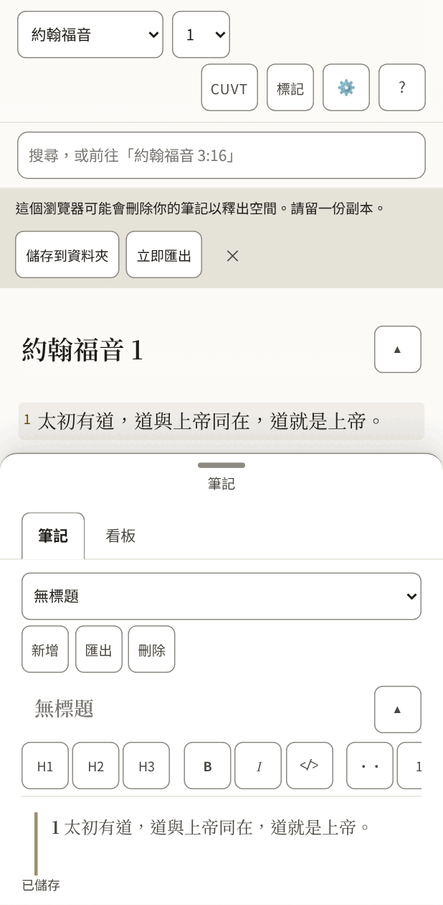

*On a phone the notes are a sheet that slides up over the text.*

- [ ] The formatting buttons carry one or two letters each (bold, italic, headings): they should be the letters a writer in this language expects.
- [ ] The line under the note ("Quoted …", "Saved") reads as a short report, not a sentence cut in two.
- [ ] Every text in the table below is correct and sounds natural.
- [ ] Nothing in the pictures is cut off, overlapping or badly broken across lines.

**The 51 texts of this part**

| Key | English | 中文（繁體） |
|---|---|---|
| `notes.new` A new note. Nouns have gender in other languages, so notes and boards each say it. | New | 新增 |
| `notes.startOne` | Start one | 新增一則 |
| `notes.heading` | Notes | 筆記 |
| `notes.picker` | Note | 筆記 |
| `notes.showMenus` | Show the note menus | 顯示筆記選單 |
| `notes.hideMenus` | Hide the note menus | 隱藏筆記選單 |
| `notes.none` | No notes yet | 還沒有筆記 |
| `notes.preview` | Preview | 預覽 |
| `notes.write` | Write | 編輯 |
| `notes.previewTitle` | See it rendered | 檢視排版後的樣子 |
| `notes.writeTitle` | Back to writing | 回到編輯 |
| `notes.canvas` | Canvas | 看板 |
| `notes.canvasTitle` | Lay verses and notes out on a board | 把經文和筆記排在看板上 |
| `notes.export` | Export | 匯出 |
| `notes.exportTitle` | Download every note and board as Markdown in a .zip | 把所有筆記和看板以 Markdown 打包成 .zip 下載 |
| `notes.delete` | Delete | 刪除 |
| `notes.title` | Note title | 筆記標題 |
| `notes.body` | Note body | 筆記內文 |
| `notes.placeholder` | Write here… | 在這裡寫… |
| `notes.goTo` | Go to John 1:3-5 | 前往約翰福音 1:3-5 |
| `notes.noneOpen` | No note open. | 沒有開啟中的筆記。 |
| `notes.saveFailed` | Could not save — export your notes | 無法儲存 — 請匯出你的筆記 |
| `notes.saving` | Saving… | 正在儲存… |
| `notes.saved` | Saved | 已儲存 |
| `notes.linkIn` | John 1:3-5 (KJV) | 約翰福音 1:3-5（BSB） |
| `notes.linkMissing` | John 1:3-5 (KJV — not downloaded) | 約翰福音 1:3-5（BSB — 尚未下載） |
| `tools.label` | Formatting | 格式 |
| `tools.heading` | Heading 2 | 2級標題 |
| `tools.headingGlyph` | H2 | H2 |
| `tools.bold` | Bold | 粗體 |
| `tools.boldGlyph` | B | B |
| `tools.italic` | Italic | 斜體 |
| `tools.italicGlyph` | I | I |
| `tools.code` | Code | 程式碼 |
| `tools.bullets` | Bulleted list | 項目符號清單 |
| `tools.numbers` | Numbered list | 編號清單 |
| `tools.quote` | Quote | 引用 |
| `tools.link` | Link to a passage | 經文連結 |
| `insert.quoted` | Quoted John 1:3-5 | 已引用約翰福音 1:3-5 |
| `insert.quotedFrom` | Quoted John 1:3-5 (BSB) | 已引用約翰福音 1:3-5（CUVT） |
| `insert.linked` | Linked John 1:3-5 | 已連結約翰福音 1:3-5 |
| `insert.addedBoard` | Added the board “John 1” | 已加入看板「約翰福音 1」 |
| `insert.addedToBoard` | Added John 1:3-5 to “John 1” | 已把約翰福音 1:3-5加入看板「約翰福音 1」 |
| `insert.alreadyOnBoard` | John 1:3-5 is already on “John 1” | 約翰福音 1:3-5已經在「約翰福音 1」上了 |
| `insert.inNewNote` | Quoted John 1:3-5 in a new note | 已引用約翰福音 1:3-5，在新筆記中 |
| `insert.inNote` | Quoted John 1:3-5 in “John 1” | 已引用約翰福音 1:3-5，在「約翰福音 1」中 |
| `insert.inUntitledNote` | Quoted John 1:3-5 in an untitled note | 已引用約翰福音 1:3-5，在無標題筆記中 |
| `insert.studyBoard` | Study board | 研讀看板 |
| `preview.empty` | Nothing written yet. | 還沒有寫任何內容。 |
| `preview.editHere` | Edit here (block 3) | 在此編輯（第3段） |
| `preview.goTo` | Go to John 1:3-5 | 前往約翰福音 1:3-5 |

#### 2.4 Search

One box does two things: a reference goes straight to the passage, anything else searches the open Bible. The short list under the box is for jumping; the full list counts every match, book by book.

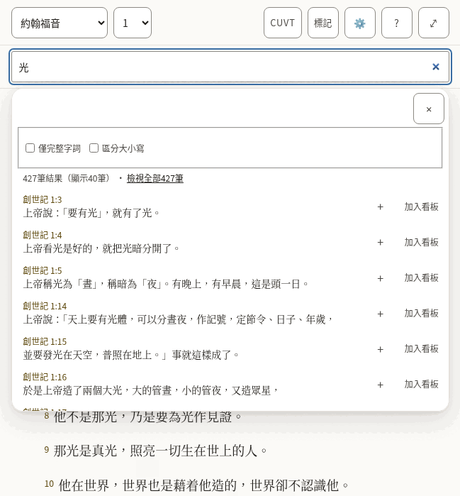

*The suggestions under the box.*

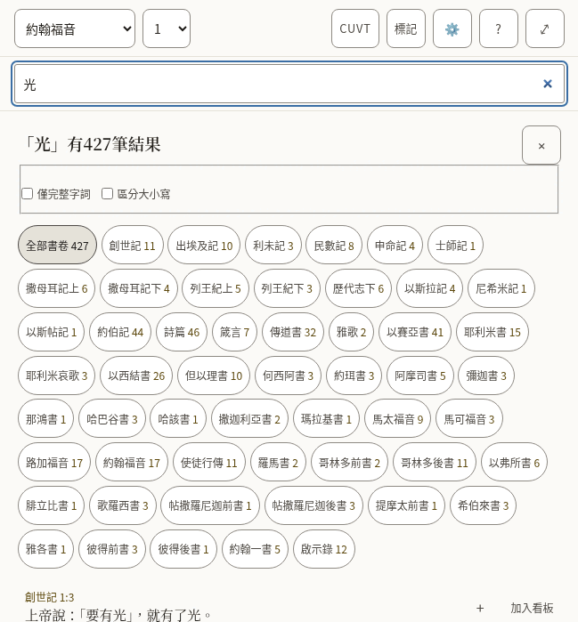

*Every match, with the count for each book.*

- [ ] The counts read naturally with a small number and with a large one.
- [ ] The two options ("Whole words only", "Match case") are understood without explanation.
- [ ] Every text in the table below is correct and sounds natural.
- [ ] Nothing in the pictures is cut off, overlapping or badly broken across lines.

**The 31 texts of this part**

| Key | English | 中文（繁體） |
|---|---|---|
| `search.label` | Search or go to a reference | 搜尋或前往某處經文 |
| `search.placeholder` | Search, or go to "John 3:16" | 搜尋，或前往「約翰福音 3:16」 |
| `search.hint` | Enter opens the passage, or every match. Down arrow moves into the suggestions. | Enter 開啟該處經文，或顯示全部結果。下方向鍵進入建議清單。 |
| `search.suggestions` | Suggestions | 建議 |
| `search.goTo` | Go to John 1:2 | 前往約翰福音 1:2 |
| `search.close` | Close suggestions | 關閉建議 |
| `search.matching` | Matching | 比對方式 |
| `search.wholeWords` | Whole words only | 僅完整字詞 |
| `search.wholeWordsHint` | Finds love but not loveth. Off, the search also looks inside longer words. | 只找 love，不找 loveth。關閉時，搜尋也會找到較長詞語的內部。 |
| `search.matchCase` | Match case | 區分大小寫 |
| `search.matchCaseHint` | Capital letters matter: God and god are different. | 大小寫會產生作用：God 和 god 不同。 |
| `search.noMatches` | No matches | 沒有結果 |
| `search.matches` | 1 match 1,382 matches | 1筆結果 1,382筆結果 |
| `search.showing` | ␣— showing 40 | （顯示40筆） |
| `search.seeAll` | See all 1,382 | 檢視全部1,382筆 |
| `search.insert` | Insert John 1:2 into the open note | 把約翰福音 1:2插入開啟中的筆記 |
| `search.toCanvas` The name of a result's Canvas button: its visible word first (2.5.3). | Canvas — put John 1:2 on the board | 加入看板 — 把約翰福音 1:2放到看板上 |
| `search.weakBelow` | Below: inside a longer word | 以下：出現在較長的詞語中 |
| `search.announceNone` | No matches for “light” | 沒有「光」的結果 |
| `search.announceCount` | 1 match for “light” 1,382 matches for “light” | 「光」有1筆結果 「光」有1,382筆結果 |
| `results.label` | Search results | 搜尋結果 |
| `results.heading` `{count}` is replaced by the total, in its own element. | {count} match for “light” {count} matches for “light” | 「光」有{count}筆結果 「光」有{count}筆結果 |
| `results.close` | Close search results | 關閉搜尋結果 |
| `results.filter` | Filter by book | 按書卷篩選 |
| `results.allBooks` | All books | 全部書卷 |
| `results.weakBelow` | Below: “light” inside a longer word | 以下：「光」出現在較長的詞語中 |
| `results.insert` | Quote John 1:2 into the open note | 把約翰福音 1:2引用到開啟中的筆記 |
| `results.insertTitle` | Quote into the open note | 引用到開啟中的筆記 |
| `results.showing` | Showing 100 of 1,382 | 顯示1,382筆中的100筆 |
| `results.inBook` | ␣in John | ，在約翰福音中 |
| `results.more` | Show 100 more | 再顯示100筆 |

### The panels

Opened from the bar. They take the place of the chapter while they are open.

#### 2.5 Marks

Each of the five colours is a collection of the verses marked with it, and can be given a name of the reader’s own.

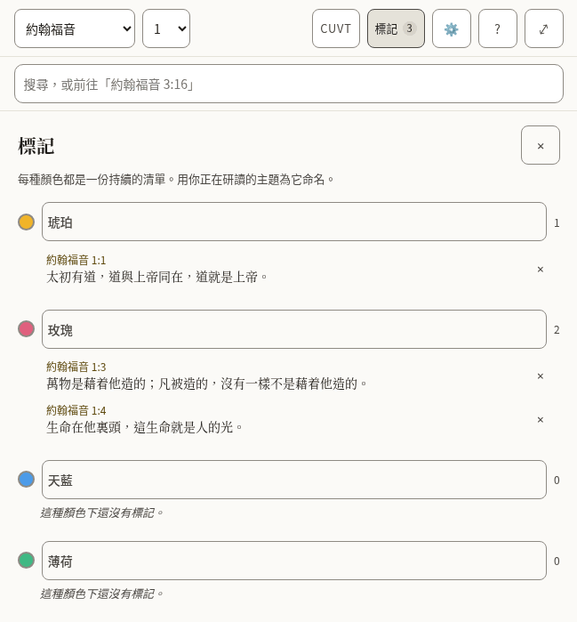

*Three marked verses in two collections.*

- [ ] The colour names are the everyday words for those colours.
- [ ] Every text in the table below is correct and sounds natural.
- [ ] Nothing in the pictures is cut off, overlapping or badly broken across lines.

**The 9 texts of this part**

| Key | English | 中文（繁體） |
|---|---|---|
| `marks.label` | Marked verses | 標記過的經文 |
| `marks.title` | Marks | 標記 |
| `marks.close` | Close marks | 關閉標記 |
| `marks.hint` | Each colour is a running list. Name one for the subject you are tracking. | 每種顏色都是一份持續的清單。用你正在研讀的主題為它命名。 |
| `marks.nameFor` | Name for the amber collection | 琥珀合集的名稱 |
| `marks.empty` | Nothing marked in this colour yet. | 這種顏色下還沒有標記。 |
| `marks.remove` | Remove the mark on John 1:2 | 移除約翰福音 1:2上的標記 |
| `marks.removed` | Mark removed. Undo is available in the Marks bar. | 標記已移除。可以在標記列中復原。 |
| `marks.restored` | Mark restored | 標記已還原 |

#### 2.6 Translations, and reading two side by side

Where a Bible is downloaded, read, compared with the one being read, or removed. Each shows its size before it is downloaded.

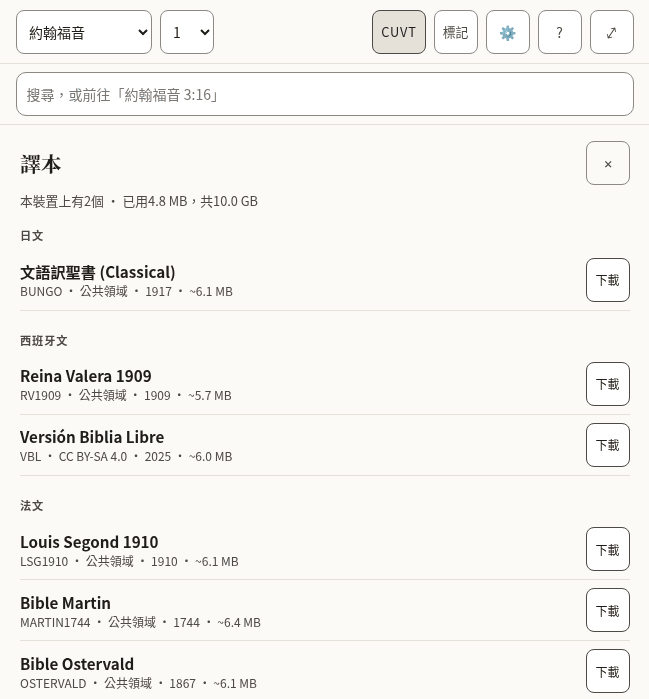

*The list of translations, by language.*

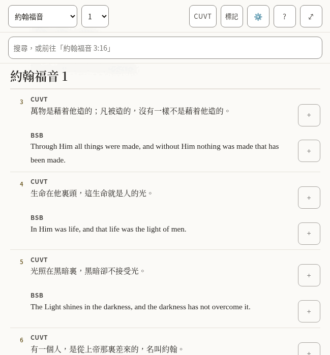

*Two translations, verse by verse.*

- [ ] The language headings are how this language names those languages.
- [ ] The note about what removing a translation does and does not touch is plain.
- [ ] Every text in the table below is correct and sounds natural.
- [ ] Nothing in the pictures is cut off, overlapping or badly broken across lines.

**The 32 texts of this part**

| Key | English | 中文（繁體） |
|---|---|---|
| `library.title` | Translations | 譯本 |
| `library.close` | Close translations | 關閉譯本 |
| `library.onDevice` | 2 on this device | 本裝置上有2個 |
| `library.used` | 11.8 MB of 1.9 GB used | 已用11.8 MB，共1.9 GB |
| `library.about` | about 5.4 MB | 約5.4 MB |
| `library.licences.public-domain` | Public domain | 公共領域 |
| `library.licences.cc-by-4.0` | CC BY 4.0 | CC BY 4.0 |
| `library.licences.cc-by-sa-4.0` | CC BY-SA 4.0 | CC BY-SA 4.0 |
| `library.licences.cc0` | CC0 | CC0 |
| `library.licences.custom-free` | Free licence | 自由授權 |
| `library.reading` | Reading | 正在閱讀 |
| `library.comparing` | Comparing | 正在對照 |
| `library.read` | Read | 閱讀 |
| `library.compare` | Compare | 對照 |
| `library.compareTitle` | Show beside the translation you are reading | 與你正在讀的譯本並排顯示 |
| `library.downloading` | Downloading Berean Standard Bible | 正在下載新標點和合本 |
| `library.download` | Download | 下載 |
| `library.removeActive` | Remove Berean Standard Bible — switch to another translation first | 移除新標點和合本 — 請先切換到其他譯本 |
| `library.removeFromDevice` | Remove Berean Standard Bible from this device | 從本裝置上移除新標點和合本 |
| `library.note` | A downloaded translation stays on this device and can be read offline. Removing one never touches your notes or marks: both belong to the passage, not to a translation. | 下載後的譯本會存在本裝置上，可以離線閱讀。移除譯本不會影響你的筆記和標記：兩者都屬於經文本身，而不屬於某個譯本。 |
| `library.progress` | Berean Standard Bible: 50% downloaded | 新標點和合本：已下載50% |
| `library.downloaded` | Berean Standard Bible downloaded | 新標點和合本已下載 |
| `library.failed` | Berean Standard Bible: No connection — try again when you are online. | 新標點和合本：沒有網路連線 — 連上網路後再試。 |
| `library.failedOnline` | The download did not finish. Try again later. | 下載沒有完成。請稍後再試。 |
| `library.offline` | No connection — try again when you are online. | 沒有網路連線 — 連上網路後再試。 |
| `compare.label` | Translations side by side | 譯本並排對照 |
| `compare.compared` | Translations compared | 對照中的譯本 |
| `compare.stop` | Stop comparing KJV | 停止對照BSB |
| `compare.verse` | Verse | 節 |
| `compare.verseBefore` | Verse␣ | 節␣ |
| `compare.missing` | Not in KJV | BSB中沒有 |
| `compare.quote` | Quote KJV verse 16 | 引用BSB第16節 |

#### 2.7 Settings

How the text looks, the interface language, where the reader’s work is kept, and whether an assistant may help.

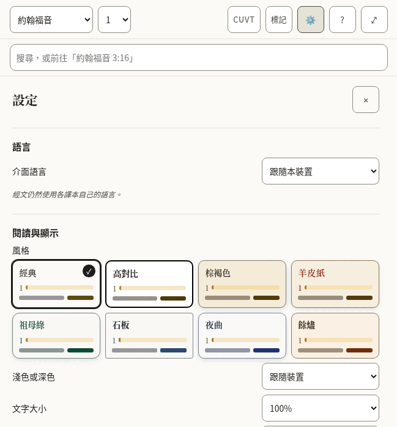

*The top of Settings.*

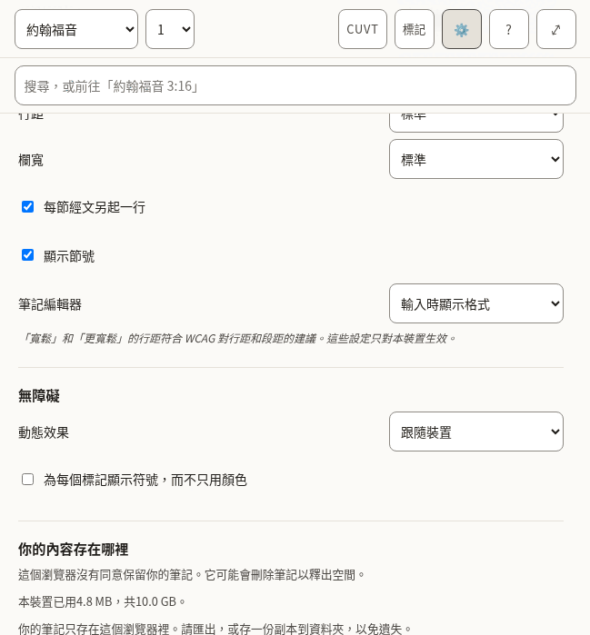

*Further down.*

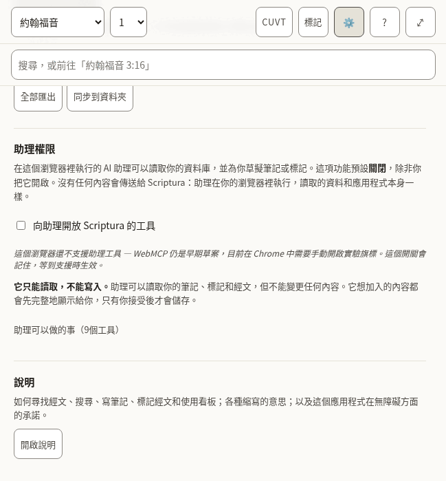

*The end.*

- [ ] Each label and the choices under it read as one thought.
- [ ] The style names are evocative, not literal (Vellum, Emerald, Nocturne): they should sound like names, not descriptions.
- [ ] The explanations in smaller type are complete sentences and easy to follow.
- [ ] Every text in the table below is correct and sounds natural.
- [ ] Nothing in the pictures is cut off, overlapping or badly broken across lines.

**The 66 texts of this part**

| Key | English | 中文（繁體） |
|---|---|---|
| `settings.title` | Settings | 設定 |
| `settings.close` | Close settings | 關閉設定 |
| `settings.display` | Reading &amp; display | 閱讀與顯示 |
| `settings.style` | Style | 風格 |
| `settings.styles.classic` | Classic | 經典 |
| `settings.styles.contrast` | High contrast | 高對比 |
| `settings.styles.sepia` | Sepia | 棕褐色 |
| `settings.styles.vellum` | Vellum | 羊皮紙 |
| `settings.styles.emerald` | Emerald | 祖母綠 |
| `settings.styles.slate` | Slate | 石板 |
| `settings.styles.nocturne` | Nocturne | 夜曲 |
| `settings.styles.ember` | Ember | 餘燼 |
| `settings.appearance` | Light or dark | 淺色或深色 |
| `settings.appearances.system` | Follow the device | 跟隨裝置 |
| `settings.appearances.light` | Light | 淺色 |
| `settings.appearances.dark` | Dark | 深色 |
| `settings.textSize` | Text size | 文字大小 |
| `settings.spacing` | Line spacing | 行距 |
| `settings.spacings.normal` | Normal | 標準 |
| `settings.spacings.relaxed` | Relaxed | 寬鬆 |
| `settings.spacings.loose` | Loose | 更寬鬆 |
| `settings.measure` | Column width | 欄寬 |
| `settings.measures.narrow` | Narrow | 窄 |
| `settings.measures.normal` | Normal | 標準 |
| `settings.measures.wide` | Wide | 寬 |
| `settings.measures.full` | Full | 全寬 |
| `settings.editor` | Note editor | 筆記編輯器 |
| `settings.editors.live` | Show formatting as you write | 輸入時顯示格式 |
| `settings.editors.plain` | Plain text | 純文字 |
| `settings.displayNote` | Relaxed and Loose spacing meet the WCAG guidance for line and paragraph spacing. These settings apply to this device only. | 「寬鬆」和「更寬鬆」的行距符合 WCAG 對行距和段距的建議。這些設定只對本裝置生效。 |
| `settings.accessibility` | Accessibility | 無障礙 |
| `settings.motion` | Motion | 動態效果 |
| `settings.motions.system` | Follow the device | 跟隨裝置 |
| `settings.motions.reduce` | Reduce motion | 減少動態效果 |
| `settings.markers` | Show a symbol on every highlight, not only a colour | 為每個標記顯示符號，而不只用顏色 |
| `settings.verseLines` | Start each verse on a new line | 每節經文另起一行 |
| `settings.verseNumbers` | Show verse numbers | 顯示節號 |
| `settings.recedeMenus` | On a small screen, hide the menus while reading | 在小螢幕上，閱讀時隱藏選單 |
| `settings.storage` | Where your work lives | 你的內容存在哪裡 |
| `settings.persistence.persisted` | This browser has agreed to keep your notes. Clearing site data still removes them. | 這個瀏覽器已同意保留你的筆記。清除網站資料仍會刪除它們。 |
| `settings.persistence.denied` | This browser has not agreed to keep your notes. It may delete them to free up space. | 這個瀏覽器沒有同意保留你的筆記。它可能會刪除筆記以釋出空間。 |
| `settings.persistence.unsupported` | This browser will not say whether it keeps your notes. Assume it may delete them. | 這個瀏覽器不會說明是否保留你的筆記。請當作它可能會刪除。 |
| `settings.persistence.unknown` | Checking… | 正在檢查… |
| `settings.usedOnDevice` | 11.8 MB of 1.9 GB used on this device. | 本裝置已用11.8 MB，共1.9 GB。 |
| `settings.mirrored` | Your notes are also saved to a folder you chose. | 你的筆記也會存到你選擇的資料夾中。 |
| `settings.notMirrored` | Your notes live only in this browser. Export them, or save a copy to a folder, to keep them safe. | 你的筆記只存在這個瀏覽器裡。請匯出，或存一份副本到資料夾，以免遺失。 |
| `settings.exportAll` | Export everything | 全部匯出 |
| `settings.anotherFolder` | Choose another folder | 選擇其他資料夾 |
| `settings.mirror` | Mirror to a folder | 同步到資料夾 |
| `settings.assistant` | Assistant access | 助理權限 |
| `settings.assistantIntro` | An AI assistant running in this browser can read your library and draft notes or marks for you. This is **off** until you turn it on. Nothing is sent to Scriptura: the assistant runs in your browser and reads the same data the app does. | 在這個瀏覽器裡執行的 AI 助理可以讀取你的資料庫，並為你草擬筆記或標記。這項功能預設**關閉**，除非你把它開啟。沒有任何內容會傳送給 Scriptura：助理在你的瀏覽器裡執行，讀取的資料和應用程式本身一樣。 |
| `settings.assistantToggle` | Offer Scriptura’s tools to an assistant | 向助理開放 Scriptura 的工具 |
| `settings.assistantSupported` | This browser supports assistant tools. | 這個瀏覽器支援助理工具。 |
| `settings.assistantUnsupported` | This browser does not support assistant tools yet — WebMCP is an early draft, available in Chrome behind a flag. The switch is remembered for when it does. | 這個瀏覽器還不支援助理工具 — WebMCP 仍是早期草案，目前在 Chrome 中需要手動開啟實驗旗標。這個開關會記住，等到支援時生效。 |
| `settings.assistantReadOnly` | **It can read, not write.** An assistant can read your notes, marks and passages, but it cannot change anything. Anything it wants to add is shown to you in full first, and is saved only when you accept it. | **它只能讀取，不能寫入。**助理可以讀取你的筆記、標記和經文，但不能變更任何內容。它想加入的內容都會先完整地顯示給你，只有你接受後才會儲存。 |
| `settings.assistantTools` | What an assistant would be able to do (9 tools) | 助理可以做的事（9個工具） |
| `settings.toolReads` | reads | 讀取 |
| `settings.toolNeedsApproval` | needs your approval | 需要你的同意 |
| `settings.toolsInEnglish` Shown only in the other languages, beside the tool descriptions, which stay English. | The descriptions are in English, as the assistant reads them. | 工具說明是英文的，因為助理就是這樣讀取它們的。 |
| `settings.help` | Help | 說明 |
| `settings.helpIntro` | How to find a passage, search, write notes, mark verses and use boards; what the abbreviations mean; and what this app promises about accessibility. | 如何尋找經文、搜尋、寫筆記、標記經文和使用看板；各種縮寫的意思；以及這個應用程式在無障礙方面的承諾。 |
| `settings.openHelp` | Open help | 開啟說明 |
| `settings.language` | Language | 語言 |
| `settings.languageLabel` | Interface language | 介面語言 |
| `settings.languageSystem` | Match this device | 跟隨本裝置 |
| `settings.languageNote` | Bible text stays in the language of each translation. | 經文仍然使用各譯本自己的語言。 |

#### 2.8 Help

The longest text in the app, and the one a reader turns to when stuck. It includes a list of terms and abbreviations, and a statement about accessibility.

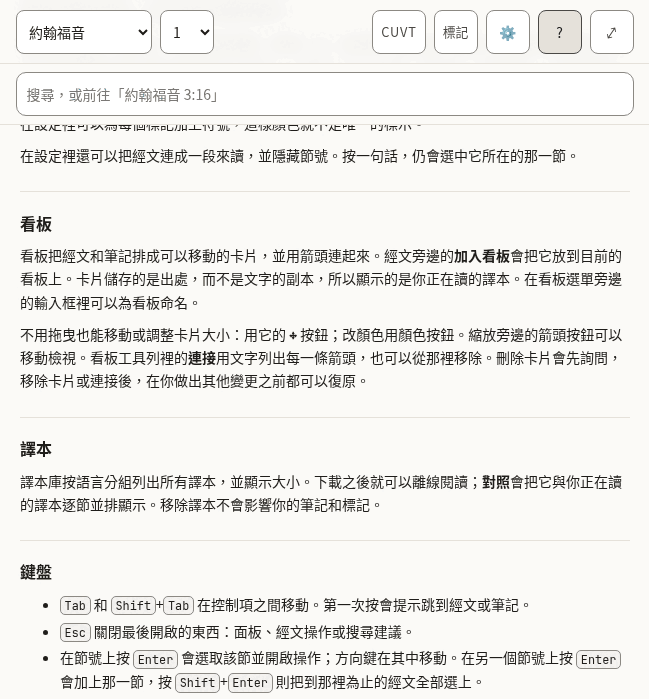

*The top of Help.*

- [ ] It reads well from start to finish as an explanation, not as a list of translated sentences.
- [ ] The examples of references are ones that work in a Bible in this language.
- [ ] The names of keys (Enter, Shift, Escape) are how this language’s keyboards and manuals name them.
- [ ] Every text in the table below is correct and sounds natural.
- [ ] Nothing in the pictures is cut off, overlapping or badly broken across lines.

**The 76 texts of this part**

| Key | English | 中文（繁體） |
|---|---|---|
| `help.title` | Help | 說明 |
| `help.close` | Close help | 關閉說明 |
| `help.sections.finding.heading` | Finding a passage | 尋找經文 |
| `help.sections.finding.blocks.1.p` | Type a reference in the search box and press Enter. All of these work: | 在搜尋框中輸入經文出處，然後按 Enter。下面這些寫法都可以： |
| `help.sections.finding.blocks.2.ul.1` | `John 3:16` — one verse. | `約翰福音 3:16` — 一節經文。 |
| `help.sections.finding.blocks.2.ul.2` | `John 3:16-18` — a range of verses. | `約翰福音 3:16-18` — 一段經文。 |
| `help.sections.finding.blocks.2.ul.3` | `John 3` — a whole chapter. | `約翰福音 3` — 整章。 |
| `help.sections.finding.blocks.2.ul.4` | `Juan 3:16` or `Jean 3:16` — the book name in the translation you are reading. | `Juan 3:16` 或 `Jean 3:16` — 你正在讀的譯本裡的書卷名。 |
| `help.sections.finding.blocks.2.ul.5` | `Jhn 3:16` — an abbreviation. `43 3:16` — the book number. | `Jhn 3:16` — 簡稱。`43 3:16` — 書卷編號。 |
| `help.sections.finding.blocks.3.p` | You can also pick the book and chapter from the two menus in the bar. | 也可以用工具列上的兩個選單挑選書卷和章。 |
| `help.sections.finding.blocks.4.p` | On a small screen the menus step aside while you read, write or arrange a board. Press the **▾** button beside the title to bring them back; in a chapter or a note, scrolling back a little does the same. In Settings you can stop them moving by themselves. | 在小螢幕上，閱讀、書寫或整理看板時，選單會自動讓開。按標題旁的 **▾** 按鈕，就能讓它們回來；在經文或筆記裡，往回捲動一點也可以。在設定裡可以讓它們不再自動移動。 |
| `help.sections.searching.heading` | Searching | 搜尋 |
| `help.sections.searching.blocks.1.p` | Anything that is not a reference is a search. Search looks inside words, so `love` also finds *loveth* and *beloved*. Accents do not matter: `amo` finds *amó*. | 不是經文出處的內容都會當成搜尋。搜尋會找到詞語內部，所以 `愛` 也會找到*慈愛*。中文不受重音影響；在西文譯本裡，`amo` 也會找到*amó*。 |
| `help.sections.searching.blocks.2.ul.1` | Put a phrase in quotes to find it exactly: `"in the beginning"`. | 用引號括起來可以精確尋找整句：`"起初"`。 |
| `help.sections.searching.blocks.2.ul.2` | Put a minus sign before a word to leave verses with it out: `God -love`. | 在詞前加減號可以排除含該詞的經文：`神 -愛`。 |
| `help.sections.searching.blocks.2.ul.3` | **Whole words only** stops the search looking inside longer words. | **僅完整字詞**讓搜尋不再找詞語內部。 |
| `help.sections.searching.blocks.2.ul.4` | **Match case** makes capital letters matter. | **區分大小寫**讓西文的大小寫產生作用。 |
| `help.sections.searching.blocks.3.p` | The first results are verses where your word stands alone; verses where it sits inside a longer word come after a line that says so. Press Enter on a search to see every match, counted by book. | 先列出該詞單獨出現的經文；出現在較長詞語內部的經文排在一行說明之後。在搜尋框按 Enter，可以看到全部結果，並按書卷統計。 |
| `help.sections.notes.heading` | Notes | 筆記 |
| `help.sections.notes.blocks.1.p` | Notes are plain text with Markdown. Formatting takes shape as you write, and its symbols come back on the line you are editing; to see only the Markdown, choose **Plain text** under Note editor in Settings. The toolbar above the note adds headings, bold, italic, lists and quotes; press a tool again to take the formatting off. With Plain text, **Preview** shows the note as it will read. | 筆記是帶 Markdown 的純文字。格式會在輸入時顯示，正在編輯的那一行會重新顯示符號；如果只想看 Markdown，請在設定的「筆記編輯器」中選擇**純文字**。筆記上方的工具列可以加入標題、粗體、斜體、清單和引用；再按一次同一個工具就會取消格式。使用純文字時，**預覽**會顯示筆記最後的樣子。 |
| `help.sections.notes.blocks.2.p` | A link to a passage looks like `[[john 3:16]]`. Add `@kjv` to say which translation: `[[john 3:16@kjv]]`. Put the cursor inside a link and a **Go to** button opens it. **Quote** beside a verse copies the verse into your note with its reference and a link. | 指向經文的連結寫作 `[[john 3:16]]`。加上 `@kjv` 可以指明譯本：`[[john 3:16@kjv]]`。把游標放在連結裡，**前往**按鈕就會開啟它。經文旁邊的**引用**會把該節連同出處和連結一起複製到筆記中。 |
| `help.sections.notes.blocks.3.p` | Notes are saved on this device as you type. **Export** downloads every note and board as text files in a zip. | 筆記在你輸入時就儲存在本裝置上。**匯出**會把所有筆記和看板做成文字檔，打包成 .zip 下載。 |
| `help.sections.marks.heading` | Marks | 標記 |
| `help.sections.marks.blocks.1.p` | Press a verse, or its number, to mark it in one of five colours. Each colour is a collection: name it for the subject you are following, and the **Marks** panel lists its verses in Bible order. Marks follow the passage, not the translation, so a mark made in one translation shows in all of them. | 按一節經文或它的節號，就可以用五種顏色之一標記它。每種顏色都是一個合集：用你正在研讀的主題為它命名，**標記**面板會按聖經順序列出這些經文。標記跟著經文本身，而不是譯本，所以在一個譯本裡做的標記，在所有譯本裡都會顯示。 |
| `help.sections.marks.blocks.2.p` | Press more verses to act on several at once, and press one again to leave it out. With verses apart selected, **Select** in the row of actions takes in every verse between them; holding <kbd>Shift</kbd> while you press a verse does the same. **Quote** then writes them into your note as one passage under one reference. | 再按其他經文，就可以一次處理好幾節；再按一次，就把那一節去掉。選取了不相連的經文時，操作列裡的**選取**會把它們之間的經文全部選上；按住 <kbd>Shift</kbd> 再按一節經文，效果相同。這時**引用**會把它們當成一段經文、用一個出處寫進筆記。 |
| `help.sections.marks.blocks.3.p` | In Settings you can add a symbol to every mark, so colour is not the only sign. | 在設定裡可以為每個標記加上符號，這樣顏色就不是唯一的標示。 |
| `help.sections.marks.blocks.4.p` | In Settings you can also run the verses together as one text and hide their numbers. Pressing a sentence still picks the verse it belongs to. | 在設定裡還可以把經文連成一段來讀，並隱藏節號。按一句話，仍會選中它所在的那一節。 |
| `help.sections.boards.heading` | Boards | 看板 |
| `help.sections.boards.blocks.1.p` | A board lays verses and notes out as cards you can move and join with arrows. **Canvas** beside a verse puts it on the current board. Cards hold a reference, not a copy of the text, so they show the translation you are reading. Give a board a name in the box beside the board menu. | 看板把經文和筆記排成可以移動的卡片，並用箭頭連起來。經文旁邊的**加入看板**會把它放到目前的看板上。卡片儲存的是出處，而不是文字的副本，所以顯示的是你正在讀的譯本。在看板選單旁邊的輸入框裡可以為看板命名。 |
| `help.sections.boards.blocks.2.p` | To move or resize a card without dragging, use its **✥** button; to colour it, its colour button. The arrow buttons beside the zoom move the view. **Connections**, in the board's bar, lists every arrow in words and removes one. Removing a card asks first, and removing a card or a connection can be undone until you change something else. | 不用拖曳也能移動或調整卡片大小：用它的 **✥** 按鈕；改顏色用顏色按鈕。縮放旁邊的箭頭按鈕可以移動檢視。看板工具列裡的**連接**用文字列出每一條箭頭，也可以從那裡移除。刪除卡片會先詢問，移除卡片或連接後，在你做出其他變更之前都可以復原。 |
| `help.sections.translations.heading` | Translations | 譯本 |
| `help.sections.translations.blocks.1.p` | The library lists every translation, grouped by language, with its size. Download one to read it offline; **Compare** shows it beside the one you are reading, verse by verse. Removing a translation never touches your notes or marks. | 譯本庫按語言分組列出所有譯本，並顯示大小。下載之後就可以離線閱讀；**對照**會把它與你正在讀的譯本逐節並排顯示。移除譯本不會影響你的筆記和標記。 |
| `help.sections.keyboard.heading` | Keyboard | 鍵盤 |
| `help.sections.keyboard.blocks.1.ul.1` | <kbd>Tab</kbd> and <kbd>Shift</kbd>+<kbd>Tab</kbd> move between controls. The first press offers to skip to the text or the notes. | <kbd>Tab</kbd> 和 <kbd>Shift</kbd>+<kbd>Tab</kbd> 在控制項之間移動。第一次按會提示跳到經文或筆記。 |
| `help.sections.keyboard.blocks.1.ul.2` | <kbd>Escape</kbd> closes whatever opened last: a panel, the verse actions, the search suggestions. | <kbd>Esc</kbd> 關閉最後開啟的東西：面板、經文操作或搜尋建議。 |
| `help.sections.keyboard.blocks.1.ul.3` | <kbd>Enter</kbd> on a verse number selects it and opens the actions; the arrow keys move along them. <kbd>Enter</kbd> on another number adds that verse, and <kbd>Shift</kbd>+<kbd>Enter</kbd> takes in every verse up to it. | 在節號上按 <kbd>Enter</kbd> 會選取該節並開啟操作；方向鍵在其中移動。在另一個節號上按 <kbd>Enter</kbd> 會加上那一節，按 <kbd>Shift</kbd>+<kbd>Enter</kbd> 則把到那裡為止的經文全部選上。 |
| `help.sections.keyboard.blocks.1.ul.4` | On the divider between the panes, the arrow keys, <kbd>Home</kbd> and <kbd>End</kbd> resize; the two small buttons do the same. | 在兩欄之間的分隔列上，方向鍵、<kbd>Home</kbd> 和 <kbd>End</kbd> 可以調整寬度；旁邊的兩個小按鈕作用相同。 |
| `help.sections.keyboard.blocks.1.ul.5` | In a note, <kbd>Shift</kbd>+<kbd>Tab</kbd> reaches the formatting tools; the arrow keys move between them. | 在筆記中，<kbd>Shift</kbd>+<kbd>Tab</kbd> 可以到達格式工具；方向鍵在工具之間移動。 |
| `help.sections.keyboard.blocks.1.ul.6` | On a board, cards take focus: the arrow keys move a card, <kbd>Alt</kbd> with an arrow resizes it, and <kbd>Delete</kbd> asks to remove it. With the board itself focused, the arrow keys move the view and <kbd>+</kbd> and <kbd>−</kbd> zoom. | 在看板上，卡片可以取得焦點：方向鍵移動卡片，<kbd>Alt</kbd> 加方向鍵調整大小，<kbd>Delete</kbd> 會詢問是否移除。焦點在看板本身時，方向鍵移動檢視，<kbd>+</kbd> 和 <kbd>−</kbd> 縮放。 |
| `help.abbreviations` | Abbreviations | 縮寫 |
| `help.abbreviationsCaption` | What each abbreviation means | 每個縮寫的意思 |
| `help.short` | Short | 縮寫 |
| `help.meaning` | Meaning | 意思 |
| `help.terms.1.1` | CC BY-SA 4.0 | CC BY-SA 4.0 |
| `help.terms.1.2` | Creative Commons Attribution–ShareAlike 4.0: a free licence that asks you to credit the source and share changes under the same terms. | 創用 CC 姓名標示-相同方式分享 4.0：一種自由授權條款，要求標示來源，並以相同方式分享修改。 |
| `help.terms.2.1` | CC0 | CC0 |
| `help.terms.2.2` | Creative Commons Zero: the author has waived all rights; the text is free to use. | 創用 CC 零：作者放棄了全部權利，文字可以自由使用。 |
| `help.terms.3.1` | OT | OT |
| `help.terms.3.2` | Old Testament. | 舊約（英文 Old Testament）。 |
| `help.terms.4.1` | NT | NT |
| `help.terms.4.2` | New Testament. | 新約（英文 New Testament）。 |
| `help.terms.5.1` | PWA | PWA |
| `help.terms.5.2` | Progressive web app: a website you can install and use offline. | 漸進式網頁應用程式：可以安裝並離線使用的網站。 |
| `help.terms.6.1` | WCAG | WCAG |
| `help.terms.6.2` | Web Content Accessibility Guidelines, the standard this app is measured against. | 《網頁內容無障礙指引》，本應用程式依此衡量自己。 |
| `help.glossaryHeading` | Words used here | 這裡用到的詞 |
| `help.glossary.1.1` | Collection | 合集 |
| `help.glossary.1.2` | Every verse you mark in one colour. Name a colour for the subject you are following, and the Marks panel lists those verses in Bible order. | 你用同一種顏色標記的所有經文。用你正在研讀的主題為一種顏色命名，標記面板就會按聖經順序列出這些經文。 |
| `help.glossary.2.1` | Board | 看板 |
| `help.glossary.2.2` | A space where verses and notes are laid out as cards and joined with arrows. Boards are saved and exported with your notes. | 把經文和筆記排成卡片、並用箭頭連起來的地方。看板會隨筆記一起儲存和匯出。 |
| `help.glossary.3.1` | Card | 卡片 |
| `help.glossary.3.2` | One item on a board: a verse, a note, or text you typed. A verse card shows the verse from whichever translation you are reading. | 看板上的一項：一節經文、一則筆記，或者你輸入的文字。經文卡片顯示的是你目前所讀譯本中的經文。 |
| `help.glossary.4.1` | Translation | 譯本 |
| `help.glossary.4.2` | One version of the Bible, in one language. Every translation here is free to copy. | 聖經的一個版本，用一種語言。這裡的每個譯本都可以自由重製。 |
| `help.glossary.5.1` | Whole words only | 僅完整字詞 |
| `help.glossary.5.2` | A search option. With it on, "love" finds love but not loveth. With it off, it finds both. | 搜尋選項。開啟時，「love」只找 love，不找 loveth；關閉時兩者都找。 |
| `help.glossary.6.1` | Match case | 區分大小寫 |
| `help.glossary.6.2` | A search option. With it on, "God" and "god" are different. | 搜尋選項。開啟時，「God」和「god」不同。 |
| `help.glossary.7.1` | Mirror to a folder | 同步到資料夾 |
| `help.glossary.7.2` | Keep a copy of your notes as text files in a folder on this computer, updated as you write. Works in Chrome and Edge. | 在本電腦的某個資料夾中保留一份筆記的文字副本，並在你書寫時更新。支援 Chrome 和 Edge。 |
| `help.glossary.8.1` | Assistant tools | 助理工具 |
| `help.glossary.8.2` | A way for an AI assistant running in your browser to read your library and suggest notes or marks. Off unless you turn it on; nothing is saved without your approval. | 讓在你瀏覽器中執行的 AI 助理讀取資料庫並建議筆記或標記的方式。預設關閉；未經你同意不會儲存任何內容。 |
| `help.accessibilityHeading` | Accessibility | 無障礙 |
| `help.accessibility.1` | This app aims to meet the Web Content Accessibility Guidelines 2.2 at Level AAA for everything the app itself shows: its controls, its text, its colours and its behaviour. Every control can be reached by keyboard, is at least 44 by 44 pixels, shows where focus is, and has a name. Text is at least 7:1 against its background in every colour theme, and you can change the size, spacing and colours in Settings. | 本應用程式力求在它自己顯示的一切內容上達到《網頁內容無障礙指引》2.2 的 AAA 級：控制項、文字、顏色和行為。每個控制項都可以用鍵盤到達，尺寸至少為 44×44 像素，會顯示焦點位置，並且有名稱。在所有配色主題下，文字與背景的對比至少為 7:1，你也可以在設定中變更字級、行距和顏色。 |
| `help.accessibility.2` | Two things are outside that promise. The Bible text is shown as it was published: how hard it is to read, and how its words are said, belong to each translation, not to this app. The same is true of what you write in your notes. | 有兩件事不在這個承諾之內。經文按出版時的樣子顯示：它的閱讀難度和讀音屬於各個譯本，而不屬於本應用程式。你寫在筆記裡的內容也一樣。 |
| `help.accessibility.3` | What is checked by machine is checked on every change. What needs a person — a screen reader on a phone, the app under a Windows contrast theme — is checked by hand, less often. If something does not work for you, please report it at the project's issue tracker on GitHub (`AlanRoman117/scriptura`). | 可以由機器檢查的部分，每次變更都會檢查。需要人來檢查的部分 — 手機上的螢幕閱讀器、Windows 高對比主題下的應用程式 — 由人工檢查，頻率較低。如果有什麼地方對你不管用，請在專案的 GitHub 問題區回報（`AlanRoman117/scriptura`）。 |

### Met less often

Boards, the questions asked before something is deleted, and the notices. Many of these texts are spoken by a screen reader and never shown.

#### 2.9 Boards (the canvas)

A surface where verses and notes are laid out as cards and joined with arrows. Most of its texts are the names of buttons, heard by a screen reader.

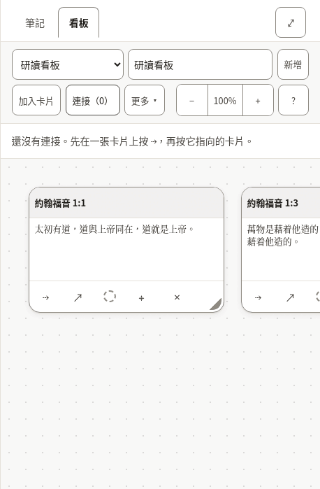

*Two verses on a board, with the list of connections open.*

- [ ] The words for a board, a card and a connection are used the same way here as everywhere else.
- [ ] Every text in the table below is correct and sounds natural.
- [ ] Nothing in the pictures is cut off, overlapping or badly broken across lines.

**The 93 texts of this part**

| Key | English | 中文（繁體） |
|---|---|---|
| `canvas.new` A new board. | New | 新增 |
| `canvas.more` Beside the Bible, the button the less-used board actions fold behind. | More | 更多 |
| `canvas.startOne` | Start one | 新增一個 |
| `canvas.label` | Boards | 看板 |
| `canvas.heading` | Board: John 1 | 看板：約翰福音 1 |
| `canvas.noneOpenHeading` | none open | 未開啟任何看板 |
| `canvas.picker` | Board | 看板 |
| `canvas.showMenus` | Show the board menus | 顯示看板選單 |
| `canvas.hideMenus` | Hide the board menus | 隱藏看板選單 |
| `canvas.name` | Board name | 看板名稱 |
| `canvas.none` | No boards yet | 還沒有看板 |
| `canvas.undo` | Undo: put back John 1:1 Undo: put back the connection John 1:1 → John 1:14 | 復原：還原約翰福音 1:1 復原：還原連接約翰福音 1:1 → 約翰福音 1:14 |
| `canvas.putBack` | John 1:1 put back The connection John 1:1 → John 1:14 put back | 已還原約翰福音 1:1 已還原連接約翰福音 1:1 → 約翰福音 1:14 |
| `canvas.removed` | John 1:1 removed. Undo is in the board's bar. The connection John 1:1 → John 1:14 removed. Undo is in the board's bar. | 已移除卡片：約翰福音 1:1。可以在看板工具列中復原。 已移除連接：約翰福音 1:1 → 約翰福音 1:14。可以在看板工具列中復原。 |
| `canvas.addCard` | Add card | 加入卡片 |
| `canvas.addNote` | Add note | 加入筆記 |
| `canvas.addNoteName` | Add note — put the newest note on the board | 加入筆記 — 把最新的一則筆記放到看板上 |
| `canvas.addNoteNoNotes` | Add note — write a note first | 加入筆記 — 請先寫一則筆記 |
| `canvas.toNote` | Add to note | 加入筆記中 |
| `canvas.toNoteName` | Add to note — put this board into the note you have open | 加入筆記中 — 把這個看板放進你開啟中的筆記裡 |
| `canvas.connections` | Connections (2) | 連接（2） |
| `canvas.connectionsLabel` | Connections | 連接 |
| `canvas.deleteBoard` | Delete board | 刪除看板 |
| `canvas.zoom` | Zoom | 縮放 |
| `canvas.zoomOut` | Zoom out | 縮小 |
| `canvas.zoomIn` | Zoom in | 放大 |
| `canvas.zoomReset` | Zoom 120%. Reset to full size, showing your cards | 縮放120%。回到原始大小並顯示你的卡片 |
| `canvas.moveView` | Move the view | 移動檢視 |
| `canvas.viewLeft` | Move the view left | 檢視左移 |
| `canvas.viewUp` | Move the view up | 檢視上移 |
| `canvas.viewDown` | Move the view down | 檢視下移 |
| `canvas.viewRight` | Move the view right | 檢視右移 |
| `canvas.help` | Help — boards, keyboard, and what the abbreviations mean | 說明 — 看板、鍵盤，以及各種縮寫的意思 |
| `canvas.noConnections` | No connections yet. Press ⇢ on a card, then the card it leads to. | 還沒有連接。先在一張卡片上按 ⇢，再按它指向的卡片。 |
| `canvas.removeConnection` | Remove the connection John 1:1 → John 1:14 | 移除連接約翰福音 1:1 → 約翰福音 1:14 |
| `canvas.missingCard` | a missing card | 一張已不存在的卡片 |
| `canvas.edge` | John 1:1 → John 1:14 | 約翰福音 1:1 → 約翰福音 1:14 |
| `canvas.frame` | Board canvas, 1 card Board canvas, 4 cards | 看板畫布，1張卡片 看板畫布，4張卡片 |
| `canvas.frameHint` | Arrow keys move the view; plus and minus zoom. Each card takes focus: arrow keys move it, and Alt with an arrow resizes it. | 方向鍵移動檢視，加號和減號縮放。每張卡片都可以取得焦點：方向鍵移動卡片，Alt 加方向鍵調整大小。 |
| `canvas.verseCard` | Verse card | 經文卡片 |
| `canvas.noteCard` | Note card | 筆記卡片 |
| `canvas.card` | Card | 卡片 |
| `canvas.cardName` | Verse card: John 1:1, Amber (amber) Verse card: John 1:1 | 經文卡片：約翰福音 1:1，琥珀 經文卡片：約翰福音 1:1 |
| `canvas.colourName` | Amber (amber) | 琥珀 |
| `canvas.cardTitle` | Card title | 卡片標題 |
| `canvas.cardTitlePlaceholder` | Card | 卡片 |
| `canvas.cardText` | Card text | 卡片文字 |
| `canvas.cardTextPlaceholder` | Write here… | 在這裡寫… |
| `canvas.cardBody` | John 1:1 — text | 約翰福音 1:1 — 文字 |
| `canvas.connect` | Connect John 1:1 to another card | 把約翰福音 1:1連到另一張卡片 |
| `canvas.connectPrompt` | Choose the card to connect to: press it, or Enter on it. Escape cancels. | 選擇要連到的卡片：按一下它，或在它上面按 Enter。Esc 取消。 |
| `canvas.connected` | Connected John 1:1 to John 1:14 | 已把約翰福音 1:1連到約翰福音 1:14 |
| `canvas.open` | Open John 1:1 in the reader | 在閱讀中開啟約翰福音 1:1 |
| `canvas.colour` | Colour: Amber (amber). Change the colour of John 1:1 Colour: none. Change the colour of John 1:1 | 顏色：琥珀。變更約翰福音 1:1的顏色 顏色：無。變更約翰福音 1:1的顏色 |
| `canvas.adjust` | Move or resize John 1:1 without dragging | 不用拖曳也能移動或調整約翰福音 1:1 |
| `canvas.takeOff` | Take John 1:1 off the board | 把約翰福音 1:1從看板上移除 |
| `canvas.empty` | Nothing on this board yet. Add a card here, or use **Canvas** beside a verse while reading. | 這個看板上還什麼都沒有。可以在這裡加入卡片，或在閱讀時用經文旁邊的**加入看板**。 |
| `canvas.adjustPanel` | Move and resize John 1:1 | 移動並調整約翰福音 1:1 |
| `canvas.colourPanel` | Colour of John 1:1 | 約翰福音 1:1的顏色 |
| `canvas.adjustTitle` | Move and resize | 移動與調整 |
| `canvas.colourTitle` | Colour | 顏色 |
| `canvas.panelTitle` | Move and resize: John 1:1 | 移動與調整：約翰福音 1:1 |
| `canvas.move` | Move | 移動 |
| `canvas.moveLeft` | Move left | 左移 |
| `canvas.moveUp` | Move up | 上移 |
| `canvas.moveDown` | Move down | 下移 |
| `canvas.moveRight` | Move right | 右移 |
| `canvas.size` | Size | 大小 |
| `canvas.narrower` | Narrower | 更窄 |
| `canvas.wider` | Wider | 更寬 |
| `canvas.shorter` | Shorter | 更矮 |
| `canvas.taller` | Taller | 更高 |
| `canvas.colours` | Colours | 顏色 |
| `canvas.noColour` | No colour | 無顏色 |
| `canvas.moved` | John 1:1: moved to 320, 180 | 約翰福音 1:1：已移動到 320，180 |
| `canvas.resized` | John 1:1: 280 wide, 180 tall | 約翰福音 1:1：寬 280，高 180 |
| `canvas.coloured` | John 1:1: Amber (amber) | 約翰福音 1:1：琥珀 |
| `canvas.uncoloured` | John 1:1: no colour | 約翰福音 1:1：無顏色 |
| `canvas.noneOpen` | No board open. | 沒有開啟中的看板。 |
| `cards.verseMissing` | Not in this translation. | 這個譯本中沒有。 |
| `cards.untitledNote` | Untitled note | 無標題筆記 |
| `cards.untitledBoard` | Untitled board | 無標題看板 |
| `cards.emptyNote` | Empty note. | 空筆記。 |
| `cards.deletedNote` | This note has been deleted. | 這則筆記已被刪除。 |
| `cards.card` | Card | 卡片 |
| `cards.emptyBoard` | _Empty board._ | _空看板_ |
| `cards.connections` | Connections | 連接 |
| `cards.missingCard` | (missing card) | （已不存在的卡片） |
| `embed.scrolls` | Board: John 1, scrolls sideways | 看板：約翰福音 1，可左右捲動 |
| `embed.picture` | Board: John 1, 1 cards Board: John 1, 4 cards | 看板：約翰福音 1，1張卡片 看板：約翰福音 1，4張卡片 |
| `embed.empty` | This board is empty. | 這個看板是空的。 |
| `embed.missing` | A board was embedded here, but it no longer exists. | 這裡曾嵌入一個看板，但它已經不存在了。 |
| `embed.open` | Open board | 開啟看板 |

#### 2.10 Questions before something is deleted

Deleting a note or a board, or removing a card, a mark or a translation, asks first. The question names what will go, and says whether it can come back.

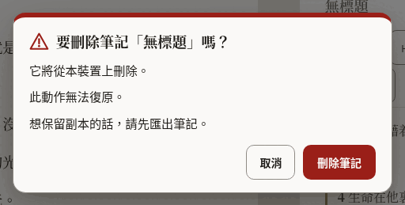

*The question before a note is deleted.*

- [ ] It is unmistakable what will be deleted and that it cannot be undone.
- [ ] The button that deletes says what it deletes.
- [ ] Every text in the table below is correct and sounds natural.
- [ ] Nothing in the pictures is cut off, overlapping or badly broken across lines.

**The 26 texts of this part**

| Key | English | 中文（繁體） |
|---|---|---|
| `confirm.permanent` | You cannot undo this. | 此動作無法復原。 |
| `confirm.undoable` | You can undo this until your next change. | 在你做出下一次變更之前都可以復原。 |
| `confirm.note.title` | Delete the note “John 1”? | 要刪除筆記「約翰福音 1」嗎？ |
| `confirm.note.gone` | It will be deleted from this device. | 它將從本裝置上刪除。 |
| `confirm.note.keepCopy` | To keep a copy, export your notes first. | 想保留副本的話，請先匯出筆記。 |
| `confirm.note.action` | Delete note | 刪除筆記 |
| `confirm.note.done` | Deleted the note “John 1” | 已刪除筆記「約翰福音 1」 |
| `confirm.board.title` | Delete the board “John 1”? | 要刪除看板「約翰福音 1」嗎？ |
| `confirm.board.cards` | The board and its card will be deleted. The board and its 4 cards will be deleted. | 看板及其1張卡片都會被刪除。 看板及其4張卡片都會被刪除。 |
| `confirm.board.empty` | The board is empty. | 這個看板是空的。 |
| `confirm.board.kept` | Your notes are not changed. | 你的筆記不會改變。 |
| `confirm.board.action` | Delete board | 刪除看板 |
| `confirm.board.done` | Deleted the board “John 1” | 已刪除看板「約翰福音 1」 |
| `confirm.card.title` | Remove John 1:1 from the board? | 要把約翰福音 1:1從看板上移除嗎？ |
| `confirm.card.connections` | Its connection is removed too. Its 3 connections are removed too. | 它的1條連接也會一併移除。 它的3條連接也會一併移除。 |
| `confirm.card.noteKept` | The note itself is not changed. | 筆記本身不會改變。 |
| `confirm.card.action` | Remove card | 移除卡片 |
| `confirm.mark.title` | Remove the mark on John 1:2? | 要移除約翰福音 1:2上的標記嗎？ |
| `confirm.mark.leaves` | The verse leaves the collection “Amber”. | 這節經文將離開合集「琥珀」。 |
| `confirm.mark.action` | Remove mark | 移除標記 |
| `confirm.translation.title` | Remove Berean Standard Bible from this device? | 要從本裝置上移除新標點和合本嗎？ |
| `confirm.translation.frees` | This frees about 5.4 MB. | 這會釋出大約5.4 MB的空間。 |
| `confirm.translation.kept` | Your notes and marks are not changed. | 你的筆記和標記不會改變。 |
| `confirm.translation.again` | You can download it again when you are online. | 連上網路時可以再次下載。 |
| `confirm.translation.action` | Remove translation | 移除譯本 |
| `confirm.translation.done` | Removed Berean Standard Bible from this device | 已從本裝置上移除新標點和合本 |

#### 2.11 Notices

A line about where the reader’s work is kept, the offer of a newer version, and the notice on this preview.

- [ ] The notice about storage is honest without being alarming.
- [ ] Every text in the table below is correct and sounds natural.

**The 23 texts of this part**

| Key | English | 中文（繁體） |
|---|---|---|
| `durability.label` | Where your notes are kept | 你的筆記存在哪裡 |
| `durability.denied` | This browser may delete your notes to free up space. Save a copy. | 這個瀏覽器可能會刪除你的筆記以釋出空間。請留一份副本。 |
| `durability.stale` | You have not exported your notes for a while. | 你已經有一段時間沒有匯出筆記了。 |
| `durability.local` | Your notes live in this browser only. | 你的筆記只存在這個瀏覽器裡。 |
| `durability.saveFolder` | Save to a folder | 儲存到資料夾 |
| `durability.saveFolderTitle` | Keep a copy as .md files in a folder you choose | 在你選擇的資料夾中保留一份 .md 副本 |
| `durability.exportNow` | Export now | 立即匯出 |
| `durability.dismiss` | Dismiss this notice | 關閉這個提示 |
| `update.label` | A new version is ready | 新版本已就緒 |
| `update.ready` | A new version of Scriptura is ready. | Scriptura 的新版本已就緒。 |
| `update.readyAnnounce` | A new version of Scriptura is ready. Reload when it suits you. | Scriptura 的新版本已就緒。方便時重新載入即可。 |
| `update.reload` | Reload | 重新載入 |
| `update.reloading` | Reloading… | 正在重新載入… |
| `update.later` | Later | 稍後 |
| `previewBuild.label` | Preview | 預覽版 |
| `previewBuild.intro` | **Preview.** An early build for the people reviewing its translations. | **預覽版。**這是給翻譯審閱者使用的早期版本。 |
| `previewBuild.report` | Report a translation correction on GitHub (opens in a new tab) | 在 GitHub 上回報翻譯問題（會在新分頁中開啟） |
| `previewBuild.reportShort` The notice's short link; `newTab` completes its name for a screen reader. | Report a correction | 回報翻譯問題 |
| `previewBuild.newTab` | (on GitHub, opens in a new tab) | （在 GitHub 上，會在新分頁中開啟） |
| `previewBuild.hide` | Hide | 隱藏 |
| `previewBuild.heading` | About this preview | 關於這個預覽版 |
| `previewBuild.about` | This build is for the people checking the interface in Spanish, French, Japanese, Chinese and Portuguese. Nothing you do here is sent anywhere: your notes and marks stay in this browser. To report a word that is wrong or unclear, use the link below. It opens a short form on GitHub, which needs a free account. | 這個版本是給審閱西班牙文、法文、日文、中文和葡萄牙文介面的人使用的。你在這裡做的一切都不會被傳送到任何地方：筆記和標記都留在這個瀏覽器裡。發現用詞錯誤或不清楚的地方，請用下面的連結回報。它會開啟 GitHub 上的一份簡短表單，需要一個免費帳號。 |
| `previewBuild.version` | Version: 0.1.0 | 版本：0.1.0 |

#### 2.12 Panes, tabs and the sheet

The names of the two panes, the tabs that choose between notes and a board, and the buttons that resize them. Mostly heard, not seen.

- [ ] Every text in the table below is correct and sounds natural.

**The 20 texts of this part**

| Key | English | 中文（繁體） |
|---|---|---|
| `layout.scripture` | Scripture | 經文 |
| `layout.notes` | Notes | 筆記 |
| `layout.expandNotes` | Expand notes | 展開筆記 |
| `layout.collapseNotes` | Collapse notes | 收合筆記 |
| `layout.gripWithNews` | Expand notes, Quoted John 1:3-5 | 展開筆記，已引用約翰福音 1:3-5 |
| `layout.sheetHint` | Drag, or use the up and down arrow keys, to make the notes taller or shorter. | 拖曳，或用上下方向鍵，可以讓筆記區更高或更矮。 |
| `layout.notesMoreRoom` | Give the notes more room | 給筆記更多空間 |
| `layout.bibleMoreRoom` | Give the Bible more room | 給聖經更多空間 |
| `layout.resize` | Resize panes | 調整兩欄寬度 |
| `layout.split` Both shares arrive formatted as percentages. | 56% Bible, 44% notes | 聖經56%，筆記44% |
| `layout.showNotes` | Show notes | 顯示筆記 |
| `layout.paneBible` | Bible | 聖經 |
| `layout.paneNotes` | Notes | 筆記 |
| `layout.sides` The side pane holds the notes or the canvas; these name the switch and the canvas side. | Notes or canvas | 筆記或看板 |
| `layout.paneBoard` | Canvas | 看板 |
| `layout.expandBoard` | Expand canvas | 展開看板 |
| `layout.collapseBoard` | Collapse canvas | 收合看板 |
| `layout.showBoard` | Show canvas | 顯示看板 |
| `layout.maximize` | Maximize Bible | 最大化聖經 |
| `layout.restore` | Restore Bible | 還原聖經 |

#### 2.13 What an assistant proposes

When the reader has allowed an assistant to help, what it wants to add is shown first and waits for a yes.

- [ ] Every text in the table below is correct and sounds natural.

**The 10 texts of this part**

| Key | English | 中文（繁體） |
|---|---|---|
| `proposal.noteTitle` | A note has been drafted for you | 已為你草擬了一則筆記 |
| `proposal.marksTitle` | Verses suggested for marking | 建議標記的經文 |
| `proposal.lede` | An assistant proposed this. Nothing has been saved — review it, change anything you like, and it only takes effect when you accept. | 這是助理提出的。什麼都還沒有儲存 — 請先檢視，隨意修改，只有你接受後才會生效。 |
| `proposal.titleInput` | Proposed note title | 建議的筆記標題 |
| `proposal.bodyInput` | Proposed note body | 建議的筆記內文 |
| `proposal.into` `{collection}` is replaced by the collection's name, in bold. | Into {collection} (amber) | 加入{collection}（琥珀） |
| `proposal.missing` | Not in this translation. | 這個譯本中沒有。 |
| `proposal.discard` | Discard | 捨棄 |
| `proposal.save` | Save this note | 儲存這則筆記 |
| `proposal.mark` | Mark 1 verse Mark 3 verses | 標記1節經文 標記3節經文 |

---

## Part 3: Try it yourself

Open **<https://alanroman117.github.io/Scriptura/>** on a computer, and then on a phone if you can.

The app follows your browser's language. If it does not open in 中文（繁體）, choose the gear in the bar at the top, then the first choice in the panel, and pick **中文（繁體）**.

A picture shows words standing still. What you are looking for here is what only use can show: a word that does not fit its button, a message that arrives at the wrong moment, a sentence that is right alone and wrong after the one before it.

- [ ] Accept the Bible the app offers in your language, and read the first chapter of John.
- [ ] Press a verse, then two more. Read what the row says, then press **引用**.
- [ ] Read the note that was made, and the line beneath it.
- [ ] Type a word into the search box and read the count. Open the full list of results.
- [ ] Type a reference, such as "約翰福音 3:16", and press <kbd>Enter</kbd>.
- [ ] Mark a verse with a colour, then open **標記** and give that colour a name.
- [ ] Open **譯本**: download another Bible, compare it with yours, then remove it and read the question it asks.
- [ ] Open **設定** and read it from top to bottom, changing each choice once.
- [ ] Open **說明** and read it as a newcomer would.
- [ ] Put two verses on a board (**加入看板**), open the board, and join them.
- [ ] Delete the note and read the question it asks.
- [ ] On a phone: do the first three steps again, upright and on its side.
- [ ] If you use a screen reader: listen to the bar at the top, to a verse being selected, and to a quote being made. The interface should be spoken in your language, and the Bible in its own.

While you do this:

- [ ] No text is cut off, runs out of its button, or sits on top of another.
- [ ] No English appears where your language should be. (The names of Bibles are as their publishers wrote them, and what an assistant may do, in Settings, is in English on purpose.)
- [ ] Numbers, sizes and counts look right as they change.
- [ ] Nothing reads as rude, childish, or stiffer than the rest.

---

## Your notes

<!-- YOURS: everything below this line is kept when the guide is written again. -->

### What should change

One row for each correction. Add as many rows as you need.

| Where (the key, or the screen) | What is wrong | What it should say |
|---|---|---|
| | | |
| | | |
| | | |
| | | |
| | | |
| | | |

### Anything else

What a table cannot hold: the tone as a whole, a word you would change everywhere, something that confused you.

> 

### Your verdict

- [ ] It can be published as it is.
- [ ] It can be published once the corrections above are made.
- [ ] It needs another reading after the corrections.

| | |
|---|---|
| Reviewed by | |
| Date | |
| Version tested (Help, "About this preview") | |
| Device and browser | |
| Parts done (1, 2, 3) | |
